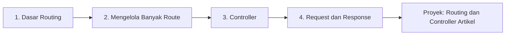

# Peta Belajar: Routing, Controller, dan Request Handling

Bab utama ini menjawab pertanyaan inti setiap aplikasi web: *bagaimana Laravel menerima request dan membuat response?* Kamu akan belajar
memetakan URL ke kode (routing), memindahkan logika ke controller, membaca data request, dan membuat berbagai jenis response. Semua dikerjakan pada
proyek bertema artikel.

## Tujuan Pembelajaran

Setelah menyelesaikan bab utama ini, kamu dapat:

- [ ] Membuat route untuk berbagai metode HTTP, dengan parameter, nama, grup, dan middleware.
- [ ] Menggunakan route model binding.
- [ ] Membuat controller, termasuk resource controller dan single action controller.
- [ ] Membaca data request dengan objek `Request`.
- [ ] Membuat response berupa tampilan, redirect, JSON, dan berkas unduhan.
- [ ] Menangani error dan memilih status code HTTP yang tepat.

## Prasyarat

- Bab utama [Pengantar Laravel](../level-01/index.md): proyek Laravel berjalan, struktur direktori, `config()`, Artisan, dan service container.
- Pemahaman HTTP dari bab utama [Dasar Web dan PHP](../level-00/index.md): metode, status code, request, dan response.

## Gambaran Besar

## Peta Per Tahap

Sub bab yang belum tersedia ditandai **Segera hadir** dan belum dapat dibuka.

### Tahap 1: Dasar Routing

| Sub bab | Yang kamu pelajari | Status |
|---|---|---|
| [Pengantar Routing](02-01-introduction-to-routing.md) | Konsep, anatomi route, berkas route, `route:list` | Draf |
| [Routing Dasar](02-02-basic-routing.md) | Metode HTTP, closure, redirect, dan view route | Draf |
| [Parameter Route](02-03-route-parameters.md) | Menangkap bagian URL | Draf |
| [Parameter Route Opsional](02-04-optional-route-parameters.md) | Parameter yang boleh tidak ada | Draf |
| [Named Route](02-05-named-routes.md) | Memberi nama dan membuat URL | Draf |

### Tahap 2: Mengelola Banyak Route

| Sub bab | Yang kamu pelajari | Status |
|---|---|---|
| [Grup Route](02-06-route-groups.md) | Berbagi pengaturan | Draf |
| [Prefix Route](02-07-route-prefix.md) | Awalan URL bersama | Draf |
| [Middleware Route](02-08-route-middleware.md) | Menyaring request | Draf |
| [Batasan Route](02-09-route-constraints.md) | Membatasi format parameter | Draf |
| [Route Model Binding](02-10-route-model-binding.md) | Parameter menjadi model | Draf |

### Tahap 3: Controller

| Sub bab | Yang kamu pelajari | Status |
|---|---|---|
| [Pengantar Controller](02-11-introduction-to-controllers.md) | Peran controller | Draf |
| [Membuat Controller](02-12-creating-controllers.md) | `make:controller` dan opsinya | Draf |
| [Resource Controller](02-13-resource-controllers.md) | CRUD dengan satu baris route | Draf |
| [Single Action Controller](02-14-single-action-controllers.md) | Controller satu tugas | Draf |

### Tahap 4: Request dan Response

| Sub bab | Yang kamu pelajari | Status |
|---|---|---|
| [Objek Request](02-15-request-object.md) | Membaca input dan informasi request | Draf |
| [Objek Response](02-16-response-object.md) | Jenis response dan header | Draf |
| [Redirect Response](02-17-redirect-response.md) | Mengalihkan pengguna | Draf |
| [JSON Response](02-18-json-response.md) | Data untuk aplikasi lain | Draf |
| [Response Unduh Berkas](02-19-file-download-response.md) | Mengirim berkas | Draf |
| [Penanganan Error dan HTTP Status Code](02-20-error-handling-and-http-status-codes.md) | 404, 403, 500, dan lainnya | Draf |

### Proyek Praktik

| Proyek | Hasil akhir | Status |
|---|---|---|
| [Routing dan Controller Artikel](proyek-routing-controller-artikel.md) | Route dan controller untuk portal artikel | Draf |

## Kriteria Penyelesaian

- [ ] Mampu membuat route aplikasi.
- [ ] Mampu membuat controller.
- [ ] Mampu menangani request dan response HTTP.
- [ ] Memahami route model binding.

## Cara Belajar yang Disarankan

1. Buka dokumentasi Laravel versi **13.x** saat mencari referensi.
2. Gunakan satu proyek, `portal-artikel`, yang dibuat pada sub bab pertama, dan commit di Git setiap selesai satu sub bab.
3. Jalankan `php artisan route:list` setiap kali menambah route untuk melihat dampaknya.
4. Uji setiap route dengan browser dan `curl -i` agar terbiasa membaca status code.

!!! info "Status materi"
    Semua dua puluh sub bab pada bab utama ini sudah tersedia (berstatus **DRAFT**). Proyek praktik penutup juga sudah tersedia.

## Referensi Resmi

- [Laravel: Routing](https://laravel.com/docs/13.x/routing)
- [Laravel: Controllers](https://laravel.com/docs/13.x/controllers)
- [Laravel: HTTP Requests](https://laravel.com/docs/13.x/requests)
- [Laravel: HTTP Responses](https://laravel.com/docs/13.x/responses)
