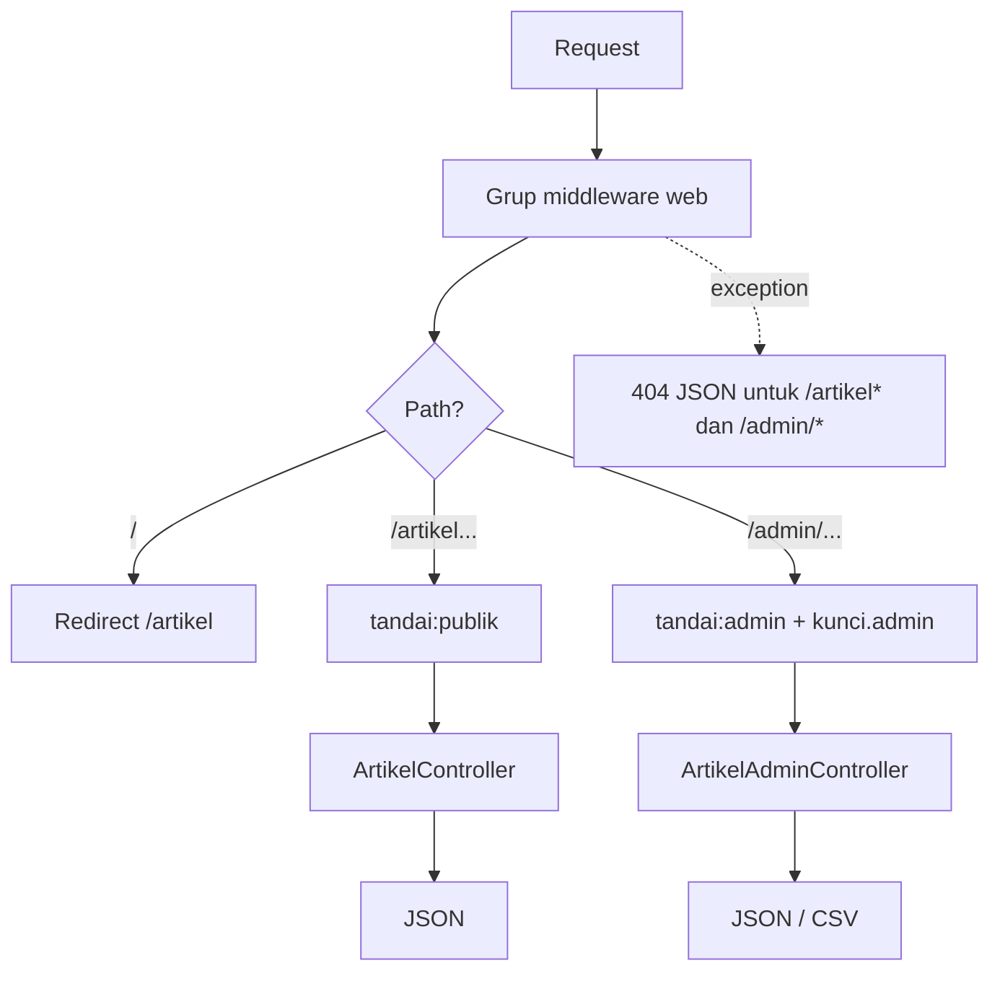

# Proyek Praktik: Routing dan Controller Artikel

Kamu sudah menyelesaikan seluruh sub bab **Routing, Controller, dan Request Handling**. Pada proyek ini semuanya dipakai bersama untuk merapikan `portal-artikel` menjadi satu layanan kecil yang utuh: **Routing dan Controller Artikel**. Hasilnya
adalah daftar dan detail artikel (JSON) yang terbuka untuk publik, area `admin` yang dijaga kunci, ekspor CSV, penanganan error yang rapi, dan sebuah skrip verifikasi otomatis.

## Tujuan Pembelajaran

Setelah menyelesaikan proyek ini, kamu dapat:

- [ ] Menyusun `routes/web.php` yang bersih memakai grup, prefix, nama route, batasan, dan middleware.
- [ ] Menghubungkan route ke controller biasa dan menjelaskan pembagian tugas antar controller.
- [ ] Memakai Route Model Binding dengan `slug` dan menolak slug tidak valid dengan batasan route.
- [ ] Membaca input query (`q`, `halaman`, `per_halaman`) dengan batas yang aman lewat objek `Request`.
- [ ] Mengembalikan JSON, unduhan CSV, dan error JSON yang konsisten.
- [ ] Melindungi area admin dengan middleware dan memverifikasinya secara otomatis dengan skrip `curl`.
- [ ] Membersihkan route latihan dan mengelola perubahan dengan Git.

## Prasyarat

Proyek ini memakai seluruh sub bab bab utama **Routing, Controller, dan Request Handling**, terutama
[Route Model Binding](02-10-route-model-binding.md), [Route Middleware](02-08-route-middleware.md), [Batasan Route](02-09-route-constraints.md),
[Objek Request](02-15-request-object.md), [JSON Response](02-18-json-response.md), [Response Unduh Berkas](02-19-file-download-response.md),
dan [Penanganan Error dan HTTP Status Code](02-20-error-handling-and-http-status-codes.md).

Kondisi awal `~/belajar-laravel/portal-artikel` (hasil sub bab sebelumnya):

| Komponen | Keterangan |
|---|---|
| Model `App\Models\Artikel` | Tabel `artikel` dengan kolom `id`, `judul`, `slug`; `#[RouteKey('slug')]` |
| Seeder | Tiga artikel contoh (sudah dijalankan: `php artisan migrate --seed`) |
| `config/portal.php` | Kunci `admin_key` dari variabel lingkungan `PORTAL_ADMIN_KEY` |
| Alias middleware | `kunci.admin` (header `X-Admin-Key`) dan `tandai` (parameter menjadi header `X-Portal`) di `bootstrap/app.php` |

Jika ada komponen yang belum kamu punya, kembali ke sub bab terkait. Lingkungan: PHP 8.3 atau lebih baru, Composer, dan terminal Bash.

## Pengantar

Selama bab ini `routes/web.php` terisi banyak route latihan: `inspeksi`, `contoh-response`, `uji-error`, dan lainnya. Itu wajar untuk belajar, tetapi berbahaya bila tertinggal di produksi: route inspeksi membuka informasi request. Proyek ini
juga latihan **membersihkan**: kita mengganti isi `routes/web.php` dengan rancangan akhir yang kecil dan terukur.

Kita belum memakai fitur bab berikutnya: Blade, validasi form, dan penyimpanan lewat form. Karena itu endpoint tulis bersifat **simulasi** (tidak menyimpan ke database) dan seluruh respons berupa JSON atau CSV.

## Penjelasan Konsep

### Persyaratan aplikasi

| Kebutuhan | Endpoint | Hasil |
|---|---|---|
| Beranda | `GET /` | Redirect ke `/artikel` |
| Daftar artikel | `GET /artikel` | JSON `data` + `meta`, mendukung `q`, `halaman`, `per_halaman` |
| Detail artikel | `GET /artikel/{slug}` | JSON satu artikel; `404` JSON bila tidak ada |
| Ekspor (admin) | `GET /admin/artikel/ekspor.csv` | Unduhan CSV |
| Tulis (admin, simulasi) | `POST /admin/artikel`, `PUT/DELETE /admin/artikel/{slug}` | `201`, `200`, `204` |
| Penjagaan | semua `/admin/*` | `403` tanpa header `X-Admin-Key` yang benar |

### Rancangan

| Bagian | Peran |
|---|---|
| `routes/web.php` | Daftar route: publik dan grup admin |
| `ArtikelController` | Membaca daftar dan detail (publik) |
| `Admin\ArtikelAdminController` | Operasi tulis simulasi dan ekspor CSV |
| `bootstrap/app.php` | Alias middleware dan penanganan `404` JSON |
| `scripts/verifikasi.sh` | Pemeriksaan otomatis dengan `curl` |

### Keamanan

- Area admin **gagal tertutup**: tanpa kunci yang benar selalu `403`.
- Kunci admin hanya ada di `.env` (tidak di-commit) dan dibandingkan dengan `hash_equals` di middleware.
- Parameter `slug` dibatasi pola `[a-z0-9-]+` dan model binding mengembalikan `404` untuk data yang tidak ada.
- `per_halaman` dibatasi `1`-`50` dan `halaman` minimal `1` agar tidak ada kueri besar tak terduga.
- JSON hanya memuat kolom `id`, `judul`, `slug`; CSV menetralkan sel yang diawali `=`, `+`, `-`, `@`.
- Route latihan (`inspeksi`, `uji-error`, dan lain-lain) **dihapus**.
- Endpoint tulis tetap dilindungi CSRF karena berada di grup `web`.

!!! tip "Analogi"
    Proyek ini seperti **merapikan rumah setelah renovasi**: perabot (route latihan) dikeluarkan, hanya pintu yang memang dipakai yang dibiarkan, dan pintu admin dikunci.

## Cara Kerja



## Contoh Praktik

### Struktur akhir (berkas yang kamu tambah atau ubah)

```text
portal-artikel/
├── app/Http/Controllers/
│   ├── ArtikelController.php            (diganti)
│   └── Admin/ArtikelAdminController.php (baru)
├── bootstrap/app.php                    (ubah withExceptions)
├── routes/web.php                       (diganti)
└── scripts/verifikasi.sh                (baru)
```

Controller latihan lain (`InspeksiRequestController`, `ContohResponseController`, dan seterusnya) boleh dihapus atau dibiarkan sebagai arsip, selama route-nya tidak lagi terdaftar.

## Penjelasan Kode

### Route

File: `routes/web.php` (ganti seluruh isi)

```php
<?php

use App\Http\Controllers\Admin\ArtikelAdminController;
use App\Http\Controllers\ArtikelController;
use Illuminate\Support\Facades\Route;

Route::redirect('/', '/artikel');

Route::middleware('tandai:publik')->group(function () {
    Route::get('/artikel', [ArtikelController::class, 'index'])
        ->name('artikel.index');

    Route::get('/artikel/{artikel}', [ArtikelController::class, 'show'])
        ->where('artikel', '[a-z0-9-]+')
        ->name('artikel.show');
});

Route::prefix('admin')
    ->name('admin.')
    ->middleware(['tandai:admin', 'kunci.admin'])
    ->group(function () {
        Route::get('artikel/ekspor.csv', [ArtikelAdminController::class, 'ekspor'])
            ->name('artikel.ekspor');

        Route::post('artikel', [ArtikelAdminController::class, 'store'])
            ->name('artikel.store');

        Route::put('artikel/{artikel}', [ArtikelAdminController::class, 'update'])
            ->where('artikel', '[a-z0-9-]+')
            ->name('artikel.update');

        Route::delete('artikel/{artikel}', [ArtikelAdminController::class, 'destroy'])
            ->where('artikel', '[a-z0-9-]+')
            ->name('artikel.destroy');
    });
```

| Bagian | Penjelasan |
|---|---|
| `Route::redirect('/', '/artikel')` | Pintasan redirect; menurut dokumentasi bawaannya status `302` |
| `Route::middleware('tandai:publik')->group` | Semua route publik mendapat header `X-Portal: publik` |
| `{artikel}` + model `Artikel` | Route Model Binding; kunci route `slug` dari model |
| `->where('artikel', '[a-z0-9-]+')` | Slug berpola lain langsung `404`, tanpa menyentuh database |
| `prefix('admin')->name('admin.')` | Path `/admin/...` dan nama `admin.artikel.*` |
| `middleware(['tandai:admin', 'kunci.admin'])` | Penanda dan penjaga kunci pada seluruh grup admin |
| `artikel/ekspor.csv` | Route `GET` statis; tidak berbenturan karena tidak ada `GET admin/artikel/{artikel}` |

### Controller publik

File: `app/Http/Controllers/ArtikelController.php` (ganti seluruh isi)

```php
<?php

namespace App\Http\Controllers;

use App\Models\Artikel;
use Illuminate\Http\JsonResponse;
use Illuminate\Http\Request;

class ArtikelController extends Controller
{
    public function index(Request $request): JsonResponse
    {
        $halaman = max(1, $request->integer('halaman', 1));
        $perHalaman = min(50, max(1, $request->integer('per_halaman', 10)));

        $dasar = Artikel::query();

        if ($request->filled('q')) {
            $dasar->where('judul', 'like', '%'.$request->string('q')->toString().'%');
        }

        $total = $dasar->count();

        $data = $dasar
            ->select(['id', 'judul', 'slug'])
            ->orderBy('id')
            ->skip(($halaman - 1) * $perHalaman)
            ->take($perHalaman)
            ->get();

        return response()->json([
            'data' => $data,
            'meta' => [
                'halaman' => $halaman,
                'per_halaman' => $perHalaman,
                'total' => $total,
            ],
        ]);
    }

    public function show(Artikel $artikel): JsonResponse
    {
        return response()->json([
            'data' => $artikel->only(['id', 'judul', 'slug']),
        ]);
    }
}
```

| Bagian | Penjelasan |
|---|---|
| `max(1, ...)` dan `min(50, max(1, ...))` | Menjepit nilai ke rentang aman |
| `filled('q')` | Pencarian hanya bila `q` ada dan tidak kosong |
| `where('judul', 'like', ...)` | Nilai dikirim sebagai *binding*, sehingga tidak ada SQL injection; karakter `%` dan `_` dalam `q` tetap bermakna sebagai wildcard `LIKE` |
| `count()` sebelum `select` | Total dihitung dari filter yang sama |
| `show(Artikel $artikel)` | Model sudah dicari lewat binding; slug yang tidak ada menjadi `404` sebelum method berjalan |
| `only([...])` | Hanya kolom aman yang dikirim |

### Controller admin

File: `app/Http/Controllers/Admin/ArtikelAdminController.php`

```php
<?php

namespace App\Http\Controllers\Admin;

use App\Http\Controllers\Controller;
use App\Models\Artikel;
use Illuminate\Http\JsonResponse;
use Illuminate\Http\Request;
use Symfony\Component\HttpFoundation\StreamedResponse;

class ArtikelAdminController extends Controller
{
    public function store(Request $request): JsonResponse
    {
        $judul = $request->string('judul')->trim()->toString();

        if ($judul === '') {
            return response()->json(['pesan' => 'Judul wajib diisi'], 422);
        }

        // Simulasi: belum disimpan ke database.
        return response()->json(['data' => ['judul' => $judul]], 201);
    }

    public function update(Request $request, Artikel $artikel): JsonResponse
    {
        $judul = $request->string('judul')->trim()->toString();

        if ($judul === '') {
            return response()->json(['pesan' => 'Judul wajib diisi'], 422);
        }

        // Simulasi: belum disimpan ke database.
        return response()->json(['data' => [
            'slug' => $artikel->slug,
            'judul' => $judul,
        ]]);
    }

    public function destroy(Artikel $artikel): JsonResponse
    {
        // Simulasi: belum dihapus dari database.
        return response()->json(null, 204);
    }

    public function ekspor(): StreamedResponse
    {
        return response()->streamDownload(function () {
            $out = fopen('php://output', 'w');
            fputcsv($out, ['id', 'judul', 'slug']);

            foreach (Artikel::query()->orderBy('id')->get(['id', 'judul', 'slug']) as $artikel) {
                fputcsv($out, [$artikel->id, $this->aman($artikel->judul), $artikel->slug]);
            }

            fclose($out);
        }, 'artikel.csv', ['Content-Type' => 'text/csv']);
    }

    private function aman(string $nilai): string
    {
        return preg_match('/^[=+\-@]/', $nilai) === 1 ? "'".$nilai : $nilai;
    }
}
```

| Bagian | Penjelasan |
|---|---|
| `string('judul')->trim()->toString()` | Input dibaca sebagai teks dan dipotong spasinya |
| `422` bila kosong | Validasi sederhana buatan sendiri; validasi lengkap dibahas pada bab selanjutnya |
| `201`, `200`, `204` | Status sesuai jenis operasi |
| `streamDownload` + `fputcsv` | Ekspor tanpa berkas sementara |
| `aman()` | Menetralkan sel CSV yang diawali karakter rumus |

### Penanganan error

File: `bootstrap/app.php` (bagian `withExceptions`)

```php-inline
use Illuminate\Http\Request;
use Symfony\Component\HttpKernel\Exception\NotFoundHttpException;

->withExceptions(function (Exceptions $exceptions): void {
    $exceptions->render(function (NotFoundHttpException $e, Request $request) {
        if ($request->is('artikel', 'artikel/*', 'admin/*')) {
            return response()->json(['pesan' => 'Sumber daya tidak ditemukan'], 404);
        }
    });
})
```

Pada source framework 13.x, `ModelNotFoundException` diubah menjadi `NotFoundHttpException` sebelum callback `render` dijalankan (lewat `prepareException`), sehingga slug yang tidak ditemukan juga mendapat respons JSON ini.

### Skrip verifikasi

File: `scripts/verifikasi.sh`

```bash
#!/usr/bin/env bash
set -u

BASE="${BASE:-http://127.0.0.1:8000}"
KUNCI="${PORTAL_ADMIN_KEY:-}"
SLUG="${SLUG:-belajar-routing-laravel}"
gagal=0

cek() {
  if [ "$2" = "$3" ]; then
    echo "OK    $1"
  else
    echo "GAGAL $1 (harap $2, dapat $3)"
    gagal=$((gagal + 1))
  fi
}

status() { curl -s -o /dev/null -w '%{http_code}' "$@"; }

cek "beranda mengalihkan" 302 "$(status "$BASE/")"
cek "daftar artikel" 200 "$(status "$BASE/artikel")"
cek "detail artikel" 200 "$(status "$BASE/artikel/$SLUG")"
cek "slug tidak ada" 404 "$(status "$BASE/artikel/tidak-ada")"
cek "slug berpola salah" 404 "$(status "$BASE/artikel/TIDAK_VALID")"

jumlah="$(curl -s "$BASE/artikel?per_halaman=1" | grep -o '"slug"' | wc -l | tr -d ' ')"
cek "per_halaman=1 menghasilkan 1 artikel" 1 "$jumlah"

penanda="$(curl -s -D - -o /dev/null "$BASE/artikel" | grep -ci '^x-portal: publik')"
cek "header X-Portal publik" 1 "$penanda"

cek "admin tanpa kunci ditolak" 403 "$(status "$BASE/admin/artikel/ekspor.csv")"
cek "admin kunci salah ditolak" 403 "$(status -H 'X-Admin-Key: salah' "$BASE/admin/artikel/ekspor.csv")"

if [ -n "$KUNCI" ]; then
  cek "admin dengan kunci benar" 200 "$(status -H "X-Admin-Key: $KUNCI" "$BASE/admin/artikel/ekspor.csv")"
else
  echo "LEWAT admin dengan kunci benar (PORTAL_ADMIN_KEY belum diset)"
fi

if [ "$gagal" -eq 0 ]; then
  echo "Semua pemeriksaan lulus"
else
  echo "$gagal pemeriksaan gagal"
  exit 1
fi
```

| Bagian | Penjelasan |
|---|---|
| `${PORTAL_ADMIN_KEY:-}` | Kunci dibaca dari variabel lingkungan shell, tidak ditulis di skrip |
| `status()` | Mengambil kode status saja |
| `cek` | Membandingkan harapan dan kenyataan, menghitung kegagalan |
| `exit 1` | Skrip gagal bila ada pemeriksaan yang tidak lulus |

Skrip tidak menguji `POST`/`PUT`/`DELETE` karena butuh token CSRF; itu diuji manual pada Langkah 8.

## Implementasi Langkah demi Langkah

### Langkah 1: periksa kondisi awal

```bash
cd ~/belajar-laravel/portal-artikel
git status --short
php artisan route:list --except-vendor
```

Pastikan Git bersih dan catat route latihan yang akan dihapus. `git log --oneline` memastikan versi lama tersimpan.

### Langkah 2: ganti route

Ganti isi `routes/web.php` sesuai Penjelasan Kode, lalu:

```bash
php -l routes/web.php
```

### Langkah 3: ganti controller publik

Ganti isi `app/Http/Controllers/ArtikelController.php`.

```bash
php -l app/Http/Controllers/ArtikelController.php
```

### Langkah 4: buat controller admin

```bash
php artisan make:controller Admin/ArtikelAdminController
```

Ganti isi berkas sesuai Penjelasan Kode, lalu:

```bash
php -l app/Http/Controllers/Admin/ArtikelAdminController.php
```

### Langkah 5: ubah penanganan error

Sesuaikan `withExceptions` di `bootstrap/app.php`.

```bash
php -l bootstrap/app.php
php artisan route:list --except-vendor
```

Pastikan hanya route akhir yang tampil.

### Langkah 6: buat skrip verifikasi

```bash
mkdir -p scripts
```

Isi `scripts/verifikasi.sh` sesuai Penjelasan Kode.

```bash
bash -n scripts/verifikasi.sh
```

`bash -n` hanya memeriksa sintaks.

### Langkah 7: jalankan server dan skrip

```bash
php artisan serve
```

Di terminal lain:

```bash
PORTAL_ADMIN_KEY='isi-nilai-dari-.env-lokalmu' bash scripts/verifikasi.sh
```

Gunakan kunci lokalmu sendiri dan jangan menempelkannya ke berkas yang di-commit. Skrip tanpa variabel itu melewati pemeriksaan kunci benar.

### Langkah 8: uji manual endpoint tulis

Tambahkan sementara `Route::get('/token', fn () => csrf_token());` di `routes/web.php` (hapus setelah uji), lalu:

```bash
KUNCI='isi-nilai-dari-.env-lokalmu'
TOKEN=$(curl -s -c cookies.txt http://127.0.0.1:8000/token)
curl -i -b cookies.txt -X POST -H "X-CSRF-TOKEN: $TOKEN" -H "X-Admin-Key: $KUNCI" \
  -H "Content-Type: application/json" -d '{"judul":"  Artikel Uji  "}' \
  http://127.0.0.1:8000/admin/artikel
curl -i -b cookies.txt -X POST -H "X-CSRF-TOKEN: $TOKEN" -H "X-Admin-Key: $KUNCI" \
  -H "Content-Type: application/json" -d '{"judul":"   "}' \
  http://127.0.0.1:8000/admin/artikel
curl -i -b cookies.txt -X DELETE -H "X-CSRF-TOKEN: $TOKEN" -H "X-Admin-Key: $KUNCI" \
  http://127.0.0.1:8000/admin/artikel/belajar-routing-laravel
curl -i -b cookies.txt -X DELETE -H "X-CSRF-TOKEN: $TOKEN" http://127.0.0.1:8000/admin/artikel/belajar-routing-laravel
rm cookies.txt
```

Hapus route `/token` setelah selesai.

### Langkah 9: bersihkan dan kelola dengan Git

Pastikan `.env` tidak ikut tercatat:

```bash
git status --short
git add app bootstrap routes scripts
git commit -m "Rapikan portal artikel: route akhir, controller, dan skrip verifikasi"
```

## Eksekusi dan Verifikasi

| Langkah | Cara memverifikasi |
|---|---|
| 2-5 | `php -l` tanpa error; `route:list` hanya memuat route akhir |
| 6 | `bash -n` tanpa keluaran |
| 7 | Skrip mencetak `OK` untuk setiap pemeriksaan dan `Semua pemeriksaan lulus` |
| 8 | `201` untuk judul valid, `422` untuk judul kosong, `204` untuk `DELETE` dengan kunci, `403` tanpa kunci |
| 9 | `git status` bersih; `.env` tidak tercatat |

## Hasil yang Diharapkan

Hasil diturunkan dari dokumentasi dan source, dan belum dijalankan oleh penulis materi; sesuaikan slug dengan data seeder-mu dan cocokkan dengan hasil nyatamu.

Contoh keluaran skrip bila semuanya berhasil (jumlah dan urutan sesuai skrip):

```text
OK    beranda mengalihkan
OK    daftar artikel
OK    detail artikel
OK    slug tidak ada
OK    slug berpola salah
OK    per_halaman=1 menghasilkan 1 artikel
OK    header X-Portal publik
OK    admin tanpa kunci ditolak
OK    admin kunci salah ditolak
OK    admin dengan kunci benar
Semua pemeriksaan lulus
```

| Permintaan | Hasil penting |
|---|---|
| `GET /artikel?per_halaman=2&halaman=1` | `200`, dua artikel, `meta.total` = jumlah artikel di database |
| `GET /artikel?q=middleware` | Hanya artikel yang judulnya mengandung kata itu |
| `GET /artikel/tidak-ada` | `404`, `{"pesan":"Sumber daya tidak ditemukan"}` |
| `GET /admin/artikel/ekspor.csv` dengan kunci | `200`, baris pertama `id,judul,slug` |
| `POST /admin/artikel` judul `  Artikel Uji  ` | `201`, `{"data":{"judul":"Artikel Uji"}}` |
| `POST /admin/artikel` judul kosong | `422` |
| `DELETE /admin/artikel/{slug}` dengan kunci dan token | `204` |
| Tanpa token CSRF | `419` (token dicek sebelum middleware route; belum saya uji urutannya) |

## Kesalahan Umum dan Pemecahan Masalah

| Gejala | Penyebab | Cara mengenali | Solusi | Pencegahan |
|---|---|---|---|---|
| Skrip: `detail artikel` gagal (`404`) | Slug seeder berbeda | Cek `SLUG` di skrip | Jalankan dengan `SLUG=slug-yang-ada bash scripts/verifikasi.sh` | Ambil slug dari data nyata |
| `403` pada kunci yang benar | Variabel `PORTAL_ADMIN_KEY` di `.env` kosong/berbeda | Middleware gagal tertutup | Isi `.env` lokal, `php artisan config:clear` | Samakan nilai dengan `.env` |
| `Connection refused` | Server belum jalan | `curl` gagal terhubung | `php artisan serve` | Jalankan server dulu |
| `Target class [...] does not exist` | Namespace controller salah | Error di `route:list` | Cek namespace `App\Http\Controllers\Admin` | Gunakan `make:controller Admin/...` |
| Slug tidak ketemu padahal ada | Model tidak memakai `slug` sebagai kunci route | `404` pada slug valid | Periksa `#[RouteKey('slug')]` pada model | Uji dengan satu slug dulu |
| `419` pada `POST` | Token CSRF tidak ada | Page Expired | Sertakan token dan cookie | Ingat CSRF pada route web |
| Route latihan masih ada | `routes/web.php` tidak diganti penuh | `route:list` memuat `inspeksi` | Ganti seluruh isi berkas | Periksa `route:list` setelah rilis |
| `.env` tercatat di Git | `.gitignore` diubah | `git status` memuat `.env` | `git rm --cached .env` | Jangan commit `.env` |
| Skrip bash gagal di Windows PowerShell | Sintaks Bash | Error parsing | Jalankan di Git Bash atau WSL | Gunakan terminal Bash |

## Latihan Praktik

### Latihan dasar

**D1. Pemeriksaan tambahan pada skrip**
- *Masalah:* skrip belum memeriksa semua perilaku.
- *Persyaratan:* tambahkan dua pemeriksaan: `GET /artikel?per_halaman=1000` tetap `200` dan `meta.per_halaman` bernilai `50` (cari dengan `grep`), serta `GET /artikel?halaman=-5` tetap `200`.
- *Perilaku yang diharapkan:* kedua pemeriksaan lulus.
- *Tujuan belajar:* mengotomatiskan uji batas.

**D2. Peta route**
- *Masalah:* tim baru perlu memahami daftar route.
- *Persyaratan:* simpan keluaran `php artisan route:list --except-vendor` ke `docs-route.txt` (jangan di-commit) dan tulis satu kalimat tentang fungsi tiap route.
- *Perilaku yang diharapkan:* satu kalimat kegunaan untuk setiap route.
- *Tujuan belajar:* membaca daftar route.

### Latihan implementasi

**I1. Filter jumlah dan urutan**
- *Masalah:* klien ingin mengurutkan daftar.
- *Persyaratan:* tambahkan parameter `urut` yang hanya menerima `terbaru` atau `terlama` (selain itu pakai `terlama`), mengurutkan berdasarkan `id`. Tambahkan pemeriksaan di skrip.
- *Perilaku yang diharapkan:* nilai tak dikenal tidak menyebabkan error.
- *Tujuan belajar:* daftar izin untuk input.

**I2. Rate limit sederhana pada admin**
- *Masalah:* percobaan tebak kunci admin tidak dibatasi.
- *Persyaratan:* baca bagian `throttle` pada dokumentasi routing/rate limiting, pasang pembatas pada grup admin, dan buktikan `429` setelah melebihi batas. Catat sumber dokumentasi yang kamu pakai.
- *Perilaku yang diharapkan:* permintaan berlebih mendapat `429`.
- *Tujuan belajar:* membatasi percobaan serangan.

### Latihan tantangan

**T1. Versi API**
- *Masalah:* klien lama dan baru harus bisa hidup berdampingan.
- *Persyaratan:* buat grup `v1` dan `v2` dengan prefix `/api-v1` dan `/api-v2`, dengan nama route berawalan yang berbeda; `v2` menambahkan kolom baru ke JSON tanpa mengubah `v1`. Perluas skrip verifikasi untuk keduanya.
- *Perilaku yang diharapkan:* kedua versi berjalan dan lulus pemeriksaan.
- *Tujuan belajar:* mengatur versi lewat grup route.
- *Catatan:* kerjakan mandiri; tidak ada kunci jawaban.

## Uji Pemahaman

1. Mengapa route latihan harus dihapus sebelum rilis?
2. Apa fungsi `->where('artikel', '[a-z0-9-]+')`?
3. Mengapa `per_halaman` dibatasi `1`-`50`?
4. Mengapa admin disebut "gagal tertutup"?
5. Mengapa `store` mengembalikan `422` bila judul kosong?
6. Mengapa `PORTAL_ADMIN_KEY` tidak ditulis di skrip?
7. Mengapa skrip verifikasi tidak menguji `POST`?
8. Apa yang membuat slug tidak ditemukan menghasilkan JSON `404`?

??? success "Kunci jawaban singkat"
    1. Route latihan dapat membuka informasi atau fungsi yang tidak seharusnya publik.
    2. Menolak slug berpola lain dengan `404` sebelum menyentuh database.
    3. Mencegah kueri besar yang membebani server.
    4. Tanpa kunci yang benar selalu ditolak (`403`), termasuk bila konfigurasi kosong.
    5. Data tidak valid ditolak dengan kode yang jelas; validasi penuh dibahas kemudian.
    6. Rahasia tidak boleh masuk repositori; kunci dibaca dari lingkungan.
    7. Grup `web` mensyaratkan token CSRF, sehingga uji tulis dilakukan manual dengan token.
    8. Model binding gagal, diubah menjadi `NotFoundHttpException`, lalu ditangkap callback `render`.

## Ringkasan

- `routes/web.php` akhir kecil dan terstruktur: publik, grup admin, nama, batasan, middleware.
- `ArtikelController` melayani baca; `ArtikelAdminController` melayani tulis simulasi dan ekspor.
- Input dibatasi, output dipilih kolomnya, area admin gagal tertutup, dan error dikembalikan sebagai JSON konsisten.
- Skrip `curl` mengotomatiskan pemeriksaan; endpoint tulis diuji manual karena CSRF.
- Route latihan dibersihkan sebelum rilis.

Selanjutnya, bab utama berikutnya memperkenalkan *Views dan Blade* untuk menampilkan halaman HTML.

## Referensi Resmi

- [Laravel: Routing](https://laravel.com/docs/13.x/routing)
- [Laravel: Redirect Routes](https://laravel.com/docs/13.x/routing#redirect-routes)
- [Laravel: Route Groups](https://laravel.com/docs/13.x/routing#route-groups)
- [Laravel: Controllers](https://laravel.com/docs/13.x/controllers)
- [Laravel: HTTP Requests](https://laravel.com/docs/13.x/requests)
- [Laravel: HTTP Responses](https://laravel.com/docs/13.x/responses)
- [Laravel: Error Handling](https://laravel.com/docs/13.x/errors)
