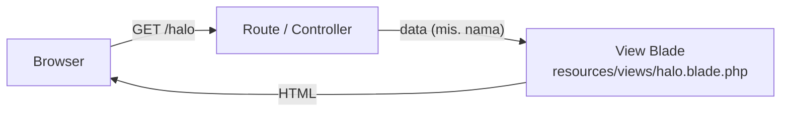
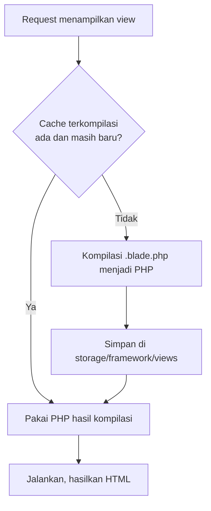
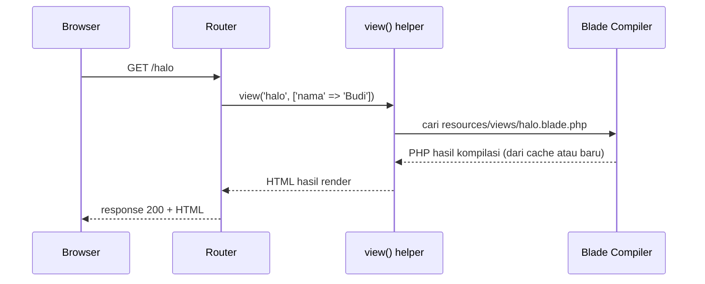

# Pengantar Blade

Pada bab utama sebelumnya, route kita mengembalikan teks biasa seperti `'Daftar artikel'`. Aplikasi nyata menampilkan halaman HTML lengkap: judul, menu,
daftar data, dan form. Menulis HTML panjang di dalam closure route atau controller cepat menjadi berantakan. Laravel menyediakan **Blade**, mesin template
(*templating engine*) untuk memisahkan tampilan dari logika. Sub bab ini memperkenalkan apa itu Blade, di mana berkasnya disimpan, bagaimana menampilkannya
dari route, dan apa yang terjadi di balik layar.

## Tujuan Pembelajaran

Setelah menyelesaikan sub bab ini, kamu dapat:

- [ ] Menjelaskan masalah yang diselesaikan oleh template dan peran Blade dalam arsitektur MVC.
- [ ] Menyebutkan lokasi dan ekstensi berkas Blade (`resources/views`, `.blade.php`).
- [ ] Membuat sebuah view dan menampilkannya lewat helper `view()` dan `Route::view`.
- [ ] Menjelaskan aturan nama view, termasuk notasi titik untuk subfolder.
- [ ] Mengirim data dari route ke view dan menampilkannya dengan `{{ }}`.
- [ ] Menjelaskan bahwa Blade dikompilasi menjadi PHP biasa dan di-*cache*, serta cara membersihkan cache-nya dengan `view:clear`.

## Prasyarat

- Bab utama [Routing, Controller, dan Request Handling](../level-02/index.md), terutama
  [Routing Dasar](../level-02/02-02-basic-routing.md) (route `view`) dan [Pengantar Controller](../level-02/02-11-introduction-to-controllers.md).
- [Arsitektur MVC](../level-01/01-03-mvc-architecture.md) dan [Struktur Direktori Laravel](../level-01/01-09-laravel-directory-structure.md).
- Dasar HTML dan [Manipulasi String](../level-00/00-15-string-manipulation.md) (konsep *escaping* dengan `htmlspecialchars`).
- Laravel installer, terminal Bash, dan `php artisan serve`.

## Pengantar

Bayangkan kamu membuat halaman profil dengan PHP native seperti pada proyek siswa: HTML, `echo`, `foreach`, dan query data tercampur dalam satu berkas.
Mengubah warna tombol berarti membuka berkas yang sama dengan kode akses data. Jika dua orang mengerjakan tampilan dan logika bersamaan, konflik hampir pasti
terjadi.

Solusinya adalah memisahkan tanggung jawab: route atau controller menyiapkan **data**, sedangkan sebuah berkas **template** menentukan bagaimana data itu
**tampil**. Di Laravel, berkas template itu disebut **view**, dan bahasa template bawaannya adalah **Blade**.

## Penjelasan Konsep

### Apa itu Blade?

Menurut dokumentasi resmi, Blade adalah mesin template yang sederhana namun kuat dan sudah disertakan dalam Laravel. Berbeda dari sebagian mesin template PHP
lain, Blade **tidak melarang** penggunaan kode PHP biasa di dalam template. Blade menambahkan sintaks ringkas untuk hal yang paling sering dilakukan: mencetak
data, percabangan, dan perulangan.

!!! tip "Analogi"
    Blade seperti surat berformat di aplikasi pengolah kata: kerangka surat tetap sama, sedangkan nama penerima dan tanggal diisi otomatis dari data. Kerangka itu adalah
    view; pengisian data dilakukan oleh route atau controller.

### Posisi Blade dalam MVC

Dalam arsitektur MVC yang sudah kamu kenal, view adalah lapisan tampilan.



Route atau controller **tidak** menyusun HTML. Ia memanggil view dan menyerahkan data; view yang menghasilkan HTML akhir.

### Lokasi dan ekstensi berkas

| Hal | Aturan |
|---|---|
| Folder view | `resources/views` |
| Ekstensi berkas Blade | `.blade.php` |
| Contoh | `resources/views/halo.blade.php` dipanggil dengan nama `halo` |

Ekstensi `.blade.php` penting: dengan ekstensi itu Laravel tahu berkas tersebut harus diproses oleh Blade. Proyek baru sudah memuat `welcome.blade.php`, yaitu
halaman sambutan yang tampil di route `/`.

### Memanggil view

Ada dua cara umum menampilkan view dari route:

```php-inline
// 1. Helper view() di dalam closure
Route::get('/halo', function () {
    return view('halo');
});

// 2. Jalan pintas Route::view bila tidak ada logika lain
Route::view('/tentang', 'tentang');
```

Argumen `view()` adalah **nama view**, bukan path berkas. Aturan penamaannya:

| Berkas | Nama view |
|---|---|
| `resources/views/halo.blade.php` | `halo` |
| `resources/views/artikel/index.blade.php` | `artikel.index` |
| `resources/views/admin/pengguna/daftar.blade.php` | `admin.pengguna.daftar` |

Subfolder dipisahkan dengan **titik** (*dot notation*), tanpa ekstensi `.blade.php`. Kamu bisa memeriksa keberadaan sebuah view dengan
`View::exists('artikel.index')` (facade `Illuminate\Support\Facades\View`).

### Mengirim data ke view

Argumen kedua `view()` adalah array asosiatif. Setiap **kunci** menjadi variabel di dalam view:

```php-inline
return view('halo', ['nama' => 'Budi']);
```

Di dalam `halo.blade.php`, variabel itu tersedia sebagai `$nama`. Untuk mencetaknya dipakai sintaks `{{ }}`:

```html
<p>Halo, {{ $nama }}!</p>
```

Sintaks `{{ }}` otomatis memanggil `htmlspecialchars` pada nilainya sehingga karakter seperti `<` dan `>` diubah menjadi entitas HTML. Ini melindungi aplikasi
dari serangan **XSS**. Pembahasan lengkap ada pada sub bab Blade Syntax dan Displaying Data; di sini cukup ingat bahwa `{{ }}` aman untuk teks dari pengguna.

### Kode PHP biasa tetap boleh

Karena Blade tidak membatasi PHP, tag PHP biasa tetap berfungsi, tetapi hampir selalu ada direktif Blade yang lebih ringkas:

```html
<p>Tahun ini: <?php echo date('Y'); ?></p>
<p>Tahun ini: {{ date('Y') }}</p>
```

Kedua baris menghasilkan keluaran sama. Bentuk kedua lebih singkat, dan tetap ter-*escape*.

### Blade dikompilasi dan di-cache

Semua template Blade **dikompilasi menjadi kode PHP biasa** dan disimpan sebagai cache sampai berkas aslinya berubah. Karena itu, menurut dokumentasi, Blade pada
dasarnya tidak menambah beban pada aplikasi.



Hasil kompilasi disimpan di `storage/framework/views` (lokasi bawaan). Nama berkasnya berupa kode acak (*hash*), jadi tidak perlu kamu ubah. Bila kamu perlu
menghapus seluruh cache view, misalnya setelah mengubah logika sebuah direktif kustom, jalankan:

```bash
php artisan view:clear
```

Selama pengembangan biasa, kamu tidak perlu menjalankannya: Laravel mengompilasi ulang view yang berkas aslinya berubah.

!!! warning "Hindari `__DIR__` dan `__FILE__` di view"
    Dokumentasi menyarankan agar tidak memakai konstanta `__DIR__` dan `__FILE__` di dalam view Blade, karena keduanya merujuk ke lokasi berkas **hasil kompilasi**
    di cache, bukan ke berkas `.blade.php` yang kamu tulis.

### Keamanan

- Gunakan `{{ }}` untuk mencetak data. Jangan mencetak data dari pengguna tanpa *escaping*.
- Jangan menaruh rahasia (kunci API, kata sandi) di view; isi view dikirim ke browser sebagai HTML.
- Jangan memanggil query database atau logika berat di dalam view. Selain berantakan, ini membuat logika akses data sulit diuji.

## Cara Kerja



`view()` mengembalikan objek view, bukan string. Laravel mengubahnya menjadi response HTTP, sama seperti nilai kembalian route lainnya.

## Contoh Praktik

Kamu membuat proyek baru `belajar-blade`, menambah sebuah view `halo`, menampilkannya lewat route, mengirim data, lalu mengamati bahwa Blade meng-*escape* HTML
berbahaya. Proyek ini dilanjutkan pada sub bab Blade berikutnya.

## Penjelasan Kode

File: `resources/views/halo.blade.php`

```html
<!DOCTYPE html>
<html lang="id">
<head>
    <meta charset="UTF-8">
    <title>Halo Blade</title>
</head>
<body>
    <h1>Halo, {{ $nama }}!</h1>
    <p>Tahun ini: {{ date('Y') }}</p>
</body>
</html>
```

| Bagian | Fungsi |
|---|---|
| `<!DOCTYPE html>` sampai `</html>` | HTML biasa; Blade tidak mengubahnya |
| `{{ $nama }}` | Mencetak variabel `$nama` kiriman route, dengan *escaping* |
| `{{ date('Y') }}` | Mencetak hasil ekspresi PHP biasa, juga ter-*escape* |

File: `routes/web.php` (tambahkan di bawah route bawaan)

```php-inline
Route::get('/halo', function () {
    return view('halo', ['nama' => 'Budi']);
});

Route::get('/halo-berbahaya', function () {
    return view('halo', ['nama' => '<script>alert("XSS")</script>']);
});

Route::view('/halo-statis', 'halo', ['nama' => 'Tamu']);
```

| Route | Fungsi |
|---|---|
| `GET /halo` | Memanggil view `halo` dengan `nama` bernilai `Budi` |
| `GET /halo-berbahaya` | Mengirim teks berisi tag `<script>` untuk mengamati *escaping* |
| `GET /halo-statis` | Hasil sama dengan `view()`, tetapi memakai `Route::view` dengan data pada argumen ketiga |

## Implementasi Langkah demi Langkah

### Langkah 1: buat proyek

```bash
cd ~/belajar-laravel
laravel new belajar-blade --git
cd belajar-blade
php artisan --version
```

Jawab pertanyaan installer seperti pada sub bab Membuat Proyek Laravel (tanpa starter kit, Blade, pengujian pilihanmu, tanpa Boost, SQLite, dan npm hanya bila
Node.js sudah terpasang).

### Langkah 2: periksa folder view

```bash
ls resources/views
```

Kamu akan melihat setidaknya `welcome.blade.php`. Buka berkas itu dan perhatikan bahwa isinya sebagian besar HTML.

### Langkah 3: buat view `halo`

Buat `resources/views/halo.blade.php` dengan isi pada bagian Penjelasan Kode. Pastikan ekstensinya tepat `.blade.php`.

### Langkah 4: tambah route

Tambahkan tiga route pada Penjelasan Kode ke `routes/web.php`, lalu periksa:

```bash
php artisan route:list --path=halo
```

### Langkah 5: jalankan dan uji

```bash
php artisan serve
```

Buka di browser, lalu bandingkan dengan `curl`:

- `http://127.0.0.1:8000/halo`
- `http://127.0.0.1:8000/halo-berbahaya`
- `http://127.0.0.1:8000/halo-statis`

```bash
curl -i http://127.0.0.1:8000/halo-berbahaya
```

Di Windows PowerShell tulis `curl.exe`. Perhatikan bagian `<h1>` pada keluaran.

### Langkah 6: amati hasil kompilasi

```bash
ls storage/framework/views
```

Akan ada berkas `.php` dengan nama acak. Buka salah satunya dan perhatikan bahwa `{{ $nama }}` sudah menjadi kode PHP biasa. Lalu:

```bash
php artisan view:clear
ls storage/framework/views
```

Muat ulang `/halo`, lalu periksa folder itu lagi: berkas hasil kompilasi dibuat kembali.

### Langkah 7: catat di Git

```bash
git add resources/views/halo.blade.php routes/web.php
git commit -m "Tambah view halo dan route Blade pertama"
git log --oneline
```

## Eksekusi dan Verifikasi

| Langkah | Cara memverifikasi |
|---|---|
| 1 | `php artisan --version` menampilkan Laravel Framework 13.x |
| 2 | `resources/views` memuat `welcome.blade.php` |
| 3 | Berkas bernama `halo.blade.php` ada di `resources/views` |
| 4 | `route:list --path=halo` menampilkan tiga route |
| 5 | Ketiga alamat menghasilkan status 200 dan halaman HTML |
| 6 | Folder `storage/framework/views` berisi berkas `.php` hasil kompilasi; muncul lagi setelah `view:clear` dan akses ulang |
| 7 | `git log --oneline` memuat commit baru |

## Hasil yang Diharapkan

| Alamat | Tampilan |
|---|---|
| `/halo` | Judul `Halo, Budi!` dan tahun berjalan |
| `/halo-statis` | Judul `Halo, Tamu!` |
| `/halo-berbahaya` | Teks `<script>alert("XSS")</script>` tampil **sebagai teks**; tidak ada kotak peringatan |

Pada sumber HTML `/halo-berbahaya`, tag `<script>` muncul dalam bentuk entitas seperti `&lt;script&gt;`, bukan sebagai tag yang dijalankan. Bentuk persis
tanda kutip (`&quot;`) dapat berbeda antarversi. Hasil ini diturunkan dari dokumentasi dan perilaku `htmlspecialchars`, dan belum dijalankan oleh penulis materi;
cocokkan dengan hasilmu.

## Kesalahan Umum dan Pemecahan Masalah

| Gejala | Penyebab | Cara mengenali | Solusi | Pencegahan |
|---|---|---|---|---|
| `View [halo] not found` | Berkas tidak ada, salah nama, atau ekstensi bukan `.blade.php` | Halaman error menyebut nama view | Pastikan berkas ada di `resources/views/halo.blade.php` | Cocokkan nama view dengan nama berkas tanpa ekstensi |
| `Undefined variable $nama` | Route tidak mengirim `nama` | Pesan error menunjuk baris view | Kirim data lewat argumen kedua `view()` | Periksa kunci array sama dengan nama variabel |
| `{{ $nama }}` tampil mentah di browser | Ekstensi berkas `.html` atau `.php`, bukan `.blade.php` | Sumber halaman memuat tanda kurung kurawal | Ganti ekstensi menjadi `.blade.php` | Selalu pakai `.blade.php` |
| View di subfolder tidak ketemu | Memakai garis miring atau menyertakan ekstensi | Error `View [artikel/index.blade] not found` | Tulis `artikel.index` | Gunakan notasi titik |
| Perubahan view tidak tampil | Cache browser atau cache view | Isi lama tetap muncul | Muat ulang paksa (Ctrl+F5); jalankan `php artisan view:clear` | Jangan menjalankan `view:cache` saat pengembangan |
| `Class "View" not found` saat memakai `View::exists` | Facade belum di-*import* | Pesan error | Tambahkan `use Illuminate\Support\Facades\View;` | Atau cukup pakai helper `view()` |
| Halaman kosong tanpa error | Closure route tidak mengembalikan view | Status 200 dengan badan kosong | Tambahkan `return` sebelum `view(...)` | Selalu `return view(...)` |
| Nama parameter `Route::view` bentrok | Memakai `view`, `data`, `status`, atau `headers` sebagai kunci data | Perilaku aneh | Ganti nama kunci | Hindari nama dicadangkan |

## Latihan Praktik

### Latihan dasar

**D1. View pertama**
- *Masalah:* ingin halaman `/tentang` yang berisi HTML sendiri.
- *Persyaratan:* buat `resources/views/tentang.blade.php` berisi judul dan satu paragraf, lalu tampilkan dengan `Route::view('/tentang', 'tentang')`.
- *Perilaku yang diharapkan:* `/tentang` berstatus 200 dan menampilkan halaman HTML.
- *Tujuan belajar:* membuat view dan memetakannya ke route.

**D2. Nama view subfolder**
- *Masalah:* ingin merapikan view per fitur.
- *Persyaratan:* buat `resources/views/artikel/index.blade.php`, tampilkan dari route `/artikel` dengan nama `artikel.index`, dan tulis nama view untuk
  `resources/views/admin/laporan/bulanan.blade.php`.
- *Perilaku yang diharapkan:* halaman tampil; nama view untuk berkas kedua ditulis benar.
- *Tujuan belajar:* menerapkan notasi titik.

### Latihan implementasi

**I1. Kartu profil**
- *Masalah:* halaman profil perlu menampilkan data berbeda per pengguna.
- *Persyaratan:* buat route `/profil` yang mengirim `nama`, `kota`, dan `hobi` ke view `profil`, lalu tampilkan ketiganya dengan `{{ }}`.
- *Perilaku yang diharapkan:* ubah nilai di route, muat ulang, tampilan ikut berubah tanpa mengubah view.
- *Tujuan belajar:* memisahkan data (route) dari tampilan (view).

**I2. Bukti escaping**
- *Masalah:* ingin membuktikan `{{ }}` aman.
- *Persyaratan:* kirim `<b>tebal</b>` sebagai nilai `nama`, lihat hasilnya di browser dan di sumber halaman. Jelaskan perbedaannya bila yang dipakai `echo` PHP mentah.
- *Perilaku yang diharapkan:* tag tampil sebagai teks, tidak sebagai huruf tebal.
- *Tujuan belajar:* memahami perlindungan XSS bawaan Blade.

### Latihan tantangan

**T1. Selidiki hasil kompilasi**
- *Masalah:* ingin tahu apa yang sebenarnya dijalankan PHP.
- *Persyaratan:* buat view dengan tiga ekspresi `{{ }}`, akses lewat browser, buka berkas hasil kompilasi di `storage/framework/views`, dan tuliskan padanan kode PHP
  untuk tiap ekspresi. Jelaskan mengapa mengubah view tidak memerlukan `view:clear`.
- *Perilaku yang diharapkan:* catatan menunjukkan `{{ }}` menjadi pemanggilan `echo` dengan *escaping*.
- *Tujuan belajar:* memahami Blade sebagai PHP yang dikompilasi.
- *Catatan:* kerjakan mandiri; tidak ada kunci jawaban.

## Uji Pemahaman

1. Masalah apa yang diselesaikan oleh template seperti Blade?
2. Di folder mana view disimpan dan apa ekstensi berkasnya?
3. Berkas `resources/views/admin/pengguna/daftar.blade.php` dipanggil dengan nama apa?
4. Apa perbedaan `view('halo')` dan `Route::view('/halo', 'halo')`?
5. Bagaimana data dari route sampai ke view?
6. Mengapa `{{ $nama }}` lebih aman daripada `<?php echo $nama; ?>`?
7. Ke mana Blade dikompilasi dan kapan cache perlu dibersihkan dengan `view:clear`?
8. Mengapa `__DIR__` sebaiknya dihindari di dalam view?

??? success "Kunci jawaban singkat"
    1. Memisahkan tampilan dari logika sehingga HTML tidak tercampur kode akses data.
    2. `resources/views`; `.blade.php`.
    3. `admin.pengguna.daftar`.
    4. Hasil sama; `Route::view` adalah jalan pintas bila route tidak perlu logika lain.
    5. Lewat array asosiatif sebagai argumen kedua `view()`; kunci menjadi variabel.
    6. `{{ }}` memanggil `htmlspecialchars` otomatis sehingga HTML berbahaya tidak dijalankan.
    7. Ke PHP biasa di `storage/framework/views`; bersihkan bila perlu menghapus seluruh cache, misalnya setelah mengubah logika direktif kustom.
    8. Konstanta itu merujuk ke lokasi berkas hasil kompilasi di cache, bukan ke berkas `.blade.php` asli.

## Ringkasan

- Blade adalah mesin template bawaan Laravel yang memisahkan tampilan dari logika.
- View disimpan di `resources/views` dengan ekstensi `.blade.php`; nama view memakai notasi titik tanpa ekstensi.
- Tampilkan view dengan `view('nama', $data)` atau `Route::view('/uri', 'nama', $data)`.
- `{{ }}` mencetak data dengan *escaping* otomatis dan melindungi dari XSS.
- Blade dikompilasi menjadi PHP biasa dan di-*cache* di `storage/framework/views`; `php artisan view:clear` menghapus cache itu.

Selanjutnya: *Sintaks Blade*, yaitu cara menulis ekspresi, komentar, dan direktif dasar di template.

## Referensi Resmi

- [Laravel: Blade Templates](https://laravel.com/docs/13.x/blade)
- [Laravel: Views](https://laravel.com/docs/13.x/views)
- [Laravel: Displaying Data](https://laravel.com/docs/13.x/blade#displaying-data)
- [Laravel: Routing, View Routes](https://laravel.com/docs/13.x/routing#view-routes)
