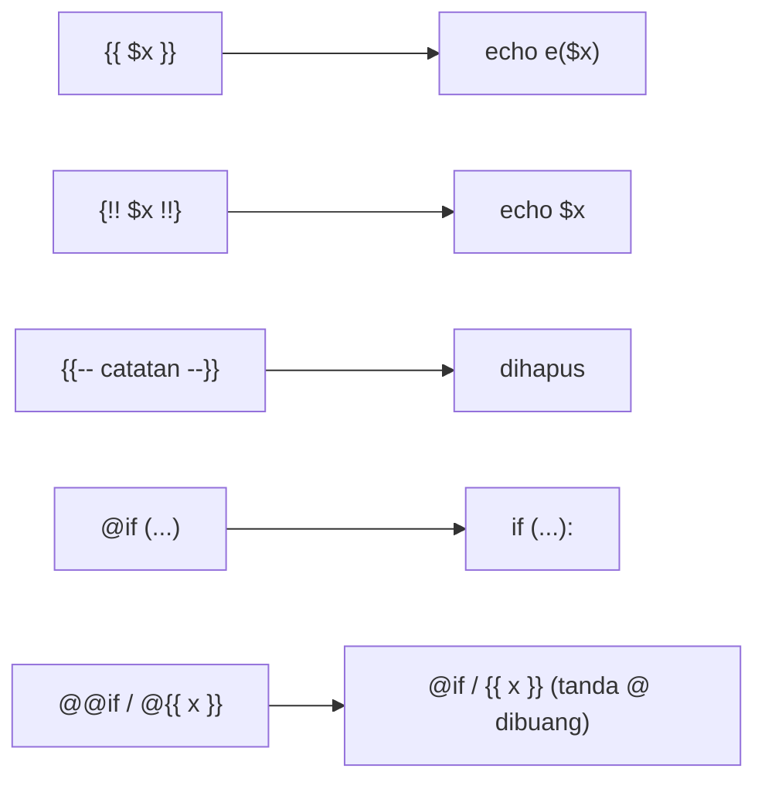

# Sintaks Blade

Pada sub bab sebelumnya kamu sudah memakai `{{ $nama }}` tanpa membahasnya lebih jauh. Blade sebenarnya hanya punya beberapa "penanda" sintaks, dan begitu kamu
mengenalnya, semua template terasa konsisten. Sub bab ini merangkum seluruh sintaks dasar Blade: mencetak ekspresi, komentar, direktif, cara
menghindari tafsiran Blade, dan menulis PHP mentah. Pembahasan mendalam tiap bagian ada pada sub bab berikutnya.

## Tujuan Pembelajaran

Setelah menyelesaikan sub bab ini, kamu dapat:

- [ ] Membedakan `{{ }}`, `{!! !!}`, `{{-- --}}`, dan `@direktif`.
- [ ] Menulis ekspresi PHP di dalam `{{ }}`.
- [ ] Menulis komentar Blade dan menjelaskan perbedaannya dari komentar HTML.
- [ ] Menghindari tafsiran Blade dengan `@{{ }}`, `@@`, dan `@verbatim`.
- [ ] Menyisipkan PHP mentah dengan `@php` dan mengimpor class dengan `@use`.
- [ ] Menjelaskan mengapa `{!! !!}` berisiko dan kapan sebaiknya dihindari.

## Prasyarat

- [Pengantar Blade](03-01-introduction-to-blade.md): view, `.blade.php`, dan `view()`.
- [Routing Dasar](../level-02/02-02-basic-routing.md).
- Dasar PHP: variabel, fungsi, dan `echo` (lihat [Variabel dan Konstanta](../level-00/00-08-variables-and-constants.md)).
- Proyek `belajar-blade` dari sub bab sebelumnya.

## Pengantar

Template berisi dua jenis teks: HTML yang dikirim apa adanya, dan bagian yang harus dihitung oleh PHP. Mesin template perlu cara jelas untuk menandai batas keduanya.
PHP native memakai `<?php ... ?>`, yang panjang dan mudah membuat template sulit dibaca. Blade menyediakan penanda yang jauh lebih ringkas.

## Penjelasan Konsep

### Empat penanda utama

| Penanda | Nama | Fungsi |
|---|---|---|
| `{{ ... }}` | *Echo* ter-*escape* | Mencetak ekspresi dengan `htmlspecialchars` |
| `{!! ... !!}` | *Echo* mentah | Mencetak ekspresi **tanpa** *escaping* |
| `{{-- ... --}}` | Komentar Blade | Catatan untuk pengembang; tidak masuk ke HTML |
| `@nama` | Direktif | Jalan pintas struktur PHP, mis. `@if`, `@foreach` |

### Echo ter-escape: `{{ }}`

Menurut dokumentasi, pernyataan `{{ }}` otomatis dilewatkan ke fungsi `htmlspecialchars` untuk mencegah serangan XSS. Di dalamnya kamu tidak terbatas pada
variabel: ekspresi PHP apa pun boleh dipakai.

```html
<h1>{{ $judul }}</h1>
<p>{{ strtoupper($judul) }}</p>
<p>Rp {{ number_format($harga, 0, ',', '.') }}</p>
```

| Ekspresi | Hasil bila `$judul = 'Belajar Blade'` dan `$harga = 15000` |
|---|---|
| `{{ $judul }}` | `Belajar Blade` |
| `{{ strtoupper($judul) }}` | `BELAJAR BLADE` |
| `{{ number_format($harga, 0, ',', '.') }}` | `15.000` |

Satu `{{ }}` berisi satu ekspresi yang menghasilkan nilai. Jangan menaruh pernyataan (misalnya `$a = 1;`) di dalamnya; untuk itu ada `@php`.

### Echo mentah: `{!! !!}`

`{!! $html !!}` mencetak nilai apa adanya. Dokumentasi mengingatkan agar sangat berhati-hati saat mencetak konten dari pengguna dan sebaiknya memakai
sintaks `{{ }}` untuk data dari pengguna.

| Nilai `$html` | `{{ $html }}` | `{!! $html !!}` |
|---|---|---|
| `<em>miring</em>` | Tampil sebagai teks `<em>miring</em>` | Tampil sebagai huruf *miring* |
| `<script>alert(1)</script>` | Tampil sebagai teks | **Skrip dijalankan** |

!!! danger "Risiko XSS"
    Pakai `{!! !!}` hanya untuk HTML yang kamu hasilkan atau sudah bersihkan sendiri. Jangan pernah untuk isi komentar, nama, atau kolom lain yang bisa diisi pengguna.

### Komentar Blade: `{{-- --}}`

Komentar Blade tidak ikut dikirim ke browser, berbeda dari komentar HTML:

| Jenis | Penulisan | Muncul di sumber halaman? |
|---|---|---|
| Komentar HTML | `<!-- catatan -->` | Ya |
| Komentar Blade | `{{-- catatan --}}` | Tidak |

Gunakan komentar Blade untuk catatan internal agar tidak membocorkan detail aplikasi kepada pengunjung.

### Direktif: `@nama`

Direktif diawali tanda `@` dan menyediakan jalan pintas untuk struktur kendali PHP. Contoh singkat (dibahas penuh di sub bab Conditional dan Loop Directives):

```html
@if ($stok > 0)
    <p>Tersedia</p>
@else
    <p>Habis</p>
@endif
```

Direktif biasanya berpasangan: `@if` ditutup `@endif`, `@foreach` ditutup `@endforeach`.

### Menghindari tafsiran Blade

Banyak kerangka JavaScript juga memakai `{{ }}`. Untuk mencegah Blade memprosesnya, ada tiga cara:

| Kebutuhan | Cara | Tulisan di template | Hasil di HTML |
|---|---|---|---|
| Satu ekspresi untuk JavaScript | Awali `@` | `@{{ pesan }}` | `{{ pesan }}` |
| Menampilkan nama direktif apa adanya | Gandakan `@` | `@@if` | `@if` |
| Blok besar berisi banyak `{{ }}` | `@verbatim` | `@verbatim ... @endverbatim` | Isi blok tidak diproses |

Tanda `@` di depan dibuang oleh Blade, sedangkan ekspresi setelahnya dibiarkan.

### PHP mentah: `@php` dan `@use`

Untuk kasus langka yang butuh PHP biasa, gunakan blok `@php ... @endphp`:

```html
@php
    $total = $harga * 2;
@endphp
```

Untuk mengimpor class cukup satu baris `@use('App\Models\Flight')`, dan argumen kedua dapat berisi alias. Meski tersedia, logika di view sebaiknya
dihindari: hitung di controller, lalu kirim hasilnya ke view.

### Aturan praktis

- Cetak dengan `{{ }}` secara bawaan; `{!! !!}` adalah pengecualian.
- Ekspresi di `{{ }}` harus ringkas; pindahkan perhitungan rumit ke controller.
- Beri komentar dengan `{{-- --}}`, bukan `<!-- -->`, untuk catatan internal.
- Hindari `@php` kecuali benar-benar perlu.

## Cara Kerja

Blade memindai template dan mengganti penanda dengan kode PHP saat kompilasi. HTML di luar penanda tidak diubah.



Bentuk hasil kompilasi sebenarnya dapat berbeda antarversi. Gambar di atas hanya menyampaikan idenya, dan kamu bisa memeriksa hasil nyata di `storage/framework/views`
seperti pada sub bab sebelumnya.

## Contoh Praktik

Kamu membuat satu view `sintaks` yang memuat semua penanda, menampilkannya di `/sintaks`, lalu membandingkan tampilan di browser dengan sumber HTML-nya.

## Penjelasan Kode

File: `resources/views/sintaks.blade.php`

```html
<!DOCTYPE html>
<html lang="id">
<head>
    <meta charset="UTF-8">
    <title>Sintaks Blade</title>
</head>
<body>
    {{-- Komentar Blade: tidak muncul di sumber halaman --}}
    <!-- Komentar HTML: muncul di sumber halaman -->

    <h1>{{ $judul }}</h1>
    <p>Huruf besar: {{ strtoupper($judul) }}</p>
    <p>Harga: Rp {{ number_format($harga, 0, ',', '.') }}</p>

    <p>Ter-escape: {{ $html }}</p>
    <p>Mentah: {!! $html !!}</p>

    <p>Untuk JavaScript: @{{ pesan }}</p>
    <p>Nama direktif: @@if</p>

    @verbatim
        <div>Halo, {{ nama }}</div>
    @endverbatim

    @php
        $total = $harga * 2;
    @endphp
    <p>Total dua barang: {{ $total }}</p>
</body>
</html>
```

| Bagian | Fungsi |
|---|---|
| `{{-- ... --}}` | Komentar Blade, dihapus saat kompilasi |
| `<!-- ... -->` | Komentar HTML, tetap dikirim ke browser |
| `{{ $judul }}`, `{{ strtoupper($judul) }}` | Echo ter-*escape* untuk variabel dan ekspresi |
| `{{ number_format(...) }}` | Memformat angka; `,` sebagai desimal, `.` sebagai pemisah ribuan |
| `{{ $html }}` dan `{!! $html !!}` | Perbandingan echo ter-*escape* dan mentah pada data yang sama |
| `@{{ pesan }}` | Dibiarkan sebagai `{{ pesan }}` untuk JavaScript |
| `@@if` | Dicetak sebagai teks `@if` |
| `@verbatim ... @endverbatim` | Isi tidak diproses Blade |
| `@php ... @endphp` | Menjalankan PHP mentah; `$total` dipakai setelahnya |

File: `routes/web.php` (tambahkan di bawah route yang ada)

```php-inline
Route::get('/sintaks', function () {
    return view('sintaks', [
        'judul' => 'Belajar Blade',
        'harga' => 15000,
        'html'  => '<em>miring</em>',
    ]);
});
```

## Implementasi Langkah demi Langkah

### Langkah 1: masuk ke proyek

```bash
cd ~/belajar-laravel/belajar-blade
git status
```

Pastikan pekerjaan sub bab sebelumnya sudah di-*commit*.

### Langkah 2: buat view

Buat `resources/views/sintaks.blade.php` dengan isi pada Penjelasan Kode.

### Langkah 3: tambah route

Tambahkan route `/sintaks` ke `routes/web.php`, lalu:

```bash
php artisan route:list --path=sintaks
```

### Langkah 4: jalankan dan uji

```bash
php artisan serve
```

Buka `http://127.0.0.1:8000/sintaks` di browser. Lalu lihat sumber HTML:

```bash
curl -s http://127.0.0.1:8000/sintaks
```

Di Windows PowerShell tulis `curl.exe`. Cocokkan tiap baris dengan tabel Penjelasan Kode.

### Langkah 5: eksperimen dengan komentar

Cari kata `Komentar` pada sumber halaman. Seharusnya hanya komentar HTML yang muncul.

### Langkah 6: catat di Git

```bash
git add resources/views/sintaks.blade.php routes/web.php
git commit -m "Tambah view sintaks Blade"
git log --oneline
```

## Eksekusi dan Verifikasi

| Langkah | Cara memverifikasi |
|---|---|
| 1 | `git status` tidak menampilkan perubahan yang belum di-*commit* |
| 2 | Berkas `sintaks.blade.php` ada di `resources/views` |
| 3 | `route:list --path=sintaks` menampilkan satu route `GET` |
| 4 | `/sintaks` berstatus 200 dan menampilkan halaman |
| 5 | Komentar Blade tidak ada di sumber; komentar HTML ada |
| 6 | `git log --oneline` memuat commit baru |

## Hasil yang Diharapkan

Tampilan di browser (teks persis dapat berbeda sedikit, mis. spasi):

```text
Belajar Blade
Huruf besar: BELAJAR BLADE
Harga: Rp 15.000
Ter-escape: <em>miring</em>
Mentah: miring        (dicetak miring)
Untuk JavaScript: {{ pesan }}
Nama direktif: @if
Halo, {{ nama }}
Total dua barang: 30000
```

Pada sumber HTML, baris `Ter-escape` berisi `&lt;em&gt;miring&lt;/em&gt;`, sedangkan baris `Mentah` berisi `<em>miring</em>`. Hasil ini diturunkan dari
dokumentasi dan perilaku PHP, dan belum dijalankan oleh penulis materi; cocokkan dengan hasilmu.

## Kesalahan Umum dan Pemecahan Masalah

| Gejala | Penyebab | Cara mengenali | Solusi | Pencegahan |
|---|---|---|---|---|
| `{{ pesan }}` JavaScript hilang atau error `Undefined constant` | Blade menafsirkan `{{ }}` | Error menyebut `pesan` | Tulis `@{{ pesan }}` atau bungkus dengan `@verbatim` | Awali `@` untuk ekspresi JavaScript |
| `Undefined variable $judul` | Route tidak mengirim data | Error menunjuk baris view | Kirim `judul` pada array `view()` | Cocokkan kunci array dengan nama variabel |
| `syntax error, unexpected ...` di dalam `{{ }}` | Memasukkan pernyataan (pakai `;` atau `=`) | Halaman error menunjuk berkas kompilasi | Pindahkan ke `@php ... @endphp` atau ke controller | Isi `{{ }}` dengan satu ekspresi |
| HTML tampil sebagai teks | Memakai `{{ }}` pada HTML | Tag terlihat di halaman | Pakai `{!! !!}` hanya bila HTML tepercaya | Pahami dahulu sumber data |
| Skrip tak terduga berjalan | `{!! !!}` dipakai pada data pengguna | Kotak peringatan atau perilaku aneh | Ganti ke `{{ }}` | Jangan mencetak input pengguna dengan `{!! !!}` |
| Komentar Blade muncul di halaman | Memakai `{{ -- ... -- }}` salah ketik | Teks komentar terlihat | Tulis tepat `{{-- ... --}}` tanpa spasi di antara kurung dan tanda hubung | Salin pola dari contoh |
| `@if` tampil sebagai `@if` padahal ingin direktif | Menulis `@@if` | Teks `@if` di halaman | Tulis satu `@` | Gunakan `@@` hanya untuk mencetak nama direktif |
| Pesan `Unclosed ... @verbatim` atau tampilan terpotong | `@endverbatim` hilang | Sebagian halaman tidak tampil | Tambahkan `@endverbatim` | Tutup setiap direktif berpasangan |

## Latihan Praktik

### Latihan dasar

**D1. Kenali penanda**
- *Masalah:* ingin tahu fungsi tiap penanda.
- *Persyaratan:* tuliskan fungsi `{{ }}`, `{!! !!}`, `{{-- --}}`, dan `@if` dengan kalimatmu sendiri, lalu beri satu contoh untuk masing-masing.
- *Perilaku yang diharapkan:* keempat fungsi tertulis benar.
- *Tujuan belajar:* mengingat sintaks inti Blade.

**D2. Ekspresi di dalam echo**
- *Masalah:* ingin mengubah teks tanpa mengubah data.
- *Persyaratan:* di view `sintaks`, tampilkan `$judul` dengan `ucfirst`, `strlen`, dan `str_replace` (ganti `Blade` menjadi `Laravel`), masing-masing dalam satu `{{ }}`.
- *Perilaku yang diharapkan:* tiga baris hasil sesuai fungsi PHP.
- *Tujuan belajar:* memakai ekspresi PHP di Blade.

### Latihan implementasi

**I1. Nota sederhana**
- *Masalah:* toko butuh nota yang menampilkan harga dan total.
- *Persyaratan:* route `/nota` mengirim `barang`, `harga`, dan `jumlah`; view menampilkan ketiganya dan total (`harga * jumlah`) diformat dengan `number_format`.
  Hitung total langsung di ekspresi `{{ }}`.
- *Perilaku yang diharapkan:* total benar dan ber-format ribuan.
- *Tujuan belajar:* menulis ekspresi di `{{ }}`.

**I2. Contoh JavaScript**
- *Masalah:* halaman perlu menampilkan `{{ nama }}` untuk dirender oleh JavaScript.
- *Persyaratan:* tampilkan teks `Halo, {{ nama }}` apa adanya menggunakan `@`, lalu ulangi dengan `@verbatim`. Jelaskan kapan memilih masing-masing.
- *Perilaku yang diharapkan:* sumber HTML memuat `{{ nama }}` pada kedua kasus.
- *Tujuan belajar:* menghindari tafsiran Blade.

### Latihan tantangan

**T1. Audit keamanan**
- *Masalah:* ada template yang memakai `{!! $komentar !!}` untuk menampilkan komentar pengunjung.
- *Persyaratan:* jelaskan serangan yang mungkin terjadi, buktikan di proyekmu dengan nilai `<b>uji</b>`, lalu perbaiki template. Tuliskan satu situasi ketika `{!! !!}` masih wajar dipakai.
- *Perilaku yang diharapkan:* penjelasan tepat dan perbaikan memakai `{{ }}`.
- *Tujuan belajar:* menilai risiko XSS.
- *Catatan:* kerjakan mandiri; tidak ada kunci jawaban.

## Uji Pemahaman

1. Apa perbedaan `{{ }}` dan `{!! !!}`?
2. Apa perbedaan komentar Blade dan komentar HTML?
3. Bolehkah menulis `{{ $a = 5; }}`? Mengapa?
4. Bagaimana menampilkan `{{ nama }}` apa adanya untuk JavaScript?
5. Apa hasil `@@if` di HTML?
6. Kapan `@verbatim` lebih tepat daripada awalan `@`?
7. Mengapa `@php` sebaiknya dihindari?
8. Kapan `{!! !!}` aman dipakai?

??? success "Kunci jawaban singkat"
    1. `{{ }}` meng-*escape* dengan `htmlspecialchars`; `{!! !!}` mencetak apa adanya.
    2. Komentar Blade dihapus saat kompilasi; komentar HTML terkirim ke browser.
    3. Tidak. `{{ }}` hanya menerima ekspresi, bukan pernyataan; gunakan `@php` atau hitung di controller.
    4. `@{{ nama }}`, atau bungkus dengan `@verbatim ... @endverbatim`.
    5. Teks `@if`.
    6. Saat ada banyak ekspresi `{{ }}` dalam satu blok.
    7. Logika di view sulit diuji dan mencampur tanggung jawab; hitung di controller.
    8. Hanya untuk HTML yang dihasilkan atau sudah dibersihkan oleh aplikasi sendiri, bukan input pengguna.

## Ringkasan

- `{{ }}` mencetak ekspresi dengan *escaping*; `{!! !!}` mencetak mentah dan berisiko XSS.
- `{{-- --}}` adalah komentar yang tidak masuk ke HTML; `<!-- -->` tetap terkirim.
- `@nama` adalah direktif; berpasangan seperti `@if` dan `@endif`.
- Gunakan `@{{ }}`, `@@`, atau `@verbatim` untuk mencegah tafsiran Blade.
- `@php` dan `@use` menyediakan PHP mentah, tetapi sebaiknya jarang dipakai.

Selanjutnya: *Menampilkan Data*, yaitu *escaping*, data mentah, dan cara menyerahkan data ke JavaScript dengan aman.

## Referensi Resmi

- [Laravel: Blade Templates](https://laravel.com/docs/13.x/blade)
- [Laravel: Displaying Data](https://laravel.com/docs/13.x/blade#displaying-data)
- [Laravel: Raw PHP](https://laravel.com/docs/13.x/blade#raw-php)
- [Laravel: Comments](https://laravel.com/docs/13.x/blade#comments)
