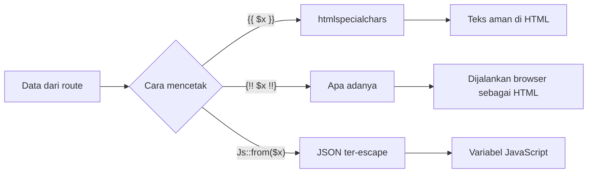

# Menampilkan Data

Hampir semua halaman web menampilkan data: nama pengguna, daftar produk, komentar. Data itu sering berasal dari pengguna, dan di situlah risiko terbesar muncul.
Sub bab ini membahas cara menampilkan variabel, array, dan objek dengan Blade, bagaimana *escaping* bekerja, kapan data mentah boleh dicetak, dan cara menyerahkan
data PHP ke JavaScript dengan aman.

## Tujuan Pembelajaran

Setelah menyelesaikan sub bab ini, kamu dapat:

- [ ] Menampilkan variabel, elemen array, dan properti objek di view.
- [ ] Menjelaskan apa yang dilakukan `htmlspecialchars` dan mengapa `{{ }}` mencegah XSS.
- [ ] Memberi nilai cadangan dengan operator `??` untuk data yang mungkin kosong.
- [ ] Menjelaskan *double encoding* dan cara menonaktifkannya.
- [ ] Menampilkan data mentah dengan `{!! !!}` secara bertanggung jawab.
- [ ] Menyerahkan array PHP ke JavaScript dengan `Js::from`.

## Prasyarat

- [Sintaks Blade](03-02-blade-syntax.md): `{{ }}`, `{!! !!}`, dan komentar.
- [Array](../level-00/00-13-arrays.md) dan [Class dan Objek](../level-00/00-19-classes-and-objects.md) pada PHP.
- Proyek `belajar-blade`.

## Pengantar

Bayangkan sebuah kolom komentar. Seorang pengunjung menulis `<script>` yang mencuri sesi pengguna lain. Jika aplikasi mencetak komentar itu apa adanya, skrip
tersebut berjalan di browser setiap orang yang membuka halaman. Ini disebut **XSS** (*cross-site scripting*). Cara menampilkan data yang benar adalah
membuat setiap data diperlakukan sebagai **teks**, bukan sebagai HTML, kecuali ada alasan kuat.

## Penjelasan Konsep

### Menampilkan variabel, array, dan objek

Semua bentuk berikut dicetak dengan `{{ }}`:

| Jenis data | Penulisan di view | Catatan |
|---|---|---|
| Variabel | `{{ $nama }}` | Kunci array `view()` menjadi variabel |
| Elemen array | `{{ $produk['nama'] }}` | Kunci string di dalam tanda kutip |
| Properti objek | `{{ $pengguna->nama }}` | Berlaku untuk objek, termasuk model Eloquent nanti |
| Hasil fungsi | `{{ strtoupper($nama) }}` | Ekspresi PHP apa pun |
| Hasil operasi | `{{ $harga * $jumlah }}` | Dihitung sebelum dicetak |

### Cara kerja *escaping*

Fungsi PHP `htmlspecialchars` mengubah karakter khusus HTML menjadi entitas, sehingga browser menampilkannya sebagai teks:

| Karakter | Menjadi |
|---|---|
| `<` | `&lt;` |
| `>` | `&gt;` |
| `&` | `&amp;` |
| `"` | `&quot;` |
| `'` | `&#039;` |

Menurut dokumentasi resmi, pernyataan `{{ }}` otomatis dilewatkan ke `htmlspecialchars`. Di luar Blade kamu dapat memanggil helper `e()` dengan hasil serupa.

### Nilai cadangan untuk data kosong

Variabel yang tidak dikirim akan menimbulkan error `Undefined variable`. Untuk data yang mungkin tidak ada, gunakan operator *null coalescing* `??`:

```html
<p>Halo, {{ $nama ?? 'Tamu' }}</p>
<p>Kota: {{ $profil['kota'] ?? 'Belum diisi' }}</p>
```

`??` memakai nilai kanan bila nilai kiri tidak ada atau bernilai `null`.

### *Double encoding*

Secara bawaan, Blade (dan helper `e`) meng-*encode* ulang entitas HTML yang sudah ada. Misalnya teks `&amp;` ditampilkan sebagai teks `&amp;`, bukan `&`. Bila
kamu ingin mematikan perilaku itu, dokumentasi menunjukkan pemanggilan `Blade::withoutDoubleEncoding()` di method `boot` pada `AppServiceProvider`:

File: `app/Providers/AppServiceProvider.php`

```php
<?php

namespace App\Providers;

use Illuminate\Support\Facades\Blade;
use Illuminate\Support\ServiceProvider;

class AppServiceProvider extends ServiceProvider
{
    public function boot(): void
    {
        Blade::withoutDoubleEncoding();
    }
}
```

Dalam latihan di sub bab ini kamu tidak perlu mengubah berkas itu. Pengaturan ini hanya dipakai bila kamu memang menyimpan teks yang sudah ter-*encode*.

### Data mentah: `{!! !!}`

`{!! $html !!}` tidak melakukan *escaping*. Dokumentasi menegaskan bahwa kamu sebaiknya memakai `{{ }}` untuk data yang berasal dari pengguna. Pakai bentuk mentah hanya bila:

- HTML dibuat oleh aplikasimu sendiri (mis. hasil render Markdown yang sudah dibersihkan), dan
- kamu paham dari mana tiap bagiannya berasal.

!!! danger "Aturan praktis"
    Jika sebagian dari isi variabel dapat diketik oleh pengguna, jangan cetak dengan `{!! !!}`.

### Menyerahkan data ke JavaScript

Cara naif adalah `var app = <?php echo json_encode($array); ?>;`. Dokumentasi menyarankan memakai `Illuminate\Support\Js::from`:

```html
<script>
    var app = {{ Illuminate\Support\Js::from($array) }};
</script>
```

Method `from` menerima argumen sama seperti `json_encode`, tetapi memastikan hasilnya aman untuk disisipkan di HTML. Ia mengembalikan pernyataan `JSON.parse(...)` yang
mengubah array atau objek menjadi objek JavaScript. Gunakan hanya untuk **variabel yang sudah ada**; dokumentasi mengingatkan bahwa ekspresi rumit sebagai argumen
dapat menyebabkan kegagalan tak terduga karena Blade berbasis *regular expression*.

### Blade dan kerangka JavaScript

Awalan `@` mencegah Blade menafsirkan `{{ }}`: `@{{ nama }}` dicetak sebagai `{{ nama }}`. Untuk blok besar gunakan `@verbatim` (lihat [Sintaks Blade](03-02-blade-syntax.md)).

### Keamanan

- Perlakukan semua data dari luar (form, URL, basis data) sebagai tidak tepercaya.
- `{{ }}` melindungi konteks HTML, tetapi tidak menggantikan validasi input yang dibahas pada bab utama keamanan.
- Jangan menaruh data rahasia (token pribadi, kata sandi) pada variabel yang dikirim ke JavaScript; semua isinya terlihat di sumber halaman.

## Cara Kerja



## Contoh Praktik

Kamu membuat halaman `/data` yang menampilkan sebuah produk dari array, seorang pengguna dari objek, sebuah komentar berbahaya, data dengan nilai cadangan, dan
data yang diserahkan ke JavaScript.

## Penjelasan Kode

File: `routes/web.php` (tambahkan)

```php-inline
Route::get('/data', function () {
    return view('data', [
        'produk' => ['nama' => 'Buku Laravel', 'harga' => 85000],
        'pengguna' => (object) ['nama' => 'Sari', 'kota' => null],
        'komentar' => '<script>alert("XSS")</script>Bagus sekali!',
        'tags' => ['php', 'laravel', 'blade'],
    ]);
});
```

| Data | Jenis | Fungsi |
|---|---|---|
| `produk` | Array asosiatif | Dicetak dengan `$produk['nama']` |
| `pengguna` | Objek (`(object)` mengubah array menjadi objek) | Dicetak dengan `$pengguna->nama`; `kota` bernilai `null` |
| `komentar` | String berisi tag `<script>` | Menguji *escaping* |
| `tags` | Array daftar | Diserahkan ke JavaScript |

File: `resources/views/data.blade.php`

```html
<!DOCTYPE html>
<html lang="id">
<head>
    <meta charset="UTF-8">
    <title>Menampilkan Data</title>
</head>
<body>
    <h1>{{ $produk['nama'] }}</h1>
    <p>Harga: Rp {{ number_format($produk['harga'], 0, ',', '.') }}</p>

    <p>Pengguna: {{ $pengguna->nama }}</p>
    <p>Kota: {{ $pengguna->kota ?? 'Belum diisi' }}</p>

    <p>Komentar aman: {{ $komentar }}</p>
    <p>Komentar mentah (BERBAHAYA): {!! $komentar !!}</p>

    <script>
        var tags = {{ Illuminate\Support\Js::from($tags) }};
        console.log(tags);
    </script>
</body>
</html>
```

| Bagian | Fungsi |
|---|---|
| `$produk['nama']` | Mengambil elemen array |
| `$pengguna->nama` | Mengambil properti objek |
| `$pengguna->kota ?? 'Belum diisi'` | Memakai cadangan karena nilainya `null` |
| `{{ $komentar }}` | Menampilkan komentar sebagai teks |
| `{!! $komentar !!}` | Sengaja dicetak mentah agar kamu melihat bahayanya |
| `Js::from($tags)` | Menyerahkan array ke JavaScript dengan aman |

!!! warning
    Baris `{!! $komentar !!}` hanya untuk percobaan. Hapus setelah kamu mengamati hasilnya.

## Implementasi Langkah demi Langkah

### Langkah 1: tambah route

Tambahkan route `/data` ke `routes/web.php`.

### Langkah 2: buat view

Buat `resources/views/data.blade.php` dengan isi di atas.

### Langkah 3: jalankan dan amati

```bash
php artisan serve
```

Buka `http://127.0.0.1:8000/data`. Buka juga konsol browser (F12) untuk melihat keluaran `console.log(tags)`.

### Langkah 4: bandingkan dua baris komentar

Lihat tampilan dan sumber halaman (Ctrl+U). Perhatikan baris "aman" dan baris "mentah".

### Langkah 5: hapus baris berbahaya

Hapus baris `{!! $komentar !!}`, muat ulang, dan pastikan tidak ada kotak peringatan.

### Langkah 6: catat di Git

```bash
git add routes/web.php resources/views/data.blade.php
git commit -m "Tambah halaman menampilkan data"
```

## Eksekusi dan Verifikasi

| Langkah | Cara memverifikasi |
|---|---|
| 1–2 | `php artisan route:list --path=data` menampilkan route `GET /data` |
| 3 | Status 200; judul `Buku Laravel`, harga `85.000` |
| 4 | Baris aman menampilkan tag sebagai teks; baris mentah menjalankan skrip |
| 5 | Tidak ada kotak peringatan setelah baris mentah dihapus |
| 6 | `git log --oneline` memuat commit baru |

## Hasil yang Diharapkan

| Bagian halaman | Tampilan |
|---|---|
| Judul | `Buku Laravel` |
| Harga | `Rp 85.000` |
| Pengguna / Kota | `Sari` / `Belum diisi` |
| Komentar aman | `<script>alert("XSS")</script>Bagus sekali!` sebagai teks |
| Komentar mentah | Kotak peringatan `XSS` muncul (skrip dijalankan) |
| Konsol browser | Array `["php", "laravel", "blade"]` |

Hasil ini diturunkan dari dokumentasi dan perilaku PHP/browser, dan belum dijalankan oleh penulis materi; cocokkan dengan hasilmu.

## Kesalahan Umum dan Pemecahan Masalah

| Gejala | Penyebab | Cara mengenali | Solusi | Pencegahan |
|---|---|---|---|---|
| `Undefined array key "nama"` | Kunci tidak ada di array | Pesan error menyebut kunci | Periksa ejaan kunci atau gunakan `??` | Cetak `$data` sementara untuk melihat isinya |
| `Attempt to read property "nama" on array` | Memakai `->` pada array | Pesan error | Gunakan `$a['nama']` | Cocokkan sintaks dengan jenis data |
| `Trying to access array offset on null` | Variabel bernilai `null` | Error pada baris cetak | Gunakan `??` atau periksa dengan `@isset` | Beri nilai cadangan untuk data opsional |
| Entitas HTML tampil ganda (`&amp;amp;`) | Data sudah ter-*encode* sebelum masuk Blade | Teks aneh di halaman | Simpan teks mentah; atau pertimbangkan `Blade::withoutDoubleEncoding()` | Jangan meng-*encode* manual sebelum `{{ }}` |
| Skrip tak terduga berjalan | Memakai `{!! !!}` pada data pengguna | Kotak peringatan atau perilaku aneh | Ganti ke `{{ }}` | Tinjau setiap pemakaian `{!! !!}` |
| `Js::from` menghasilkan error | Argumen berupa ekspresi rumit | Error kompilasi Blade | Simpan ke variabel di controller, lalu `Js::from($variabel)` | Hanya beri variabel sederhana |
| Konsol menampilkan `Unexpected token` | Memakai `{{ json_encode(...) }}` yang di-*escape* | Nilai penuh `&quot;` | Pakai `Js::from` | Jangan cetak JSON dengan `{{ }}` biasa |

## Latihan Praktik

### Latihan dasar

**D1. Tiga jenis data**
- *Masalah:* ingin menampilkan variabel, array, dan objek.
- *Persyaratan:* kirim `judul` (string), `buku` (array dengan `penulis`), dan `penerbit` (objek dengan `nama`), lalu tampilkan ketiganya.
- *Perilaku yang diharapkan:* ketiga nilai tampil benar.
- *Tujuan belajar:* memilih sintaks cetak sesuai jenis data.

**D2. Nilai cadangan**
- *Masalah:* sebagian profil tidak punya nomor telepon.
- *Persyaratan:* kirim `profil` tanpa kunci `telepon`, lalu tampilkan `Tidak ada` memakai `??`.
- *Perilaku yang diharapkan:* halaman tidak error dan menampilkan `Tidak ada`.
- *Tujuan belajar:* menangani data opsional.

### Latihan implementasi

**I1. Buku tamu aman**
- *Masalah:* halaman menampilkan tiga pesan pengunjung.
- *Persyaratan:* kirim array tiga pesan (satu berisi `<b>tebal</b>`), tampilkan tiap pesan dengan `{{ }}`, dan buktikan tag tampil sebagai teks. (Perulangan dibahas di sub bab Loop Directives; sementara cetak ketiganya secara berurutan dengan indeks.)
- *Perilaku yang diharapkan:* tidak ada teks yang menjadi huruf tebal.
- *Tujuan belajar:* memastikan data pengguna ter-*escape*.

**I2. Data ke JavaScript**
- *Masalah:* ingin menampilkan daftar kota di konsol browser.
- *Persyaratan:* kirim array `kota` dan serahkan ke JavaScript memakai `Js::from`; tampilkan dengan `console.log`.
- *Perilaku yang diharapkan:* array tercetak di konsol.
- *Tujuan belajar:* menyerahkan data dengan aman.

### Latihan tantangan

**T1. Review kode berisiko**
- *Masalah:* seorang rekan menulis `<p>{!! $request->nama !!}</p>` dan `var d = <?php echo json_encode($data); ?>;`.
- *Persyaratan:* jelaskan risiko tiap baris, tulis versi aman, dan tunjukkan satu nilai masukan yang membuktikan bahayanya.
- *Perilaku yang diharapkan:* versi aman memakai `{{ }}` dan `Js::from`.
- *Tujuan belajar:* menilai kode secara kritis.
- *Catatan:* kerjakan mandiri; tidak ada kunci jawaban.

## Uji Pemahaman

1. Apa yang dilakukan `htmlspecialchars`?
2. Apa tiga cara mengakses data pada array, objek, dan variabel di Blade?
3. Apa fungsi operator `??` di view?
4. Apa itu *double encoding* dan bagaimana mematikannya?
5. Kapan `{!! !!}` boleh dipakai?
6. Mengapa `Js::from` lebih baik daripada `json_encode` langsung?
7. Apa risiko menaruh data rahasia pada variabel JavaScript?
8. Apa fungsi `@{{ }}`?

??? success "Kunci jawaban singkat"
    1. Mengubah karakter khusus HTML menjadi entitas sehingga tampil sebagai teks.
    2. `$variabel`, `$array['kunci']`, `$objek->properti`.
    3. Memberi nilai cadangan bila nilai kiri tidak ada atau `null`.
    4. Entitas yang sudah ada di-*encode* lagi; matikan dengan `Blade::withoutDoubleEncoding()` di `AppServiceProvider::boot`.
    5. Hanya untuk HTML yang dibuat dan dibersihkan aplikasi sendiri, bukan input pengguna.
    6. `Js::from` memastikan JSON aman untuk HTML.
    7. Seluruh isinya terlihat di sumber halaman oleh siapa pun.
    8. Mencegah Blade memproses ekspresi agar dapat dirender oleh JavaScript.

## Ringkasan

- `{{ }}` mencetak data sebagai teks aman; sintaks cetak berbeda untuk variabel, array, dan objek.
- Gunakan `??` untuk data opsional.
- `{!! !!}` hanya untuk HTML tepercaya; jangan pakai untuk input pengguna.
- Serahkan data ke JavaScript dengan `Illuminate\Support\Js::from`.
- Data yang dikirim ke browser selalu dapat dilihat pengguna.

Selanjutnya: *Direktif Kondisional*, yaitu menampilkan bagian halaman berdasarkan kondisi.

## Referensi Resmi

- [Laravel: Displaying Data](https://laravel.com/docs/13.x/blade#displaying-data)
- [Laravel: HTML Entity Encoding](https://laravel.com/docs/13.x/blade#html-entity-encoding)
- [Laravel: Rendering JSON](https://laravel.com/docs/13.x/blade#rendering-json)
- [PHP: htmlspecialchars](https://www.php.net/manual/en/function.htmlspecialchars.php)
