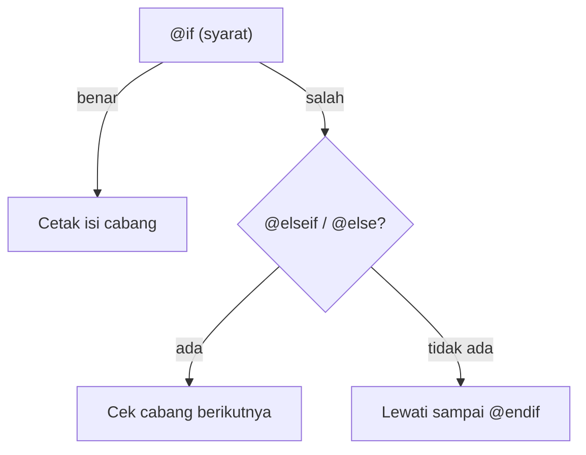

# Direktif Kondisional

Halaman yang baik menyesuaikan diri dengan data: pesan "stok habis" hanya muncul saat stok kosong, tombol tertentu hanya tampil untuk admin, dan warna lencana berubah
menurut status. Di PHP native kamu menulis `<?php if (...): ?>`. Blade menyediakan direktif yang lebih bersih. Sub bab ini membahas `@if`, `@unless`, `@isset`,
`@empty`, `@switch`, direktif lingkungan, serta `@class` dan `@style` untuk atribut bersyarat.

## Tujuan Pembelajaran

Setelah menyelesaikan sub bab ini, kamu dapat:

- [ ] Menulis percabangan dengan `@if`, `@elseif`, `@else`, dan `@endif`.
- [ ] Memakai `@unless`, `@isset`, dan `@empty` pada kasus yang sesuai.
- [ ] Memakai `@switch` untuk banyak kemungkinan nilai.
- [ ] Menjelaskan `@auth`, `@guest`, `@production`, dan `@env`.
- [ ] Menambah kelas dan gaya CSS secara bersyarat dengan `@class` dan `@style`.
- [ ] Menghindari logika bisnis yang berat di view.

## Prasyarat

- [Sintaks Blade](03-02-blade-syntax.md) dan [Menampilkan Data](03-03-displaying-data.md).
- [Pernyataan Kondisional](../level-00/00-11-conditional-statements.md) pada PHP, termasuk operator perbandingan dan logika.
- Proyek `belajar-blade`.

## Pengantar

Tanpa percabangan, view hanya bisa menampilkan hal yang sama untuk semua kondisi. Dengan percabangan, satu view dapat melayani banyak keadaan data. Direktif Blade
bekerja identik dengan padanannya di PHP, hanya penulisannya lebih rapi: tidak perlu `<?php`, tanda kurung kurawal, atau titik dua.

## Penjelasan Konsep

### `@if`, `@elseif`, `@else`

```html
@if ($stok > 10)
    <p>Stok aman</p>
@elseif ($stok > 0)
    <p>Stok menipis</p>
@else
    <p>Stok habis</p>
@endif
```

Syarat ditulis dalam tanda kurung seperti PHP. Setiap `@if` harus ditutup `@endif`.

### `@unless`

`@unless` menampilkan isinya bila syarat **salah**; padanan dari `@if (! ...)`:

```html
@unless ($sudahMasuk)
    <p>Kamu belum masuk.</p>
@endunless
```

### `@isset` dan `@empty`

| Direktif | Padanan PHP | Benar bila |
|---|---|---|
| `@isset($x)` | `isset($x)` | `$x` ada dan bukan `null` |
| `@empty($x)` | `empty($x)` | `$x` kosong: `null`, `''`, `0`, `[]`, dan sejenisnya |

```html
@isset($catatan)
    <p>Catatan: {{ $catatan }}</p>
@endisset

@empty($daftar)
    <p>Daftar masih kosong.</p>
@endempty
```

### `@switch`

Berguna bila satu nilai menentukan beberapa cabang:

```html
@switch($status)
    @case('baru')
        <span>Baru</span>
        @break
    @case('dikirim')
        <span>Dikirim</span>
        @break
    @default
        <span>Tidak diketahui</span>
@endswitch
```

Setiap `@case` biasanya diakhiri `@break`, seperti `switch` di PHP.

### Direktif otentikasi dan lingkungan

| Direktif | Fungsi |
|---|---|
| `@auth` ... `@endauth` | Isi tampil bila pengguna sudah terotentikasi |
| `@guest` ... `@endguest` | Isi tampil bila pengguna belum masuk |
| `@production` ... `@endproduction` | Isi tampil hanya di lingkungan *production* |
| `@env('staging')` ... `@endenv` | Isi tampil di lingkungan bernama tertentu; boleh array, mis. `@env(['staging', 'production'])` |

Otentikasi baru dibahas pada bab utama keamanan, jadi `@auth` dan `@guest` di sini hanya dikenalkan. Lingkungan ditentukan oleh `APP_ENV` di berkas `.env`.

### Kelas dan gaya bersyarat: `@class` dan `@style`

`@class` menerima array. **Kunci** adalah kelas, **nilai** adalah syarat boolean. Elemen dengan kunci angka selalu disertakan:

```html
@php
    $aktif = false;
    $galat = true;
@endphp

<span @class([
    'lencana',
    'tebal' => $aktif,
    'abu' => ! $aktif,
    'merah' => $galat,
])></span>
```

Hasil: `<span class="lencana abu merah"></span>`. `@style` bekerja sama untuk gaya inline:

```html
<span @style([
    'background-color: red',
    'font-weight: bold' => $aktif,
])></span>
```

### Logika di view: seberapa jauh?

| Cocok di view | Sebaiknya di controller |
|---|---|
| Menampilkan/menyembunyikan bagian halaman | Menghitung diskon, pajak, atau status bisnis |
| Memilih kelas CSS menurut status | Query atau penyaringan data |
| Pesan kosong ("belum ada data") | Aturan akses yang rumit |

Keputusan bisnis ditentukan sebelum view, lalu view cukup menampilkan hasilnya (mis. `$stokHabis = true`).

### Keamanan

- Menyembunyikan tombol di view **bukan** kontrol akses. Pengguna tetap bisa mengirim request ke route; otorisasi harus dicek di sisi server (dibahas pada bab keamanan).
- Jangan menaruh data rahasia di dalam cabang yang "hanya disembunyikan"; HTML yang dikirim tetap dilihat browser bila cabang itu terpenuhi.

## Cara Kerja



Blade mengompilasi direktif ini menjadi `if`, `elseif`, dan `else` PHP biasa.

## Contoh Praktik

Kamu membuat halaman `/stok` yang menampilkan tiga produk dengan status stok, label status pesanan, dan lencana berkelas bersyarat.

## Penjelasan Kode

File: `routes/web.php` (tambahkan)

```php-inline
Route::get('/stok', function () {
    return view('stok', [
        'produk' => [
            ['nama' => 'Buku PHP', 'stok' => 25, 'status' => 'dikirim'],
            ['nama' => 'Buku Laravel', 'stok' => 3, 'status' => 'baru'],
            ['nama' => 'Buku Blade', 'stok' => 0, 'status' => 'batal'],
        ],
        'catatan' => null,
    ]);
});
```

File: `resources/views/stok.blade.php`

```html
<!DOCTYPE html>
<html lang="id">
<head>
    <meta charset="UTF-8">
    <title>Stok Produk</title>
    <style>
        .lencana { padding: 2px 8px; border-radius: 4px; }
        .hijau { background: #c8f7c5; }
        .kuning { background: #fff3b0; }
        .merah { background: #f7c5c5; }
    </style>
</head>
<body>
    <h1>Stok Produk</h1>

    @isset($catatan)
        <p>Catatan: {{ $catatan }}</p>
    @endisset

    @empty($produk)
        <p>Belum ada produk.</p>
    @endempty

    <h2>{{ $produk[0]['nama'] }}</h2>
    @if ($produk[0]['stok'] > 10)
        <p>Stok aman</p>
    @elseif ($produk[0]['stok'] > 0)
        <p>Stok menipis</p>
    @else
        <p>Stok habis</p>
    @endif

    <h2>{{ $produk[1]['nama'] }}</h2>
    <span @class([
        'lencana',
        'hijau' => $produk[1]['stok'] > 10,
        'kuning' => $produk[1]['stok'] > 0 && $produk[1]['stok'] <= 10,
        'merah' => $produk[1]['stok'] === 0,
    ])>Sisa {{ $produk[1]['stok'] }}</span>

    <h2>{{ $produk[2]['nama'] }}</h2>
    @switch($produk[2]['status'])
        @case('baru')
            <span>Pesanan baru</span>
            @break
        @case('dikirim')
            <span>Sedang dikirim</span>
            @break
        @default
            <span>Pesanan dibatalkan</span>
    @endswitch

    @unless ($produk[2]['stok'] > 0)
        <p>Produk ini tidak bisa dipesan.</p>
    @endunless

    @production
        <p>Mode production</p>
    @endproduction
</body>
</html>
```

| Bagian | Fungsi |
|---|---|
| `@isset($catatan)` | Melewati isi karena `$catatan` bernilai `null` |
| `@empty($produk)` | Melewati isi karena array tidak kosong |
| `@if / @elseif / @else` | Memilih pesan menurut stok produk pertama (25) |
| `@class([...])` | Menghasilkan `class="lencana kuning"` untuk stok 3 |
| `@switch` | Menampilkan label menurut `status` produk ketiga |
| `@unless` | Tampil karena stok produk ketiga 0 |
| `@production` | Tidak tampil di lingkungan lokal (`APP_ENV=local`) |

Mengakses `$produk[0]`, `[1]`, dan `[2]` secara manual hanya untuk memisahkan latihan; sub bab berikutnya menyederhanakannya dengan perulangan.

## Implementasi Langkah demi Langkah

### Langkah 1: tambah route dan view

Tambahkan route `/stok` dan buat `resources/views/stok.blade.php`.

### Langkah 2: jalankan

```bash
php artisan serve
```

Buka `http://127.0.0.1:8000/stok`.

### Langkah 3: ubah data dan amati

Ubah `stok` produk pertama menjadi `5`, lalu `0`, muat ulang, dan lihat pesan berubah. Ubah `catatan` menjadi `'Promo akhir bulan'` dan lihat paragraf catatan muncul.

### Langkah 4: periksa kelas hasil `@class`

```bash
curl -s http://127.0.0.1:8000/stok | grep lencana
```

Di PowerShell gunakan `curl.exe` dan `Select-String lencana`.

### Langkah 5: catat di Git

```bash
git add routes/web.php resources/views/stok.blade.php
git commit -m "Tambah halaman stok dengan direktif kondisional"
```

## Eksekusi dan Verifikasi

| Langkah | Cara memverifikasi |
|---|---|
| 1 | `route:list --path=stok` menampilkan route `GET /stok` |
| 2 | Status 200 |
| 3 | Pesan stok berubah sesuai nilai |
| 4 | Ada `class="lencana kuning"` pada sumber HTML |
| 5 | Commit tercatat |

## Hasil yang Diharapkan

| Bagian | Dengan data awal |
|---|---|
| Catatan | Tidak tampil (`null`) |
| Buku PHP | `Stok aman` |
| Buku Laravel | Lencana `class="lencana kuning"` berisi `Sisa 3` |
| Buku Blade | `Pesanan dibatalkan` dan `Produk ini tidak bisa dipesan.` |
| `@production` | Tidak tampil bila `APP_ENV=local` |

Hasil ini diturunkan dari dokumentasi dan perilaku Blade, dan belum dijalankan oleh penulis materi; cocokkan dengan hasilmu.

## Kesalahan Umum dan Pemecahan Masalah

| Gejala | Penyebab | Cara mengenali | Solusi | Pencegahan |
|---|---|---|---|---|
| Halaman error `Unexpected end of file` | `@endif` atau `@endswitch` hilang | Error kompilasi menunjuk akhir berkas | Tutup setiap direktif berpasangan | Tulis penutup segera setelah pembuka |
| `@isset` tak berefek pada nilai `null` | `@isset` salah paham: `null` dianggap tidak ada | Isi cabang tidak tampil | Gunakan `@if (is_null($x))` bila perlu membedakan | Pahami `isset` vs `empty` |
| `@empty` menganggap `0` kosong | `empty(0)` bernilai benar | Angka 0 dianggap kosong | Bandingkan eksplisit: `@if ($x === 0)` | Ingat daftar nilai "kosong" PHP |
| `@case` terjalankan beruntun | Lupa `@break` | Beberapa label tampil | Tambah `@break` | Tulis `@break` otomatis di tiap `@case` |
| Kelas tidak muncul pada `@class` | Kunci/nilai terbalik | Atribut `class` kosong | Kunci = kelas, nilai = syarat | Ikuti pola di dokumentasi |
| `Undefined variable $produk` | Data tidak dikirim | Error pada baris cetak | Kirim `produk` pada `view()` | Cocokkan nama |
| Tombol admin "hilang" tetapi masih bisa diakses | Mengandalkan `@if` sebagai keamanan | Request langsung masih berhasil | Cek otorisasi di server | Anggap view hanya tampilan |

## Latihan Praktik

### Latihan dasar

**D1. Nilai ujian**
- *Masalah:* tampilkan predikat nilai.
- *Persyaratan:* kirim `nilai`; `@if` menampilkan `A` (≥ 85), `B` (≥ 70), `C` (≥ 55), selain itu `D`.
- *Perilaku yang diharapkan:* predikat berubah menurut nilai.
- *Tujuan belajar:* percabangan bertingkat.

**D2. Sapaan tamu**
- *Masalah:* tamu belum punya nama.
- *Persyaratan:* gunakan `@isset($nama)` untuk menyapa `Halo, {{ $nama }}`, atau `Halo, Tamu` bila tidak ada.
- *Perilaku yang diharapkan:* kedua kondisi teruji dengan mengirim/tidak mengirim `nama`.
- *Tujuan belajar:* memakai `@isset`.

### Latihan implementasi

**I1. Status pesanan**
- *Masalah:* pesanan punya status `baru`, `diproses`, `dikirim`, `selesai`, atau `batal`.
- *Persyaratan:* gunakan `@switch` untuk menampilkan label Indonesia dan `@class` untuk warna lencana per status; sediakan `@default` untuk status tak dikenal.
- *Perilaku yang diharapkan:* lima status menghasilkan lima tampilan, status lain menghasilkan "Tidak diketahui".
- *Tujuan belajar:* menggabungkan `@switch` dan `@class`.

**I2. Pesan kosong**
- *Masalah:* daftar kosong tampak janggal.
- *Persyaratan:* kirim `tugas` berupa array kosong dan tampilkan pesan "Belum ada tugas" dengan `@empty`.
- *Perilaku yang diharapkan:* pesan tampil bila array kosong.
- *Tujuan belajar:* menangani keadaan kosong.

### Latihan tantangan

**T1. Pindahkan logika ke controller**
- *Masalah:* sebuah view menghitung diskon berlapis dengan banyak `@if`.
- *Persyaratan:* buat contoh view seperti itu, lalu refaktor: hitung `diskon` di route/controller dan view hanya menampilkan hasil. Jelaskan keuntungan pemisahannya.
- *Perilaku yang diharapkan:* view lebih pendek dan hasil tidak berubah.
- *Tujuan belajar:* menjaga view tetap sederhana.
- *Catatan:* kerjakan mandiri; tidak ada kunci jawaban.

## Uji Pemahaman

1. Apa padanan PHP dari `@unless`?
2. Apa beda `@isset` dan `@empty`?
3. Mengapa `@break` penting dalam `@switch`?
4. Bagaimana `@class` memutuskan kelas yang dipakai?
5. Apa gunanya `@production` dan dari mana lingkungan ditentukan?
6. Mengapa `@auth` bukan pengganti otorisasi di server?
7. Logika apa yang sebaiknya tidak ada di view?

??? success "Kunci jawaban singkat"
    1. `if (! ...)`.
    2. `@isset`: ada dan bukan `null`; `@empty`: kosong menurut aturan PHP (`null`, `''`, `0`, `[]`, dan lainnya).
    3. Tanpa `@break`, eksekusi berlanjut ke `@case` berikutnya.
    4. Kunci = nama kelas, nilai = syarat; kunci angka selalu disertakan.
    5. Menampilkan isi hanya di lingkungan production; ditentukan oleh `APP_ENV` di `.env`.
    6. Menyembunyikan tampilan tidak mencegah request langsung; server harus memeriksa hak akses.
    7. Perhitungan bisnis, query, dan aturan akses rumit.

## Ringkasan

- `@if`/`@elseif`/`@else`, `@unless`, `@isset`, `@empty`, dan `@switch` setara struktur PHP dengan penulisan lebih rapi.
- `@auth`, `@guest`, `@production`, dan `@env` memeriksa pengguna dan lingkungan.
- `@class` dan `@style` menambah kelas dan gaya CSS secara bersyarat.
- Keputusan bisnis dibuat sebelum view; view hanya menampilkan hasil.
- Menyembunyikan elemen bukan kontrol keamanan.

Selanjutnya: *Direktif Perulangan*, yaitu mengulang tampilan untuk banyak data.

## Referensi Resmi

- [Laravel: Blade Directives](https://laravel.com/docs/13.x/blade#blade-directives)
- [Laravel: If Statements](https://laravel.com/docs/13.x/blade#if-statements)
- [Laravel: Switch Statements](https://laravel.com/docs/13.x/blade#switch-statements)
- [Laravel: Conditional Classes & Styles](https://laravel.com/docs/13.x/blade#conditional-classes)
