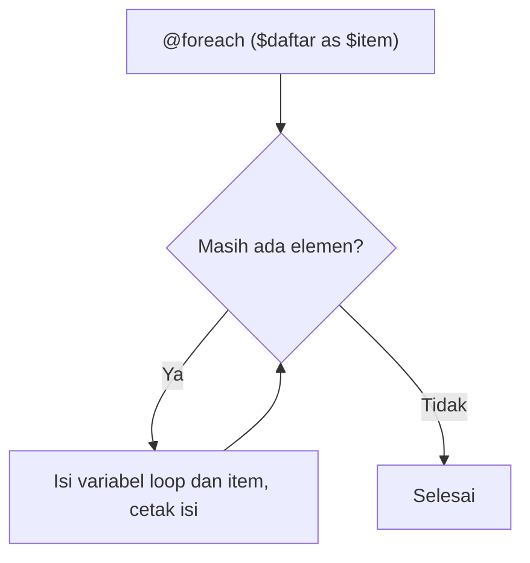

# Direktif Perulangan

Hampir semua halaman memuat daftar: produk, artikel, pesanan. Daftar itu harus dibuat dari data, bukan ditulis tangan satu per satu. Blade menyediakan direktif
perulangan yang setara dengan `for`, `foreach`, dan `while` pada PHP, ditambah `@forelse` dan variabel `$loop`. Sub bab ini mengajarkan cara memakainya untuk
menampilkan daftar dan tabel.

## Tujuan Pembelajaran

Setelah menyelesaikan sub bab ini, kamu dapat:

- [ ] Menampilkan daftar dengan `@foreach`.
- [ ] Menangani daftar kosong dengan `@forelse` dan `@empty`.
- [ ] Memakai `@for` dan `@while` pada kasus yang sesuai.
- [ ] Memakai `@continue` dan `@break` untuk mengontrol perulangan.
- [ ] Membaca informasi iterasi lewat variabel `$loop`.
- [ ] Membuat tabel dengan baris belang dan penomoran.

## Prasyarat

- [Menampilkan Data](03-03-displaying-data.md) dan [Direktif Kondisional](03-04-conditional-directives.md).
- [Perulangan](../level-00/00-12-loops.md) dan [Array](../level-00/00-13-arrays.md) pada PHP.
- Proyek `belajar-blade`.

## Pengantar

Bayangkan menulis `<li>` untuk seratus produk satu per satu. Setiap kali data berubah, kamu harus mengedit HTML. Dengan perulangan, kamu menulis **satu**
templat baris, dan Blade mengulangnya untuk setiap elemen data.

## Penjelasan Konsep

### `@foreach`

```html
<ul>
    @foreach ($buah as $item)
        <li>{{ $item }}</li>
    @endforeach
</ul>
```

Pada array asosiatif, ambil juga kuncinya:

```html
@foreach ($harga as $nama => $nilai)
    <p>{{ $nama }}: {{ $nilai }}</p>
@endforeach
```

### `@forelse`

`@forelse` adalah `@foreach` dengan cabang untuk data kosong:

```html
@forelse ($tugas as $item)
    <li>{{ $item }}</li>
@empty
    <li>Belum ada tugas.</li>
@endforelse
```

### `@for` dan `@while`

| Direktif | Kapan dipakai | Contoh |
|---|---|---|
| `@for` | Jumlah ulangan diketahui | `@for ($i = 1; $i <= 5; $i++)` |
| `@while` | Selama syarat benar | `@while ($x < 3)` |

`@for` cocok misalnya untuk nomor halaman. `@while` jarang dipakai di view; pastikan syaratnya akhirnya menjadi salah agar tidak berputar tanpa henti.

### `@continue` dan `@break`

```html
@foreach ($produk as $p)
    @continue($p['stok'] === 0)
    <li>{{ $p['nama'] }}</li>
    @break($loop->iteration === 3)
@endforeach
```

`@continue` melewati iterasi saat ini; `@break` menghentikan perulangan. Syaratnya boleh ditulis di dalam tanda kurung direktif.

### Variabel `$loop`

Di dalam `@foreach` tersedia variabel `$loop`:

| Properti | Arti |
|---|---|
| `$loop->index` | Indeks iterasi (mulai dari 0) |
| `$loop->iteration` | Iterasi ke berapa (mulai dari 1) |
| `$loop->remaining` | Sisa iterasi |
| `$loop->count` | Total elemen |
| `$loop->first` / `$loop->last` | Apakah iterasi pertama / terakhir |
| `$loop->even` / `$loop->odd` | Apakah iterasi genap / ganjil |
| `$loop->depth` | Kedalaman perulangan bersarang |
| `$loop->parent` | `$loop` milik perulangan induk |

Contoh umum: nomor urut, baris belang, dan pemisah koma:

```html
@foreach ($tags as $tag)
    {{ $tag }}@if (! $loop->last), @endif
@endforeach
```

Pada perulangan bersarang, `$loop->parent` mengakses `$loop` induknya.

### Menggabungkan dengan `@class`

```html
<tr @class(['belang' => $loop->even])>
```

Baris genap mendapat kelas `belang`.

### Performa dan batas

- Perulangan di view menampilkan data yang **sudah** disiapkan. Jangan menjalankan query di dalam perulangan (masalah N+1 dibahas pada bab utama basis data).
- Data besar sebaiknya dipaginasi, bukan ditampilkan seluruhnya.

### Keamanan

Setiap elemen yang dicetak di perulangan tetap harus memakai `{{ }}`. Satu elemen berisi HTML berbahaya cukup untuk membuka celah XSS.

## Cara Kerja



Blade mengompilasi `@foreach` menjadi `foreach` PHP dan mengelola `$loop` untuk kamu.

## Contoh Praktik

Kamu membuat halaman `/katalog` berisi tabel produk dengan nomor urut, baris belang, pesan stok, dan daftar tag; plus halaman kosong untuk menguji `@forelse`.

## Penjelasan Kode

File: `routes/web.php` (tambahkan)

```php-inline
Route::get('/katalog', function () {
    return view('katalog', [
        'produk' => [
            ['nama' => 'Buku PHP', 'harga' => 65000, 'stok' => 25],
            ['nama' => 'Buku Laravel', 'harga' => 85000, 'stok' => 3],
            ['nama' => 'Buku Blade', 'harga' => 45000, 'stok' => 0],
            ['nama' => 'Buku MySQL', 'harga' => 70000, 'stok' => 12],
        ],
        'tags' => ['php', 'laravel', 'blade'],
    ]);
});

Route::get('/katalog-kosong', function () {
    return view('katalog', ['produk' => [], 'tags' => []]);
});
```

File: `resources/views/katalog.blade.php`

```html
<!DOCTYPE html>
<html lang="id">
<head>
    <meta charset="UTF-8">
    <title>Katalog</title>
    <style>
        table { border-collapse: collapse; }
        td, th { border: 1px solid #ccc; padding: 4px 8px; }
        .belang { background: #f2f2f2; }
    </style>
</head>
<body>
    <h1>Katalog Produk</h1>

    <table>
        <thead>
            <tr><th>No</th><th>Nama</th><th>Harga</th><th>Stok</th></tr>
        </thead>
        <tbody>
            @forelse ($produk as $p)
                <tr @class(['belang' => $loop->even])>
                    <td>{{ $loop->iteration }}</td>
                    <td>{{ $p['nama'] }}</td>
                    <td>{{ number_format($p['harga'], 0, ',', '.') }}</td>
                    <td>
                        @if ($p['stok'] === 0)
                            Habis
                        @else
                            {{ $p['stok'] }}
                        @endif
                    </td>
                </tr>
            @empty
                <tr><td colspan="4">Belum ada produk.</td></tr>
            @endforelse
        </tbody>
    </table>

    <p>
        Tag:
        @foreach ($tags as $tag)
            {{ $tag }}@if (! $loop->last), @endif
        @endforeach
    </p>

    <h2>Hanya produk tersedia (maksimal 2)</h2>
    <ul>
        @foreach ($produk as $p)
            @continue($p['stok'] === 0)
            <li>{{ $p['nama'] }}</li>
            @break($loop->iteration === 2)
        @endforeach
    </ul>

    <p>
        Nomor halaman:
        @for ($i = 1; $i <= 3; $i++)
            [{{ $i }}]
        @endfor
    </p>
</body>
</html>
```

| Bagian | Fungsi |
|---|---|
| `@forelse ... @empty` | Menampilkan baris produk, atau satu baris pesan bila kosong |
| `$loop->iteration` | Nomor urut mulai dari 1 |
| `@class(['belang' => $loop->even])` | Memberi kelas pada baris genap |
| `@if ($p['stok'] === 0)` | Menampilkan `Habis` untuk stok nol |
| `@if (! $loop->last), @endif` | Menambah koma kecuali setelah elemen terakhir |
| `@continue` dan `@break` | Melewati produk habis dan berhenti setelah iterasi kedua |
| `@for` | Menulis nomor halaman 1 sampai 3 |

## Implementasi Langkah demi Langkah

### Langkah 1: tambah route dan view

Tambahkan dua route dan buat `resources/views/katalog.blade.php`.

### Langkah 2: jalankan

```bash
php artisan serve
```

Buka `http://127.0.0.1:8000/katalog` dan `http://127.0.0.1:8000/katalog-kosong`.

### Langkah 3: ubah data

Tambah satu produk ke array, muat ulang, dan lihat nomor serta baris belang menyesuaikan tanpa mengubah view.

### Langkah 4: uji `@break`

Ubah `$loop->iteration === 2` menjadi `=== 3` dan amati daftar tersedia berubah.

### Langkah 5: catat di Git

```bash
git add routes/web.php resources/views/katalog.blade.php
git commit -m "Tambah halaman katalog dengan direktif perulangan"
```

## Eksekusi dan Verifikasi

| Langkah | Cara memverifikasi |
|---|---|
| 1 | `route:list --path=katalog` menampilkan dua route |
| 2 | Tabel memuat empat baris di `/katalog` dan satu baris pesan di `/katalog-kosong` |
| 3 | Penambahan data muncul tanpa mengubah view |
| 4 | Daftar tersedia berubah |
| 5 | Commit tercatat |

## Hasil yang Diharapkan

| Bagian | `/katalog` |
|---|---|
| Tabel | Empat baris bernomor 1–4; baris 2 dan 4 berkelas `belang`; stok Buku Blade tampil `Habis` |
| Tag | `php, laravel, blade` (tanpa koma di belakang) |
| Daftar tersedia | `Buku PHP` dan `Buku Laravel` (berhenti pada iterasi kedua) |
| Nomor halaman | `[1] [2] [3]` |

Pada `/katalog-kosong` tabel berisi satu baris `Belum ada produk.` Hasil ini diturunkan dari dokumentasi dan perilaku Blade, dan belum dijalankan oleh penulis
materi; cocokkan dengan hasilmu.

## Kesalahan Umum dan Pemecahan Masalah

| Gejala | Penyebab | Cara mengenali | Solusi | Pencegahan |
|---|---|---|---|---|
| `foreach() argument must be of type array atau object` | Variabel bukan array/koleksi | Error menyebut tipe `null` | Pastikan data dikirim dan berupa array | Beri nilai awal `[]` di controller |
| Halaman membeku/timeout | `@while` tanpa akhir | Browser berputar terus | Pastikan variabel syarat berubah | Hindari `@while` bila `@foreach` cukup |
| `$loop` tidak ditemukan | Dipakai di luar `@foreach`/`@forelse` | `Undefined variable $loop` | Pindahkan ke dalam perulangan | Ingat cakupan `$loop` |
| Koma menggantung di akhir daftar | Tidak memakai `$loop->last` | Teks berakhir dengan koma | Tambah `@if (! $loop->last)` | Gunakan `implode` di controller bila lebih sederhana |
| `@continue` tidak berfungsi | Salah ketik atau di luar perulangan | Error kompilasi | Letakkan di dalam `@foreach` | Periksa penutup |
| Baris belang tidak berubah | Memakai `$loop->index` dengan syarat salah | Semua baris sama | Pakai `$loop->even` atau `$loop->odd` | Uji dengan minimal 3 data |
| Halaman lambat dengan data banyak | Menampilkan semuanya, atau query dalam perulangan | Waktu muat membengkak | Gunakan paginasi dan ambil data di controller | Hindari query di view |

## Latihan Praktik

### Latihan dasar

**D1. Daftar nama**
- *Masalah:* tampilkan daftar siswa.
- *Persyaratan:* kirim array lima nama dan tampilkan dalam `<ol>` dengan `@foreach`.
- *Perilaku yang diharapkan:* lima item bernomor.
- *Tujuan belajar:* perulangan dasar.

**D2. Daftar kosong**
- *Masalah:* daftar tugas mungkin kosong.
- *Persyaratan:* gunakan `@forelse` dengan pesan "Tidak ada tugas" dan uji dengan array kosong dan terisi.
- *Perilaku yang diharapkan:* kedua keadaan tampil benar.
- *Tujuan belajar:* memakai `@forelse`.

### Latihan implementasi

**I1. Tabel nilai**
- *Masalah:* guru ingin tabel nilai siswa.
- *Persyaratan:* tampilkan nomor, nama, nilai, dan predikat (gunakan `@if`) dalam tabel dengan baris belang.
- *Perilaku yang diharapkan:* tabel benar untuk minimal lima siswa.
- *Tujuan belajar:* menggabungkan perulangan, kondisi, dan `$loop`.

**I2. Tabel perkalian**
- *Masalah:* ingin tabel perkalian 1–5.
- *Persyaratan:* gunakan dua `@for` bersarang dan tampilkan hasil `i x j`.
- *Perilaku yang diharapkan:* 25 sel terisi benar.
- *Tujuan belajar:* perulangan bersarang.

### Latihan tantangan

**T1. Kategori dan produk**
- *Masalah:* katalog dikelompokkan per kategori.
- *Persyaratan:* kirim array kategori berisi array produk; tampilkan dengan `@foreach` bersarang, beri nomor global dengan `$loop->parent`, dan tandai kategori kosong dengan `@forelse`.
- *Perilaku yang diharapkan:* struktur kategori → produk tampil benar.
- *Tujuan belajar:* perulangan bersarang dan `$loop->parent`.
- *Catatan:* kerjakan mandiri; tidak ada kunci jawaban.

## Uji Pemahaman

1. Apa beda `@foreach` dan `@forelse`?
2. Kapan `@for` lebih cocok daripada `@foreach`?
3. Apa beda `$loop->index` dan `$loop->iteration`?
4. Bagaimana menghindari koma di akhir daftar?
5. Apa fungsi `$loop->parent`?
6. Mengapa query tidak boleh dijalankan di dalam perulangan view?
7. Apa risiko `@while`?

??? success "Kunci jawaban singkat"
    1. `@forelse` menyediakan cabang `@empty` untuk data kosong.
    2. Saat jumlah ulangan berupa angka tetap, bukan elemen data.
    3. `index` mulai dari 0; `iteration` mulai dari 1.
    4. `@if (! $loop->last), @endif`.
    5. Mengakses variabel `$loop` perulangan induk pada perulangan bersarang.
    6. Query berulang memperlambat halaman (masalah N+1); ambil data di controller.
    7. Bila syarat tak pernah salah, perulangan tidak berhenti.

## Ringkasan

- `@foreach` mengulang elemen; `@forelse` menambah cabang untuk data kosong.
- `@for` dan `@while` setara padanan PHP; `@while` perlu hati-hati.
- `@continue` dan `@break` mengontrol alur perulangan.
- `$loop` memberi nomor, pertama/terakhir, genap/ganjil, dan induk perulangan.
- Tetap cetak elemen dengan `{{ }}` dan jangan jalankan query di perulangan view.

Selanjutnya: *Layout Blade*, yaitu satu kerangka halaman yang dipakai banyak view.

## Referensi Resmi

- [Laravel: Loops](https://laravel.com/docs/13.x/blade#loops)
- [Laravel: The Loop Variable](https://laravel.com/docs/13.x/blade#the-loop-variable)
- [PHP: Control Structures](https://www.php.net/manual/en/language.control-structures.php)
