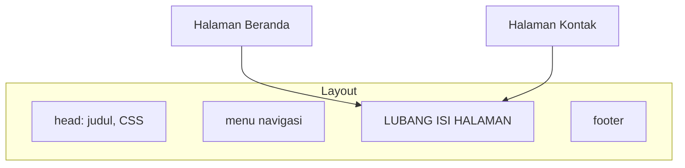
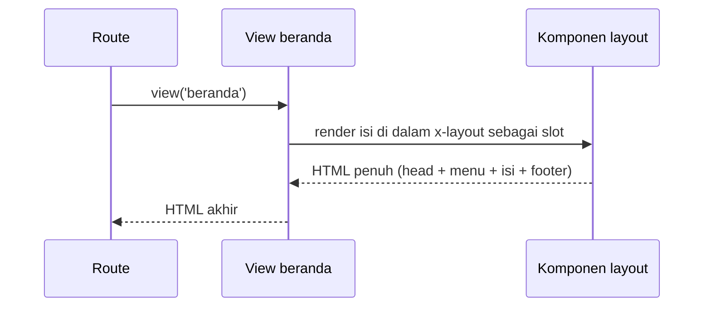

# Layout Blade

Kamu sudah bisa membuat satu halaman lengkap dengan HTML, data, kondisi, dan perulangan. Tetapi saat jumlah halaman bertambah, setiap berkas mengulang bagian yang sama:
`<!DOCTYPE html>`, `<head>`, menu, dan footer. Mengubah satu tautan menu berarti mengedit puluhan berkas. **Layout** menyelesaikan masalah ini dengan memusatkan
kerangka halaman di satu tempat.

## Tujuan Pembelajaran

Setelah menyelesaikan sub bab ini, kamu dapat:

- [ ] Menjelaskan masalah duplikasi yang diselesaikan layout.
- [ ] Menyebutkan dua pendekatan layout Blade: komponen dan pewarisan template.
- [ ] Membuat layout berbasis komponen di `resources/views/components`.
- [ ] Memakai `{{ $slot }}` untuk isi halaman dan slot bernama untuk judul.
- [ ] Menerapkan layout pada beberapa halaman dengan `<x-layout>`.
- [ ] Menjelaskan manfaat layout bagi pemeliharaan dan konsistensi tampilan.

## Prasyarat

- [Direktif Perulangan](03-05-loop-directives.md) dan sub bab Blade sebelumnya.
- Proyek `belajar-blade`.
- Pemahaman HTML dasar: `<head>`, `<body>`, dan `<nav>`.

## Pengantar

Lihat tiga berkas view yang sudah kamu buat: `halo`, `data`, dan `katalog`. Masing-masing memuat `<!DOCTYPE html>`, `<head>`, dan `<body>` sendiri. Jika kamu ingin
menambah menu navigasi di semua halaman, tiga berkas harus diedit, dan di aplikasi nyata jumlahnya bisa ratusan. Ini melanggar prinsip **DRY** (*Don't Repeat Yourself*).

## Penjelasan Konsep

### Apa itu layout?

**Layout** adalah kerangka halaman yang dipakai bersama: dokumen HTML, `<head>`, menu, footer, dan satu **lubang** tempat isi tiap halaman disisipkan.



### Dua pendekatan

Dokumentasi resmi menjelaskan dua cara membuat layout:

| Pendekatan | Ciri | Dibahas pada |
|---|---|---|
| **Layout dengan komponen** | `<x-layout>` dan `{{ $slot }}` | Sub bab ini |
| **Pewarisan template** | `@extends`, `@section`, `@yield` | [Pewarisan Template](03-07-template-inheritance.md) |

Dokumentasi menyebut pewarisan template sebagai cara utama membangun aplikasi sebelum komponen diperkenalkan. Keduanya tetap didukung. Materi ini memulai dengan pendekatan komponen
karena lebih mirip HTML dan lebih mudah dibaca pemula; komponen dibahas lengkap pada [Komponen Blade](03-08-blade-components.md).

### Membuat layout komponen

Berkas di `resources/views/components` otomatis menjadi komponen. Berkas `components/layout.blade.php` dipakai sebagai `<x-layout>`.

File: `resources/views/components/layout.blade.php`

```html
<!DOCTYPE html>
<html lang="id">
<head>
    <meta charset="UTF-8">
    <meta name="viewport" content="width=device-width, initial-scale=1">
    <title>{{ $title ?? 'Belajar Blade' }}</title>
</head>
<body>
    <nav>
        <a href="/beranda">Beranda</a> |
        <a href="/kontak">Kontak</a>
    </nav>
    <hr>

    <main>
        {{ $slot }}
    </main>

    <hr>
    <footer>&copy; Belajar Blade</footer>
</body>
</html>
```

| Bagian | Fungsi |
|---|---|
| `{{ $title ?? 'Belajar Blade' }}` | Judul halaman dari slot `title`, atau teks bawaan bila tidak diisi |
| `<nav>` dan `<footer>` | Bagian yang sama di semua halaman |
| `{{ $slot }}` | Lubang tempat isi halaman disisipkan |

### Memakai layout

Halaman membungkus isinya dengan `<x-layout>`. Semua isi di dalam tag otomatis masuk ke `$slot`:

File: `resources/views/beranda.blade.php`

```html
<x-layout>
    <h1>Beranda</h1>
    <p>Selamat datang di Belajar Blade.</p>
</x-layout>
```

Untuk mengisi judul halaman, gunakan **slot bernama** `title`:

```html
<x-layout>
    <x-slot:title>
        Kontak Kami
    </x-slot>

    <h1>Kontak</h1>
    <p>Email: halo@contoh.test</p>
</x-layout>
```

Isi di luar `<x-slot:title>` tetap masuk ke `$slot` utama.

### Konsistensi dan pemeliharaan

| Tanpa layout | Dengan layout |
|---|---|
| Menu diedit di setiap berkas | Menu diedit sekali |
| Halaman bisa berbeda tanpa sengaja | Seluruh halaman berbagi struktur |
| Menambah CSS global di banyak tempat | Satu `<head>` |

### Aturan praktis

- Satu layout utama untuk satu jenis tampilan (mis. publik vs admin).
- Letakkan semua yang bersifat global (CSS, menu, skrip) di layout.
- Biarkan halaman hanya memuat isinya.

### Keamanan

- Jangan menaruh data pribadi pengguna di layout tanpa pengecekan; layout dipakai di semua halaman, termasuk halaman publik.
- Gunakan `{{ }}` untuk setiap data di layout, termasuk judul, agar judul dari data pengguna tidak menyuntik HTML.

## Cara Kerja



## Contoh Praktik

Kamu membuat layout `x-layout`, dua halaman (`/beranda` dan `/kontak`) yang memakainya, lalu mengubah menu di satu tempat dan melihat kedua halaman ikut berubah.

## Penjelasan Kode

File: `routes/web.php` (tambahkan)

```php-inline
Route::view('/beranda', 'beranda');
Route::view('/kontak', 'kontak');
```

File: `resources/views/kontak.blade.php`

```html
<x-layout>
    <x-slot:title>
        Kontak Kami
    </x-slot>

    <h1>Kontak</h1>
    <p>Email: halo@contoh.test</p>
</x-layout>
```

| Bagian | Fungsi |
|---|---|
| `Route::view` | Menampilkan view tanpa logika tambahan |
| `<x-layout>` | Memanggil komponen `resources/views/components/layout.blade.php` |
| `<x-slot:title>` | Mengisi variabel `$title` pada layout |
| Isi lain | Masuk ke `$slot` |

## Implementasi Langkah demi Langkah

### Langkah 1: buat layout

Buat folder `resources/views/components` dan berkas `layout.blade.php` seperti di atas.

### Langkah 2: buat halaman

Buat `beranda.blade.php` dan `kontak.blade.php`.

### Langkah 3: tambah route

Tambahkan dua `Route::view`, lalu:

```bash
php artisan route:list --path=beranda
php artisan route:list --path=kontak
```

### Langkah 4: jalankan

```bash
php artisan serve
```

Buka `http://127.0.0.1:8000/beranda` dan `http://127.0.0.1:8000/kontak`. Klik menu untuk berpindah halaman.

### Langkah 5: ubah layout sekali

Tambahkan tautan `<a href="/katalog">Katalog</a>` ke `<nav>` di layout, muat ulang kedua halaman, dan pastikan tautan muncul di keduanya.

### Langkah 6: catat di Git

```bash
git add resources/views routes/web.php
git commit -m "Tambah layout komponen dan halaman beranda serta kontak"
```

## Eksekusi dan Verifikasi

| Langkah | Cara memverifikasi |
|---|---|
| 1–2 | Berkas ada di lokasi yang benar |
| 3 | `route:list` menampilkan `GET beranda` dan `GET kontak` |
| 4 | Kedua halaman memiliki menu dan footer yang sama |
| 5 | Tautan baru muncul di dua halaman setelah satu kali edit |
| 6 | Commit tercatat |

## Hasil yang Diharapkan

| Alamat | Tampilan |
|---|---|
| `/beranda` | Menu, judul `Beranda`, paragraf sambutan, footer; judul tab `Belajar Blade` |
| `/kontak` | Menu, judul `Kontak`, email, footer; judul tab `Kontak Kami` |

Hasil ini diturunkan dari dokumentasi dan perilaku Blade, dan belum dijalankan oleh penulis materi; cocokkan dengan hasilmu.

## Kesalahan Umum dan Pemecahan Masalah

| Gejala | Penyebab | Cara mengenali | Solusi | Pencegahan |
|---|---|---|---|---|
| `Unable to locate a class or view for component [layout]` | Berkas bukan di `resources/views/components/layout.blade.php` | Error menyebut komponen | Periksa lokasi dan nama berkas | Nama komponen = nama berkas dalam kebab-case |
| Isi halaman tidak tampil | Layout lupa `{{ $slot }}` | Hanya menu dan footer | Tambahkan `{{ $slot }}` | Selalu sertakan lubang isi |
| Judul selalu bawaan | Slot `title` tidak diisi atau salah tulis | Judul tab tidak berubah | Gunakan `<x-slot:title>` dan penutup `</x-slot>` | Cocokkan nama slot dengan variabel |
| Menu muncul dua kali | Halaman juga memuat menu sendiri | Menu ganda | Hapus menu dari halaman | Pindahkan elemen global ke layout |
| `Undefined variable $title` | Layout memakai `$title` tanpa nilai cadangan | Error saat slot tidak diisi | Tulis `{{ $title ?? '...' }}` | Beri nilai cadangan pada slot opsional |
| Tampilan tidak berubah setelah edit | Cache browser | Isi lama | Muat ulang paksa (Ctrl+F5) | Nonaktifkan cache saat pengembangan |

## Latihan Praktik

### Latihan dasar

**D1. Halaman ketiga**
- *Masalah:* tambah halaman "Tentang".
- *Persyaratan:* buat `tentang.blade.php` yang memakai `<x-layout>` dan route `/tentang`.
- *Perilaku yang diharapkan:* halaman tampil dengan menu dan footer yang sama.
- *Tujuan belajar:* memakai layout pada halaman baru.

**D2. Judul halaman**
- *Masalah:* tiap halaman butuh judul tab berbeda.
- *Persyaratan:* beri `Tentang Kami` pada halaman "Tentang" lewat slot `title`.
- *Perilaku yang diharapkan:* judul tab berubah.
- *Tujuan belajar:* memakai slot bernama.

### Latihan implementasi

**I1. Menu aktif**
- *Masalah:* pengguna ingin tahu halaman yang sedang dibuka.
- *Persyaratan:* di layout, tandai tautan menu aktif dengan `@class` memakai `request()->is('beranda')`.
- *Perilaku yang diharapkan:* tautan halaman aktif mendapat kelas `aktif`.
- *Tujuan belajar:* menggabungkan layout dengan direktif bersyarat.

**I2. Tambahan CSS global**
- *Masalah:* ingin gaya yang sama di semua halaman.
- *Persyaratan:* tambah `<style>` sederhana di `<head>` layout (font dan warna latar) dan pastikan semua halaman berubah.
- *Perilaku yang diharapkan:* satu perubahan memengaruhi semua halaman.
- *Tujuan belajar:* memusatkan tampilan global.

### Latihan tantangan

**T1. Dua layout**
- *Masalah:* situs punya bagian publik dan bagian admin dengan kerangka berbeda.
- *Persyaratan:* buat `x-layout` dan `x-admin-layout` (berkas `admin-layout.blade.php`), lalu gunakan masing-masing pada dua halaman. Jelaskan kapan perlu memisahkan layout.
- *Perilaku yang diharapkan:* dua halaman memiliki kerangka berbeda.
- *Tujuan belajar:* merancang beberapa layout.
- *Catatan:* kerjakan mandiri; tidak ada kunci jawaban.

## Uji Pemahaman

1. Masalah apa yang diselesaikan layout?
2. Apa dua pendekatan layout di Blade?
3. Di mana komponen `layout` disimpan agar bisa dipakai sebagai `<x-layout>`?
4. Apa fungsi `{{ $slot }}`?
5. Bagaimana mengisi judul halaman dari view?
6. Mengapa judul di layout perlu `{{ }}`?

??? success "Kunci jawaban singkat"
    1. Duplikasi kerangka halaman yang membuat perubahan global sulit.
    2. Komponen (`<x-layout>`) dan pewarisan template (`@extends`).
    3. `resources/views/components/layout.blade.php`.
    4. Tempat isi halaman disisipkan.
    5. Dengan slot bernama `<x-slot:title>`.
    6. Agar judul yang mengandung HTML tidak dieksekusi (pencegahan XSS).

## Ringkasan

- Layout memusatkan kerangka halaman sehingga perubahan global cukup sekali.
- Pendekatan komponen memakai `<x-layout>` dan `{{ $slot }}`.
- Slot bernama (`<x-slot:title>`) mengisi bagian khusus layout.
- Letakkan elemen global di layout, isi spesifik di halaman.

Selanjutnya: *Pewarisan Template*, cara kedua membuat layout dengan `@extends`, `@section`, dan `@yield`.

## Referensi Resmi

- [Laravel: Building Layouts](https://laravel.com/docs/13.x/blade#building-layouts)
- [Laravel: Layouts Using Components](https://laravel.com/docs/13.x/blade#layouts-using-components)
- [Laravel: Slots](https://laravel.com/docs/13.x/blade#slots)
