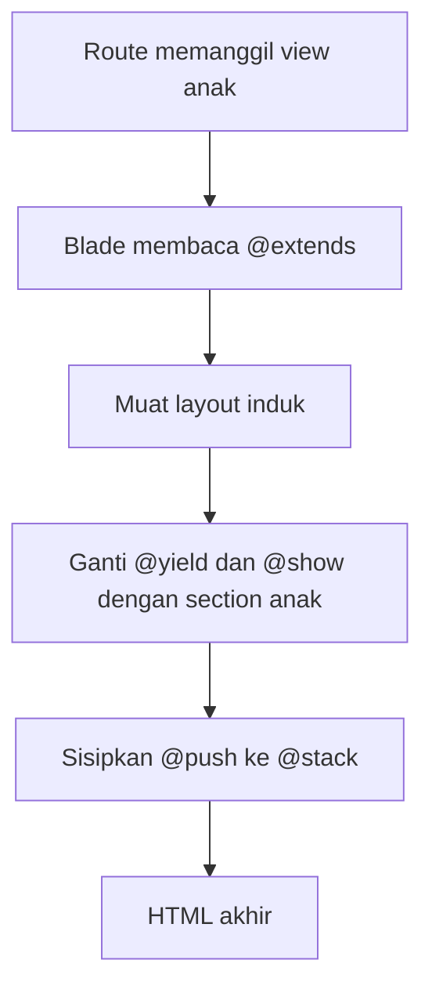

# Pewarisan Template

Selain layout berbasis komponen, Blade menyediakan cara klasik untuk berbagi kerangka halaman: **pewarisan template** (*template inheritance*). Cara ini memakai
`@extends`, `@section`, dan `@yield`. Walaupun komponen kini lebih sering dipilih untuk proyek baru, pewarisan template masih banyak ditemui di kode lama dan di paket
pihak ketiga, sehingga kamu perlu memahaminya. Dokumentasi menyebutnya sebagai cara utama membangun aplikasi sebelum komponen diperkenalkan.

## Tujuan Pembelajaran

Setelah menyelesaikan sub bab ini, kamu dapat:

- [ ] Membuat layout induk dengan `@yield` dan `@section`.
- [ ] Membuat halaman anak yang mewarisi layout dengan `@extends`.
- [ ] Membedakan `@endsection` dan `@show`.
- [ ] Menambah isi ke section induk dengan `@parent`.
- [ ] Memberi nilai bawaan pada `@yield` dan memeriksa section dengan `@hasSection`.
- [ ] Memakai `@push`, `@prepend`, dan `@stack` untuk skrip atau gaya per halaman.
- [ ] Memilih antara pewarisan template dan komponen.

## Prasyarat

- [Layout Blade](03-06-blade-layouts.md).
- [Direktif Kondisional](03-04-conditional-directives.md).
- Proyek `belajar-blade`.

## Pengantar

Pada layout komponen, halaman membungkus isinya dengan `<x-layout>`. Pada pewarisan template, arahnya dibalik: halaman anak **menyatakan** bahwa ia mewarisi
layout induk, lalu mengisi bagian-bagian (*section*) yang disediakan induk.

## Penjelasan Konsep

### Layout induk

Induk menandai tempat yang dapat diisi anak dengan `@yield` (lubang) dan `@section` (bagian yang punya isi bawaan).

File: `resources/views/layouts/app.blade.php`

```html
<!DOCTYPE html>
<html lang="id">
<head>
    <meta charset="UTF-8">
    <title>Belajar Blade - @yield('title')</title>
    @stack('styles')
</head>
<body>
    <aside>
        @section('sidebar')
            <p>Sidebar utama</p>
        @show
    </aside>

    <main>
        @yield('content')
    </main>

    @stack('scripts')
</body>
</html>
```

| Direktif | Fungsi |
|---|---|
| `@yield('title')` | Menampilkan section bernama `title`; kosong bila anak tidak mengisinya |
| `@section('sidebar') ... @show` | Mendefinisikan section **dan langsung menampilkannya** dengan isi bawaan |
| `@yield('content')` | Lubang untuk isi utama halaman |
| `@stack('styles')`, `@stack('scripts')` | Tempat berkumpulnya isi yang di-*push* oleh anak |

### Halaman anak

File: `resources/views/warisan/beranda.blade.php`

```html
@extends('layouts.app')

@section('title', 'Beranda Warisan')

@section('sidebar')
    @parent
    <p>Tambahan sidebar dari halaman ini</p>
@endsection

@section('content')
    <h1>Beranda</h1>
    <p>Halaman ini mewarisi layouts.app.</p>
@endsection
```

| Bagian | Fungsi |
|---|---|
| `@extends('layouts.app')` | Mewarisi `resources/views/layouts/app.blade.php` |
| `@section('title', 'Beranda Warisan')` | Bentuk singkat: nama section dan isinya sebagai string |
| `@section('sidebar') ... @endsection` | Mengisi sidebar |
| `@parent` | Menyisipkan isi bawaan induk, sehingga isi anak **ditambahkan**, bukan menimpa |
| `@section('content') ... @endsection` | Mengisi isi utama |

Hanya isi di dalam `@section` yang ikut ditampilkan; teks di luar section pada halaman anak diabaikan.

### `@endsection` dan `@show`

| Penutup | Perilaku |
|---|---|
| `@endsection` | Hanya **mendefinisikan** section; ditampilkan di tempat `@yield` |
| `@show` | Mendefinisikan sekaligus **langsung menampilkan** section di tempat itu |

Karena itu induk memakai `@show` pada `sidebar` (isi bawaan langsung tampil), sedangkan anak memakai `@endsection`.

### Nilai bawaan `@yield`

Argumen kedua `@yield` adalah nilai bila section tidak didefinisikan:

```html
@yield('content', 'Belum ada isi.')
```

### Memeriksa section: `@hasSection`

```html
@hasSection('navigasi')
    <nav>@yield('navigasi')</nav>
@endif
```

Sebaliknya, `@sectionMissing('navigasi')` memeriksa bahwa section tidak ada.

### Stacks: `@push`, `@prepend`, `@stack`

Stack mengumpulkan isi dari banyak tempat ke satu lokasi di layout, misalnya skrip khusus halaman:

File: `resources/views/warisan/grafik.blade.php`

```html
@extends('layouts.app')

@section('title', 'Grafik')

@section('content')
    <h1>Grafik</h1>
@endsection

@push('scripts')
    <script>console.log('skrip grafik dimuat');</script>
@endpush
```

`@push` menambah di akhir stack, `@prepend` menambah di awal. Isi stack ditampilkan di titik `@stack('scripts')` pada layout.

### Komponen atau pewarisan?

| Aspek | Pewarisan template | Komponen |
|---|---|---|
| Sintaks | `@extends`, `@section`, `@yield` | `<x-layout>`, `$slot` |
| Kemiripan dengan HTML | Lebih seperti direktif | Seperti tag HTML |
| Data dan atribut | Terbatas | Props, atribut, slot |
| Umum di | Kode lama, paket lama | Proyek baru |

Pilih satu pendekatan per proyek agar konsisten. Kamu tetap harus bisa membaca keduanya.

### Keamanan

- `@section('title', $judul)` dan isi section lain tetap harus dicetak dengan `{{ }}` bila berasal dari data pengguna.
- Isi `@push('scripts')` yang memuat data dinamis harus memakai `Js::from` atau `{{ }}` yang aman.

## Cara Kerja



## Contoh Praktik

Kamu membuat layout induk `layouts.app`, dua halaman anak (`/warisan` dan `/warisan/grafik`), dan mengamati `@parent`, `@yield`, serta `@stack`.

## Penjelasan Kode

File: `routes/web.php` (tambahkan)

```php-inline
Route::view('/warisan', 'warisan.beranda');
Route::view('/warisan/grafik', 'warisan.grafik');
```

Nama view memakai titik: `warisan.beranda` merujuk ke `resources/views/warisan/beranda.blade.php`.

## Implementasi Langkah demi Langkah

### Langkah 1: buat layout induk

Buat `resources/views/layouts/app.blade.php`.

### Langkah 2: buat dua halaman anak

Buat `resources/views/warisan/beranda.blade.php` dan `resources/views/warisan/grafik.blade.php`.

### Langkah 3: tambah route

Tambahkan dua `Route::view` di atas, lalu `php artisan route:list --path=warisan`.

### Langkah 4: jalankan dan amati

```bash
php artisan serve
```

Buka `/warisan` dan `/warisan/grafik`. Lihat sumber HTML (Ctrl+U) dan temukan: judul tab, sidebar (isi induk + isi anak), dan skrip yang di-*push*.

### Langkah 5: uji perbedaan `@parent`

Hapus baris `@parent` dari halaman anak, muat ulang, dan lihat sidebar induk menghilang digantikan isi anak saja.

### Langkah 6: catat di Git

```bash
git add resources/views routes/web.php
git commit -m "Tambah pewarisan template dengan section dan stack"
```

## Eksekusi dan Verifikasi

| Langkah | Cara memverifikasi |
|---|---|
| 1–2 | Tiga berkas ada |
| 3 | Dua route terdaftar |
| 4 | `/warisan` memuat dua paragraf sidebar; `/warisan/grafik` mencetak pesan di konsol |
| 5 | Tanpa `@parent`, hanya isi anak yang tampil di sidebar |
| 6 | Commit tercatat |

## Hasil yang Diharapkan

| Alamat | Tampilan |
|---|---|
| `/warisan` | Judul tab `Belajar Blade - Beranda Warisan`; sidebar memuat `Sidebar utama` dan `Tambahan sidebar dari halaman ini`; isi `Beranda` |
| `/warisan/grafik` | Judul tab `Belajar Blade - Grafik`; sidebar hanya `Sidebar utama`; konsol browser menampilkan `skrip grafik dimuat` |

Hasil ini diturunkan dari dokumentasi dan perilaku Blade, dan belum dijalankan oleh penulis materi; cocokkan dengan hasilmu.

## Kesalahan Umum dan Pemecahan Masalah

| Gejala | Penyebab | Cara mengenali | Solusi | Pencegahan |
|---|---|---|---|---|
| `View [layouts.app] not found` | Lokasi atau nama berkas salah | Pesan error | Periksa `resources/views/layouts/app.blade.php` | Gunakan notasi titik tanpa ekstensi |
| Isi halaman kosong | Menulis isi di luar `@section` | Tidak ada isi | Pindahkan ke dalam `@section('content')` | Hanya isi di dalam section yang dipakai |
| Sidebar induk hilang | Tidak memakai `@parent` | Hanya isi anak tampil | Tambahkan `@parent` | Ingat: section anak menimpa induk |
| Sidebar induk tidak tampil sama sekali | Induk memakai `@endsection`, bukan `@show` | Sidebar kosong | Ganti dengan `@show` | `@show` untuk section berisi bawaan |
| Skrip tidak muncul | Layout tidak punya `@stack('scripts')` | Skrip tidak ada di sumber | Tambah `@stack` di layout | Samakan nama stack |
| `Unclosed @section` | Lupa `@endsection` | Error kompilasi | Tutup setiap section | Satu pembuka satu penutup |
| Judul `Belajar Blade - ` kosong | `@section('title')` tidak diisi | Judul terpotong | Isi section atau beri nilai bawaan `@yield('title', 'Tanpa judul')` | Gunakan nilai bawaan |

## Latihan Praktik

### Latihan dasar

**D1. Halaman anak baru**
- *Masalah:* tambah halaman "Tentang".
- *Persyaratan:* buat view anak yang mewarisi `layouts.app` dengan judul dan isi sendiri, serta route `/warisan/tentang`.
- *Perilaku yang diharapkan:* halaman tampil dalam kerangka yang sama.
- *Tujuan belajar:* memakai `@extends` dan `@section`.

**D2. Nilai bawaan**
- *Masalah:* halaman tanpa judul menghasilkan judul kosong.
- *Persyaratan:* ubah layout menjadi `@yield('title', 'Tanpa judul')` dan uji dengan halaman yang tidak mengisi `title`.
- *Perilaku yang diharapkan:* judul bawaan muncul.
- *Tujuan belajar:* memakai nilai bawaan `@yield`.

### Latihan implementasi

**I1. Gaya per halaman**
- *Masalah:* satu halaman butuh CSS khusus.
- *Persyaratan:* gunakan `@push('styles')` pada satu halaman anak untuk menambah aturan CSS, dan buktikan halaman lain tidak terpengaruh.
- *Perilaku yang diharapkan:* gaya hanya ada pada halaman yang me-*push*.
- *Tujuan belajar:* menggunakan stack.

**I2. Navigasi opsional**
- *Masalah:* sebagian halaman punya menu samping, sebagian tidak.
- *Persyaratan:* gunakan `@hasSection('navigasi')` di layout untuk menampilkan `<nav>` hanya bila section diisi.
- *Perilaku yang diharapkan:* `<nav>` hanya muncul pada halaman yang mengisinya.
- *Tujuan belajar:* memeriksa section.

### Latihan tantangan

**T1. Konversi layout**
- *Masalah:* tim ingin memigrasikan layout dari pewarisan ke komponen.
- *Persyaratan:* ubah `layouts.app` dan satu halaman anak menjadi versi `<x-layout>` dari sub bab sebelumnya, dan tuliskan padanan: `@yield('content')` → ?, `@section('title')` → ?
- *Perilaku yang diharapkan:* tampilan sama persis.
- *Tujuan belajar:* memahami kesetaraan kedua pendekatan.
- *Catatan:* kerjakan mandiri; tidak ada kunci jawaban.

## Uji Pemahaman

1. Apa fungsi `@extends`?
2. Apa beda `@endsection` dan `@show`?
3. Apa fungsi `@parent`?
4. Bagaimana memberi nilai bawaan pada `@yield`?
5. Kapan memakai `@push` dan `@stack`?
6. Apa yang terjadi pada teks di luar `@section` pada halaman anak?
7. Kapan memilih komponen dibanding pewarisan template?

??? success "Kunci jawaban singkat"
    1. Menyatakan bahwa view mewarisi layout induk.
    2. `@endsection` hanya mendefinisikan; `@show` mendefinisikan dan langsung menampilkan.
    3. Menyisipkan isi section dari induk sehingga isi anak ditambahkan.
    4. Argumen kedua: `@yield('nama', 'nilai bawaan')`.
    5. Untuk mengumpulkan skrip/gaya dari halaman anak ke satu titik di layout.
    6. Diabaikan.
    7. Untuk proyek baru yang butuh props, atribut, dan slot; pewarisan dipakai untuk menjaga kode lama.

## Ringkasan

- `@extends` mewarisi layout; `@yield` dan `@section` menentukan lubang dan isi.
- `@show` menampilkan section langsung; `@endsection` hanya mendefinisikan.
- `@parent` menambah isi induk; `@yield('x', 'bawaan')` memberi cadangan.
- `@push`, `@prepend`, dan `@stack` mengatur skrip/gaya per halaman.
- Pilih satu pendekatan layout per proyek.

Selanjutnya: *Komponen Blade*, tulang punggung antarmuka modern di Laravel.

## Referensi Resmi

- [Laravel: Layouts Using Template Inheritance](https://laravel.com/docs/13.x/blade#layouts-using-template-inheritance)
- [Laravel: Stacks](https://laravel.com/docs/13.x/blade#stacks)
- [Laravel: Blade Templates](https://laravel.com/docs/13.x/blade)
