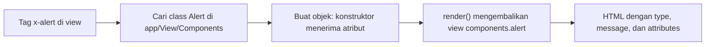

# Komponen Blade

Layout memecah halaman menjadi kerangka dan isi. **Komponen** memecah antarmuka menjadi potongan kecil yang dapat dipakai ulang: tombol, kartu, peringatan, atau
baris tabel. Satu komponen ditulis sekali, dipakai di banyak tempat, dan diubah di satu berkas. Sub bab ini membahas komponen berbasis class: cara membuatnya dengan
Artisan, menyiapkan data, menerima atribut tambahan, dan mengisi slot.

## Tujuan Pembelajaran

Setelah menyelesaikan sub bab ini, kamu dapat:

- [ ] Menjelaskan masalah yang diselesaikan komponen dan perbedaannya dari `@include`.
- [ ] Membuat komponen class dengan `php artisan make:component`.
- [ ] Menjelaskan dua berkas komponen: class di `app/View/Components` dan view di `resources/views/components`.
- [ ] Menampilkan komponen dengan tag `<x-nama />`.
- [ ] Menyiapkan data lewat konstruktor dan menampilkannya di view komponen.
- [ ] Memakai `$slot`, slot bernama, dan `$attributes`.

## Prasyarat

- [Layout Blade](03-06-blade-layouts.md), terutama `<x-layout>`.
- [Class dan Objek](../level-00/00-19-classes-and-objects.md) serta [Namespace dan Autoloading](../level-00/00-22-namespace-and-autoloading.md).
- [Artisan CLI](../level-01/01-12-artisan-cli.md).
- Proyek `belajar-blade`.

## Pengantar

Bayangkan peringatan sukses, peringatan galat, dan peringatan info. Strukturnya sama (kotak berwarna dengan pesan), hanya warna dan teks yang berbeda. Menyalin HTML
yang sama ke banyak halaman membuat perubahan gaya melelahkan. Dengan komponen, kamu menulis `<x-alert type="success" message="Tersimpan" />` dan hasilnya
seragam di seluruh aplikasi.

## Penjelasan Konsep

### Dua jenis komponen

Menurut dokumentasi, ada dua cara menulis komponen: **berbasis class** (sub bab ini) dan **anonim** (satu berkas view, dibahas pada
[Komponen Anonim](03-09-anonymous-components.md)).

### Membuat komponen

```bash
php artisan make:component Alert
```

Perintah itu membuat dua berkas:

| Berkas | Fungsi |
|---|---|
| `app/View/Components/Alert.php` | Class: menyiapkan data dan logika |
| `resources/views/components/alert.blade.php` | View: markup HTML komponen |

Komponen di dua folder itu ditemukan otomatis, tanpa registrasi tambahan. Komponen dapat berada di subfolder, misalnya `php artisan make:component Forms/Input` menghasilkan class
di `app/View/Components/Forms` dan view di `resources/views/components/forms`, dengan tag `<x-forms.input />`.

Nama tag memakai awalan `x-` dan nama class dalam *kebab-case*: `UserProfile` menjadi `<x-user-profile />`.

### Data lewat konstruktor

Semua data komponen didefinisikan di konstruktor class. Properti `public` otomatis tersedia di view komponen:

File: `app/View/Components/Alert.php`

```php
<?php

namespace App\View\Components;

use Illuminate\Contracts\View\View;
use Illuminate\View\Component;

class Alert extends Component
{
    public function __construct(
        public string $type = 'info',
        public string $message = '',
    ) {}

    public function render(): View
    {
        return view('components.alert');
    }
}
```

| Bagian | Fungsi |
|---|---|
| `public string $type = 'info'` | Properti publik dengan nilai bawaan `info` |
| `public string $message = ''` | Pesan; bawaan kosong |
| `render()` | Mengembalikan view komponen |

Hasil `make:component` dapat sedikit berbeda antarversi. Yang penting: class memiliki konstruktor dan `render()` yang mengembalikan view.

### View komponen

File: `resources/views/components/alert.blade.php`

```html
<div {{ $attributes->merge(['class' => 'alert alert-'.$type]) }}>
    @if ($title ?? false)
        <strong>{{ $title }}</strong>
    @endif

    {{ $message }}

    {{ $slot }}
</div>
```

| Bagian | Fungsi |
|---|---|
| `{{ $attributes->merge([...]) }}` | Menerapkan atribut tambahan dari pemanggil, dan menggabungkan `class` |
| `$type`, `$message` | Properti publik class |
| `$title` | Slot bernama (opsional) |
| `{{ $slot }}` | Isi di antara tag pembuka dan penutup |

### Memakai komponen

Nilai teks biasa ditulis sebagai atribut HTML. Ekspresi PHP dan variabel diberi awalan titik dua `:`:

```html
<x-alert type="success" message="Data tersimpan" />

<x-alert type="danger" :message="$pesan" class="besar">
    <x-slot:title>
        Galat
    </x-slot>
    Silakan coba lagi.
</x-alert>
```

| Tulisan | Arti |
|---|---|
| `type="success"` | Nilai string `success` |
| `:message="$pesan"` | Nilai dari variabel PHP `$pesan` |
| `class="besar"` | Bukan argumen konstruktor, jadi masuk ke `$attributes` |
| `<x-slot:title>` | Mengisi slot bernama `$title` |

### Penamaan: camelCase dan kebab-case

Argumen konstruktor memakai `camelCase` (`$alertType`), sedangkan atribut HTML memakai `kebab-case` (`alert-type="..."`).

### Atribut tambahan: `$attributes`

Atribut yang bukan argumen konstruktor (seperti `class`, `id`, `data-*`) masuk ke *attribute bag* `$attributes`. `merge()` memberi nilai bawaan; khusus `class`, nilai
bawaan dan nilai dari pemanggil **digabung**. Untuk atribut lain, nilai dari pemanggil **menimpa** nilai bawaan.

### Metode publik pada komponen

Method `public` pada class dapat dipanggil dari view sebagai `$namaMethod()`. Gunakan untuk logika kecil agar view tetap bersih.

### Komponen dan `@include`

| Aspek | `@include` | Komponen |
|---|---|---|
| Data | Mewarisi semua variabel parent | Eksplisit lewat atribut/konstruktor |
| Atribut dan slot | Tidak ada | Ada |
| Keterbacaan | Bergantung konteks | Jelas di tag pemanggilan |

Dokumentasi menyebut komponen menawarkan beberapa keunggulan dibanding `@include`, seperti pengikatan data dan atribut.

### Keamanan

- Nilai atribut dan slot yang berasal dari pengguna tetap dicetak dengan `{{ }}`.
- Dokumentasi memperingatkan agar elemen array `$data` pada `render()` berbentuk closure tidak disisipkan langsung ke string Blade, karena dapat membuka celah eksekusi kode jarak jauh.
- Jangan mencetak seluruh `$attributes` dengan `{!! !!}`.

## Cara Kerja



## Contoh Praktik

Kamu membuat komponen `Alert`, memakainya dengan tiga variasi pada halaman `/komponen` di dalam `<x-layout>`, dan mengamati penggabungan `class`.

## Penjelasan Kode

File: `routes/web.php` (tambahkan)

```php-inline
Route::get('/komponen', function () {
    return view('komponen', ['pesan' => 'Koneksi gagal']);
});
```

File: `resources/views/komponen.blade.php`

```html
<x-layout>
    <x-slot:title>
        Demo Komponen
    </x-slot>

    <h1>Demo Komponen</h1>

    <x-alert type="success" message="Data tersimpan" />

    <x-alert type="danger" :message="$pesan" class="besar" />

    <x-alert type="info">
        <x-slot:title>
            Info
        </x-slot>
        Ini pesan dari slot.
    </x-alert>
</x-layout>
```

Tambahkan sedikit gaya pada `<head>` di `components/layout.blade.php` agar hasilnya terlihat:

```html
<style>
    .alert { padding: 8px; margin: 8px 0; border-radius: 4px; }
    .alert-success { background: #c8f7c5; }
    .alert-danger { background: #f7c5c5; }
    .alert-info { background: #c5e1f7; }
    .besar { font-size: 1.3em; }
</style>
```

| Pemanggilan | Hasil |
|---|---|
| `type="success" message="..."` | Kotak hijau dengan pesan |
| `:message="$pesan" class="besar"` | Kotak merah; `class` menjadi `alert alert-danger besar` |
| Dengan slot `title` dan isi | Kotak biru berjudul `Info` dengan isi slot |

## Implementasi Langkah demi Langkah

### Langkah 1: buat komponen

```bash
php artisan make:component Alert
```

Pastikan dua berkas terbentuk, lalu ganti isinya dengan kode di atas.

### Langkah 2: tambah route dan view

Tambahkan route `/komponen` dan buat `resources/views/komponen.blade.php`.

### Langkah 3: tambah gaya di layout

Tambahkan blok `<style>` ke `components/layout.blade.php`.

### Langkah 4: jalankan

```bash
php artisan serve
```

Buka `http://127.0.0.1:8000/komponen`.

### Langkah 5: periksa atribut

Lihat sumber HTML dan pastikan elemen kedua memiliki `class="alert alert-danger besar"`.

### Langkah 6: ubah sekali, lihat tiga tempat

Ubah markup `alert.blade.php` (mis. tambahkan ikon teks `!`) dan lihat ketiga peringatan ikut berubah.

### Langkah 7: catat di Git

```bash
git add app/View resources/views routes/web.php
git commit -m "Tambah komponen Alert"
```

## Eksekusi dan Verifikasi

| Langkah | Cara memverifikasi |
|---|---|
| 1 | `app/View/Components/Alert.php` dan `resources/views/components/alert.blade.php` ada |
| 2 | `route:list --path=komponen` menampilkan route |
| 3–4 | Halaman menampilkan tiga kotak peringatan |
| 5 | Elemen kedua berkelas `alert alert-danger besar` |
| 6 | Perubahan tampil di ketiga kotak |
| 7 | Commit tercatat |

## Hasil yang Diharapkan

| Kotak | Tampilan |
|---|---|
| 1 | Latar hijau, `Data tersimpan` |
| 2 | Latar merah, font lebih besar, `Koneksi gagal` |
| 3 | Latar biru, judul tebal `Info`, lalu `Ini pesan dari slot.` |

Teks keluaran `php artisan make:component` bergantung versi (biasanya berupa pesan bahwa class dan view dibuat). Hasil ini diturunkan dari dokumentasi dan perilaku
Blade, dan belum dijalankan oleh penulis materi; cocokkan dengan hasilmu.

## Kesalahan Umum dan Pemecahan Masalah

| Gejala | Penyebab | Cara mengenali | Solusi | Pencegahan |
|---|---|---|---|---|
| `Unable to locate a class or view for component [alert]` | Class atau view tidak ada/salah lokasi | Error menyebut komponen | Periksa `app/View/Components` dan `resources/views/components` | Buat dengan `make:component` |
| `Undefined variable $title` | Slot opsional tidak diisi | Error saat slot tidak ada | Tulis `@if ($title ?? false)` atau beri nilai cadangan | Cek slot opsional |
| Atribut `type` tampil sebagai atribut HTML | `type` bukan argumen konstruktor | `type="..."` ada di tag | Tambahkan ke konstruktor | Daftarkan semua data di konstruktor |
| Variabel PHP tampil sebagai teks `$pesan` | Lupa awalan `:` | Teks `$pesan` di halaman | Tulis `:message="$pesan"` | Gunakan `:` untuk ekspresi |
| `class` pemanggil menimpa bawaan | Tidak memakai `merge` | Kelas bawaan hilang | Pakai `$attributes->merge([...])` | Selalu gabungkan atribut di root |
| Argumen `alertType` tidak terbaca | Memakai camelCase di HTML | Nilai kosong | Tulis `alert-type="..."` | kebab-case di HTML |
| Perubahan class tidak terbaca | Cache autoload | Class lama tetap dipakai | `composer dump-autoload` bila perlu | Pastikan namespace sesuai folder |

## Latihan Praktik

### Latihan dasar

**D1. Komponen tombol**
- *Masalah:* tombol di aplikasi harus seragam.
- *Persyaratan:* buat komponen `Button` dengan argumen `type` (bawaan `button`) dan isi lewat `$slot`; tampilkan dua tombol berbeda.
- *Perilaku yang diharapkan:* dua tombol dengan gaya sama.
- *Tujuan belajar:* membuat komponen class.

**D2. Atribut tambahan**
- *Masalah:* tombol butuh `id` dan `class` berbeda di tiap halaman.
- *Persyaratan:* gunakan `$attributes->merge(['class' => 'tombol'])` dan panggil dengan `class="besar" id="kirim"`.
- *Perilaku yang diharapkan:* elemen memiliki `class="tombol besar"` dan `id="kirim"`.
- *Tujuan belajar:* memakai attribute bag.

### Latihan implementasi

**I1. Kartu produk**
- *Masalah:* katalog butuh kartu seragam.
- *Persyaratan:* buat komponen `ProdukCard` dengan `nama` dan `harga`, tampilkan harga dengan `number_format`, dan pakai di dalam `@foreach`.
- *Perilaku yang diharapkan:* empat kartu seragam dari data katalog.
- *Tujuan belajar:* menggabungkan komponen dengan perulangan.

**I2. Slot bernama**
- *Masalah:* kartu perlu judul dan footer.
- *Persyaratan:* buat komponen `Card` dengan slot `title` dan `footer` (opsional, dicek dengan `@isset`) serta isi utama dari `$slot`.
- *Perilaku yang diharapkan:* judul dan footer hanya muncul bila diisi.
- *Tujuan belajar:* memakai slot bernama.

### Latihan tantangan

**T1. Komponen dengan method**
- *Masalah:* lencana status perlu warna sesuai nilai.
- *Persyaratan:* buat komponen `Badge` dengan properti `status` dan method publik `warna()` yang mengembalikan nama kelas; panggil di view. Jelaskan mengapa logika ini lebih baik berada di class daripada di view.
- *Perilaku yang diharapkan:* lencana berubah warna menurut status.
- *Tujuan belajar:* memakai method publik komponen.
- *Catatan:* kerjakan mandiri; tidak ada kunci jawaban.

## Uji Pemahaman

1. Apa keuntungan komponen dibanding menyalin HTML?
2. Dua berkas apa yang dibuat `make:component`?
3. Bagaimana nama class `UserProfile` ditulis sebagai tag?
4. Apa fungsi awalan `:` pada atribut?
5. Apa isi `$attributes`?
6. Apa beda penggabungan `class` dan atribut lain pada `merge`?
7. Bagaimana kamu mengisi slot bernama?

??? success "Kunci jawaban singkat"
    1. Satu sumber markup; perubahan sekali mengubah semua tempat.
    2. Class di `app/View/Components` dan view di `resources/views/components`.
    3. `<x-user-profile />`.
    4. Menandai nilai sebagai ekspresi PHP, bukan string literal.
    5. Atribut HTML tambahan yang bukan argumen konstruktor.
    6. `class` digabung dengan nilai bawaan; atribut lain ditimpa nilai pemanggil.
    7. Dengan `<x-slot:nama> ... </x-slot>` di dalam tag komponen.

## Ringkasan

- Komponen memecah antarmuka menjadi potongan yang dapat dipakai ulang; tag berawalan `x-`.
- Komponen class terdiri dari class (data) dan view (markup); keduanya ditemukan otomatis.
- Data lewat konstruktor; ekspresi PHP diberi awalan `:`.
- `$attributes` dan `merge` menangani atribut tambahan; `$slot` dan slot bernama mengisi konten.
- Cetak semua data dengan `{{ }}` dan jangan menaruh logika berat di view.

Selanjutnya: *Komponen Anonim*, komponen cukup dengan satu berkas view.

## Referensi Resmi

- [Laravel: Components](https://laravel.com/docs/13.x/blade#components)
- [Laravel: Passing Data to Components](https://laravel.com/docs/13.x/blade#passing-data-to-components)
- [Laravel: Component Attributes](https://laravel.com/docs/13.x/blade#component-attributes)
- [Laravel: Slots](https://laravel.com/docs/13.x/blade#slots)
