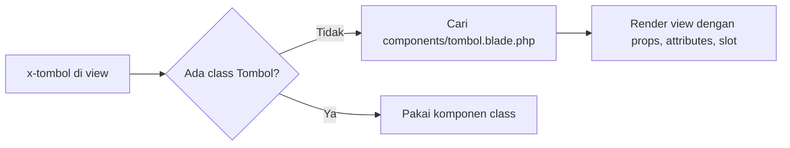

# Komponen Anonim

Komponen class memerlukan dua berkas, padahal banyak komponen sebenarnya hanya potongan HTML tanpa logika PHP: tombol, kartu, atau lencana. Untuk kasus itu Blade
menyediakan **komponen anonim** (*anonymous components*): cukup satu berkas view di `resources/views/components`, tanpa class.

## Tujuan Pembelajaran

Setelah menyelesaikan sub bab ini, kamu dapat:

- [ ] Menjelaskan perbedaan komponen anonim dan komponen berbasis class.
- [ ] Membuat komponen anonim dengan satu berkas view.
- [ ] Mendeklarasikan data dengan `@props` beserta nilai bawaan.
- [ ] Membuat komponen di subfolder dan memanggilnya dengan notasi titik.
- [ ] Membuat komponen "induk" dengan `index.blade.php` dan komponen anak.
- [ ] Mengakses data induk dengan `@aware`.

## Prasyarat

- [Komponen Blade](03-08-blade-components.md): tag `<x-...>`, `$slot`, dan `$attributes`.
- Proyek `belajar-blade`.

## Pengantar

Sebuah tombol biasanya hanya berisi `<button class="tombol">Isi</button>`. Membuat class PHP, konstruktor, dan `render()` untuk itu berlebihan. Komponen anonim
menjawab kebutuhan ini: file view saja sudah menjadi komponen.

## Penjelasan Konsep

### Komponen anonim sederhana

Menurut dokumentasi, untuk membuat komponen anonim kamu cukup menaruh template Blade di `resources/views/components`. Berkas
`resources/views/components/tombol.blade.php` langsung dapat dipanggil dengan `<x-tombol>`.

Artisan juga dapat membuatnya dengan opsi `--view`:

```bash
php artisan make:component forms.input --view
```

Perintah itu membuat `resources/views/components/forms/input.blade.php` yang dipanggil dengan `<x-forms.input />`.

### Mendeklarasikan data dengan `@props`

Tanpa class, tidak ada konstruktor. Gantinya adalah direktif `@props` di bagian atas berkas. Kunci berisi nilai bawaan; nilai tanpa kunci dianggap wajib:

File: `resources/views/components/tombol.blade.php`

```html
@props(['jenis' => 'primer', 'tipe' => 'button'])

<button type="{{ $tipe }}" {{ $attributes->merge(['class' => 'tombol tombol-'.$jenis]) }}>
    {{ $slot }}
</button>
```

| Bagian | Fungsi |
|---|---|
| `@props([...])` | Daftar data komponen; atribut yang tidak terdaftar masuk ke `$attributes` |
| `'jenis' => 'primer'` | Data `jenis` dengan nilai bawaan `primer` |
| `{{ $attributes->merge([...]) }}` | Menerapkan atribut tambahan dari pemanggil |
| `{{ $slot }}` | Isi tombol |

Pemanggilan:

```html
<x-tombol>Simpan</x-tombol>
<x-tombol jenis="bahaya" tipe="submit" class="besar" id="hapus">Hapus</x-tombol>
```

Hasil pemanggilan kedua: `type="submit"`, `class="tombol tombol-bahaya besar"`, dan `id="hapus"`.

!!! note "Nama data"
    Seperti pada komponen class, nama di `@props` memakai `camelCase` dan atribut HTML memakai `kebab-case`.

### Komponen di subfolder

Gunakan titik untuk subfolder, sama seperti nama view:

| Berkas | Tag |
|---|---|
| `components/tombol.blade.php` | `<x-tombol>` |
| `components/forms/input.blade.php` | `<x-forms.input>` |
| `components/ui/kartu/judul.blade.php` | `<x-ui.kartu.judul>` |

### Komponen induk: `index.blade.php`

Kadang beberapa komponen saling terkait, misalnya `menu` dan `item`. Dokumentasi menunjukkan bahwa komponen utama dapat berupa `index.blade.php` di dalam folder grupnya:

```text
resources/views/components/menu/index.blade.php   -> <x-menu>
resources/views/components/menu/item.blade.php    -> <x-menu.item>
```

File: `resources/views/components/menu/index.blade.php`

```html
@props(['warna' => 'abu'])

<ul {{ $attributes->merge(['class' => 'menu menu-'.$warna]) }}>
    {{ $slot }}
</ul>
```

File: `resources/views/components/menu/item.blade.php`

```html
@aware(['warna' => 'abu'])

<li {{ $attributes->merge(['class' => 'item item-'.$warna]) }}>
    {{ $slot }}
</li>
```

Anak tidak otomatis mengetahui atribut induk. Direktif `@aware` memungkinkan anak membaca data yang diberikan ke induk:

```html
<x-menu warna="biru">
    <x-menu.item>Beranda</x-menu.item>
    <x-menu.item>Kontak</x-menu.item>
</x-menu>
```

Kedua `<li>` mewarisi `warna="biru"` tanpa menuliskannya lagi. `@aware` hanya bekerja untuk data yang diteruskan lewat atribut HTML ke induk, bukan untuk data
yang hanya memakai nilai bawaan `@props` induk.

### Anonim atau class?

| Pilih | Bila |
|---|---|
| Anonim | Komponen murni markup, tanpa logika PHP |
| Class | Perlu logika, dependensi, atau method pembantu |

Keduanya dipanggil dengan cara sama, sehingga mengubah komponen anonim menjadi class di kemudian hari tidak mengubah pemakaian.

### Keamanan

Prinsipnya sama dengan komponen class: cetak data dengan `{{ }}`, dan jangan mengeluarkan `$attributes` atau slot dari pengguna dengan `{!! !!}`.

## Cara Kerja



## Contoh Praktik

Kamu membuat komponen anonim `tombol`, grup `menu` dengan `item`, lalu memakainya di halaman `/anonim`.

## Penjelasan Kode

File: `routes/web.php` (tambahkan)

```php-inline
Route::view('/anonim', 'anonim');
```

File: `resources/views/anonim.blade.php`

```html
<x-layout>
    <x-slot:title>
        Komponen Anonim
    </x-slot>

    <h1>Komponen Anonim</h1>

    <x-tombol>Simpan</x-tombol>
    <x-tombol jenis="bahaya" tipe="submit" class="besar" id="hapus">Hapus</x-tombol>

    <x-menu warna="biru">
        <x-menu.item>Beranda</x-menu.item>
        <x-menu.item>Kontak</x-menu.item>
    </x-menu>
</x-layout>
```

Tambahkan di `<style>` pada layout:

```html
.tombol { padding: 6px 12px; border: 0; border-radius: 4px; cursor: pointer; }
.tombol-primer { background: #3b82f6; color: #fff; }
.tombol-bahaya { background: #ef4444; color: #fff; }
.besar { font-size: 1.2em; }
.menu-biru .item-biru { color: #1d4ed8; }
```

| Tag | Berkas |
|---|---|
| `<x-tombol>` | `components/tombol.blade.php` |
| `<x-menu>` | `components/menu/index.blade.php` |
| `<x-menu.item>` | `components/menu/item.blade.php` |

## Implementasi Langkah demi Langkah

### Langkah 1: buat tiga komponen

Buat `tombol.blade.php`, `menu/index.blade.php`, dan `menu/item.blade.php` di `resources/views/components`.

### Langkah 2: buat halaman dan route

Buat `anonim.blade.php` dan route `/anonim`.

### Langkah 3: jalankan dan periksa

```bash
php artisan serve
```

Buka `http://127.0.0.1:8000/anonim`, lalu periksa sumber HTML: atribut `type`, `class`, dan `id` pada tombol kedua, serta kelas pada `<ul>` dan `<li>`.

### Langkah 4: uji `@aware`

Hapus `@aware` di `item.blade.php`, muat ulang, dan amati kelas `item-biru` berubah menjadi `item-abu`. Kembalikan setelah selesai.

### Langkah 5: catat di Git

```bash
git add resources/views routes/web.php
git commit -m "Tambah komponen anonim tombol dan menu"
```

## Eksekusi dan Verifikasi

| Langkah | Cara memverifikasi |
|---|---|
| 1 | Tiga berkas komponen ada |
| 2 | `/anonim` berstatus 200 |
| 3 | Tombol kedua: `type="submit"`, `class="tombol tombol-bahaya besar"`, `id="hapus"` |
| 4 | Tanpa `@aware`, `<li>` berkelas `item item-abu` |
| 5 | Commit tercatat |

## Hasil yang Diharapkan

| Elemen | Hasil |
|---|---|
| Tombol pertama | Biru, `type="button"`, teks `Simpan` |
| Tombol kedua | Merah dan lebih besar, `type="submit"`, `id="hapus"` |
| `<ul>` | `class="menu menu-biru"` |
| `<li>` | `class="item item-biru"` (dengan `@aware`) |

Hasil ini diturunkan dari dokumentasi dan perilaku Blade, dan belum dijalankan oleh penulis materi; cocokkan dengan hasilmu.

## Kesalahan Umum dan Pemecahan Masalah

| Gejala | Penyebab | Cara mengenali | Solusi | Pencegahan |
|---|---|---|---|---|
| `Unable to locate a class or view for component [tombol]` | Berkas tidak di `resources/views/components` | Error menyebut komponen | Pindahkan dan periksa nama | Nama berkas = nama tag |
| Atribut `jenis` muncul sebagai atribut HTML | Tidak didaftarkan di `@props` | `jenis="..."` di tag | Tambahkan ke `@props` | Daftarkan semua data |
| `@props` tidak berfungsi | Ditulis bukan di baris atas | Variabel `undefined` | Letakkan di awal berkas | Konvensi: baris pertama |
| Anak tidak mewarisi `warna` | Tidak memakai `@aware` | Nilai bawaan dipakai | Tambahkan `@aware(['warna' => 'abu'])` | Gunakan `@aware` untuk data induk |
| `<x-menu>` tidak ditemukan | Berkas bernama `menu/menu.blade.php` atau salah letak | Error komponen | Pakai `menu/index.blade.php` | Ikuti struktur contoh |
| Slot tidak tampil | Lupa `{{ $slot }}` | Komponen kosong | Tambahkan `{{ $slot }}` | Selalu sediakan lubang isi |
| Variabel wajib tidak ada | Data tanpa nilai bawaan tidak dikirim | `Undefined variable` | Kirim atau beri nilai bawaan | Beri nilai bawaan bila opsional |

## Latihan Praktik

### Latihan dasar

**D1. Lencana**
- *Masalah:* butuh lencana status seragam.
- *Persyaratan:* buat `components/lencana.blade.php` dengan `@props(['warna' => 'abu'])`, tampilkan di tiga warna.
- *Perilaku yang diharapkan:* tiga lencana berbeda warna dengan satu berkas komponen.
- *Tujuan belajar:* membuat komponen anonim dengan `@props`.

**D2. Subfolder**
- *Masalah:* ingin mengelompokkan komponen form.
- *Persyaratan:* buat `components/form/label.blade.php` dan panggil sebagai `<x-form.label>`.
- *Perilaku yang diharapkan:* label tampil lewat notasi titik.
- *Tujuan belajar:* memahami penamaan subfolder.

### Latihan implementasi

**I1. Kartu anonim**
- *Masalah:* kartu produk berulang di banyak halaman.
- *Persyaratan:* buat `x-kartu` dengan `@props(['judul'])`, isi dari `$slot`, dan terima `class` tambahan. Tampilkan empat kartu dari data katalog.
- *Perilaku yang diharapkan:* empat kartu seragam.
- *Tujuan belajar:* menggabungkan komponen anonim dan perulangan.

**I2. Komponen induk-anak**
- *Masalah:* tab navigasi dengan warna yang diatur dari induk.
- *Persyaratan:* buat `x-tab` (induk, `index.blade.php`) dan `x-tab.item` (anak) yang memakai `@aware`; satu atribut `warna` di induk memengaruhi semua anak.
- *Perilaku yang diharapkan:* semua anak mengikuti warna induk.
- *Tujuan belajar:* memakai `@aware`.

### Latihan tantangan

**T1. Anonim lalu class**
- *Masalah:* komponen `lencana` kini perlu logika (warna dari status bisnis).
- *Persyaratan:* ubah `lencana` menjadi komponen class tanpa mengubah pemanggilan di halaman. Jelaskan apa yang tidak perlu diubah dan mengapa.
- *Perilaku yang diharapkan:* tampilan dan pemanggilan tetap sama.
- *Tujuan belajar:* memahami kesetaraan pemakaian.
- *Catatan:* kerjakan mandiri; tidak ada kunci jawaban.

## Uji Pemahaman

1. Apa beda komponen anonim dan komponen class?
2. Bagaimana mendeklarasikan data pada komponen anonim?
3. Bagaimana nama berkas `components/forms/input.blade.php` dipanggil?
4. Apa fungsi `index.blade.php` dalam folder komponen?
5. Kapan `@aware` diperlukan?
6. Kapan sebaiknya beralih ke komponen class?

??? success "Kunci jawaban singkat"
    1. Anonim hanya berkas view tanpa class; class memiliki konstruktor dan logika PHP.
    2. Dengan `@props([...])` di awal berkas.
    3. `<x-forms.input />`.
    4. Menjadi komponen utama untuk folder grup, dipanggil dengan nama folder.
    5. Agar komponen anak membaca data yang diberikan ke komponen induk.
    6. Saat butuh logika PHP, dependensi, atau method pembantu.

## Ringkasan

- Komponen anonim = satu berkas view di `resources/views/components`, tanpa class.
- Data dideklarasikan dengan `@props`; atribut lain masuk ke `$attributes`.
- Subfolder dipanggil dengan notasi titik; `index.blade.php` menjadi komponen induk.
- `@aware` meneruskan data induk ke anak.
- Pilih class hanya bila butuh logika PHP.

Selanjutnya: *Mengirim Data ke Komponen*, pendalaman props, atribut, dan slot.

## Referensi Resmi

- [Laravel: Anonymous Components](https://laravel.com/docs/13.x/blade#anonymous-components)
- [Laravel: Data Properties / Attributes](https://laravel.com/docs/13.x/blade#data-properties-attributes)
- [Laravel: Accessing Parent Data](https://laravel.com/docs/13.x/blade#accessing-parent-data)
