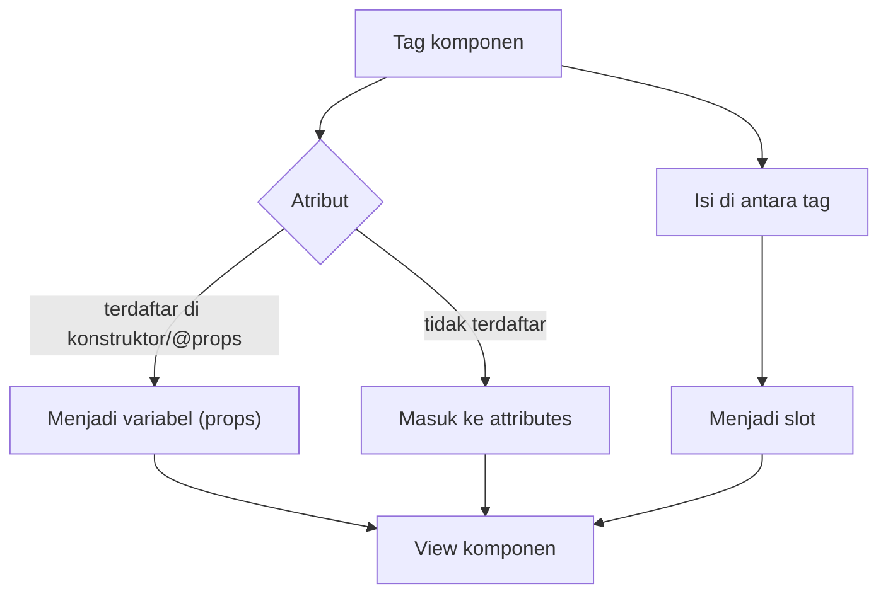

# Mengirim Data ke Komponen

Komponen berguna karena dapat diatur dari luar. Tombol yang sama bisa berwarna biru atau merah, kartu yang sama bisa menampilkan produk berbeda. Sub bab ini
menyatukan semua cara memasukkan data ke komponen: atribut string, ekspresi PHP dengan `:`, sintaks singkat `:$variabel`, atribut tambahan melalui
`$attributes`, dan slot.

## Tujuan Pembelajaran

Setelah menyelesaikan sub bab ini, kamu dapat:

- [ ] Membedakan atribut string literal dan ekspresi PHP (awalan `:`).
- [ ] Memakai sintaks singkat `:$nama` dan awalan `::` untuk mencegah tafsiran PHP.
- [ ] Mengatur nilai bawaan dan data wajib pada komponen.
- [ ] Mengelola atribut tambahan: `merge`, `class`, `only`, `except`, dan `has`.
- [ ] Memakai slot bawaan dan slot bernama, termasuk memeriksa slot kosong.
- [ ] Memilih cara pengiriman data yang tepat.

## Prasyarat

- [Komponen Blade](03-08-blade-components.md) dan [Komponen Anonim](03-09-anonymous-components.md).
- [Direktif Kondisional](03-04-conditional-directives.md).
- Proyek `belajar-blade`.

## Pengantar

Tanpa cara mengirim data, komponen hanya potongan HTML statis. Dengan data, satu komponen dapat melayani banyak situasi. Ada tiga jalur utama yang masing-masing
punya tujuan berbeda: **atribut data** (props), **atribut tambahan** (`$attributes`), dan **slot** (konten).

## Penjelasan Konsep

### Tiga jalur data

| Jalur | Dipakai untuk | Contoh |
|---|---|---|
| Props (data) | Nilai yang memengaruhi logika/tampilan komponen | `jenis="bahaya"`, `:harga="$p['harga']"` |
| `$attributes` | Atribut HTML biasa yang diteruskan ke elemen akar | `class`, `id`, `data-*` |
| Slot | Potongan HTML sebagai isi | `{{ $slot }}`, `<x-slot:title>` |

### String literal dan ekspresi PHP

Menurut dokumentasi, nilai primitif yang ditulis langsung dikirim sebagai atribut HTML biasa, sedangkan ekspresi dan variabel PHP memakai awalan titik dua `:`:

```html
<x-kartu judul="Buku Laravel" :harga="85000" :aktif="true" :tags="['php', 'blade']" />
<x-kartu :judul="$produk['nama']" :harga="$produk['harga'] * 2" />
```

| Tulisan | Nilai yang diterima komponen |
|---|---|
| `judul="Buku Laravel"` | String `Buku Laravel` |
| `:harga="85000"` | Integer `85000` |
| `:aktif="true"` | Boolean `true` |
| `:tags="['php', 'blade']"` | Array PHP |
| `:harga="$produk['harga'] * 2"` | Hasil ekspresi |

Tanpa `:`, `harga="85000"` dikirim sebagai **string** `"85000"`. Ini sumber galat tipe bila komponen class memakai `int`.

### Sintaks singkat

Bila nama atribut sama dengan nama variabel, tulis:

```html
<x-kartu :$judul :$harga />
{{-- sama dengan --}}
<x-kartu :judul="$judul" :harga="$harga" />
```

### Awalan `::` untuk kerangka JavaScript

Beberapa pustaka JavaScript (misalnya Alpine.js) juga memakai atribut berawalan titik dua. Awalan ganda `::` memberi tahu Blade bahwa atribut **bukan** ekspresi PHP; Blade
membuang satu titik dua dan meneruskan sisanya:

```html
<x-tombol ::class="{ aktif: terpilih }">Pilih</x-tombol>
```

### Nilai bawaan dan data wajib

Pada komponen class, tentukan di konstruktor (`public string $jenis = 'primer'`). Pada komponen anonim, di `@props`:

```html
@props(['judul', 'harga' => 0, 'aktif' => true])
```

`judul` tanpa nilai bawaan dianggap wajib: bila tidak dikirim, memakainya di view akan menimbulkan `Undefined variable`.

### Mengelola atribut tambahan

| Cara | Fungsi | Contoh |
|---|---|---|
| `$attributes` | Mencetak semua atribut tambahan | `<div {{ $attributes }}>` |
| `$attributes->merge([...])` | Nilai bawaan; `class` digabung, lainnya ditimpa | `->merge(['class' => 'kartu'])` |
| `$attributes->class([...])` | Kelas bersyarat | `->class(['kartu', 'aktif' => $aktif])` |
| `$attributes->only(['id'])` | Hanya atribut tertentu | |
| `$attributes->except(['class'])` | Semua kecuali tertentu | |
| `$attributes->has('id')` | Apakah atribut ada | `@if ($attributes->has('id'))` |

Contoh `class()`:

```html
<div {{ $attributes->class(['kartu', 'kartu-aktif' => $aktif]) }}>
```

### Slot

```html
<x-kartu judul="Info">
    <x-slot:footer>
        Diperbarui hari ini
    </x-slot>

    Isi kartu dari slot bawaan.
</x-kartu>
```

Di dalam komponen: `{{ $slot }}` untuk isi bawaan, `{{ $footer }}` untuk slot bernama. Periksa slot kosong dengan `$slot->isEmpty()`:

```html
@if ($slot->isEmpty())
    <p>Belum ada isi.</p>
@else
    {{ $slot }}
@endif
```

Slot dapat memiliki atribut sendiri, misalnya `<x-slot:footer class="kecil">`. Slot bernama bersifat opsional; periksa dengan `@isset($footer)` bila boleh tidak diisi.

### Aturan memilih jalur

| Kebutuhan | Pilih |
|---|---|
| Nilai yang dipakai logika (jenis, harga) | Props |
| `class`, `id`, `aria-*`, `data-*` | `$attributes` |
| Potongan HTML (judul kaya, ikon) | Slot |

### Keamanan

- Data dari pengguna tetap dicetak dengan `{{ }}`, termasuk di dalam komponen.
- Jangan meneruskan `$attributes` yang berisi input pengguna ke atribut berbahaya (`onclick`, `href` dengan `javascript:`).
- Validasi tipe di komponen class (`int`, `string`) membantu mencegah nilai tak terduga.

## Cara Kerja



## Contoh Praktik

Kamu membuat komponen anonim `kartu` yang menerima props, atribut tambahan, dan slot, lalu memakainya untuk menampilkan empat produk di halaman `/kartu`.

## Penjelasan Kode

File: `resources/views/components/kartu.blade.php`

```html
@props(['judul', 'harga' => 0, 'aktif' => true])

<div {{ $attributes->class(['kartu', 'kartu-nonaktif' => ! $aktif]) }}>
    <h3>{{ $judul }}</h3>
    <p>Rp {{ number_format($harga, 0, ',', '.') }}</p>

    @if ($slot->isEmpty())
        <p><em>Tanpa deskripsi.</em></p>
    @else
        <div>{{ $slot }}</div>
    @endif

    @isset($footer)
        <small>{{ $footer }}</small>
    @endisset
</div>
```

| Bagian | Fungsi |
|---|---|
| `@props([...])` | `judul` wajib; `harga` dan `aktif` punya nilai bawaan |
| `$attributes->class([...])` | Menambah `kartu` dan, bila tidak aktif, `kartu-nonaktif`; menggabungkan `class` pemanggil |
| `$slot->isEmpty()` | Menampilkan teks cadangan bila tidak ada isi |
| `@isset($footer)` | Menampilkan slot `footer` hanya bila diisi |

File: `routes/web.php` (tambahkan)

```php-inline
Route::get('/kartu', function () {
    return view('kartu', [
        'produk' => [
            ['nama' => 'Buku PHP', 'harga' => 65000, 'aktif' => true],
            ['nama' => 'Buku Laravel', 'harga' => 85000, 'aktif' => true],
            ['nama' => 'Buku Blade', 'harga' => 45000, 'aktif' => false],
        ],
    ]);
});
```

File: `resources/views/kartu.blade.php`

```html
<x-layout>
    <x-slot:title>
        Kartu Produk
    </x-slot>

    <h1>Kartu Produk</h1>

    @foreach ($produk as $p)
        <x-kartu :judul="$p['nama']" :harga="$p['harga']" :aktif="$p['aktif']" class="margin">
            @if ($loop->first)
                Produk terlaris.
            @endif

            @if ($loop->last)
                <x-slot:footer>
                    Stok terbatas
                </x-slot>
            @endif
        </x-kartu>
    @endforeach

    <x-kartu judul="Tanpa harga" />
</x-layout>
```

Tambahkan di `<style>` layout:

```html
.kartu { border: 1px solid #ccc; padding: 8px; margin: 8px 0; }
.kartu-nonaktif { opacity: .5; }
.margin { margin-left: 16px; }
```

| Pemanggilan | Hasil |
|---|---|
| `:harga="$p['harga']"` | Integer dari data |
| `:aktif="$p['aktif']"` | Boolean; false membuat kartu redup |
| `class="margin"` | Atribut tambahan yang digabung ke `class` |
| `$loop->first` / `$loop->last` | Mengisi slot bawaan / slot `footer` secara bersyarat |
| `<x-kartu judul="Tanpa harga" />` | Memakai nilai bawaan `harga` 0 dan slot kosong |

## Implementasi Langkah demi Langkah

### Langkah 1: buat komponen

Buat `resources/views/components/kartu.blade.php`.

### Langkah 2: tambah route dan view

Tambahkan route `/kartu` dan buat `kartu.blade.php`.

### Langkah 3: jalankan

```bash
php artisan serve
```

Buka `http://127.0.0.1:8000/kartu`.

### Langkah 4: periksa atribut

Lihat sumber HTML: kartu ketiga memiliki kelas `kartu kartu-nonaktif margin`.

### Langkah 5: uji data wajib

Ubah `<x-kartu judul="Tanpa harga" />` menjadi `<x-kartu />` dan amati galat `Undefined variable $judul`. Kembalikan setelah selesai.

### Langkah 6: catat di Git

```bash
git add resources/views routes/web.php
git commit -m "Tambah komponen kartu dengan props, atribut, dan slot"
```

## Eksekusi dan Verifikasi

| Langkah | Cara memverifikasi |
|---|---|
| 1–2 | Berkas ada, route terdaftar |
| 3 | Halaman menampilkan empat kartu |
| 4 | Kartu ketiga berkelas `kartu kartu-nonaktif margin` |
| 5 | `<x-kartu />` tanpa `judul` menghasilkan galat |
| 6 | Commit tercatat |

## Hasil yang Diharapkan

| Kartu | Tampilan |
|---|---|
| Buku PHP | `Rp 65.000`; deskripsi `Produk terlaris.` |
| Buku Laravel | `Rp 85.000`; teks `Tanpa deskripsi.` |
| Buku Blade | Redup; `Rp 45.000`; footer `Stok terbatas` |
| Tanpa harga | `Rp 0`; teks `Tanpa deskripsi.` |

Hasil ini diturunkan dari dokumentasi dan perilaku Blade, dan belum dijalankan oleh penulis materi; cocokkan dengan hasilmu.

## Kesalahan Umum dan Pemecahan Masalah

| Gejala | Penyebab | Cara mengenali | Solusi | Pencegahan |
|---|---|---|---|---|
| Teks `$p['nama']` muncul literal | Lupa awalan `:` | Teks variabel tampil | Tulis `:judul="$p['nama']"` | Gunakan `:` untuk ekspresi |
| `TypeError` pada komponen class | `harga="85000"` dikirim sebagai string ke `int` | Pesan tipe | Tulis `:harga="85000"` | Ekspresi bertipe wajib `:` |
| `Undefined variable $judul` | Data wajib tidak dikirim | Error pada baris cetak | Kirim `judul` atau beri nilai bawaan | Daftarkan di `@props` |
| `class` pemanggil menghilang | Tidak mencetak `$attributes` di elemen akar | Kelas tidak muncul | `{{ $attributes->class([...]) }}` | Selalu cetak di elemen akar |
| Slot `footer` tidak tampil | Tidak diisi, atau salah nama | Footer kosong | Cek nama dan gunakan `x-slot:footer` | Beri `@isset($footer)` |
| `aktif="false"` dianggap benar | `"false"` adalah string tidak kosong | Kartu tetap aktif | Tulis `:aktif="false"` | Gunakan `:` untuk boolean |
| Atribut Alpine `:class` diproses PHP | Satu titik dua | Error PHP | Gunakan `::class` | Ingat awalan ganda |

## Latihan Praktik

### Latihan dasar

**D1. Props bertipe**
- *Masalah:* ingin mengirim angka dan boolean.
- *Persyaratan:* panggil `x-kartu` dengan `:harga="15000"` dan `:aktif="false"`, lalu ubah menjadi string tanpa `:` dan jelaskan bedanya.
- *Perilaku yang diharapkan:* perbedaan perilaku `false` dan `"false"` dipahami.
- *Tujuan belajar:* memahami awalan `:`.

**D2. Sintaks singkat**
- *Masalah:* nama variabel sama dengan nama atribut.
- *Persyaratan:* ubah pemanggilan menjadi `:$judul :$harga`.
- *Perilaku yang diharapkan:* hasil tidak berubah.
- *Tujuan belajar:* memakai sintaks singkat.

### Latihan implementasi

**I1. Komponen peringatan lengkap**
- *Masalah:* peringatan butuh jenis, judul, dan isi.
- *Persyaratan:* buat `x-peringatan` anonim dengan `@props(['jenis' => 'info'])`, slot `judul`, dan `$slot`; gabungkan `class` dan `id` dari pemanggil.
- *Perilaku yang diharapkan:* tiga variasi jenis tampil benar.
- *Tujuan belajar:* menggabungkan props, atribut, dan slot.

**I2. Atribut selektif**
- *Masalah:* hanya `id` dan `data-*` yang boleh masuk elemen kedua.
- *Persyaratan:* gunakan `$attributes->only(['id'])` pada elemen kedua dan `->except(['id'])` pada elemen akar.
- *Perilaku yang diharapkan:* `id` hanya muncul di elemen kedua.
- *Tujuan belajar:* membagi atribut.

### Latihan tantangan

**T1. Perancangan API komponen**
- *Masalah:* tim meminta komponen `x-tabel` yang fleksibel.
- *Persyaratan:* rancang (tulis dan implementasikan) komponen dengan props `judul` dan `striped`, slot `header`, slot bawaan untuk baris, dan atribut tambahan. Jelaskan alasan memilih props, atribut, atau slot untuk tiap bagian.
- *Perilaku yang diharapkan:* komponen dapat dipakai dengan tiga cara tanpa mengubah markup di dalamnya.
- *Tujuan belajar:* memilih jalur data yang tepat.
- *Catatan:* kerjakan mandiri; tidak ada kunci jawaban.

## Uji Pemahaman

1. Apa fungsi awalan `:` pada atribut komponen?
2. Mengapa `harga="85000"` dan `:harga="85000"` berbeda?
3. Apa fungsi awalan `::`?
4. Apa beda props dan `$attributes`?
5. Bagaimana memeriksa slot kosong?
6. Bagaimana menggabungkan kelas bersyarat pada elemen akar komponen?
7. Kapan memilih slot daripada props?

??? success "Kunci jawaban singkat"
    1. Menandai nilai sebagai ekspresi PHP.
    2. Yang pertama string; yang kedua integer.
    3. Mencegah Blade menafsirkan atribut sebagai PHP (untuk Alpine dan sejenisnya).
    4. Props = data komponen; `$attributes` = atribut HTML yang diteruskan ke elemen.
    5. `$slot->isEmpty()`.
    6. `$attributes->class(['dasar', 'kelas' => $syarat])`.
    7. Saat nilainya berupa potongan HTML.

## Ringkasan

- Atribut tanpa `:` adalah string; dengan `:` adalah ekspresi PHP.
- `:$nama` menyingkat `:nama="$nama"`; `::` membiarkan atribut untuk JavaScript.
- Props didaftarkan di konstruktor/`@props`; atribut lain masuk ke `$attributes`.
- `merge`, `class`, `only`, `except`, dan `has` mengelola atribut tambahan.
- Slot mengisi konten; `isEmpty()` dan `@isset` memeriksa isinya.

Selanjutnya: *Blade Include*, cara lain memecah tampilan menjadi bagian-bagian kecil.

## Referensi Resmi

- [Laravel: Passing Data to Components](https://laravel.com/docs/13.x/blade#passing-data-to-components)
- [Laravel: Component Attributes](https://laravel.com/docs/13.x/blade#component-attributes)
- [Laravel: Slots](https://laravel.com/docs/13.x/blade#slots)
