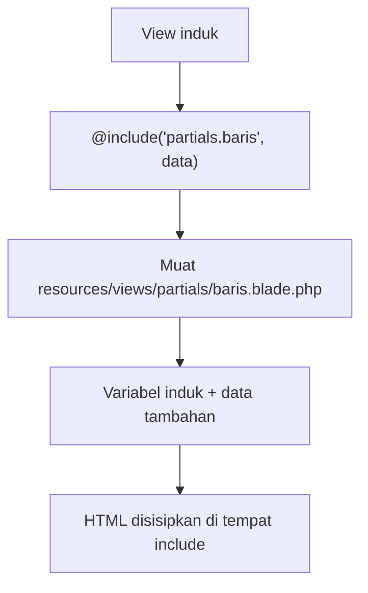

# Blade Include

Selain komponen, Blade memiliki cara lebih sederhana untuk memecah tampilan menjadi potongan: `@include`. Direktif ini menyisipkan satu view ke dalam view lain.
Dokumentasi mengakui kamu bebas memakainya, tetapi menyarankan komponen karena menawarkan pengikatan data dan atribut. Karena `@include` masih sangat umum di kode
yang ada, sub bab ini membahas cara kerjanya, variannya, dan kapan memilihnya.

## Tujuan Pembelajaran

Setelah menyelesaikan sub bab ini, kamu dapat:

- [ ] Menyisipkan view lain dengan `@include`.
- [ ] Mengirim data tambahan ke view yang disertakan.
- [ ] Memakai `@includeIf`, `@includeWhen`, `@includeUnless`, dan `@includeFirst`.
- [ ] Memakai `@each` untuk menggabungkan perulangan dan include.
- [ ] Menjelaskan perbedaan `@include` dengan komponen.
- [ ] Memakai `@once` untuk menghindari pengulangan.

## Prasyarat

- [Layout Blade](03-06-blade-layouts.md) dan [Pewarisan Template](03-07-template-inheritance.md).
- [Direktif Perulangan](03-05-loop-directives.md).
- [Komponen Blade](03-08-blade-components.md).
- Proyek `belajar-blade`.

## Pengantar

Sebuah halaman admin bisa memuat tabel, daftar peringatan, dan menu samping. Menaruh semuanya di satu berkas menghasilkan view ratusan baris. Dengan `@include`,
tiap bagian ditulis di berkas sendiri (biasanya di folder `partials`) dan disisipkan di tempat yang sesuai.

## Penjelasan Konsep

### `@include` dasar

```html
<div>
    @include('partials.galat')

    <form>
        <!-- isi form -->
    </form>
</div>
```

Nama view memakai notasi titik: `partials.galat` adalah `resources/views/partials/galat.blade.php`. Menurut dokumentasi, semua variabel di view induk tersedia juga di view yang disertakan.

### Data tambahan

Berikan array sebagai argumen kedua untuk menambah atau menimpa data:

```html
@include('partials.alert', ['jenis' => 'sukses', 'pesan' => 'Tersimpan'])
```

### Varian `@include`

| Direktif | Perilaku |
|---|---|
| `@includeIf('view')` | Menyertakan bila view ada; tanpa error bila tidak ada |
| `@includeWhen($syarat, 'view', $data)` | Menyertakan bila syarat benar |
| `@includeUnless($syarat, 'view', $data)` | Menyertakan bila syarat salah |
| `@includeFirst(['khusus', 'umum'], $data)` | Menyertakan view pertama yang ada |
| `@includeIsolated('view', $data)` | Menyertakan tanpa mewarisi variabel induk |

Bila `@include` dipakai pada view yang tidak ada, Laravel melempar error. Gunakan `@includeIf` untuk view yang boleh tidak ada.

### `@each`: perulangan + include

```html
@each('partials.baris', $produk, 'p', 'partials.kosong')
```

| Argumen | Arti |
|---|---|
| 1 | View yang dirender untuk tiap elemen |
| 2 | Array atau koleksi yang diulang |
| 3 | Nama variabel elemen di view tersebut (`$p`) |
| 4 (opsional) | View yang dirender bila array kosong |

Dokumentasi mencatat view yang dirender lewat `@each` **tidak** mewarisi variabel induk. Bila perlu, gunakan `@foreach` dan `@include`.

### `@once`

Bagian di dalam `@once` hanya dievaluasi satu kali per siklus render, berguna bila partial yang sama muncul berkali-kali tetapi skripnya cukup sekali. Bentuk ringkasnya
`@pushOnce('scripts')` ... `@endPushOnce` bekerja bersama stack.

### Komponen atau include?

| Aspek | `@include` | Komponen |
|---|---|---|
| Pewarisan variabel | Semua variabel induk ikut | Hanya yang dikirim |
| Atribut dan slot | Tidak ada | Ada |
| Ketergantungan tersembunyi | Mudah terjadi | Eksplisit |
| Cocok untuk | Potongan sederhana yang sangat terikat ke halaman | Elemen antarmuka yang dapat dipakai ulang |

!!! warning "Ketergantungan tersembunyi"
    Karena partial mewarisi semua variabel, ia dapat bergantung pada variabel yang tidak jelas asalnya. Mengganti nama variabel di induk bisa merusak partial tanpa peringatan.
    Kirim data secara eksplisit lewat argumen kedua, atau gunakan komponen.

### Keamanan

- Partial memakai `{{ }}` untuk semua data, sama seperti view lain.
- Jangan membangun nama view dari input pengguna, mis. `@include($request->halaman)`. Penyerang dapat mencoba memuat view yang tidak seharusnya terbuka.

## Cara Kerja



## Contoh Praktik

Kamu memecah halaman `/dashboard-mini` menjadi tiga partial (header, tabel pesanan, dan peringatan), memakai `@include`, `@each`, dan `@includeWhen`.

## Penjelasan Kode

File: `routes/web.php` (tambahkan)

```php-inline
Route::get('/dashboard-mini', function () {
    return view('dashboard-mini', [
        'judul' => 'Dashboard Mini',
        'pesanan' => [
            ['kode' => 'PSN-001', 'total' => 150000],
            ['kode' => 'PSN-002', 'total' => 85000],
        ],
        'peringatan' => 'Ada 2 pesanan menunggu pembayaran',
    ]);
});
```

File: `resources/views/partials/header.blade.php`

```html
<header>
    <h1>{{ $judul }}</h1>
</header>
```

File: `resources/views/partials/peringatan.blade.php`

```html
<div class="peringatan">{{ $peringatan }}</div>
```

File: `resources/views/partials/baris-pesanan.blade.php`

```html
<tr>
    <td>{{ $p['kode'] }}</td>
    <td>Rp {{ number_format($p['total'], 0, ',', '.') }}</td>
</tr>
```

File: `resources/views/partials/pesanan-kosong.blade.php`

```html
<tr><td colspan="2">Belum ada pesanan.</td></tr>
```

File: `resources/views/dashboard-mini.blade.php`

```html
<x-layout>
    <x-slot:title>
        {{ $judul }}
    </x-slot>

    @include('partials.header')

    @includeWhen(! empty($peringatan), 'partials.peringatan')

    <table>
        <thead><tr><th>Kode</th><th>Total</th></tr></thead>
        <tbody>
            @each('partials.baris-pesanan', $pesanan, 'p', 'partials.pesanan-kosong')
        </tbody>
    </table>

    @includeIf('partials.tidak-ada')
</x-layout>
```

| Bagian | Fungsi |
|---|---|
| `@include('partials.header')` | Menyisipkan header; mewarisi `$judul` dari induk |
| `@includeWhen(! empty($peringatan), ...)` | Menyisipkan peringatan hanya bila ada |
| `@each(...)` | Merender satu baris per pesanan; memakai `partials.pesanan-kosong` bila kosong |
| `@includeIf('partials.tidak-ada')` | Dilewati tanpa error karena view tidak ada |

## Implementasi Langkah demi Langkah

### Langkah 1: buat partial

Buat folder `resources/views/partials` dan empat berkas partial di atas.

### Langkah 2: buat halaman dan route

Buat `dashboard-mini.blade.php` dan route `/dashboard-mini`.

### Langkah 3: jalankan

```bash
php artisan serve
```

Buka `http://127.0.0.1:8000/dashboard-mini`.

### Langkah 4: uji data kosong

Ubah `pesanan` menjadi `[]` dan `peringatan` menjadi `''`. Muat ulang: peringatan hilang dan tabel menampilkan `Belum ada pesanan.`

### Langkah 5: uji view yang tidak ada

Ubah `@includeIf('partials.tidak-ada')` menjadi `@include('partials.tidak-ada')` dan amati galat `View [partials.tidak-ada] not found`. Kembalikan setelah selesai.

### Langkah 6: catat di Git

```bash
git add resources/views routes/web.php
git commit -m "Tambah partial dengan include dan each"
```

## Eksekusi dan Verifikasi

| Langkah | Cara memverifikasi |
|---|---|
| 1–2 | Berkas dan route ada |
| 3 | Halaman menampilkan judul, peringatan, dan dua baris pesanan |
| 4 | Peringatan hilang dan baris pesan kosong tampil |
| 5 | `@include` menimbulkan galat; `@includeIf` tidak |
| 6 | Commit tercatat |

## Hasil yang Diharapkan

| Kondisi | Tampilan |
|---|---|
| Data awal | Judul `Dashboard Mini`; peringatan; baris `PSN-001 Rp 150.000` dan `PSN-002 Rp 85.000` |
| `pesanan` kosong, `peringatan` kosong | Tanpa peringatan; satu baris `Belum ada pesanan.` |

Hasil ini diturunkan dari dokumentasi dan perilaku Blade, dan belum dijalankan oleh penulis materi; cocokkan dengan hasilmu.

## Kesalahan Umum dan Pemecahan Masalah

| Gejala | Penyebab | Cara mengenali | Solusi | Pencegahan |
|---|---|---|---|---|
| `View [partials.header] not found` | Nama atau lokasi salah | Pesan error | Periksa `resources/views/partials/header.blade.php` | Gunakan notasi titik |
| `Undefined variable $judul` di partial | Memakai `@each` atau `@includeIsolated` yang tidak mewarisi variabel | Error di partial | Kirim data eksplisit | Jangan mengandalkan pewarisan di `@each` |
| Partial memakai variabel yang tak jelas asalnya | Pewarisan variabel | Sulit dilacak | Kirim data lewat argumen kedua atau pakai komponen | Dokumentasikan variabel yang dibutuhkan |
| Variabel elemen `@each` salah nama | Argumen ketiga tidak sama dengan variabel di partial | `Undefined variable $p` | Samakan nama | Tuliskan argumen ketiga dengan hati-hati |
| Skrip dimuat berkali-kali | Partial dengan skrip dipakai berulang | Skrip ganda di sumber | Gunakan `@once` atau `@pushOnce` | Pindahkan skrip ke layout |
| Peringatan tampil walau kosong | Syarat `@includeWhen` salah | Kotak kosong | Gunakan `! empty($peringatan)` | Uji dengan data kosong |

## Latihan Praktik

### Latihan dasar

**D1. Partial menu**
- *Masalah:* menu dipakai di dua halaman.
- *Persyaratan:* pindahkan menu ke `partials/menu.blade.php` dan sertakan dengan `@include` di dua halaman.
- *Perilaku yang diharapkan:* menu sama di kedua halaman.
- *Tujuan belajar:* memakai `@include`.

**D2. Data tambahan**
- *Masalah:* satu partial dipakai dengan teks berbeda.
- *Persyaratan:* buat `partials/pesan.blade.php` yang menampilkan `$teks` dan sertakan dua kali dengan teks berbeda.
- *Perilaku yang diharapkan:* dua pesan berbeda.
- *Tujuan belajar:* mengirim data ke partial.

### Latihan implementasi

**I1. Daftar dengan `@each`**
- *Masalah:* daftar artikel dirender per baris.
- *Persyaratan:* gunakan `@each` dengan view baris dan view kosong.
- *Perilaku yang diharapkan:* daftar dan pesan kosong tampil benar.
- *Tujuan belajar:* memakai `@each`.

**I2. Pilihan view cadangan**
- *Masalah:* tema khusus bisa tidak ada.
- *Persyaratan:* gunakan `@includeFirst(['tema.khusus', 'tema.umum'])` dan uji dengan satu atau kedua view.
- *Perilaku yang diharapkan:* view yang ada dipakai.
- *Tujuan belajar:* memakai `@includeFirst`.

### Latihan tantangan

**T1. Include menjadi komponen**
- *Masalah:* partial `peringatan` dipakai di banyak halaman dan sulit dilacak.
- *Persyaratan:* ubah menjadi komponen `x-peringatan` dengan props eksplisit, ganti semua pemakaian, dan jelaskan manfaatnya dibanding versi include.
- *Perilaku yang diharapkan:* tampilan sama, ketergantungan lebih jelas.
- *Tujuan belajar:* memilih alat yang tepat.
- *Catatan:* kerjakan mandiri; tidak ada kunci jawaban.

## Uji Pemahaman

1. Apa fungsi `@include`?
2. Variabel apa yang tersedia di view yang disertakan?
3. Kapan `@includeIf` dipakai?
4. Apa empat argumen `@each`?
5. Mengapa `@each` tidak mewarisi variabel induk?
6. Apa risiko `@include` dengan nama dari input pengguna?
7. Mengapa komponen lebih disarankan daripada `@include`?

??? success "Kunci jawaban singkat"
    1. Menyisipkan view lain ke view saat ini.
    2. Semua variabel induk, ditambah data dari argumen kedua.
    3. Saat view boleh tidak ada.
    4. View baris, koleksi, nama variabel elemen, dan (opsional) view kosong.
    5. Setiap elemen dirender secara terisolasi; gunakan `@foreach` + `@include` bila perlu variabel induk.
    6. Penyerang dapat memuat view yang tidak dimaksudkan.
    7. Data dan atribut eksplisit, ada slot, dan ketergantungan jelas.

## Ringkasan

- `@include` menyisipkan view lain dan mewarisi variabel induk.
- Varian: `@includeIf`, `@includeWhen`, `@includeUnless`, `@includeFirst`, dan `@includeIsolated`.
- `@each` menggabungkan perulangan dan include, tetapi tanpa pewarisan variabel.
- `@once` mencegah pengulangan potongan tertentu.
- Komponen umumnya lebih jelas; jangan menyusun nama view dari input pengguna.

Selanjutnya: *Form Blade*, membuat form HTML yang aman di Laravel.

## Referensi Resmi

- [Laravel: Including Subviews](https://laravel.com/docs/13.x/blade#including-subviews)
- [Laravel: Rendering Views for Collections](https://laravel.com/docs/13.x/blade#rendering-views-for-collections)
- [Laravel: The @once Directive](https://laravel.com/docs/13.x/blade#the-once-directive)
