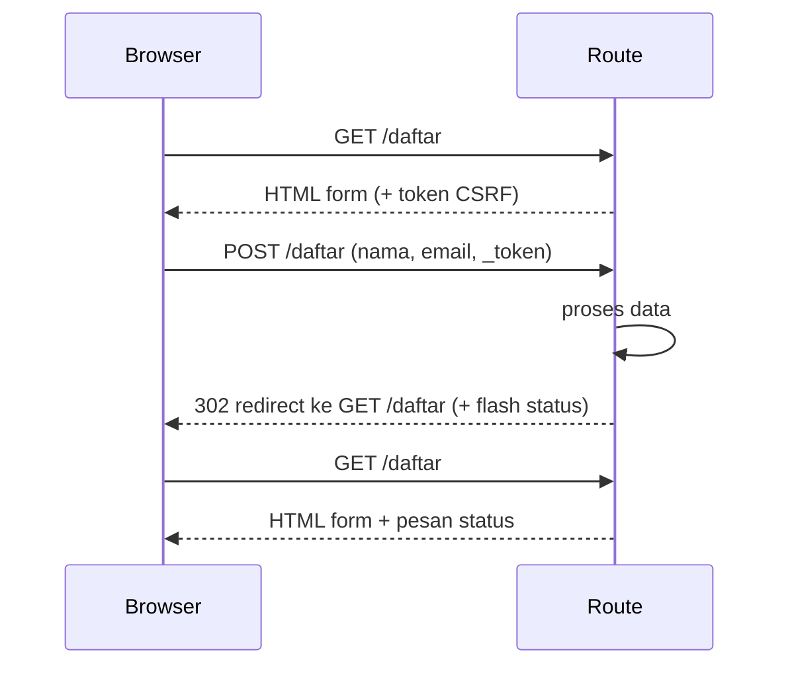

# Form Blade

Form adalah pintu utama data dari pengguna ke aplikasi: pendaftaran, login, pencarian, komentar. Pada bab Dasar Web dan PHP kamu menulis form dan membacanya dengan
`$_POST`. Di Laravel, form tetap HTML biasa, tetapi Blade menambah beberapa alat: `@csrf`, `old()`, `route()`, serta direktif atribut seperti `@selected` dan `@checked`.
Sub bab ini membangun form pendaftaran lengkap dan mengirimkannya ke route `POST`.

## Tujuan Pembelajaran

Setelah menyelesaikan sub bab ini, kamu dapat:

- [ ] Menulis form HTML dengan atribut `action` dan `method` yang benar.
- [ ] Menghubungkan form ke route lewat `route('nama')`.
- [ ] Menyertakan `@csrf` pada setiap form `POST`.
- [ ] Membuat input teks, email, `select`, dan `checkbox` dengan label yang benar.
- [ ] Mempertahankan isian lama dengan `old()` serta `@selected` dan `@checked`.
- [ ] Menerapkan pola *Post/Redirect/Get* dan menampilkan pesan status satu kali.

## Prasyarat

- [Penanganan Form PHP](../level-00/00-16-php-form-handling.md).
- [Named Route](../level-02/02-05-named-routes.md), [Objek Request](../level-02/02-15-request-object.md), dan [Redirect Response](../level-02/02-17-redirect-response.md).
- [Layout Blade](03-06-blade-layouts.md) dan [Direktif Kondisional](03-04-conditional-directives.md).
- Proyek `belajar-blade`.

## Pengantar

Form yang hanya bisa dikirim satu kali dan hilang bila salah isi sangat menjengkelkan. Form yang baik mengarah ke route yang tepat, terlindungi dari serangan,
mengingat isian pengguna, dan memberi tahu hasilnya. Sub bab ini memberi fondasi; perlindungan CSRF, method spoofing, dan pesan galat dibahas rinci pada tiga sub bab berikutnya.

## Penjelasan Konsep

### Anatomi form

```html
<form action="/daftar" method="POST">
    @csrf
    <label for="nama">Nama</label>
    <input type="text" id="nama" name="nama">
    <button type="submit">Kirim</button>
</form>
```

| Bagian | Fungsi |
|---|---|
| `action` | URL tujuan data dikirim |
| `method` | `GET` atau `POST` (HTML tidak mendukung metode lain; lihat sub bab Method Spoofing) |
| `@csrf` | Menambah kolom tersembunyi `_token` untuk perlindungan CSRF |
| `name` | Kunci data pada request: `$request->input('nama')` |
| `for` / `id` | Menghubungkan `<label>` ke `<input>` agar dapat diklik dan dibaca pembaca layar |

### Memilih `GET` atau `POST`

| Kebutuhan | Metode |
|---|---|
| Pencarian, filter (aman diulang, boleh jadi tautan) | `GET` |
| Membuat atau mengubah data, mengirim kata sandi | `POST` |

Jangan mengirim kata sandi dengan `GET`; nilainya tampil di URL, riwayat browser, dan log.

### Tujuan form dengan `route()`

Daripada menulis URL manual, panggil route lewat namanya:

```html
<form action="{{ route('daftar.simpan') }}" method="POST">
```

Jika URI route berubah, form otomatis mengikuti (lihat sub bab Named Route).

### Jenis input yang umum

| Elemen | Contoh |
|---|---|
| Teks | `<input type="text" name="nama">` |
| Email | `<input type="email" name="email">` |
| Kata sandi | `<input type="password" name="sandi">` |
| Pilihan | `<select name="kota"> <option value="...">...</option> </select>` |
| Kotak centang | `<input type="checkbox" name="setuju" value="1">` |
| Area teks | `<textarea name="pesan"></textarea>` |

### Mempertahankan isian: `old()`

Setelah form dikirim lalu pengguna dialihkan kembali (misalnya karena validasi gagal), isian sebelumnya bisa dipanggil lagi lewat helper `old()`:

```html
<input type="text" name="nama" value="{{ old('nama') }}">
```

Bila tidak ada isian lama, `old('nama')` mengembalikan `null` (tercetak kosong). Argumen kedua adalah nilai bawaan: `old('nama', $pengguna->nama)`. `old()` melindungi pengguna dari
kehilangan data dan tetap ter-*escape* oleh `{{ }}`.

### Direktif atribut: `@selected`, `@checked`, `@disabled`

Direktif ini mencetak atribut HTML hanya bila syarat benar:

```html
<option value="bandung" @selected(old('kota') == 'bandung')>Bandung</option>
<input type="checkbox" name="setuju" value="1" @checked(old('setuju'))>
<button type="submit" @disabled($terkunci)>Kirim</button>
```

Direktif lain yang tersedia: `@readonly` dan `@required`.

### Pola *Post/Redirect/Get*

Bila route `POST` langsung mengembalikan halaman HTML, menekan Refresh membuat browser mengirim ulang data. Pola yang benar: setelah memproses `POST`, **alihkan**
(`redirect`) ke halaman `GET`. Pesan hasil dikirim lewat *flash session*, yaitu data sesi yang hanya bertahan satu request:

```php-inline
return redirect()->route('daftar.form')->with('status', 'Pendaftaran diterima');
```

Di view, direktif `@session('status')` mencetak pesan itu bila ada (isinya tersedia sebagai `$value`).

### Keamanan

- `@csrf` wajib pada setiap form `POST`, `PUT`, `PATCH`, dan `DELETE`.
- Jangan percaya data form. Validasi selalu dilakukan di server (dibahas pada bab keamanan dan sub bab Form Error Messages); validasi HTML seperti `required` hanya kenyamanan.
- Ambil hanya kolom yang diharapkan (`$request->only([...])`), jangan meneruskan seluruh `$request->all()` ke penyimpanan data.
- Jangan mengisi ulang kolom kata sandi dengan `old()`.

## Cara Kerja



## Contoh Praktik

Kamu membuat form pendaftaran (`nama`, `email`, `kota`, `setuju`) di `/daftar` yang mengirim data ke route `POST`, lalu kembali ke form dengan pesan status.

## Penjelasan Kode

File: `routes/web.php` (tambahkan; letakkan `use` di bagian atas berkas bila belum ada)

```php-inline
use Illuminate\Http\Request;

Route::get('/daftar', function () {
    return view('daftar', [
        'kota' => ['jakarta' => 'Jakarta', 'bandung' => 'Bandung', 'surabaya' => 'Surabaya'],
    ]);
})->name('daftar.form');

Route::post('/daftar', function (Request $request) {
    $data = $request->only(['nama', 'email', 'kota']);

    return redirect()
        ->route('daftar.form')
        ->with('status', 'Terima kasih, '.$data['nama'].'. Data diterima.');
})->name('daftar.simpan');
```

| Bagian | Fungsi |
|---|---|
| `Route::get('/daftar', ...)->name('daftar.form')` | Menampilkan form dan memberinya nama |
| `Route::post('/daftar', ...)->name('daftar.simpan')` | Menerima data; URI sama, metode berbeda |
| `$request->only([...])` | Mengambil hanya tiga kolom |
| `redirect()->route(...)->with('status', ...)` | Mengalihkan ke form dan mengirim pesan satu kali |

!!! note "Belum menyimpan data"
    Data belum disimpan ke basis data; itu dibahas pada bab utama basis data. Perhatikan juga bahwa `$data['nama']` akan error bila kolom `nama` tidak dikirim. Sub bab
    Form Error Messages menambahkan validasi yang menjamin kolom itu ada.

File: `resources/views/daftar.blade.php`

```html
<x-layout>
    <x-slot:title>
        Pendaftaran
    </x-slot>

    <h1>Pendaftaran</h1>

    @session('status')
        <p class="sukses">{{ $value }}</p>
    @endsession

    <form action="{{ route('daftar.simpan') }}" method="POST">
        @csrf

        <p>
            <label for="nama">Nama</label><br>
            <input type="text" id="nama" name="nama" value="{{ old('nama') }}">
        </p>

        <p>
            <label for="email">Email</label><br>
            <input type="email" id="email" name="email" value="{{ old('email') }}">
        </p>

        <p>
            <label for="kota">Kota</label><br>
            <select id="kota" name="kota">
                <option value="">-- pilih --</option>
                @foreach ($kota as $kunci => $nama)
                    <option value="{{ $kunci }}" @selected(old('kota') == $kunci)>{{ $nama }}</option>
                @endforeach
            </select>
        </p>

        <p>
            <label>
                <input type="checkbox" name="setuju" value="1" @checked(old('setuju'))>
                Saya setuju dengan syarat dan ketentuan
            </label>
        </p>

        <button type="submit">Daftar</button>
    </form>
</x-layout>
```

Tambahkan di `<style>` layout: `.sukses { background: #c8f7c5; padding: 8px; }`.

| Bagian | Fungsi |
|---|---|
| `@session('status') ... @endsession` | Menampilkan pesan flash bila ada; isinya di `$value` |
| `{{ route('daftar.simpan') }}` | URL aksi dari nama route |
| `@csrf` | Token CSRF tersembunyi |
| `value="{{ old('nama') }}"` | Mempertahankan isian lama |
| `@foreach` di `select` | Membuat opsi dari data dan menandai yang terpilih dengan `@selected` |
| `@checked(old('setuju'))` | Mencentang kotak bila isian lama ada |

## Implementasi Langkah demi Langkah

### Langkah 1: tambah route

Tambahkan `use Illuminate\Http\Request;` di bagian atas `routes/web.php` dan dua route di atas, lalu:

```bash
php artisan route:list --path=daftar
```

### Langkah 2: buat view

Buat `resources/views/daftar.blade.php`.

### Langkah 3: jalankan dan isi form

```bash
php artisan serve
```

Buka `http://127.0.0.1:8000/daftar`, isi nama `Budi`, email, dan kota, lalu kirim.

### Langkah 4: amati pengalihan

Setelah kirim, kamu kembali ke `/daftar` dengan pesan hijau. Tekan Refresh dan pastikan pesan hilang tanpa browser menawarkan kirim ulang data.

### Langkah 5: periksa sumber form

Lihat sumber halaman (Ctrl+U) dan temukan `<input type="hidden" name="_token" ...>` yang dibuat `@csrf`.

### Langkah 6: catat di Git

```bash
git add resources/views routes/web.php
git commit -m "Tambah form pendaftaran dengan Blade"
```

## Eksekusi dan Verifikasi

| Langkah | Cara memverifikasi |
|---|---|
| 1 | `route:list` menampilkan rute `daftar` untuk `GET` (dan `HEAD`) serta untuk `POST` |
| 2–3 | Form tampil dengan tiga bidang, kotak centang, dan tombol |
| 4 | Pesan `Terima kasih, Budi. Data diterima.` muncul sekali |
| 5 | Ada input tersembunyi `_token` |
| 6 | Commit tercatat |

## Hasil yang Diharapkan

| Aksi | Hasil |
|---|---|
| Buka `/daftar` | Form kosong |
| Isi dan kirim | Status 302 lalu halaman `/daftar` dengan pesan hijau |
| Refresh | Pesan hilang; tidak ada permintaan kirim ulang |

Isian form tidak terisi ulang setelah berhasil karena route tidak memakai `withInput()`; `old()` akan berguna pada sub bab Form Error Messages. Hasil ini diturunkan
dari dokumentasi dan perilaku Laravel, dan belum dijalankan oleh penulis materi; cocokkan dengan hasilmu.

## Kesalahan Umum dan Pemecahan Masalah

| Gejala | Penyebab | Cara mengenali | Solusi | Pencegahan |
|---|---|---|---|---|
| `419 Page Expired` | `@csrf` hilang atau sesi kedaluwarsa | Halaman 419 | Tambah `@csrf`; muat ulang form | Selalu `@csrf` di form `POST` |
| `405 Method Not Allowed` | Metode form tidak sama dengan route | Status 405 | Samakan `method` dan jenis route | Cek `route:list` |
| `Route [daftar.simpan] not defined` | Nama route salah | Error nama route | Tambah `->name('daftar.simpan')` | Salin nama dari `route:list` |
| `Undefined array key "nama"` | Kolom tidak terkirim | Error pada route | Validasi kolom (sub bab 03.15) | Jangan mengakses kunci tanpa validasi |
| Isian hilang setiap salah | `old()` tidak dipakai atau tanpa `withInput()` | Form kosong lagi | Pakai `old()` dan redirect dengan input | Terapkan di semua kolom |
| Label tidak bisa diklik | `for` tidak sama dengan `id` | Klik label tidak fokus ke input | Samakan `for` dan `id` | Gunakan pola pasangan |
| Pesan status tidak muncul | Lupa `with('status', ...)` atau nama berbeda | Tidak ada pesan | Samakan nama kunci | Gunakan satu kunci konsisten |
| Kata sandi tampil di URL | Form memakai `GET` | Parameter di alamat | Ganti ke `POST` | Jangan kirim data sensitif via `GET` |

## Latihan Praktik

### Latihan dasar

**D1. Form pencarian**
- *Masalah:* ingin pencarian produk.
- *Persyaratan:* buat form `GET` dengan satu input `q` yang menuju `/cari`, dan route yang menampilkan nilai `q` dengan `request('q')`. Jelaskan mengapa `@csrf` tidak diperlukan pada form `GET`.
- *Perilaku yang diharapkan:* nilai `q` tampil di URL dan halaman.
- *Tujuan belajar:* memilih metode form.

**D2. Label dan input**
- *Masalah:* form kurang ramah.
- *Persyaratan:* tambahkan kolom `telepon` dengan label yang terhubung lewat `for`/`id` dan atribut `required`.
- *Perilaku yang diharapkan:* mengeklik label memfokuskan input.
- *Tujuan belajar:* menulis form yang mudah diakses.

### Latihan implementasi

**I1. Form pesan**
- *Masalah:* butuh form kontak.
- *Persyaratan:* buat form dengan `nama`, `email`, dan `pesan` (`textarea`), route `GET` dan `POST`, serta pesan status setelah kirim.
- *Perilaku yang diharapkan:* alur Post/Redirect/Get berjalan.
- *Tujuan belajar:* membuat form lengkap.

**I2. Pilihan dinamis**
- *Masalah:* daftar kota berubah-ubah.
- *Persyaratan:* kirim daftar kota dari route, buat `<option>` dengan `@foreach`, dan tandai dengan `@selected`.
- *Perilaku yang diharapkan:* menambah kota di array menambah opsi.
- *Tujuan belajar:* membuat `select` dari data.

### Latihan tantangan

**T1. Audit form**
- *Masalah:* rekan membuat form `POST` tanpa `@csrf` dan dengan `value="{{ $_POST['nama'] }}"`.
- *Persyaratan:* tuliskan masalah keamanan dan fungsionalnya, lalu perbaiki dengan `@csrf` dan `old()`.
- *Perilaku yang diharapkan:* versi perbaikan aman dan tidak error saat kolom tidak ada.
- *Tujuan belajar:* menilai form secara kritis.
- *Catatan:* kerjakan mandiri; tidak ada kunci jawaban.

## Uji Pemahaman

1. Apa fungsi atribut `action` dan `method`?
2. Mengapa memakai `route('nama')` dibanding menulis URL?
3. Apa fungsi `@csrf`?
4. Kapan `old()` berguna?
5. Mengapa route `POST` sebaiknya melakukan `redirect`?
6. Apa fungsi `@selected` dan `@checked`?
7. Mengapa kata sandi tidak dikirim dengan `GET`?

??? success "Kunci jawaban singkat"
    1. `action`: URL tujuan; `method`: `GET` atau `POST`.
    2. Form tetap benar walau URI route berubah.
    3. Menambah token tersembunyi untuk perlindungan CSRF.
    4. Mengembalikan isian sebelumnya setelah pengalihan, mis. saat validasi gagal.
    5. Menghindari kirim ulang data saat halaman di-refresh (Post/Redirect/Get).
    6. Mencetak atribut `selected`/`checked` bila syarat benar.
    7. Nilainya tampil di URL, riwayat, dan log.

## Ringkasan

- Form memakai `action`, `method`, dan `name`; hubungkan ke route dengan `route()`.
- `@csrf` wajib pada form yang mengubah data.
- `old()`, `@selected`, dan `@checked` mempertahankan isian pengguna.
- Gunakan Post/Redirect/Get dan flash session untuk pesan sekali tampil.
- Validasi dan sanitasi data di server; jangan percaya data form.

Selanjutnya: *Method Spoofing*, cara mengirim `PUT`, `PATCH`, dan `DELETE` dari form HTML.

## Referensi Resmi

- [Laravel: Blade Forms](https://laravel.com/docs/13.x/blade#forms)
- [Laravel: Additional Attributes](https://laravel.com/docs/13.x/blade#additional-attributes)
- [Laravel: HTTP Redirects](https://laravel.com/docs/13.x/redirects)
- [Laravel: Old Input](https://laravel.com/docs/13.x/requests#old-input)
