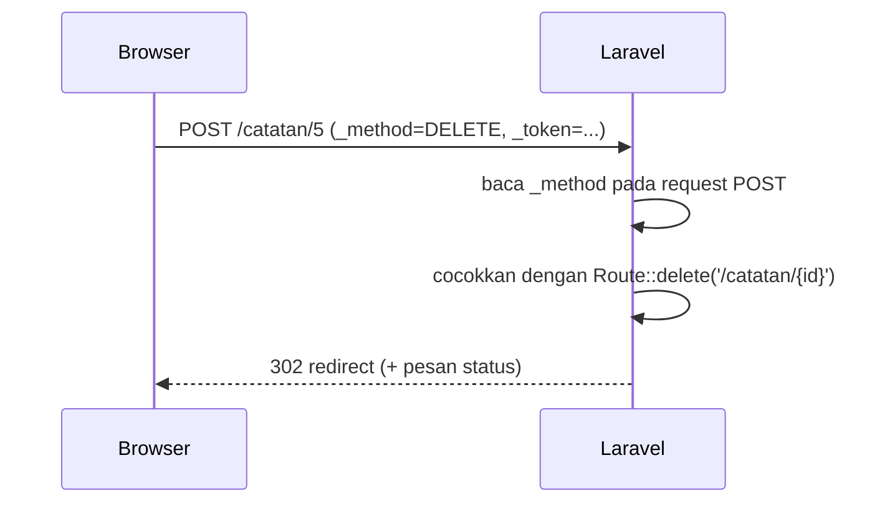

# Form Method Spoofing

Aplikasi yang rapi memakai metode HTTP sesuai tujuan: `PUT`/`PATCH` untuk mengubah dan `DELETE` untuk menghapus. Masalahnya, form HTML hanya mengenal `GET` dan `POST`. Laravel
menyelesaikannya dengan **method spoofing**: form tetap dikirim dengan `POST`, tetapi membawa kolom tersembunyi `_method` yang memberi tahu Laravel metode yang dimaksud.
Sub bab ini menjelaskan cara memakainya.

## Tujuan Pembelajaran

Setelah menyelesaikan sub bab ini, kamu dapat:

- [ ] Menjelaskan mengapa form HTML tidak dapat langsung mengirim `PUT`, `PATCH`, atau `DELETE`.
- [ ] Memakai `@method('PUT')`, `@method('PATCH')`, dan `@method('DELETE')`.
- [ ] Mencocokkan form dengan route `Route::put`, `Route::patch`, dan `Route::delete`.
- [ ] Menjelaskan hubungan method spoofing dengan resource controller.
- [ ] Mengenali galat 405 akibat metode yang tidak cocok.
- [ ] Menjelaskan mengapa penghapusan tidak boleh memakai `GET`.

## Prasyarat

- [Blade Forms](03-12-blade-forms.md).
- [Routing Dasar](../level-02/02-02-basic-routing.md) (metode HTTP) dan [Resource Controller](../level-02/02-13-resource-controllers.md).
- [HTTP dan HTTPS](../level-00/00-03-http-https-fundamentals.md).
- Proyek `belajar-blade`.

## Pengantar

Resource controller memetakan "ubah catatan" ke `PUT/PATCH /catatan/{id}` dan "hapus catatan" ke `DELETE /catatan/{id}`. Jika kamu menulis `<form method="PUT">`, browser
tidak mengenalinya dan mengirim `GET` atau `POST` biasa. Method spoofing menjembatani perbedaan antara standar HTML dan REST.

## Penjelasan Konsep

### Keterbatasan form HTML

| Atribut `method` | Dikirim browser sebagai |
|---|---|
| `GET` | `GET` |
| `POST` | `POST` |
| `PUT`, `PATCH`, `DELETE` | Tidak dikenali; diperlakukan sebagai `GET` |

Menurut dokumentasi, karena form HTML tidak dapat membuat request `PUT`, `PATCH`, atau `DELETE`, kamu perlu menambahkan kolom tersembunyi `_method` untuk meniru (*spoof*) metode tersebut.

### Direktif `@method`

```html
<form action="/catatan/5" method="POST">
    @csrf
    @method('PUT')
    ...
</form>
```

`@method('PUT')` menghasilkan `<input type="hidden" name="_method" value="PUT">`. Laravel membaca `_method` pada request `POST` dan menganggap request itu sebagai `PUT`.

### Pasangan form dan route

| Tujuan | Form | Route |
|---|---|---|
| Mengubah seluruh data | `method="POST"` + `@method('PUT')` | `Route::put('/catatan/{id}', ...)` |
| Mengubah sebagian data | `method="POST"` + `@method('PATCH')` | `Route::patch('/catatan/{id}', ...)` |
| Menghapus | `method="POST"` + `@method('DELETE')` | `Route::delete('/catatan/{id}', ...)` |

Atribut `method` pada tag `<form>` **tetap `POST`**. Hanya `_method` yang membawa metode sebenarnya.

### Mengapa `DELETE` bukan `GET`

Tautan biasa (`<a href="/catatan/5/hapus">`) memakai `GET`. `GET` dapat terpicu tanpa sengaja oleh *prefetch* browser, pemindai tautan, atau situs lain yang menyematkan
gambar dengan alamat itu. Menghapus data lewat `DELETE` (dalam form dengan `@csrf`) mencegah masalah tersebut dan memenuhi konvensi HTTP.

### Hubungan dengan resource controller

`Route::resource('catatan', CatatanController::class)` mendaftarkan route `update` (`PUT/PATCH`) dan `destroy` (`DELETE`). Form untuk route itu harus memakai
`@method('PUT')` atau `@method('DELETE')`. Pada sub bab ini kamu memakai closure agar fokus pada form.

### Keamanan

- Form dengan `@method` tetap `POST`, sehingga `@csrf` tetap wajib.
- Jangan membuat tombol hapus berupa tautan `GET`.
- Pertimbangkan konfirmasi sebelum menghapus (dialog JavaScript atau halaman konfirmasi), dan pastikan otorisasi dicek di server.

## Cara Kerja



## Contoh Praktik

Kamu membuat halaman `/catatan` yang menampilkan dua catatan dengan tombol **Ubah** (`PUT`) dan **Hapus** (`DELETE`), lalu menguji juga 405 saat metode tidak cocok.

## Penjelasan Kode

File: `routes/web.php` (tambahkan)

```php-inline
Route::get('/catatan', function () {
    return view('catatan', [
        'catatan' => [
            ['id' => 1, 'isi' => 'Belajar Blade'],
            ['id' => 2, 'isi' => 'Belajar Form'],
        ],
    ]);
})->name('catatan.index');

Route::put('/catatan/{id}', function (Request $request, string $id) {
    return redirect()->route('catatan.index')
        ->with('status', "Catatan {$id} diubah (PUT) menjadi: ".$request->input('isi'));
})->whereNumber('id')->name('catatan.update');

Route::delete('/catatan/{id}', function (string $id) {
    return redirect()->route('catatan.index')
        ->with('status', "Catatan {$id} dihapus (DELETE)");
})->whereNumber('id')->name('catatan.destroy');
```

| Bagian | Fungsi |
|---|---|
| `Route::put`, `Route::delete` | Hanya melayani metode `PUT` atau `DELETE` |
| `{id}` + `whereNumber('id')` | Parameter hanya boleh angka |
| `redirect()->route(...)->with(...)` | Pola Post/Redirect/Get dengan pesan status |

File: `resources/views/catatan.blade.php`

```html
<x-layout>
    <x-slot:title>
        Catatan
    </x-slot>

    <h1>Catatan</h1>

    @session('status')
        <p class="sukses">{{ $value }}</p>
    @endsession

    @foreach ($catatan as $c)
        <form action="{{ route('catatan.update', $c['id']) }}" method="POST">
            @csrf
            @method('PUT')
            <input type="text" name="isi" value="{{ $c['isi'] }}">
            <button type="submit">Ubah</button>
        </form>

        <form action="{{ route('catatan.destroy', $c['id']) }}" method="POST">
            @csrf
            @method('DELETE')
            <button type="submit">Hapus</button>
        </form>
        <hr>
    @endforeach
</x-layout>
```

| Bagian | Fungsi |
|---|---|
| `route('catatan.update', $c['id'])` | URL `/catatan/{id}` dengan id catatan |
| `@method('PUT')` | Kolom tersembunyi `_method=PUT` |
| `@method('DELETE')` | Kolom tersembunyi `_method=DELETE` |
| `method="POST"` | Tetap `POST` pada kedua form |

## Implementasi Langkah demi Langkah

### Langkah 1: tambah route dan view

Tambahkan tiga route dan buat `resources/views/catatan.blade.php`. Pastikan `use Illuminate\Http\Request;` sudah ada di bagian atas `routes/web.php`.

```bash
php artisan route:list --path=catatan
```

### Langkah 2: jalankan

```bash
php artisan serve
```

Buka `http://127.0.0.1:8000/catatan`.

### Langkah 3: coba Ubah dan Hapus

Ubah teks catatan 1 lalu klik **Ubah**, kemudian klik **Hapus** pada catatan 2. Perhatikan pesan status yang berbeda.

### Langkah 4: periksa kolom tersembunyi

Lihat sumber halaman dan temukan `<input type="hidden" name="_method" value="PUT">` dan `value="DELETE"`.

### Langkah 5: uji tanpa spoofing

Hapus `@method('DELETE')` dari satu form, muat ulang, lalu klik **Hapus**. Karena request menjadi `POST /catatan/{id}` dan tidak ada route `POST` untuk URI itu, kamu mendapat galat 405.
Kembalikan setelah selesai.

### Langkah 6: catat di Git

```bash
git add resources/views routes/web.php
git commit -m "Tambah contoh method spoofing PUT dan DELETE"
```

## Eksekusi dan Verifikasi

| Langkah | Cara memverifikasi |
|---|---|
| 1 | `route:list` menampilkan route `catatan` untuk `GET`, `PUT`, dan `DELETE` |
| 3 | Pesan `diubah (PUT)` dan `dihapus (DELETE)` tampil |
| 4 | Kolom `_method` ada di sumber form |
| 5 | Tanpa `@method`, hasilnya 405 |
| 6 | Commit tercatat |

## Hasil yang Diharapkan

| Aksi | Hasil |
|---|---|
| Klik **Ubah** | Kembali ke `/catatan` dengan `Catatan 1 diubah (PUT) menjadi: ...` |
| Klik **Hapus** | Kembali ke `/catatan` dengan `Catatan 2 dihapus (DELETE)` |
| Hapus tanpa `@method` | `405 Method Not Allowed` |

Data tidak benar-benar berubah karena belum ada penyimpanan; hanya pesan yang berubah. Hasil ini diturunkan dari dokumentasi dan perilaku Laravel, dan belum dijalankan
oleh penulis materi; cocokkan dengan hasilmu.

## Kesalahan Umum dan Pemecahan Masalah

| Gejala | Penyebab | Cara mengenali | Solusi | Pencegahan |
|---|---|---|---|---|
| `405 Method Not Allowed` | Lupa `@method`, atau route tidak sesuai | Header `Allow` menyebut metode lain | Tambah `@method('PUT')` atau cocokkan route | Samakan form dan `route:list` |
| `419 Page Expired` | `@csrf` hilang | Halaman 419 | Tambah `@csrf` | Selalu sertakan bersama `@method` |
| `method="PUT"` pada `<form>` tidak berfungsi | Browser tidak mengenali | Request menjadi `GET` | Pakai `method="POST"` + `@method('PUT')` | Ingat batas HTML |
| Hapus lewat tautan menghapus data tak sengaja | Memakai `GET` | Data hilang saat tautan dibuka | Ganti dengan form `DELETE` | Jangan ubah data lewat `GET` |
| `_method` diabaikan | Form memakai `GET` | Request tidak mengikuti spoofing | Gunakan `POST` | Spoofing hanya untuk `POST` |
| Route tidak cocok dengan parameter | `id` bukan angka dengan `whereNumber` | 404 | Kirim id angka | Periksa data id |

## Latihan Praktik

### Latihan dasar

**D1. Pasangkan form dan route**
- *Masalah:* tiga aksi perlu dipetakan.
- *Persyaratan:* untuk aksi tambah, ubah sebagian, dan hapus, tuliskan atribut `method` form, direktif `@method` (jika perlu), dan jenis route yang cocok.
- *Perilaku yang diharapkan:* pasangan benar untuk ketiganya.
- *Tujuan belajar:* memetakan form ke route.

**D2. Sumber HTML**
- *Masalah:* ingin melihat hasil `@method`.
- *Persyaratan:* buka sumber halaman `/catatan` dan salin dua baris kolom tersembunyi yang dihasilkan.
- *Perilaku yang diharapkan:* `_method` bernilai `PUT` dan `DELETE`.
- *Tujuan belajar:* memahami hasil direktif.

### Latihan implementasi

**I1. Ubah sebagian dengan PATCH**
- *Masalah:* hanya judul catatan yang berubah.
- *Persyaratan:* tambahkan route `PATCH /catatan/{id}/judul` dan form dengan `@method('PATCH')`.
- *Perilaku yang diharapkan:* pesan status menyebut `PATCH`.
- *Tujuan belajar:* memakai `PATCH`.

**I2. Konfirmasi hapus**
- *Masalah:* pengguna bisa menekan Hapus tak sengaja.
- *Persyaratan:* tambah `onsubmit="return confirm('Yakin menghapus?')"` pada form hapus dan jelaskan bahwa ini kenyamanan, bukan keamanan.
- *Perilaku yang diharapkan:* dialog konfirmasi muncul sebelum kirim.
- *Tujuan belajar:* menambah konfirmasi sambil memahami batasnya.

### Latihan tantangan

**T1. Resource route**
- *Masalah:* tim ingin mengganti tiga route manual dengan `Route::resource`.
- *Persyaratan:* buat controller resource `CatatanController`, daftarkan dengan `Route::resource('catatan', CatatanController::class)->only(['index', 'update', 'destroy'])`, dan sesuaikan form agar tetap berfungsi. Jelaskan nama route yang dihasilkan.
- *Perilaku yang diharapkan:* form lama bekerja dengan route resource.
- *Tujuan belajar:* menghubungkan form dengan resource controller.
- *Catatan:* kerjakan mandiri; tidak ada kunci jawaban.

## Uji Pemahaman

1. Metode apa yang dikenali atribut `method` pada form HTML?
2. Apa fungsi `@method('DELETE')`?
3. Apa nilai atribut `method` pada `<form>` bila memakai `@method`?
4. Mengapa tombol hapus tidak boleh berupa tautan `GET`?
5. Mengapa `@csrf` tetap diperlukan bersama `@method`?
6. Apa yang terjadi jika `@method('PUT')` dilupakan?

??? success "Kunci jawaban singkat"
    1. `GET` dan `POST`.
    2. Membuat kolom tersembunyi `_method=DELETE` agar Laravel menganggap request sebagai `DELETE`.
    3. Tetap `POST`.
    4. `GET` dapat terpicu tanpa sengaja dan tidak sesuai konvensi.
    5. Request-nya tetap `POST` yang berubah data, sehingga memerlukan perlindungan CSRF.
    6. Request menjadi `POST`; bila tidak ada route `POST` untuk URI itu, hasilnya 405.

## Ringkasan

- Form HTML hanya mendukung `GET` dan `POST`.
- `@method('PUT'|'PATCH'|'DELETE')` menambah kolom `_method` agar Laravel meniru metode tersebut.
- Atribut `method` tetap `POST`, dan `@csrf` tetap wajib.
- Route resource memakai `PUT/PATCH/DELETE`, sehingga formnya memerlukan method spoofing.
- Jangan menghapus atau mengubah data lewat `GET`.

Selanjutnya: *Proteksi CSRF*, bagaimana token melindungi aplikasi dari request palsu.

## Referensi Resmi

- [Laravel: Method Field](https://laravel.com/docs/13.x/blade#method-field)
- [Laravel: Form Method Spoofing](https://laravel.com/docs/13.x/routing#form-method-spoofing)
- [Laravel: Resource Controllers](https://laravel.com/docs/13.x/controllers#resource-controllers)
