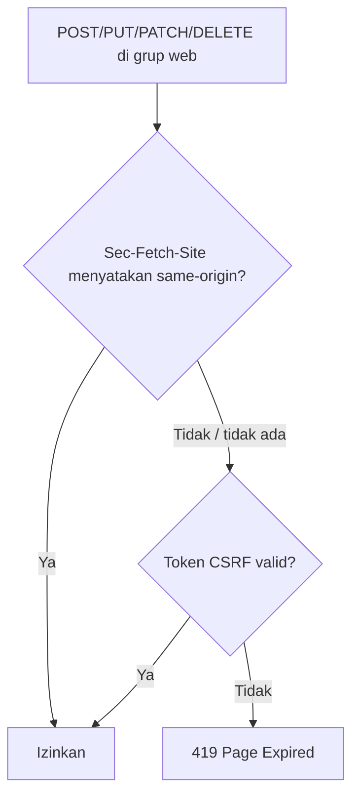

# Proteksi CSRF

Setiap form `POST` yang kamu buat sejauh ini memuat `@csrf`. Sub bab ini menjelaskan **mengapa**. CSRF (*Cross-Site Request Forgery*) adalah serangan yang membuat
browser pengguna yang sudah masuk mengirim request berbahaya ke aplikasimu tanpa sepengetahuan pengguna. Laravel melindungi aplikasi dari serangan ini secara
bawaan, tetapi kamu perlu memahami cara kerjanya agar tidak mematikannya secara tidak sengaja dan bisa memecahkan galat `419`.

## Tujuan Pembelajaran

Setelah menyelesaikan sub bab ini, kamu dapat:

- [ ] Menjelaskan apa itu serangan CSRF dengan contoh sederhana.
- [ ] Menjelaskan dua lapis perlindungan Laravel 13: verifikasi asal dan token CSRF.
- [ ] Memakai `@csrf` dan `csrf_token()`.
- [ ] Mengirim token CSRF dari JavaScript lewat header `X-CSRF-TOKEN`.
- [ ] Mengecualikan URI tertentu dengan benar dan menjelaskan risikonya.
- [ ] Mendiagnosis galat `419 Page Expired`.

## Prasyarat

- [Blade Forms](03-12-blade-forms.md) dan [Form Method Spoofing](03-13-form-method-spoofing.md).
- [Middleware Route](../level-02/02-08-route-middleware.md) dan konsep sesi dasar.
- [HTTP dan HTTPS](../level-00/00-03-http-https-fundamentals.md), termasuk cookie dan header.
- Proyek `belajar-blade`.

## Pengantar

Bayangkan kamu sedang masuk ke aplikasi dengan rute `POST /pengguna/email` yang mengganti alamat email akun. Kamu lalu membuka situs jahat di tab lain. Situs itu
menyembunyikan form yang menuju aplikasimu dan mengirimnya otomatis. Browser menyertakan cookie sesimu, sehingga aplikasi mengira **kamu** yang mengubah email. Itulah CSRF.

## Penjelasan Konsep

### Contoh serangan

```html
<!-- Di situs jahat -->
<form action="https://aplikasi-kamu.test/pengguna/email" method="POST">
    <input type="email" name="email" value="penyerang@jahat.test">
</form>
<script>document.forms[0].submit();</script>
```

Penyebabnya: browser otomatis melampirkan cookie ke setiap request menuju domain pemilik cookie, termasuk request yang dipicu situs lain.

### Solusi: rahasia yang tidak dimiliki penyerang

Aplikasi menolak setiap request `POST`, `PUT`, `PATCH`, `DELETE` (dan `QUERY` menurut dokumentasi) yang tidak membawa **rahasia** tersimpan di sesi pengguna.
Situs jahat tidak bisa membaca rahasia itu, sehingga request palsunya ditolak.

### Dua lapis perlindungan di Laravel 13

Dokumentasi 13.x menjelaskan bahwa middleware `Illuminate\Foundation\Http\Middleware\PreventRequestForgery`, yang termasuk grup `web` secara bawaan, bekerja dalam dua lapis:

| Lapis | Cara kerja |
|---|---|
| 1. Verifikasi asal | Memeriksa header `Sec-Fetch-Site` yang dikirim browser modern; bila menyatakan request berasal dari *same-origin*, request langsung diizinkan |
| 2. Token CSRF | Bila verifikasi asal tidak lolos (browser lama, bukan HTTPS, atau header tidak ada), memeriksa token CSRF |

Header `Sec-Fetch-Site`, menurut dokumentasi, hanya dikirim browser lewat koneksi aman (HTTPS). Karena itu, di lingkungan lokal tanpa HTTPS, perlindungan praktis jatuh ke token CSRF.
**Selalu sertakan token pada form**; jangan menganggap lapis pertama menggantikannya.

### Token CSRF

Laravel membuat satu token untuk setiap sesi aktif. Token tersimpan di sesi dan berubah saat sesi diregenerasi. Mengambilnya:

```php-inline
use Illuminate\Http\Request;

Route::get('/token', function (Request $request) {
    $token = $request->session()->token();
    $token = csrf_token();   // sama saja
});
```

### Menyertakan token di form: `@csrf`

```html
<form method="POST" action="/profil">
    @csrf
    <!-- sama dengan: -->
    <input type="hidden" name="_token" value="{{ csrf_token() }}">
</form>
```

### Token untuk JavaScript (AJAX)

Middleware juga memeriksa header `X-CSRF-TOKEN`. Pola umum: simpan token di tag `<meta>` pada layout, lalu baca dari JavaScript:

```html
<meta name="csrf-token" content="{{ csrf_token() }}">
```

```js
const token = document.querySelector('meta[name="csrf-token"]').content;

fetch('/simpan', {
    method: 'POST',
    headers: {
        'X-CSRF-TOKEN': token,
        'Content-Type': 'application/json',
    },
    body: JSON.stringify({ nama: 'Budi' }),
});
```

Laravel juga menaruh token di cookie terenkripsi `XSRF-TOKEN` agar pustaka seperti Axios dapat mengirimnya sebagai `X-XSRF-TOKEN` secara otomatis pada request *same-origin*.
Untuk SPA dengan Laravel sebagai API, dokumentasi mengarahkan ke Laravel Sanctum.

### Mengecualikan URI

Ada kasus sah, misalnya *webhook* dari layanan pembayaran yang tidak bisa mengirim token. Dokumentasi menyarankan menaruh route semacam itu di luar grup `web`; alternatifnya
mengecualikan URI di `bootstrap/app.php`:

File: `bootstrap/app.php`

```php-inline
->withMiddleware(function (Middleware $middleware): void {
    $middleware->preventRequestForgery(except: [
        'webhook/pembayaran',
        'webhook/*',
    ]);
})
```

Middleware CSRF dinonaktifkan otomatis saat menjalankan tes.

### Mode hanya-asal (opsional)

Dengan `$middleware->preventRequestForgery(originOnly: true)`, aplikasi hanya mengandalkan verifikasi asal; kegagalan menghasilkan `403`, bukan `419`. Dokumentasi mengingatkan bahwa tanpa HTTPS verifikasi asal tidak tersedia, jadi gunakan hanya bila kamu paham konsekuensinya. Opsi `allowSameSite: true` mengizinkan request dari subdomain.

### Mendiagnosis `419 Page Expired`

| Penyebab | Cara mengenali | Solusi |
|---|---|---|
| `@csrf` tidak ada | Kolom `_token` tidak ada di sumber form | Tambahkan `@csrf` |
| Sesi kedaluwarsa (form dibuka terlalu lama) | Form dibuka lama sebelum dikirim | Muat ulang form dan kirim lagi |
| Cookie sesi tidak terkirim (domain/port berbeda, cookie diblokir) | Tidak ada cookie `*_session` | Samakan domain dan port; periksa pengaturan cookie |
| Request dari alat tanpa sesi (curl, Postman) | Tidak ada cookie dan token | Kirim cookie sesi dan token, atau gunakan route di luar grup `web` |
| Cache halaman lama | Token dari halaman yang di-cache | Hindari meng-cache halaman berisi form |

### Keamanan

- Jangan memakai pengecualian `*` atau mematikan perlindungan hanya untuk "menghilangkan error 419".
- Jangan menaruh token CSRF di URL (GET); token hanya di body, header, atau kolom tersembunyi.
- Jangan menjalankan aksi yang mengubah data lewat `GET`; perlindungan CSRF tidak mencakup `GET`.

## Cara Kerja



Pada mode `originOnly`, cabang kegagalan menghasilkan `403`.

## Contoh Praktik

Kamu menyelidiki perlindungan CSRF: mengirim `POST` dengan `curl` tanpa token (ditolak), mengambil token dari form lalu mengirim ulang (diterima), dan mengirim token
dari JavaScript lewat tag `<meta>`.

## Penjelasan Kode

File: `resources/views/components/layout.blade.php` (tambahkan di dalam `<head>`)

```html
<meta name="csrf-token" content="{{ csrf_token() }}">
```

File: `routes/web.php` (tambahkan)

```php-inline
Route::get('/csrf', function () {
    return view('csrf');
});

Route::post('/csrf/kirim', function (Request $request) {
    return response()->json(['diterima' => $request->input('nama')]);
})->name('csrf.kirim');
```

File: `resources/views/csrf.blade.php`

```html
<x-layout>
    <x-slot:title>
        Uji CSRF
    </x-slot>

    <h1>Uji CSRF</h1>

    <form action="{{ route('csrf.kirim') }}" method="POST">
        @csrf
        <input type="text" name="nama" value="Budi">
        <button type="submit">Kirim lewat form</button>
    </form>

    <button id="ajax">Kirim lewat JavaScript</button>
    <pre id="hasil"></pre>

    <script>
        document.getElementById('ajax').addEventListener('click', async () => {
            const token = document.querySelector('meta[name="csrf-token"]').content;
            const res = await fetch('{{ route('csrf.kirim') }}', {
                method: 'POST',
                headers: {
                    'X-CSRF-TOKEN': token,
                    'Content-Type': 'application/json',
                    'Accept': 'application/json',
                },
                body: JSON.stringify({ nama: 'Sari' }),
            });
            document.getElementById('hasil').textContent = res.status + ' ' + await res.text();
        });
    </script>
</x-layout>
```

| Bagian | Fungsi |
|---|---|
| `<meta name="csrf-token">` | Menyimpan token untuk JavaScript |
| `@csrf` | Token untuk form |
| `fetch(... 'X-CSRF-TOKEN' ...)` | Mengirim token lewat header |
| `route('csrf.kirim')` di dalam `fetch` | Alamat tujuan dari nama route |
| `response()->json(...)` | Mengembalikan JSON agar hasil mudah dibaca |

## Implementasi Langkah demi Langkah

### Langkah 1: siapkan route dan view

Tambahkan tag `<meta>` ke layout, dua route, dan `csrf.blade.php`. Pastikan `use Illuminate\Http\Request;` ada di atas `routes/web.php`.

### Langkah 2: jalankan

```bash
php artisan serve
```

Buka `http://127.0.0.1:8000/csrf`, klik **Kirim lewat form** (hasil berupa JSON), lalu kembali dan klik **Kirim lewat JavaScript**.

### Langkah 3: uji tanpa token (dengan curl)

```bash
curl -i -X POST -d "nama=Penyerang" http://127.0.0.1:8000/csrf/kirim
```

Di Windows PowerShell tulis `curl.exe`. Perhatikan baris status.

### Langkah 4: uji dengan token dan cookie sesi (bash)

```bash
TOKEN=$(curl -s -c cookies.txt http://127.0.0.1:8000/csrf | grep -o 'name="_token" value="[^"]*"' | head -1 | sed 's/.*value="//;s/"//')
curl -i -b cookies.txt -c cookies.txt -d "_token=$TOKEN&nama=Budi" http://127.0.0.1:8000/csrf/kirim
rm cookies.txt
```

Perintah pertama mengambil halaman form, menyimpan cookie sesi, dan mengekstrak nilai token. Perintah kedua mengirim `POST` dengan cookie dan token yang sama.

### Langkah 5: amati perilaku browser

Hapus `@csrf` dari form di `csrf.blade.php`, muat ulang, dan klik **Kirim lewat form**. Catat hasilnya: pada Laravel 13, browser modern yang mengirim `Sec-Fetch-Site`
dapat lolos lewat verifikasi asal, sedangkan `curl` pada Langkah 3 tidak. Kembalikan `@csrf` setelah selesai.

### Langkah 6: catat di Git

```bash
git add resources/views routes/web.php
git commit -m "Tambah halaman uji CSRF"
```

## Eksekusi dan Verifikasi

| Langkah | Cara memverifikasi |
|---|---|
| 1–2 | Kedua tombol menghasilkan JSON `{"diterima":"..."}` |
| 3 | Status `419` |
| 4 | Status `200` dengan `{"diterima":"Budi"}` |
| 5 | Hasil di browser dicatat; `@csrf` dikembalikan |
| 6 | Commit tercatat |

## Hasil yang Diharapkan

| Permintaan | Hasil |
|---|---|
| Form dengan `@csrf` | `200` dan `{"diterima":"Budi"}` |
| `fetch` dengan `X-CSRF-TOKEN` | `200 {"diterima":"Sari"}` |
| `curl` tanpa token/cookie | `419` |
| `curl` dengan cookie dan token | `200` |

Tanpa `@csrf`, hasil di browser bergantung pada apakah browser mengirim `Sec-Fetch-Site` pada koneksi yang kamu pakai (dokumentasi menyatakan header itu hanya dikirim
lewat koneksi aman). Karena itu hasil Langkah 5 bisa berbeda antar lingkungan; ini bukan alasan menghapus `@csrf`. Semua hasil diturunkan dari dokumentasi dan belum dijalankan
oleh penulis materi; cocokkan dengan hasilmu.

## Kesalahan Umum dan Pemecahan Masalah

| Gejala | Penyebab | Cara mengenali | Solusi | Pencegahan |
|---|---|---|---|---|
| `419` pada form | `@csrf` hilang atau sesi kedaluwarsa | Tidak ada `_token` di sumber | Tambah `@csrf`, muat ulang form | Template form baku yang menyertakan `@csrf` |
| `419` pada `fetch` | Header `X-CSRF-TOKEN` tidak dikirim | Tab Network tidak memuat header | Baca token dari `<meta>` dan kirim | Tag `<meta>` di layout |
| `419` pada curl/Postman | Tidak membawa cookie sesi | Tidak ada cookie | Kirim cookie dan token, atau pakai route API | Uji API terpisah dari route web |
| `419` setelah form lama dibuka | Sesi habis | Terjadi setelah jeda panjang | Muat ulang halaman | Beri pesan ramah pada galat 419 |
| Token berbeda pada tiap tab | Sesi diregenerasi (mis. setelah login) | Token lama ditolak | Muat ulang halaman | Jangan menyimpan token lama |
| Webhook ditolak `419` | Route berada di grup `web` | Layanan eksternal gagal | Pindahkan ke luar grup `web` atau kecualikan URI spesifik | Hindari pengecualian lebar |
| Mematikan CSRF "agar tidak error" | Salah memahami penyebab | Banyak route tanpa perlindungan | Cari akar masalah | Jangan menambah `*` pada daftar pengecualian |

## Latihan Praktik

### Latihan dasar

**D1. Cari token**
- *Masalah:* ingin melihat token pada form.
- *Persyaratan:* buka sumber `/csrf` dan catat nilai `_token` serta tag `<meta>`. Muat ulang dan bandingkan apakah nilainya berubah.
- *Perilaku yang diharapkan:* token tampak, dan kamu mencatat apakah berubah.
- *Tujuan belajar:* mengenali token CSRF.

**D2. Jelaskan serangan**
- *Masalah:* rekan bertanya mengapa CSRF berbahaya.
- *Persyaratan:* tuliskan dengan kata sendiri alur serangan CSRF dan mengapa token mencegahnya (maksimal lima kalimat).
- *Perilaku yang diharapkan:* penjelasan memuat cookie otomatis dan rahasia yang tidak diketahui penyerang.
- *Tujuan belajar:* memahami konsep.

### Latihan implementasi

**I1. Header dari JavaScript**
- *Masalah:* tombol "Suka" memakai AJAX.
- *Persyaratan:* buat route `POST /suka`, tombol dengan `fetch`, dan header `X-CSRF-TOKEN` dari `<meta>`; tampilkan status di halaman.
- *Perilaku yang diharapkan:* status 200 dengan token; ubah header salah untuk mengamati 419.
- *Tujuan belajar:* mengirim token dari JavaScript.

**I2. Webhook terkecualikan**
- *Masalah:* layanan eksternal memanggil `POST /webhook/uji`.
- *Persyaratan:* kecualikan hanya `webhook/uji` di `bootstrap/app.php`, uji dengan `curl`, lalu hapus pengecualian dan tunjukkan 419 kembali.
- *Perilaku yang diharapkan:* `200` dengan pengecualian dan `419` tanpa.
- *Tujuan belajar:* mengecualikan URI secara terukur.

### Latihan tantangan

**T1. Dokumen panduan 419**
- *Masalah:* tim sering bingung saat melihat 419.
- *Persyaratan:* tulis daftar periksa satu halaman untuk mendiagnosis 419 (form, AJAX, curl, sesi), dan satu paragraf tentang mengapa tidak menonaktifkan perlindungan CSRF.
- *Perilaku yang diharapkan:* panduan jelas dan dapat dipakai rekan lain.
- *Tujuan belajar:* menyusun prosedur pemecahan masalah.
- *Catatan:* kerjakan mandiri; tidak ada kunci jawaban.

## Uji Pemahaman

1. Apa itu CSRF dan mengapa cookie sesi membuatnya mungkin?
2. Sebutkan dua lapis perlindungan di Laravel 13.
3. Apa fungsi `@csrf`?
4. Bagaimana mengirim token CSRF dari JavaScript?
5. Kapan pengecualian URI wajar, dan bagaimana menuliskannya?
6. Apa makna `419`, dan apa hasil kegagalan di mode `originOnly`?
7. Mengapa `GET` tidak boleh mengubah data meskipun ada perlindungan CSRF?

??? success "Kunci jawaban singkat"
    1. Request palsu yang dikirim atas nama pengguna; browser otomatis melampirkan cookie sesi ke domain tujuan.
    2. Verifikasi asal lewat `Sec-Fetch-Site`, lalu token CSRF.
    3. Menambah kolom tersembunyi `_token` ke form.
    4. Simpan token di `<meta>` dan kirim lewat header `X-CSRF-TOKEN` (atau `X-XSRF-TOKEN` dari cookie).
    5. Untuk layanan eksternal seperti webhook; tulis di `preventRequestForgery(except: [...])` pada `bootstrap/app.php`, atau taruh route di luar grup `web`.
    6. `419` = token tidak valid/tidak ada; mode `originOnly` menghasilkan `403`.
    7. Perlindungan CSRF tidak mencakup `GET`, dan `GET` dapat terpicu tanpa sengaja.

## Ringkasan

- CSRF memanfaatkan cookie otomatis agar browser mengirim request palsu.
- Laravel 13 memakai verifikasi asal (`Sec-Fetch-Site`) dan token CSRF lewat middleware `PreventRequestForgery`.
- Sertakan `@csrf` di form dan header `X-CSRF-TOKEN` di AJAX.
- Pengecualian URI hanya untuk kasus sah dan harus sesempit mungkin.
- `419` hampir selalu berarti token hilang, salah, atau sesi habis; perbaiki akar masalahnya.

Selanjutnya: *Pesan Error Form*, menampilkan kesalahan validasi kepada pengguna.

## Referensi Resmi

- [Laravel: CSRF Protection](https://laravel.com/docs/13.x/csrf)
- [Laravel: Excluding URIs From CSRF Protection](https://laravel.com/docs/13.x/csrf#csrf-excluding-uris)
- [Laravel: X-CSRF-Token](https://laravel.com/docs/13.x/csrf#csrf-x-csrf-token)
- [Laravel: Sanctum](https://laravel.com/docs/13.x/sanctum)
