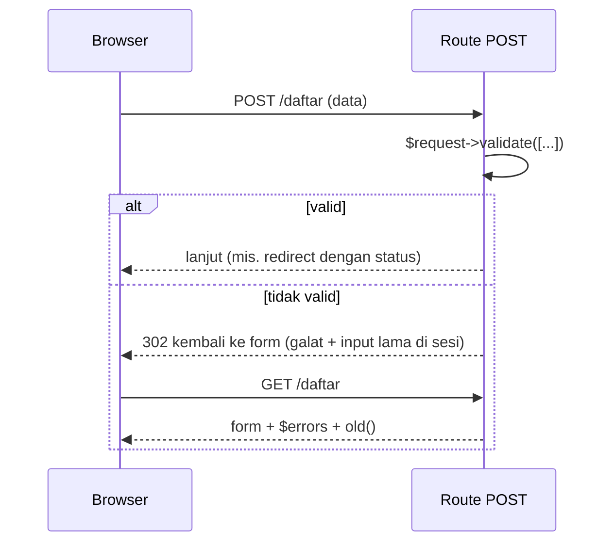
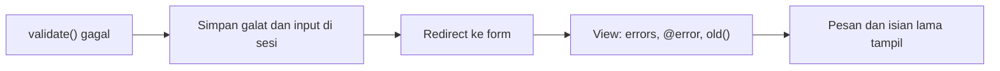

# Pesan Error Form

Pengguna sering salah mengisi form: email tanpa tanda `@`, nama kosong, angka di kolom teks. Aplikasi yang baik menolak data itu **dan** menjelaskan apa yang salah,
tanpa menghapus isian yang sudah benar. Sub bab ini menunjukkan cara menampilkan pesan galat validasi di Blade memakai `$errors`, `@error`, dan `old()`. Aturan validasi
sendiri dibahas lengkap pada bab utama Form Validation; di sini kamu hanya memakai bagian minimal agar pesan galat muncul.

## Tujuan Pembelajaran

Setelah menyelesaikan sub bab ini, kamu dapat:

- [ ] Menjelaskan alur validasi: gagal → redirect kembali dengan galat dan input lama.
- [ ] Menampilkan galat per kolom dengan `@error` dan variabel `$message`.
- [ ] Menampilkan ringkasan semua galat dengan `$errors->any()` dan `$errors->all()`.
- [ ] Menandai kolom bermasalah dengan kelas CSS.
- [ ] Mempertahankan input dengan `old()`.
- [ ] Menjelaskan *named error bag* untuk halaman dengan banyak form.

## Prasyarat

- [Blade Forms](03-12-blade-forms.md), [Form Method Spoofing](03-13-form-method-spoofing.md), dan [Proteksi CSRF](03-14-csrf-protection.md).
- [Direktif Kondisional](03-04-conditional-directives.md) dan [Direktif Perulangan](03-05-loop-directives.md).
- Proyek `belajar-blade` dengan form `/daftar`.

## Pengantar

Tanpa pesan galat, pengguna hanya melihat form yang tidak berubah dan tidak tahu mengapa. Laravel membuat alur ini mudah: bila validasi gagal, ia secara otomatis
mengalihkan pengguna kembali ke halaman sebelumnya, membawa pesan galat dan input lama di sesi. Tugasmu di Blade hanya menampilkannya.

## Penjelasan Konsep

### Alur validasi



### Validasi minimal di route

```php-inline
$validated = $request->validate([
    'nama' => 'required|min:3',
    'email' => 'required|email',
    'kota' => 'required',
    'setuju' => 'accepted',
]);
```

| Aturan | Arti |
|---|---|
| `required` | Wajib diisi |
| `min:3` | Minimal 3 karakter |
| `email` | Harus berformat email |
| `accepted` | Harus dicentang (nilai `yes`, `on`, `1`, atau `true`) |

Bila validasi gagal, Laravel melempar pengecualian yang diterjemahkan menjadi pengalihan ke URL sebelumnya, dengan galat dan input tersimpan di sesi. Bila lolos, kode
setelahnya berjalan dan `$validated` berisi data yang tervalidasi. Pesan galat bawaan berbahasa Inggris; menerjemahkannya dibahas pada bab Form Validation.

### Variabel `$errors`

Pada view yang dirender di grup `web`, variabel `$errors` selalu tersedia (bila tidak ada galat, ia kosong). Metode yang berguna:

| Cara | Hasil |
|---|---|
| `$errors->any()` | `true` bila ada galat |
| `$errors->all()` | Array semua pesan galat |
| `$errors->has('email')` | `true` bila kolom `email` memiliki galat |
| `$errors->first('email')` | Pesan pertama untuk `email` (atau string kosong) |

### Direktif `@error`

`@error('kolom')` menjalankan isinya hanya bila kolom punya galat; di dalamnya variabel `$message` berisi pesannya:

```html
<label for="email">Email</label>
<input id="email" type="email" name="email" value="{{ old('email') }}"
       class="@error('email') invalid @enderror">

@error('email')
    <div class="galat">{{ $message }}</div>
@enderror
```

Karena `@error` dikompilasi menjadi `if`, kamu dapat memakai `@else` untuk keadaan tanpa galat:

```html
<input class="@error('email') invalid @else valid @enderror">
```

### Ringkasan semua galat

```html
@if ($errors->any())
    <div class="galat">
        <strong>Periksa kembali isian kamu:</strong>
        <ul>
            @foreach ($errors->all() as $galat)
                <li>{{ $galat }}</li>
            @endforeach
        </ul>
    </div>
@endif
```

### Mempertahankan input

Setelah validasi gagal, `old('nama')` mengembalikan nilai yang dikirim sebelumnya, sehingga pengguna tidak perlu mengetik ulang. Pasangkan dengan `@selected` dan `@checked` untuk
`select` dan `checkbox` seperti pada sub bab Blade Forms. Jangan pernah mengisi ulang kolom kata sandi dengan `old()`.

### *Named error bag*

Jika satu halaman memuat beberapa form (misalnya login dan daftar) dan galat tidak boleh bercampur, beri nama pada *error bag*. Dokumentasi menunjukkan nama kantong
sebagai argumen kedua `@error`:

```html
@error('email', 'login')
    <div class="galat">{{ $message }}</div>
@enderror
```

Cara mengisi kantong bernama dari sisi validasi dibahas pada bab Form Validation.

### Keamanan dan pengalaman pengguna

- Pesan galat dicetak dengan `{{ }}`; jangan ubah menjadi `{!! !!}`.
- Jangan membocorkan informasi sensitif di pesan (misalnya "email sudah terdaftar" pada form login dapat membantu penyerang menebak akun).
- Validasi sisi klien (`required`, `type="email"`) hanya kenyamanan. Validasi server tetap wajib.
- Tampilkan pesan dekat kolom yang bermasalah dan sebut apa yang harus dilakukan.

## Cara Kerja



## Contoh Praktik

Kamu menambah validasi ke route `POST /daftar` dari sub bab Blade Forms, lalu memperbarui view agar menampilkan ringkasan galat, pesan per kolom, kelas CSS, dan isian lama.

## Penjelasan Kode

File: `routes/web.php` (ubah route `POST /daftar`)

```php-inline
Route::post('/daftar', function (Request $request) {
    $data = $request->validate([
        'nama' => 'required|min:3',
        'email' => 'required|email',
        'kota' => 'required',
        'setuju' => 'accepted',
    ]);

    return redirect()
        ->route('daftar.form')
        ->with('status', 'Terima kasih, '.$data['nama'].'. Data diterima.');
})->name('daftar.simpan');
```

| Bagian | Fungsi |
|---|---|
| `$request->validate([...])` | Memvalidasi; mengalihkan kembali otomatis bila gagal |
| `$data['nama']` | Aman dipakai karena `nama` sudah pasti ada setelah validasi lolos |

File: `resources/views/daftar.blade.php` (ganti isi `<form>` dan tambahkan ringkasan galat)

```html
<x-layout>
    <x-slot:title>
        Pendaftaran
    </x-slot>

    <h1>Pendaftaran</h1>

    @session('status')
        <p class="sukses">{{ $value }}</p>
    @endsession

    @if ($errors->any())
        <div class="galat">
            <strong>Periksa kembali isian kamu:</strong>
            <ul>
                @foreach ($errors->all() as $pesan)
                    <li>{{ $pesan }}</li>
                @endforeach
            </ul>
        </div>
    @endif

    <form action="{{ route('daftar.simpan') }}" method="POST" novalidate>
        @csrf

        <p>
            <label for="nama">Nama</label><br>
            <input type="text" id="nama" name="nama" value="{{ old('nama') }}"
                   class="@error('nama') invalid @enderror">
            @error('nama')
                <br><small class="galat-teks">{{ $message }}</small>
            @enderror
        </p>

        <p>
            <label for="email">Email</label><br>
            <input type="email" id="email" name="email" value="{{ old('email') }}"
                   class="@error('email') invalid @enderror">
            @error('email')
                <br><small class="galat-teks">{{ $message }}</small>
            @enderror
        </p>

        <p>
            <label for="kota">Kota</label><br>
            <select id="kota" name="kota" class="@error('kota') invalid @enderror">
                <option value="">-- pilih --</option>
                @foreach ($kota as $kunci => $nama)
                    <option value="{{ $kunci }}" @selected(old('kota') == $kunci)>{{ $nama }}</option>
                @endforeach
            </select>
            @error('kota')
                <br><small class="galat-teks">{{ $message }}</small>
            @enderror
        </p>

        <p>
            <label>
                <input type="checkbox" name="setuju" value="1" @checked(old('setuju'))>
                Saya setuju dengan syarat dan ketentuan
            </label>
            @error('setuju')
                <br><small class="galat-teks">{{ $message }}</small>
            @enderror
        </p>

        <button type="submit">Daftar</button>
    </form>
</x-layout>
```

Tambahkan di `<style>` layout:

```html
.galat { background: #fde2e2; padding: 8px; margin: 8px 0; }
.galat-teks { color: #b91c1c; }
input.invalid, select.invalid { border: 2px solid #b91c1c; }
```

| Bagian | Fungsi |
|---|---|
| `novalidate` pada `<form>` | Mematikan validasi bawaan browser agar galat server terlihat saat belajar (jangan dipakai sebagai pengganti validasi server) |
| `@if ($errors->any())` | Menampilkan kotak ringkasan hanya bila ada galat |
| `@error('nama') invalid @enderror` | Menambah kelas `invalid` bila `nama` bermasalah |
| `@error('nama') ... @enderror` | Menampilkan pesan untuk kolom `nama` |
| `old(...)`, `@selected`, `@checked` | Mempertahankan isian setelah validasi gagal |

## Implementasi Langkah demi Langkah

### Langkah 1: ubah route

Ganti route `POST /daftar` dengan versi bervalidasi.

### Langkah 2: ubah view

Perbarui `daftar.blade.php` dan tambahkan gaya ke layout.

### Langkah 3: jalankan

```bash
php artisan serve
```

Buka `http://127.0.0.1:8000/daftar`.

### Langkah 4: kirim form kosong

Klik **Daftar** tanpa mengisi apa pun. Amati ringkasan galat, pesan per kolom, dan batas merah pada kolom bermasalah.

### Langkah 5: isi sebagian

Isi nama `Bu`, email `salah`, pilih kota, lalu kirim. Pastikan nama, email, dan kota terisi kembali dan pesan galat sesuai.

### Langkah 6: kirim data benar

Isi nama `Budi`, email `budi@contoh.test`, kota, centang persetujuan, lalu kirim. Pastikan pesan hijau muncul.

### Langkah 7: catat di Git

```bash
git add resources/views routes/web.php
git commit -m "Tambah validasi dan pesan error pada form pendaftaran"
```

## Eksekusi dan Verifikasi

| Langkah | Cara memverifikasi |
|---|---|
| 1–3 | Halaman form tampil |
| 4 | Empat pesan galat (nama, email, kota, setuju) dan kotak ringkasan |
| 5 | Isian lama tetap ada; galat tersisa hanya untuk kolom yang salah |
| 6 | Pesan status hijau; tidak ada kotak galat |
| 7 | Commit tercatat |

## Hasil yang Diharapkan

| Kondisi | Tampilan |
|---|---|
| Form kosong | Kotak galat berisi empat pesan; teks pesan bawaan berbahasa Inggris, misalnya tentang kolom wajib diisi |
| Nama `Bu`, email `salah` | Galat nama (minimal 3 karakter) dan email (format tidak valid); nama dan email tetap terisi |
| Semua benar | `Terima kasih, Budi. Data diterima.` |

Teks pesan persis ditentukan paket bahasa Laravel dan dapat berbeda antar versi. Hasil ini diturunkan dari dokumentasi dan belum dijalankan oleh penulis materi; cocokkan
dengan hasilmu.

## Kesalahan Umum dan Pemecahan Masalah

| Gejala | Penyebab | Cara mengenali | Solusi | Pencegahan |
|---|---|---|---|---|
| Tidak ada pesan galat, form hanya kembali | View tidak memakai `$errors` atau `@error` | Form kosong tanpa pesan | Tambahkan `@error`/ringkasan | Tambah blok galat di template form |
| Isian hilang setelah galat | Lupa `old()` | Form kosong lagi | Pakai `old()` di setiap kolom | Pola bawaan template form |
| `@error('email')` tak pernah tampil | Nama kolom berbeda dengan `name` input | Pesan tidak muncul | Samakan nama dengan kunci aturan | Cocokkan `name` dan aturan |
| Pengguna tidak melihat galat browser dan server sekaligus | Validasi browser memblokir kirim | Server tidak pernah terpanggil | Gunakan `novalidate` untuk uji | Validasi server tetap wajib |
| `419` saat mengirim | `@csrf` hilang | Status 419 | Tambah `@csrf` | Lihat sub bab CSRF |
| `Undefined array key "nama"` | Mengakses `$request->input` sebelum validasi atau aturan tidak mencakup kolom | Error di route | Validasi dahulu dan gunakan `$data` hasil validasi | Selalu pakai data tervalidasi |
| Galat dari form A muncul di form B | Memakai satu kantong galat untuk beberapa form | Pesan tercampur | Gunakan named error bag | Pisahkan kantong per form |
| Pesan galat berbahasa Inggris | Paket bahasa bawaan | Teks Inggris | Publikasikan dan terjemahkan berkas bahasa (bab Form Validation) | Rencanakan lokalisasi sejak awal |

## Latihan Praktik

### Latihan dasar

**D1. Satu kolom**
- *Masalah:* form kontak butuh galat untuk email.
- *Persyaratan:* tambahkan `@error('email')` pada form kontak dan aturan `required|email`.
- *Perilaku yang diharapkan:* pesan muncul bila email kosong atau salah format.
- *Tujuan belajar:* memakai `@error`.

**D2. Ringkasan galat**
- *Masalah:* ingin daftar semua kesalahan di atas form.
- *Persyaratan:* tambahkan blok `$errors->any()` dan `$errors->all()` yang membentuk daftar.
- *Perilaku yang diharapkan:* semua galat tampil sebagai daftar.
- *Tujuan belajar:* menampilkan ringkasan.

### Latihan implementasi

**I1. Kolom tambahan**
- *Masalah:* pendaftaran butuh nomor telepon.
- *Persyaratan:* tambahkan kolom `telepon` dengan aturan `required|digits_between:10,13`, galat per kolom, kelas `invalid`, dan `old()`.
- *Perilaku yang diharapkan:* telepon salah menampilkan galat dan nilai tetap terisi.
- *Tujuan belajar:* menerapkan pola lengkap pada kolom baru.

**I2. Komponen kolom form**
- *Masalah:* pola input + label + galat berulang di setiap kolom.
- *Persyaratan:* buat komponen anonim `x-kolom` dengan props `nama`, `label`, `tipe`, yang mencetak label, input ber-`old()`, kelas `invalid`, dan `@error`. Gunakan untuk `nama` dan `email`.
- *Perilaku yang diharapkan:* form lebih singkat dan perilaku tidak berubah.
- *Tujuan belajar:* menggabungkan komponen dengan penanganan galat.

### Latihan tantangan

**T1. Dua form satu halaman**
- *Masalah:* halaman memuat form "masuk" dan "daftar", galat harus terpisah.
- *Persyaratan:* gunakan `validateWithBag('login', [...])` pada route login dan `@error('email', 'login')` pada view. Jelaskan perbedaan dengan satu kantong.
- *Perilaku yang diharapkan:* galat form masuk tidak muncul di form daftar.
- *Tujuan belajar:* memakai named error bag. (Rujuk dokumentasi validasi untuk `validateWithBag`.)
- *Catatan:* kerjakan mandiri; tidak ada kunci jawaban.

## Uji Pemahaman

1. Apa yang dilakukan Laravel bila `validate()` gagal?
2. Apa isi variabel `$message` di dalam `@error`?
3. Apa beda `$errors->first('email')` dan `$errors->all()`?
4. Mengapa `old()` penting?
5. Mengapa kolom kata sandi tidak diisi ulang dengan `old()`?
6. Mengapa validasi sisi klien tidak cukup?
7. Kapan memakai named error bag?

??? success "Kunci jawaban singkat"
    1. Mengalihkan kembali ke halaman sebelumnya dengan galat dan input lama di sesi.
    2. Pesan galat pertama untuk kolom yang diperiksa.
    3. `first` mengembalikan satu pesan untuk satu kolom; `all` mengembalikan semua pesan semua kolom.
    4. Mengembalikan isian pengguna sehingga tidak perlu mengetik ulang.
    5. Kata sandi tidak boleh ditampilkan kembali di HTML.
    6. Pengguna dapat melewati validasi browser; server harus memeriksa ulang.
    7. Saat satu halaman memuat beberapa form dan galatnya tidak boleh bercampur.

## Ringkasan

- Validasi gagal membuat Laravel mengalihkan kembali dengan galat dan input lama.
- Gunakan `$errors->any()`/`all()` untuk ringkasan dan `@error` untuk pesan per kolom.
- `old()`, `@selected`, dan `@checked` mempertahankan isian.
- Cetak pesan dengan `{{ }}` dan jangan bocorkan informasi sensitif.
- Validasi server wajib; named error bag memisahkan galat antar form.

Selanjutnya: *Manajemen Aset*, tempat menaruh dan memuat CSS, JavaScript, dan gambar.

## Referensi Resmi

- [Laravel: Validation Errors in Blade](https://laravel.com/docs/13.x/blade#validation-errors)
- [Laravel: Validation](https://laravel.com/docs/13.x/validation)
- [Laravel: Displaying the Validation Errors](https://laravel.com/docs/13.x/validation#quick-displaying-the-validation-errors)
- [Laravel: Old Input](https://laravel.com/docs/13.x/requests#old-input)
