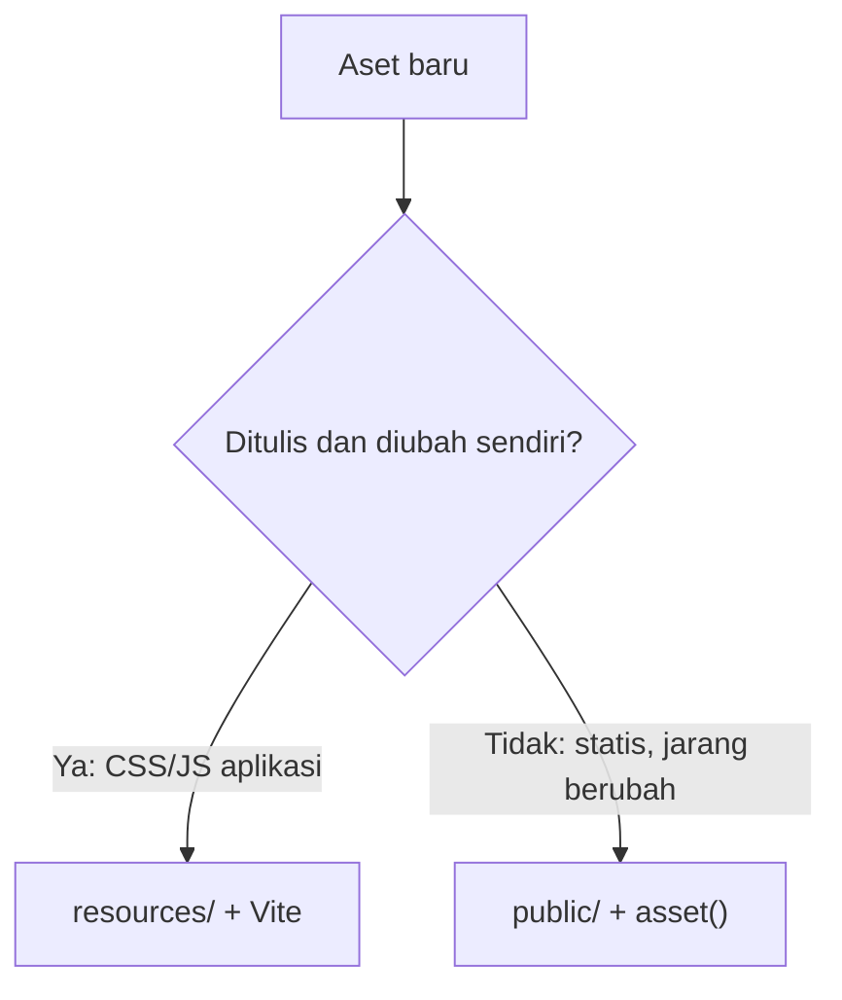
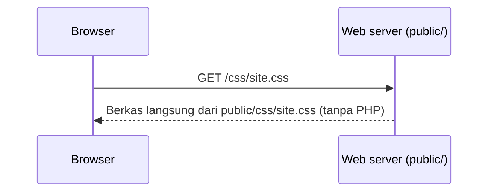

# Manajemen Aset

Halaman web terdiri dari lebih dari HTML: ada CSS untuk gaya, JavaScript untuk interaksi, serta gambar dan font. Semua itu disebut **aset** (*assets*). Laravel
menyediakan dua tempat berbeda untuk menyimpannya, dengan tujuan yang berbeda pula. Sub bab ini menjelaskan keduanya, kapan memilih masing-masing, dan cara memuatnya dari Blade.

## Tujuan Pembelajaran

Setelah menyelesaikan sub bab ini, kamu dapat:

- [ ] Menjelaskan apa itu aset dan contohnya.
- [ ] Membedakan folder `public` (disajikan apa adanya) dan `resources` (diproses build).
- [ ] Memuat aset dari `public` memakai helper `asset()`.
- [ ] Menjelaskan masalah *cache* browser pada aset yang berubah dan cara versi aset mengatasinya.
- [ ] Menyebutkan berkas aset yang tidak boleh di-*commit* ke Git.
- [ ] Memilih lokasi aset sesuai kebutuhan.

## Prasyarat

- [Struktur Direktori Laravel](../level-01/01-09-laravel-directory-structure.md), terutama `public/` dan `resources/`.
- [Layout Blade](03-06-blade-layouts.md).
- Dasar HTML dan CSS (`<link>`, ``, `<script>`).
- Proyek `belajar-blade`.

## Pengantar

Sejauh ini gaya CSS ditulis langsung di tag `<style>` di layout. Itu cukup untuk belajar, tetapi tidak untuk aplikasi nyata: gaya tidak bisa di-*cache* browser, sulit
dirapikan, dan tidak bisa dipakai oleh banyak layout. Aset sebaiknya berada di berkas terpisah, dan Laravel perlu tahu di mana serta bagaimana menyajikannya.

## Penjelasan Konsep

### Dua lokasi aset

| Lokasi | Sifat | Cocok untuk |
|---|---|---|
| `public/` | Disajikan **apa adanya** oleh web server | Berkas statis kecil: `favicon.ico`, `robots.txt`, gambar yang tidak berubah |
| `resources/` (css, js, images) | **Diproses** oleh Vite saat build, hasilnya ke `public/build` | CSS dan JavaScript aplikasi yang ditulis dan dikembangkan terus-menerus |

`public/` adalah satu-satunya folder yang bisa diakses langsung dari browser (document root). Karena itu, apa pun yang ada di sana bersifat publik. `resources/`
berada di luar document root sehingga isinya tidak dapat diakses langsung; ia hanya terbaca setelah diproses.

### Helper `asset()`

Berkas di `public/` dimuat dengan helper `asset()`, yang menghasilkan URL lengkap menuju berkas itu:

```html
<link rel="stylesheet" href="{{ asset('css/site.css') }}">

<script src="{{ asset('js/site.js') }}"></script>
```

| Pemanggilan | Berkas | Contoh URL |
|---|---|---|
| `asset('css/site.css')` | `public/css/site.css` | `http://127.0.0.1:8000/css/site.css` |
| `asset('images/logo.svg')` | `public/images/logo.svg` | `http://127.0.0.1:8000/images/logo.svg` |

URL dibentuk dari alamat request saat ini, sehingga tetap benar saat aplikasi pindah domain. Nilainya dapat diatur dengan variabel `ASSET_URL` (mis. untuk CDN).
Jangan menulis `/css/site.css` secara manual di layout, karena akan salah bila aplikasi berada di subfolder.

### Masalah cache

Browser menyimpan CSS dan JavaScript agar halaman berikutnya cepat. Bila kamu mengubah `site.css` tanpa mengubah namanya, pengunjung bisa tetap memakai versi lama.

| Pendekatan | Hasil |
|---|---|
| `public/css/site.css` diganti | Nama sama; browser bisa memakai cache lama |
| Build Vite menghasilkan `app-<hash>.css` | Isi berubah → nama (hash) berubah → browser mengunduh versi baru |

Pemberian nama berbasis isi seperti ini disebut **versioning** atau *cache busting*, dan merupakan alasan utama memakai Vite untuk aset aplikasi (dibahas di sub bab berikutnya).

### Aset yang tidak ikut di Git

Hasil build dan paket dapat dibuat ulang, sehingga tidak disimpan di repositori. Proyek Laravel baru sudah mengabaikannya lewat `.gitignore`, di antaranya:

| Folder/berkas | Isi |
|---|---|
| `node_modules/` | Paket JavaScript hasil `npm install` |
| `public/build/` | Hasil `npm run build` |
| `public/hot` | Penanda server pengembangan Vite aktif |

Periksa `.gitignore` proyekmu untuk memastikan entri tersebut ada. Berkas `package.json` dan `package-lock.json` tetap di-*commit*.

### Memilih lokasi



### Keamanan

- Segala yang ada di `public/` dapat diunduh siapa saja. Jangan taruh berkas rahasia, cadangan basis data, atau `.env` di sana.
- Jangan membiarkan pengguna mengunggah berkas langsung ke `public/` tanpa pemeriksaan; unggahan dibahas pada bab lain dengan penyimpanan yang aman.
- Muat pustaka dari CDN hanya bila perlu dan percayai sumbernya. Atribut `integrity` (SRI) membantu memastikan berkas tidak diubah.

## Cara Kerja



Berkas yang ada di `public/` disajikan langsung oleh web server tanpa melewati Laravel. Saat memakai `php artisan serve`, hal yang sama terjadi pada aset statis.

## Contoh Praktik

Kamu memindahkan gaya dari layout ke `public/css/site.css`, menaruh logo di `public/images/logo.svg`, dan memuat keduanya di layout memakai `asset()`. Lalu kamu mengamati efek cache saat berkas diubah.

## Penjelasan Kode

File: `public/css/site.css`

```css
body { font-family: sans-serif; margin: 0 auto; max-width: 800px; padding: 16px; }
nav a { margin-right: 8px; }
.logo { height: 32px; vertical-align: middle; }
.sukses { background: #c8f7c5; padding: 8px; }
.galat { background: #fde2e2; padding: 8px; margin: 8px 0; }
.galat-teks { color: #b91c1c; }
input.invalid, select.invalid { border: 2px solid #b91c1c; }
```

File: `public/images/logo.svg`

```html
<svg xmlns="http://www.w3.org/2000/svg" width="64" height="64" viewBox="0 0 64 64">
  <rect width="64" height="64" rx="12" fill="#ef4444"/>
  <text x="32" y="42" font-size="32" text-anchor="middle" fill="#fff" font-family="sans-serif">B</text>
</svg>
```

File: `resources/views/components/layout.blade.php` (ubah bagian `<head>` dan `<nav>`)

```html
<head>
    <meta charset="UTF-8">
    <meta name="viewport" content="width=device-width, initial-scale=1">
    <meta name="csrf-token" content="{{ csrf_token() }}">
    <title>{{ $title ?? 'Belajar Blade' }}</title>
    <link rel="stylesheet" href="{{ asset('css/site.css') }}">
</head>
<body>
    <nav>
        
        <a href="/beranda">Beranda</a>
        <a href="/kontak">Kontak</a>
    </nav>
```

Hapus blok `<style>...</style>` lama dari layout agar gaya hanya berasal dari berkas CSS.

| Bagian | Fungsi |
|---|---|
| `asset('css/site.css')` | URL ke `public/css/site.css` |
| `asset('images/logo.svg')` | URL ke `public/images/logo.svg` |
| `` | Gambar dengan teks alternatif untuk aksesibilitas |

Gaya khusus komponen yang sebelumnya ada di `<style>` (misalnya `.alert`, `.tombol`, `.kartu`) boleh kamu pindahkan ke `site.css` juga.

## Implementasi Langkah demi Langkah

### Langkah 1: buat folder dan berkas aset

Buat `public/css/site.css` dan `public/images/logo.svg`.

### Langkah 2: ubah layout

Ganti `<style>` dengan `<link>` dan tambahkan logo seperti di atas.

### Langkah 3: jalankan

```bash
php artisan serve
```

Buka `http://127.0.0.1:8000/beranda`. Halaman harus tetap bergaya dan logo tampil.

### Langkah 4: akses aset langsung

Buka `http://127.0.0.1:8000/css/site.css` dan `http://127.0.0.1:8000/images/logo.svg` di browser. Kamu akan melihat isi berkasnya.

### Langkah 5: periksa URL hasil `asset()`

Lihat sumber halaman dan salin nilai `href` pada tag `<link>`.

### Langkah 6: amati cache

Buka tab Network pada alat pengembang browser, muat ulang halaman, dan lihat berkas `site.css`. Ubah warna di berkas, muat ulang biasa (F5) lalu muat ulang paksa (Ctrl+F5), dan bandingkan.

### Langkah 7: periksa `.gitignore`

```bash
cat .gitignore
```

Pastikan `/node_modules`, `/public/build`, dan `/public/hot` ada.

### Langkah 8: catat di Git

```bash
git add public resources/views
git commit -m "Pindahkan gaya ke public/css dan tambah logo"
```

## Eksekusi dan Verifikasi

| Langkah | Cara memverifikasi |
|---|---|
| 1–3 | Halaman bergaya dan menampilkan logo |
| 4 | Berkas CSS dan SVG dapat dibuka langsung |
| 5 | `href` berbentuk `http://127.0.0.1:8000/css/site.css` |
| 6 | Perubahan tampil setelah muat ulang (paksa bila perlu) |
| 7 | Entri `node_modules`, `public/build`, dan `public/hot` ada |
| 8 | Commit tercatat |

## Hasil yang Diharapkan

| Aksi | Hasil |
|---|---|
| `/beranda` | Teks `sans-serif`, logo merah berhuruf B di menu |
| `/css/site.css` | Isi CSS tampil sebagai teks |
| Mengubah CSS lalu F5 | Tergantung cache browser; Ctrl+F5 selalu mengambil versi baru |

Perilaku cache berbeda antar browser dan pengaturan alat pengembang. Hasil ini diturunkan dari dokumentasi dan perilaku umum, dan belum dijalankan oleh penulis materi;
cocokkan dengan hasilmu.

## Kesalahan Umum dan Pemecahan Masalah

| Gejala | Penyebab | Cara mengenali | Solusi | Pencegahan |
|---|---|---|---|---|
| Halaman tidak bergaya | Path salah atau berkas bukan di `public/` | Tab Network menunjukkan 404 pada CSS | Samakan path `asset()` dengan lokasi berkas | Cek dengan membuka URL aset langsung |
| Gambar tidak muncul | Nama berkas berbeda (huruf besar/kecil) | 404 di Network | Samakan nama persis | Gunakan huruf kecil konsisten |
| Gaya lama tetap tampil | Cache browser | Isi lama setelah edit | Muat ulang paksa; gunakan Vite versioning | Aset aplikasi lewat Vite |
| URL aset salah di produksi | `ASSET_URL` atau `APP_URL` salah | Tautan menunjuk domain lain | Perbaiki konfigurasi `.env` | Uji URL setelah deploy |
| `404` untuk `/storage/...` | Tautan simbolik belum dibuat | Berkas unggahan tidak ditemukan | `php artisan storage:link` | Jalankan setelah instalasi |
| `node_modules` ikut ter-*commit* | `.gitignore` diubah | Repo berukuran besar | Hapus dari index dan kembalikan `.gitignore` | Jangan mengedit entri bawaan |
| Berkas rahasia bisa diunduh | Ditaruh di `public/` | URL berkas terbuka | Pindahkan ke luar `public/` | Hanya aset publik di `public/` |

## Latihan Praktik

### Latihan dasar

**D1. Pindahkan satu aturan**
- *Masalah:* gaya `.tombol` masih di komponen.
- *Persyaratan:* pindahkan aturan `.tombol` ke `public/css/site.css` dan pastikan tampilan tidak berubah.
- *Perilaku yang diharapkan:* tombol tetap bergaya.
- *Tujuan belajar:* memusatkan CSS di berkas eksternal.

**D2. Jenis aset**
- *Masalah:* ingin tahu tempat yang tepat.
- *Persyaratan:* tentukan lokasi (`public/` atau `resources/`) untuk favicon, CSS aplikasi, JavaScript aplikasi, dan `robots.txt`, beserta alasannya.
- *Perilaku yang diharapkan:* jawaban memuat alasan sifat berkas.
- *Tujuan belajar:* memilih lokasi aset.

### Latihan implementasi

**I1. Favicon**
- *Masalah:* tab tidak berikon.
- *Persyaratan:* taruh `favicon.svg` di `public/`, tambah `<link rel="icon" href="{{ asset('favicon.svg') }}">` di layout, dan verifikasi.
- *Perilaku yang diharapkan:* ikon tampil di tab.
- *Tujuan belajar:* memuat aset dengan `asset()`.

**I2. Halaman dengan gambar**
- *Masalah:* halaman produk perlu gambar.
- *Persyaratan:* buat tiga gambar kecil di `public/images/produk/`, lalu tampilkan di `@foreach` memakai `asset('images/produk/'.$p['gambar'])` dan `alt` yang bermakna.
- *Perilaku yang diharapkan:* tiga gambar tampil.
- *Tujuan belajar:* membangun path aset dinamis.

### Latihan tantangan

**T1. Eksperimen cache**
- *Masalah:* ingin membuktikan masalah cache.
- *Persyaratan:* gunakan alat pengembang untuk mencatat status/ukuran `site.css` pada muat ulang biasa, ubah isinya, dan jelaskan mengapa versioning berbasis hash mengatasinya.
- *Perilaku yang diharapkan:* catatan menunjukkan perilaku cache dan penjelasan hash.
- *Tujuan belajar:* memahami cache busting.
- *Catatan:* kerjakan mandiri; tidak ada kunci jawaban.

## Uji Pemahaman

1. Apa itu aset? Beri tiga contoh.
2. Apa beda `public/` dan `resources/` untuk aset?
3. Apa fungsi `asset()`?
4. Mengapa `public/` tidak boleh berisi berkas rahasia?
5. Apa itu cache busting?
6. Folder apa yang tidak di-*commit* ke Git?
7. Kapan cukup memakai `public/` dan kapan memakai Vite?

??? success "Kunci jawaban singkat"
    1. Berkas pendukung halaman: CSS, JavaScript, gambar (juga font).
    2. `public/` disajikan apa adanya; `resources/` diproses build lalu dihasilkan ke `public/build`.
    3. Menghasilkan URL lengkap ke berkas di `public/`.
    4. Semua isinya dapat diunduh siapa saja.
    5. Mengubah nama berkas bila isinya berubah agar browser mengambil versi baru.
    6. `node_modules`, `public/build`, dan `public/hot`.
    7. `public/` untuk berkas statis yang jarang berubah; Vite untuk CSS/JS aplikasi yang aktif dikembangkan.

## Ringkasan

- Aset adalah CSS, JavaScript, gambar, dan font.
- `public/` disajikan langsung dan dimuat dengan `asset()`; `resources/` diproses Vite.
- Cache browser dapat menampilkan aset lama; versioning berbasis hash mengatasinya.
- `node_modules`, `public/build`, dan `public/hot` tidak masuk Git.
- Semua yang ada di `public/` bersifat publik.

Selanjutnya: *Integrasi Vite*, membangun dan memuat aset aplikasi dengan Vite.

## Referensi Resmi

- [Laravel: Helpers, asset()](https://laravel.com/docs/13.x/helpers#method-asset)
- [Laravel: Asset Bundling (Vite)](https://laravel.com/docs/13.x/vite)
- [Laravel: Directory Structure](https://laravel.com/docs/13.x/structure)
- [Laravel: Filesystem, public disk](https://laravel.com/docs/13.x/filesystem#the-public-disk)
