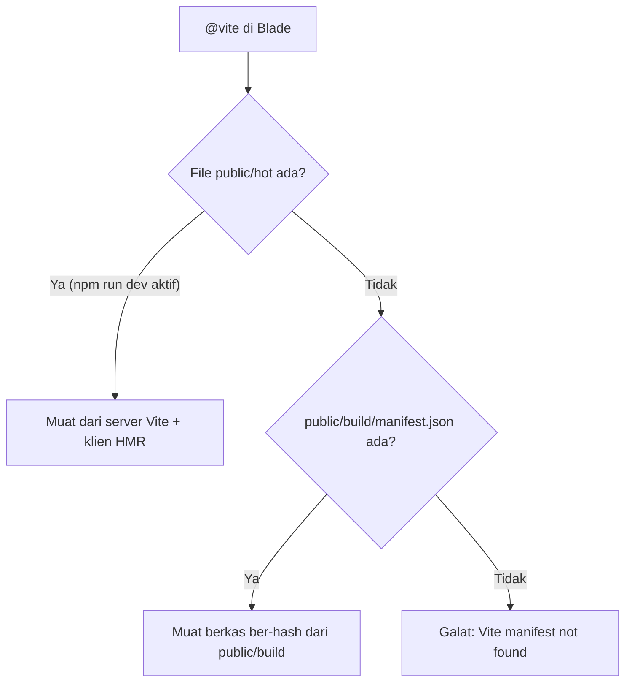
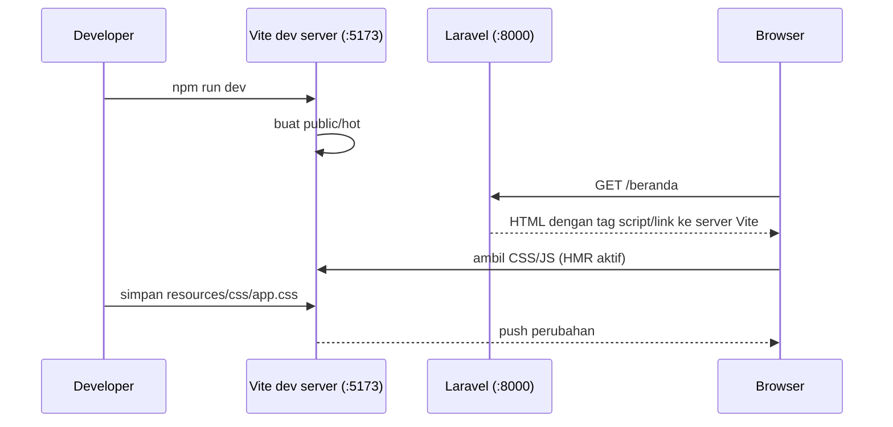

# Integrasi Vite

Pada sub bab sebelumnya CSS dimuat apa adanya dari `public/`. Aplikasi yang berkembang membutuhkan lebih: penggabungan berkas, pengecilan ukuran, nama berkas
ber-*hash* untuk mengatasi cache, dan pembaruan otomatis di browser saat kamu menyimpan perubahan. Laravel memakai **Vite**, alat build frontend modern, untuk semua itu.
Sub bab ini menjelaskan cara memasang, menjalankan, dan memuat aset Vite dari Blade.

## Tujuan Pembelajaran

Setelah menyelesaikan sub bab ini, kamu dapat:

- [ ] Menjelaskan peran Vite dan plugin `laravel-vite-plugin`.
- [ ] Memasang dependensi frontend dengan `npm install`.
- [ ] Membaca `vite.config.js` dan menjelaskan opsi `input` serta `refresh`.
- [ ] Memuat aset dengan direktif `@vite`.
- [ ] Membedakan `npm run dev` (pengembangan) dan `npm run build` (produksi).
- [ ] Mendiagnosis galat *Vite manifest not found*.

## Prasyarat

- [Manajemen Aset](03-16-asset-management.md).
- Node.js dan npm terpasang (periksa dengan `node -v` dan `npm -v`).
- Terminal dan `php artisan serve` berjalan.
- Proyek `belajar-blade`. Bila saat membuat proyek kamu tidak memasang dependensi npm, jalankan `npm install` sekarang.

## Pengantar

Tanpa alat build, kamu mengelola ratusan berkas CSS/JS secara manual, memperbarui nama berkas agar browser mengambil versi baru, dan menekan Ctrl+F5 setiap kali mengubah
sesuatu. Vite menyelesaikan ketiganya: di mode pengembangan, perubahan langsung tampil; di mode produksi, berkas digabung, dikecilkan, dan diberi nama berbasis isi.

## Penjelasan Konsep

### Apa itu Vite?

Menurut dokumentasi, Vite adalah alat build frontend modern yang menyediakan lingkungan pengembangan sangat cepat dan membundel kode untuk produksi. Laravel
menyediakan **plugin resmi** dan **direktif Blade** (`@vite`) yang menghubungkan keduanya.

### Prasyarat: Node.js

Vite berjalan di Node.js. Periksa:

```bash
node -v
npm -v
```

Dokumentasi Laravel menyebut Node.js dan NPM harus terpasang; gunakan versi LTS terbaru, dan lihat dokumentasi Vite untuk batas minimum persisnya. Node.js hanya dipakai
saat **membangun** aset di komputer pengembang atau server build; aplikasi yang sudah di-build tidak memerlukan Node.js untuk berjalan.

### Berkas penting di proyek baru

| Berkas | Fungsi |
|---|---|
| `package.json` | Daftar paket JavaScript dan skrip `dev` serta `build` |
| `vite.config.js` | Konfigurasi Vite |
| `resources/css/app.css` | Titik masuk (*entry point*) CSS |
| `resources/js/app.js` | Titik masuk JavaScript |
| `node_modules/` | Paket yang dipasang (tidak di-*commit*) |

Pada kerangka Laravel terbaru, `package.json` memuat skrip `"dev": "vite"` dan `"build": "vite build"`, serta paket seperti `vite` dan `laravel-vite-plugin`
(proyek baru juga menyertakan Tailwind CSS). Versi persisnya berubah antar rilis; lihat berkas di proyekmu.

### Memasang dependensi

```bash
npm install
```

Perintah ini membaca `package.json`, mengunduh paket ke `node_modules/`, dan membuat `package-lock.json`.

### Konfigurasi: `vite.config.js`

```js
import { defineConfig } from 'vite';
import laravel from 'laravel-vite-plugin';

export default defineConfig({
    plugins: [
        laravel({
            input: ['resources/css/app.css', 'resources/js/app.js'],
            refresh: true,
        }),
    ],
});
```

| Bagian | Fungsi |
|---|---|
| `input` | Daftar *entry point*: berkas yang akan dibundel dan dimuat dari Blade |
| `refresh: true` | Memuat ulang browser otomatis saat berkas Blade, rute, dan beberapa folder lain berubah (hanya saat `npm run dev`) |

Menurut dokumentasi, `refresh: true` memantau antara lain `resources/views/**`, `routes/**`, dan `app/View/Components/**`.

### Memuat aset: `@vite`

Taruh direktif `@vite` di `<head>`:

```html
<head>
    @vite(['resources/css/app.css', 'resources/js/app.js'])
</head>
```

Argumennya adalah path entry point **relatif ke root proyek**, bukan URL. Dokumentasi menyebut direktif ini otomatis mendeteksi server pengembangan Vite untuk HMR;
pada mode build, ia memuat aset ber-versi, termasuk CSS yang diimpor. Jika CSS diimpor dari JavaScript, cukup muat entry JavaScript.

### Dua mode

| Mode | Perintah | Kapan | Perilaku |
|---|---|---|---|
| Pengembangan | `npm run dev` | Saat menulis kode | Server Vite berjalan; perubahan langsung tampil (HMR); berkas `public/hot` dibuat |
| Produksi | `npm run build` | Sebelum deploy | Aset digabung, dikecilkan, diberi hash, ditulis ke `public/build` beserta `manifest.json` |

Server pengembangan harus tetap berjalan di terminal terpisah selama kamu bekerja, berdampingan dengan `php artisan serve`. Dokumentasi juga menyebut perintah Composer `dev`
(`composer run dev`) pada proyek baru yang menjalankan server Laravel dan Vite bersama-sama.

### Bagaimana `@vite` memilih sumber



### Contoh hasil build

Menjalankan `npm run build` pada proyek percobaan kecil (dengan satu CSS dan satu JS) menghasilkan keluaran seperti berikut (ukuran dan hash berbeda di proyekmu):

```text
public/build/manifest.json             0.50 kB
public/build/assets/app-Jubs2Ri9.css   0.09 kB
public/build/assets/app-B_mkXWZ9.js    0.03 kB
```

`manifest.json` memetakan path sumber (`resources/css/app.css`) ke berkas hasil (`assets/app-Jubs2Ri9.css`). Nama berkas mengandung *hash* isi, sehingga berubah bila isinya
berubah, dan browser mengambil versi baru (sub bab Manajemen Aset).

### Keamanan

- Server pengembangan Vite (`npm run dev`) hanya untuk komputer lokal. Jangan menjalankannya di server produksi.
- Di produksi, jalankan `npm run build`, jangan mengandalkan `public/hot`. Pastikan `public/hot` tidak ada di server produksi.
- Jangan memasukkan rahasia ke berkas JavaScript; semua isinya terkirim ke browser. Variabel lingkungan yang berawalan `VITE_` akan ikut ke sisi klien.
- Periksa paket npm sebelum memasangnya dan jangan menjalankan `npm audit fix --force` tanpa memahami dampaknya.

## Cara Kerja



Port bawaan server Vite dapat berbeda; lihat keluaran `npm run dev`.

## Contoh Praktik

Kamu memindahkan gaya ke `resources/css/app.css`, memuatnya lewat `@vite`, menjalankan `npm run dev` untuk melihat perubahan otomatis, lalu `npm run build` untuk
melihat hasil produksi dan `manifest.json`.

## Penjelasan Kode

File: `resources/css/app.css` (ganti isi dengan gaya yang kamu pindahkan dari `public/css/site.css`)

```css
body { font-family: sans-serif; margin: 0 auto; max-width: 800px; padding: 16px; }
nav a { margin-right: 8px; }
.logo { height: 32px; vertical-align: middle; }
.sukses { background: #c8f7c5; padding: 8px; }
.galat { background: #fde2e2; padding: 8px; margin: 8px 0; }
.galat-teks { color: #b91c1c; }
input.invalid, select.invalid { border: 2px solid #b91c1c; }
```

Baris `@import 'tailwindcss';` bawaan kerangka dihapus karena materi ini memakai CSS biasa. Biarkan `vite.config.js` apa adanya.

File: `resources/js/app.js`

```js
console.log('Vite aktif: app.js dimuat');
```

File: `resources/views/components/layout.blade.php` (ubah `<head>`)

```html
<head>
    <meta charset="UTF-8">
    <meta name="viewport" content="width=device-width, initial-scale=1">
    <meta name="csrf-token" content="{{ csrf_token() }}">
    <title>{{ $title ?? 'Belajar Blade' }}</title>
    @vite(['resources/css/app.css', 'resources/js/app.js'])
</head>
```

Hapus baris `<link rel="stylesheet" href="{{ asset('css/site.css') }}">`. Berkas `public/css/site.css` boleh dihapus atau dibiarkan; layout tidak memakainya lagi.

| Bagian | Fungsi |
|---|---|
| `@vite([...])` | Memuat CSS dan JS aplikasi lewat Vite |
| `resources/css/app.css` | Entry CSS yang kini diproses Vite |
| `resources/js/app.js` | Entry JS; mencetak pesan di konsol sebagai bukti termuat |

## Implementasi Langkah demi Langkah

### Langkah 1: periksa Node dan pasang dependensi

```bash
node -v
npm -v
npm install
```

### Langkah 2: baca konfigurasi

```bash
cat package.json
cat vite.config.js
```

Temukan skrip `dev` dan `build`, serta `input` pada `vite.config.js`.

### Langkah 3: pindahkan gaya dan ubah layout

Isi `resources/css/app.css` dan `resources/js/app.js` seperti di atas, lalu ubah `<head>` layout.

### Langkah 4: jalankan dua server

Terminal 1:

```bash
php artisan serve
```

Terminal 2:

```bash
npm run dev
```

Biarkan keduanya berjalan.

### Langkah 5: amati pembaruan otomatis

Buka `http://127.0.0.1:8000/beranda`. Ubah warna latar `body` di `app.css`, simpan, dan lihat halaman berubah tanpa memuat ulang manual. Buka konsol browser (F12) dan lihat
pesan `Vite aktif: app.js dimuat`. Periksa sumber halaman: tag `<script>`/`<link>` mengarah ke server Vite.

### Langkah 6: hentikan server Vite dan bangun untuk produksi

Tekan `Ctrl+C` di Terminal 2, lalu:

```bash
npm run build
ls public/build public/build/assets
cat public/build/manifest.json
```

Muat ulang halaman. Kini tag mengarah ke `/build/assets/app-....css` dan `.js` ber-hash.

### Langkah 7: uji galat manifest

Hapus folder `public/build` (pastikan `npm run dev` tidak berjalan), muat ulang halaman, dan amati galat *Vite manifest not found*. Jalankan `npm run build` lagi untuk memperbaikinya.

### Langkah 8: catat di Git

```bash
git status
git add resources vite.config.js package.json package-lock.json
git commit -m "Integrasikan Vite untuk CSS dan JavaScript"
```

Pastikan `node_modules` dan `public/build` tidak muncul di `git status`.

## Eksekusi dan Verifikasi

| Langkah | Cara memverifikasi |
|---|---|
| 1 | `node -v`, `npm -v` menampilkan versi; `node_modules` terbentuk |
| 2 | `scripts` memuat `dev` dan `build` |
| 4 | `npm run dev` mencetak alamat server Vite |
| 5 | Perubahan CSS tampil otomatis; pesan di konsol |
| 6 | `public/build/manifest.json` ada; nama berkas ber-hash |
| 7 | Galat manifest muncul lalu hilang setelah `npm run build` |
| 8 | `git status` tidak memuat `node_modules` atau `public/build` |

## Hasil yang Diharapkan

| Aksi | Hasil |
|---|---|
| `npm run dev` | Pesan bahwa Vite siap dan alamat lokal servernya |
| Mengubah `app.css` saat `dev` | Halaman berubah otomatis |
| `npm run build` | Ringkasan berkas hasil di `public/build`, termasuk `manifest.json` dan berkas `.css`/`.js` ber-hash |
| Tanpa `public/build` dan tanpa `dev` | Galat `Vite manifest not found` |

Keluaran yang ditunjukkan di atas berasal dari percobaan `npm run build` pada proyek kecil dengan Vite 8 dan `laravel-vite-plugin` 3 di komputer penulis; ukuran, hash, dan
teks keluaran di proyekmu akan berbeda. Integrasi dengan `@vite` di Blade belum dijalankan penulis dengan aplikasi Laravel penuh; cocokkan dengan hasilmu.

## Kesalahan Umum dan Pemecahan Masalah

| Gejala | Penyebab | Cara mengenali | Solusi | Pencegahan |
|---|---|---|---|---|
| `Vite manifest not found at: .../public/build/manifest.json` | Belum `npm run build` dan `npm run dev` tidak aktif | Halaman Laravel error | Jalankan `npm run dev` atau `npm run build` | Jalankan salah satunya setelah clone |
| `npm: command not found` | Node.js belum terpasang | Perintah tidak dikenali | Pasang Node.js LTS | Periksa `node -v` di awal |
| Halaman tak bergaya padahal `dev` jalan | `@vite` mengarah ke path yang salah | Tab Network: 404 atau tanpa CSS | Samakan path dengan `input` | Salin path dari `vite.config.js` |
| `Unable to locate file in Vite manifest: resources/js/x.js` | Entry tidak ada di `input` | Galat menyebut path | Tambahkan ke `input` lalu build ulang | Daftarkan semua entry |
| Perubahan tidak tampil saat `dev` | Server Vite mati atau cache browser | Terminal Vite berhenti | Jalankan lagi `npm run dev` | Biarkan terminal Vite terbuka |
| Port 5173 sudah terpakai | Proses Vite lain berjalan | Pesan port berubah | Hentikan proses lama | Satu `npm run dev` per proyek |
| Tampilan produksi memakai server Vite | `public/hot` tertinggal | Tag mengarah ke `localhost:5173` | Hapus `public/hot` | Hentikan `dev` dengan benar; jangan unggah `public/hot` |
| `npm install` gagal | Jaringan/versi Node tidak sesuai | Pesan galat npm | Perbarui Node; periksa koneksi | Gunakan Node LTS |

## Latihan Praktik

### Latihan dasar

**D1. Baca skrip**
- *Masalah:* ingin tahu perintah yang tersedia.
- *Persyaratan:* buka `package.json` dan jelaskan fungsi skrip `dev` dan `build`.
- *Perilaku yang diharapkan:* penjelasan benar untuk keduanya.
- *Tujuan belajar:* memahami skrip npm.

**D2. Bukti HMR**
- *Masalah:* ingin melihat pembaruan otomatis.
- *Persyaratan:* jalankan `npm run dev`, ubah `background` pada `body`, dan catat apakah halaman berubah tanpa muat ulang.
- *Perilaku yang diharapkan:* halaman berubah otomatis.
- *Tujuan belajar:* merasakan HMR.

### Latihan implementasi

**I1. Bandingkan dua mode**
- *Masalah:* ingin tahu bedanya di HTML.
- *Persyaratan:* simpan potongan `<head>` hasil render saat `npm run dev`, lalu saat `npm run build`, dan tulis tiga perbedaan.
- *Perilaku yang diharapkan:* perbedaan alamat dan hash tercatat.
- *Tujuan belajar:* memahami cara `@vite` bekerja.

**I2. Tambah entry baru**
- *Masalah:* halaman admin butuh CSS sendiri.
- *Persyaratan:* buat `resources/css/admin.css`, tambahkan ke `input`, muat dengan `@vite('resources/css/admin.css')` di satu halaman, jalankan build, dan lihat entry baru di `manifest.json`.
- *Perilaku yang diharapkan:* manifest memuat `resources/css/admin.css`.
- *Tujuan belajar:* menambah entry point.

### Latihan tantangan

**T1. Alur kerja tim**
- *Masalah:* rekan baru meng-*clone* repo dan melihat galat manifest.
- *Persyaratan:* tulis README singkat berisi langkah dari `git clone` sampai halaman tampil (termasuk `composer install`, `.env`, `npm install`, `npm run build`/`dev`). Jelaskan mengapa `public/build` tidak ada di repo.
- *Perilaku yang diharapkan:* langkah dapat diikuti rekan tanpa bertanya.
- *Tujuan belajar:* mendokumentasikan alur kerja frontend.
- *Catatan:* kerjakan mandiri; tidak ada kunci jawaban.

## Uji Pemahaman

1. Apa fungsi Vite dalam proyek Laravel?
2. Apa fungsi opsi `input` di `vite.config.js`?
3. Apa beda `npm run dev` dan `npm run build`?
4. Apa yang dilakukan direktif `@vite`?
5. Apa penyebab galat *Vite manifest not found*?
6. Mengapa nama berkas hasil build mengandung hash?
7. Mengapa `public/hot` tidak boleh ada di produksi?

??? success "Kunci jawaban singkat"
    1. Membundel, mengecilkan, memberi versi pada CSS/JS dan menyediakan HMR saat pengembangan.
    2. Menentukan entry point yang dibundel dan dapat dimuat dari Blade.
    3. `dev` menjalankan server pengembangan dengan HMR; `build` menghasilkan aset produksi di `public/build`.
    4. Memuat aset dari server Vite (jika aktif) atau dari `public/build` berdasarkan manifest.
    5. Belum ada `public/build/manifest.json` dan server `dev` tidak berjalan.
    6. Agar browser mengambil versi baru saat isinya berubah.
    7. Karena `@vite` akan mengarah ke server Vite yang tidak ada di produksi.

## Ringkasan

- Vite membundel dan memberi versi aset; `laravel-vite-plugin` dan `@vite` menghubungkannya dengan Blade.
- `npm install` memasang dependensi; `npm run dev` untuk pengembangan, `npm run build` untuk produksi.
- `@vite([...])` di `<head>` memuat entry point yang terdaftar di `input`.
- `manifest.json` memetakan path sumber ke berkas hasil ber-hash.
- Jangan commit `node_modules` atau `public/build`, dan jangan jalankan `dev` di produksi.

Selanjutnya: *Integrasi CSS dan JavaScript*, menyusun gaya, skrip, dan gambar secara rapi dengan Vite.

## Referensi Resmi

- [Laravel: Asset Bundling (Vite)](https://laravel.com/docs/13.x/vite)
- [Laravel: Running Vite](https://laravel.com/docs/13.x/vite#running-vite)
- [Laravel: Loading Your Scripts and Styles](https://laravel.com/docs/13.x/vite#loading-your-scripts-and-styles)
- [Vite: Getting Started](https://vite.dev/guide/)
