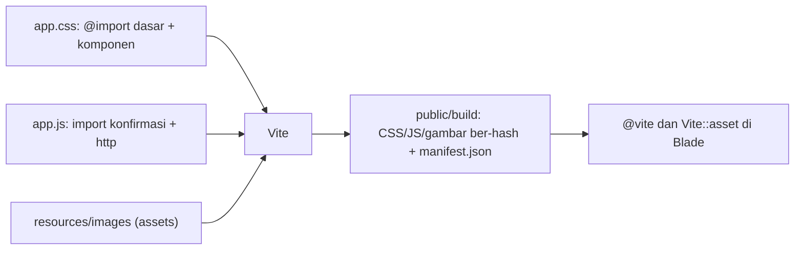

# Integrasi CSS dan JavaScript

Vite sudah terpasang dan `@vite` memuat `app.css` dan `app.js`. Sekarang saatnya menyusun frontend dengan rapi: memecah CSS dan JavaScript menjadi modul, memakai gambar
dari CSS maupun Blade, memuat skrip khusus halaman, dan menghubungkan JavaScript dengan token CSRF. Sub bab ini menutup bab Blade dengan praktik frontend yang bisa
langsung dipakai.

## Tujuan Pembelajaran

Setelah menyelesaikan sub bab ini, kamu dapat:

- [ ] Memecah CSS dengan `@import` dan menaruhnya dalam berkas terpisah.
- [ ] Memecah JavaScript menjadi modul dengan `import`.
- [ ] Menghubungkan gambar di CSS lewat path relatif sehingga ikut diproses Vite.
- [ ] Menampilkan gambar di Blade dengan `Vite::asset()` setelah mendaftarkan opsi `assets`.
- [ ] Membuat entry point khusus halaman dan memuatnya dengan `@vite`.
- [ ] Mengirim `fetch` ber-token CSRF dari modul JavaScript.

## Prasyarat

- [Integrasi Vite](03-17-vite-integration.md) dengan `npm run dev` berjalan.
- [Proteksi CSRF](03-14-csrf-protection.md), terutama tag `<meta name="csrf-token">`.
- Dasar JavaScript: fungsi, `document.querySelector`, event listener, dan modul ES (`import`/`export`).
- Proyek `belajar-blade`.

## Pengantar

Satu berkas `app.css` berisi ratusan baris cepat menjadi sulit dirawat. Vite mendukung modul seperti pada aplikasi frontend modern, jadi kamu dapat memecah kode berdasarkan
tanggung jawab dan membiarkan build menggabungkannya.

## Penjelasan Konsep

### Memecah CSS dengan `@import`

```css
/* resources/css/app.css */
@import './dasar.css';
@import './komponen.css';
```

Vite menggabungkan berkas yang diimpor ke dalam satu CSS hasil build. Struktur yang disarankan:

```text
resources/css/
  app.css          <- entry; hanya @import
  dasar.css        <- reset, tipografi, tata letak
  komponen.css     <- tombol, kartu, peringatan
```

### Memecah JavaScript dengan modul

```js
// resources/js/app.js
import { aktifkanKonfirmasiHapus } from './konfirmasi';
import { kirimJson } from './http';

aktifkanKonfirmasiHapus();
window.kirimJson = kirimJson;
```

Berkas yang diimpor memakai `export`. Dokumentasi Laravel juga menyediakan alias `@` yang menunjuk ke `/resources/js`, sehingga `import ... from '@/http'` dapat dipakai.

### Gambar di CSS

Menurut dokumentasi, path **relatif** yang dirujuk dari HTML, CSS, atau JS ditulis ulang, diberi versi, dan dibundel oleh Vite. Path **absolut** tidak diproses; berkasnya harus ada di `public/`:

```css
.hero { background: url('../images/logo.svg') no-repeat; }  /* diproses Vite */
.ikon { background: url('/images/logo.svg'); }             /* absolut: harus ada di public/ */
```

Pada percobaan penulis dengan Vite 8, gambar yang dirujuk path relatif dari CSS dibundel ke `public/build/assets` dan URL-nya ditulis ulang di CSS hasil build.

### Gambar di Blade: `Vite::asset()` dan opsi `assets`

Gambar yang hanya dipakai di template Blade tidak dikenal Vite kecuali kamu mendaftarkannya. Dokumentasi menyediakan opsi `assets` pada plugin:

File: `vite.config.js`

```js
laravel({
    input: ['resources/css/app.css', 'resources/js/app.js'],
    assets: ['resources/images/**'],
    refresh: true,
}),
```

Lalu di Blade:

```html

```

`Vite::asset()` mengembalikan URL ber-versi. Opsi `assets` tersedia pada `laravel-vite-plugin` versi terbaru (dokumentasi menyebut diperkenalkan karena perubahan pada Vite 8);
bila proyekmu memakai plugin lebih lama, ikuti petunjuk `import.meta.glob` pada dokumentasi versi tersebut.

### Entry point khusus halaman

Skrip yang hanya dipakai satu halaman tidak perlu dimuat di semua halaman. Daftarkan sebagai entry baru dan muat hanya di halaman itu:

```js
laravel({
    input: ['resources/css/app.css', 'resources/js/app.js', 'resources/js/halaman-suka.js'],
    // ...
}),
```

```html
@push('scripts')
    @vite('resources/js/halaman-suka.js')
@endpush
```

Layout menampilkan `@stack('scripts')` sebelum `</body>`. (Pada layout komponen, `@stack` dan `@push` tetap berfungsi; letakkan `@stack` di layout dan `@push` di halaman.)

### JavaScript dan token CSRF

Modul dapat membaca token dari tag `<meta>` pada layout dan menyertakannya di setiap `fetch`:

```js
// resources/js/http.js
export function kirimJson(url, data) {
    const token = document.querySelector('meta[name="csrf-token"]').content;

    return fetch(url, {
        method: 'POST',
        headers: {
            'X-CSRF-TOKEN': token,
            'Content-Type': 'application/json',
            'Accept': 'application/json',
        },
        body: JSON.stringify(data),
    });
}
```

### Praktik baik

| Praktik | Alasan |
|---|---|
| Satu tanggung jawab per berkas | Mudah dicari dan diuji |
| `app.css`/`app.js` hanya sebagai penghubung | Entry tetap ringkas |
| Pilih nama kelas yang bermakna | Hindari tabrakan gaya |
| Muat skrip khusus halaman hanya di halaman itu | Ukuran halaman lebih kecil |
| Hindari JavaScript inline panjang di Blade | Sulit dirawat dan menyulitkan kebijakan keamanan konten |

### Keamanan

- Data dinamis yang masuk ke JavaScript harus lewat `Js::from` (lihat sub bab Menampilkan Data), bukan string yang dirangkai manual.
- Jangan menaruh rahasia di modul JavaScript atau variabel `VITE_*`; semuanya terkirim ke browser.
- Dokumentasi Vite menyediakan dukungan *nonce* CSP dan SRI bila aplikasi memakai Content Security Policy; pelajari bila kebijakan keamananmu mensyaratkannya.
- Pustaka pihak ketiga (npm atau CDN) menambah permukaan serangan; pasang seperlunya.

## Cara Kerja



## Contoh Praktik

Kamu memecah CSS menjadi `dasar.css` dan `komponen.css`, membuat modul `konfirmasi.js` untuk konfirmasi hapus, modul `http.js` yang mengirim `fetch` ber-token CSRF, entry khusus
`halaman-suka.js`, dan memakai logo dari `resources/images` lewat `Vite::asset()`.

## Penjelasan Kode

File: `resources/css/app.css`

```css
@import './dasar.css';
@import './komponen.css';
```

File: `resources/css/dasar.css`

```css
body { font-family: sans-serif; margin: 0 auto; max-width: 800px; padding: 16px; }
nav a { margin-right: 8px; }
.logo { height: 32px; vertical-align: middle; }
.sukses { background: #c8f7c5; padding: 8px; }
```

File: `resources/css/komponen.css`

```css
.tombol { padding: 6px 12px; border: 0; border-radius: 4px; cursor: pointer; }
.tombol-primer { background: #3b82f6; color: #fff; }
.tombol-bahaya { background: #ef4444; color: #fff; }
.galat { background: #fde2e2; padding: 8px; margin: 8px 0; }
.galat-teks { color: #b91c1c; }
input.invalid, select.invalid { border: 2px solid #b91c1c; }
.hero { padding: 16px 16px 16px 80px; background: #f3f4f6 url('../images/logo.svg') 8px center / 56px no-repeat; }
```

Salin berkas `logo.svg` dari `public/images/` ke `resources/images/logo.svg`.

File: `resources/js/konfirmasi.js`

```js
export function aktifkanKonfirmasiHapus() {
    document.querySelectorAll('form[data-konfirmasi]').forEach((form) => {
        form.addEventListener('submit', (event) => {
            if (!window.confirm(form.dataset.konfirmasi)) {
                event.preventDefault();
            }
        });
    });
}
```

File: `resources/js/http.js`

```js
export function kirimJson(url, data) {
    const token = document.querySelector('meta[name="csrf-token"]').content;

    return fetch(url, {
        method: 'POST',
        headers: {
            'X-CSRF-TOKEN': token,
            'Content-Type': 'application/json',
            'Accept': 'application/json',
        },
        body: JSON.stringify(data),
    });
}
```

File: `resources/js/app.js`

```js
import { aktifkanKonfirmasiHapus } from './konfirmasi';

aktifkanKonfirmasiHapus();
```

File: `resources/js/halaman-suka.js`

```js
import { kirimJson } from './http';

const tombol = document.getElementById('suka');
const hasil = document.getElementById('hasil-suka');

if (tombol) {
    tombol.addEventListener('click', async () => {
        const res = await kirimJson(tombol.dataset.url, { nama: 'Sari' });
        hasil.textContent = res.status + ' ' + (await res.text());
    });
}
```

File: `vite.config.js` (ubah argumen `laravel(...)`)

```js
laravel({
    input: [
        'resources/css/app.css',
        'resources/js/app.js',
        'resources/js/halaman-suka.js',
    ],
    assets: ['resources/images/**'],
    refresh: true,
}),
```

File: `resources/views/components/layout.blade.php` (tambahkan sebelum `</body>`)

```html
    @stack('scripts')
</body>
```

File: `routes/web.php` (tambahkan)

```php-inline
Route::get('/frontend', function () {
    return view('frontend');
});

Route::post('/suka', function (Request $request) {
    return response()->json(['suka' => $request->input('nama')]);
})->name('suka');
```

File: `resources/views/frontend.blade.php`

```html
<x-layout>
    <x-slot:title>
        Frontend
    </x-slot>

    <div class="hero">
        <h1>Integrasi Frontend</h1>
        
    </div>

    <form action="#" method="POST" data-konfirmasi="Yakin ingin menghapus?">
        <button class="tombol tombol-bahaya" type="submit">Hapus (konfirmasi)</button>
    </form>

    <button id="suka" class="tombol tombol-primer" data-url="{{ route('suka') }}">Suka</button>
    <pre id="hasil-suka"></pre>

    @push('scripts')
        @vite('resources/js/halaman-suka.js')
    @endpush
</x-layout>
```

| Bagian | Fungsi |
|---|---|
| `@import` di `app.css` | Menggabungkan dua berkas CSS |
| `url('../images/logo.svg')` di `komponen.css` | Gambar relatif yang diproses Vite |
| `Vite::asset(...)` | URL ber-versi untuk gambar di Blade |
| `data-konfirmasi` + `konfirmasi.js` | Konfirmasi sebelum mengirim form |
| `halaman-suka.js` | Hanya dimuat di `/frontend` lewat `@push` dan `@vite` |
| `data-url="{{ route('suka') }}"` | Mengoper URL ke JavaScript tanpa menulisnya di dalam skrip |

Layout sudah memiliki `@vite(['resources/css/app.css', 'resources/js/app.js'])` dari sub bab sebelumnya, dan tag `<meta name="csrf-token">` yang dibaca `http.js`.

## Implementasi Langkah demi Langkah

### Langkah 1: siapkan berkas frontend

Buat berkas CSS dan JavaScript di atas, salin `logo.svg` ke `resources/images/`, lalu perbarui `vite.config.js`.

### Langkah 2: perbarui layout, route, dan view

Tambahkan `@stack('scripts')`, dua route (pastikan `use Illuminate\Http\Request;` ada), dan `frontend.blade.php`.

### Langkah 3: jalankan

Terminal 1:

```bash
php artisan serve
```

Terminal 2 (restart karena `vite.config.js` berubah):

```bash
npm run dev
```

### Langkah 4: uji di browser

Buka `http://127.0.0.1:8000/frontend`. Klik **Hapus (konfirmasi)** dan batalkan dialog. Klik **Suka** dan lihat hasil JSON di bawah tombol.

### Langkah 5: bangun untuk produksi

Hentikan `npm run dev` (Ctrl+C), lalu:

```bash
npm run build
cat public/build/manifest.json
```

Cari entry `resources/js/halaman-suka.js` dan `resources/images/logo.svg`. Muat ulang `/frontend` dan pastikan semuanya tetap berfungsi dari berkas ber-hash.

### Langkah 6: catat di Git

```bash
git status
git add resources routes vite.config.js
git commit -m "Pecah CSS dan JavaScript dengan Vite serta tambah halaman frontend"
```

## Eksekusi dan Verifikasi

| Langkah | Cara memverifikasi |
|---|---|
| 1–2 | Semua berkas ada; tidak ada galat di terminal Vite |
| 4 | Dialog konfirmasi muncul; tombol **Suka** menampilkan `200 {"suka":"Sari"}` |
| 5 | `manifest.json` memuat tiga entry JS/CSS dan gambar; halaman tetap berfungsi |
| 6 | `node_modules` dan `public/build` tidak ada di `git status` |

## Hasil yang Diharapkan

| Aksi | Hasil |
|---|---|
| Buka `/frontend` | Panel abu dengan logo di kiri judul; logo kecil di sebelah judul |
| Klik **Hapus** lalu Batal | Form tidak terkirim |
| Klik **Suka** | `200 {"suka":"Sari"}` di bawah tombol |
| Build produksi | `public/build/assets` memuat CSS, JS, dan SVG ber-hash |

Pada percobaan penulis dengan proyek Vite kecil (Vite 8, `laravel-vite-plugin` 3, tanpa Laravel penuh), `npm run build` terbukti menggabungkan `@import` CSS, membundel modul
JavaScript (`halaman-suka.js` mengimpor `http.js`), menulis ulang `url('../images/logo.svg')` menjadi SVG ber-hash di `public/build/assets`, dan mencatat entri
`resources/js/halaman-suka.js` di `manifest.json`. Bagian Blade (`@vite`, `Vite::asset`, `@stack`) dan perilaku di browser diturunkan dari dokumentasi dan belum dijalankan
penulis; cocokkan dengan hasilmu.

## Kesalahan Umum dan Pemecahan Masalah

| Gejala | Penyebab | Cara mengenali | Solusi | Pencegahan |
|---|---|---|---|---|
| `Unable to locate file in Vite manifest: resources/js/halaman-suka.js` | Entry belum ada di `input` atau build lama | Galat menyebut path | Tambahkan ke `input`, restart `dev` atau `build` ulang | Daftarkan setiap entry |
| Gambar tak muncul di CSS | Path relatif salah | Tab Network: 404 | Perbaiki path relatif terhadap berkas CSS | Uji path dari lokasi berkas |
| `Unable to locate file in Vite manifest: resources/images/logo.svg` | Opsi `assets` belum diatur | Galat pada `Vite::asset` | Tambahkan `assets: ['resources/images/**']` lalu restart | Daftarkan folder gambar |
| `Cannot use import statement outside a module` | Skrip dimuat tanpa `type="module"` | Galat di konsol | Muat lewat `@vite` | Jangan memuat modul dengan `<script src>` biasa |
| `419` saat klik **Suka** | Token tidak terkirim atau meta hilang | Network: 419 | Pastikan `<meta name="csrf-token">` dan header | Gunakan fungsi `kirimJson` bersama |
| `null` pada `querySelector('meta...')` | Layout tidak memuat tag meta | Galat `Cannot read properties of null` | Tambahkan tag meta ke layout | Letakkan di layout bersama |
| Skrip halaman tidak jalan | `@stack('scripts')` tidak ada di layout | Tag skrip tidak ada | Tambahkan `@stack` sebelum `</body>` | Cek sumber halaman |
| Perubahan `vite.config.js` tak berlaku | Server Vite tidak dimulai ulang | Perilaku lama | Hentikan dan jalankan ulang `npm run dev` | Restart setiap ubah konfigurasi |

## Latihan Praktik

### Latihan dasar

**D1. Pecah CSS**
- *Masalah:* satu berkas CSS terlalu panjang.
- *Persyaratan:* pindahkan aturan tabel ke `tabel.css` dan impor dari `app.css`.
- *Perilaku yang diharapkan:* tampilan tabel tidak berubah.
- *Tujuan belajar:* memakai `@import`.

**D2. Modul JavaScript**
- *Masalah:* ingin fungsi pembantu terpisah.
- *Persyaratan:* buat `resources/js/format.js` yang mengekspor `rupiah(angka)` dan panggil dari `app.js` dengan `console.log`.
- *Perilaku yang diharapkan:* konsol menampilkan angka berformat.
- *Tujuan belajar:* memakai `export` dan `import`.

### Latihan implementasi

**I1. Menu seluler**
- *Masalah:* menu perlu tombol buka/tutup di layar kecil.
- *Persyaratan:* buat modul `menu.js` yang mengubah kelas `terbuka` pada `<nav>` saat tombol diklik, impor dari `app.js`, dan tambahkan CSS di `komponen.css`.
- *Perilaku yang diharapkan:* menu membuka dan menutup.
- *Tujuan belajar:* menghubungkan HTML, CSS, dan JavaScript lewat Vite.

**I2. Gambar produk**
- *Masalah:* katalog butuh gambar yang di-*cache* dengan baik.
- *Persyaratan:* taruh tiga gambar di `resources/images/produk/` dan tampilkan dengan `Vite::asset('resources/images/produk/'.$p['gambar'])`.
- *Perilaku yang diharapkan:* gambar tampil dengan URL ber-hash setelah build.
- *Tujuan belajar:* memakai `Vite::asset`.

### Latihan tantangan

**T1. Halaman dengan skrip sendiri**
- *Masalah:* halaman laporan butuh pustaka grafik yang hanya dipakai di sana.
- *Persyaratan:* buat entry `resources/js/laporan.js` yang memuat modul grafik buatanmu, dimuat hanya di `/laporan` lewat `@push`. Buktikan lewat tab Network bahwa halaman lain tidak memuat berkas itu.
- *Perilaku yang diharapkan:* berkas hanya diunduh di halaman laporan.
- *Tujuan belajar:* memisahkan skrip per halaman.
- *Catatan:* kerjakan mandiri; tidak ada kunci jawaban.

## Uji Pemahaman

1. Bagaimana memecah CSS menjadi beberapa berkas di Vite?
2. Apa beda path gambar relatif dan absolut di CSS?
3. Apa fungsi opsi `assets` dan `Vite::asset()`?
4. Bagaimana memuat skrip hanya di satu halaman?
5. Dari mana JavaScript mengambil token CSRF dalam contoh ini?
6. Mengapa `vite.config.js` perlu restart server `dev` setelah diubah?
7. Mengapa data dinamis ke JavaScript sebaiknya lewat `Js::from`?

??? success "Kunci jawaban singkat"
    1. Dengan `@import './berkas.css';` pada entry CSS.
    2. Relatif diproses dan diberi versi oleh Vite; absolut tidak diproses dan berkasnya harus ada di `public/`.
    3. `assets` mendaftarkan berkas statis agar diproses Vite; `Vite::asset()` mengembalikan URL ber-versinya di Blade.
    4. Daftarkan sebagai entry baru dan muat dengan `@push('scripts')` + `@vite(...)` di halaman itu.
    5. Dari tag `<meta name="csrf-token">` di layout.
    6. Konfigurasi dibaca saat server dimulai.
    7. Agar JSON ter-escape dengan aman dan aman dari injeksi skrip.

## Ringkasan

- CSS dipecah dengan `@import`; JavaScript dengan modul ES.
- Gambar relatif di CSS diproses Vite; gambar di Blade memakai `Vite::asset()` dan opsi `assets`.
- Entry khusus halaman memuat skrip hanya di tempat yang membutuhkannya.
- Modul JavaScript membaca token CSRF dari `<meta>` untuk `fetch`.
- Hindari rahasia di kode frontend dan gunakan `Js::from` untuk data dinamis.

Selanjutnya: proyek penutup bab ini, *Admin Dashboard menggunakan Blade*.

## Referensi Resmi

- [Laravel: Working With JavaScript](https://laravel.com/docs/13.x/vite#working-with-scripts)
- [Laravel: Working With Stylesheets](https://laravel.com/docs/13.x/vite#working-with-stylesheets)
- [Laravel: Processing Static Assets With Vite](https://laravel.com/docs/13.x/vite#blade-processing-static-assets)
- [Laravel: URL Processing](https://laravel.com/docs/13.x/vite#url-processing)
- [Laravel: CSRF, X-CSRF-Token](https://laravel.com/docs/13.x/csrf#csrf-x-csrf-token)
