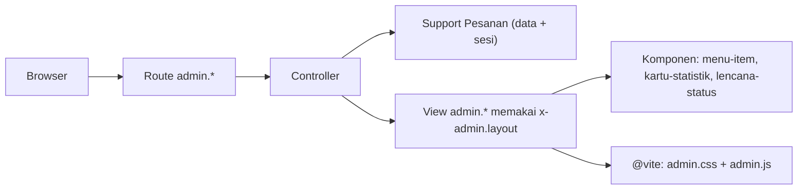

# Proyek Praktik: Admin Dashboard dengan Blade

Kamu sudah menyelesaikan seluruh sub bab **Blade Template dan Integrasi Frontend**. Pada proyek ini semuanya dipakai bersama untuk membangun **Admin Dashboard**: layout admin
dengan sidebar, kartu statistik, tabel pesanan, form tambah pesanan dengan validasi, penghapusan dengan konfirmasi, dan aset yang dibangun dengan Vite. Seluruh tampilan
dibuat dengan komponen Blade yang dapat dipakai ulang.

## Tujuan Pembelajaran

Setelah menyelesaikan proyek ini, kamu dapat:

- [ ] Membuat layout admin berbasis komponen anonim, lengkap dengan menu aktif dan pesan status.
- [ ] Membuat komponen yang dapat dipakai ulang: item menu, kartu statistik, dan lencana status.
- [ ] Menampilkan data dengan `@forelse`, `@switch`, `@class`, dan `$loop`.
- [ ] Membuat form dengan `@csrf`, `old()`, `@error`, dan pesan galat per kolom.
- [ ] Menghapus data dengan form `DELETE` (`@method`) dan konfirmasi JavaScript.
- [ ] Mengintegrasikan CSS dan JavaScript lewat Vite sebagai entry point terpisah.
- [ ] Memverifikasi perilaku utama dengan `curl`, termasuk perlindungan CSRF.

## Prasyarat

Proyek ini memakai seluruh sub bab bab utama ini, terutama [Komponen Anonim](03-09-anonymous-components.md), [Mengirim Data ke Komponen](03-10-passing-data-to-components.md),
[Blade Forms](03-12-blade-forms.md), [Method Spoofing](03-13-form-method-spoofing.md), [Proteksi CSRF](03-14-csrf-protection.md),
[Pesan Error Form](03-15-form-error-messages.md), dan [Integrasi CSS dan JavaScript](03-18-css-javascript-integration.md). Bab Routing dan Controller
([Resource Controller](../level-02/02-13-resource-controllers.md) dan [Single Action Controller](../level-02/02-14-single-action-controllers.md)) juga dipakai.

Kondisi awal `~/belajar-laravel/belajar-blade` (hasil sub bab sebelumnya):

| Komponen | Keterangan |
|---|---|
| Dependensi npm | `npm install` sudah dijalankan; `vite.config.js` memiliki `input` dan `assets: ['resources/images/**']` (dari sub bab Integrasi CSS dan JavaScript) |
| `resources/images/logo.svg` | Logo contoh |
| Sesi | Berfungsi (proyek baru memakai driver sesi `database`; migrasi bawaan sudah dijalankan oleh installer) |

Lingkungan: PHP 8.3 atau lebih baru, Composer, Node.js, dan terminal Bash.

## Pengantar

Aplikasi admin biasanya terdiri dari kerangka yang sama (sidebar, header, area konten) dan banyak halaman kecil di dalamnya. Ini kasus ideal untuk komponen Blade:
kerangka ditulis sekali, potongan berulang (kartu, lencana, item menu) dijadikan komponen, dan halaman hanya merangkainya.

Kita belum memakai basis data (dibahas pada bab berikutnya). Data pesanan awal ditulis di kode, dan pesanan baru atau yang dihapus **disimpan di sesi** milik browsermu. Dengan begitu
form dan penghapusan benar-benar mengubah tampilan, tanpa tabel basis data. Menutup tab atau menghapus cookie mengembalikan data ke keadaan awal.

## Penjelasan Konsep

### Persyaratan aplikasi

| Kebutuhan | Halaman | Hasil |
|---|---|---|
| Beranda | `GET /` | Redirect ke `/admin` |
| Dashboard | `GET /admin` | Empat kartu statistik dan tiga pesanan terbaru |
| Daftar pesanan | `GET /admin/pesanan` | Tabel dengan lencana status dan tombol hapus |
| Form tambah | `GET /admin/pesanan/baru` | Form dengan pesan galat dan input lama |
| Simpan | `POST /admin/pesanan` | Validasi, simpan ke sesi, redirect dengan pesan |
| Hapus | `DELETE /admin/pesanan/{kode}` | Hapus dari tampilan, redirect dengan pesan |

### Rancangan

| Bagian | Peran |
|---|---|
| `App\Support\Pesanan` | Sumber data pesanan (data awal + sesi) dan statistik |
| `DashboardController` | Controller *single action* untuk dashboard |
| `PesananController` | `index`, `create`, `store`, `destroy` |
| `components/admin/layout` | Kerangka halaman admin |
| `components/admin/menu-item`, `kartu-statistik`, `lencana-status` | Potongan antarmuka |
| `resources/css/admin.css`, `resources/js/admin.js` | Entry point Vite khusus admin |

### Keamanan

- Form `POST` dan `DELETE` memakai `@csrf`; perlindungan CSRF tetap aktif.
- Seluruh data dicetak dengan `{{ }}`.
- Validasi di server membatasi nama, total, dan status (`in:`) sehingga nilai tak terduga ditolak.
- Parameter `{kode}` dibatasi pola `PSN-[0-9]+` dan kode yang tidak ada menghasilkan `404`.
- **Peringatan:** dashboard ini belum memiliki login. Jangan membukanya ke internet; autentikasi dibahas pada bab keamanan.

## Cara Kerja



## Contoh Praktik

### Struktur akhir (berkas yang kamu tambah atau ubah)

```text
app/Support/Pesanan.php
app/Http/Controllers/Admin/DashboardController.php
app/Http/Controllers/Admin/PesananController.php
routes/web.php
vite.config.js
resources/css/admin.css
resources/js/admin.js
resources/views/components/admin/layout.blade.php
resources/views/components/admin/menu-item.blade.php
resources/views/components/admin/kartu-statistik.blade.php
resources/views/components/admin/lencana-status.blade.php
resources/views/admin/dashboard.blade.php
resources/views/admin/pesanan/index.blade.php
resources/views/admin/pesanan/create.blade.php
```

## Penjelasan Kode

### Sumber data

File: `app/Support/Pesanan.php` (buat folder `app/Support` bila belum ada)

```php
<?php

namespace App\Support;

class Pesanan
{
    private const AWAL = [
        ['kode' => 'PSN-001', 'pelanggan' => 'Budi', 'total' => 150000, 'status' => 'dikirim'],
        ['kode' => 'PSN-002', 'pelanggan' => 'Sari', 'total' => 85000, 'status' => 'baru'],
        ['kode' => 'PSN-003', 'pelanggan' => 'Andi', 'total' => 45000, 'status' => 'batal'],
        ['kode' => 'PSN-004', 'pelanggan' => 'Dewi', 'total' => 230000, 'status' => 'selesai'],
    ];

    public static function semua(): array
    {
        $dihapus = session('pesanan_dihapus', []);
        $semua = array_merge(self::AWAL, session('pesanan_baru', []));

        return array_values(array_filter(
            $semua,
            fn (array $p) => ! in_array($p['kode'], $dihapus, true)
        ));
    }

    public static function tambah(array $data): string
    {
        $nomor = count(self::AWAL) + count(session('pesanan_baru', [])) + 1;
        $kode = 'PSN-'.str_pad((string) $nomor, 3, '0', STR_PAD_LEFT);

        session()->push('pesanan_baru', ['kode' => $kode] + $data);

        return $kode;
    }

    public static function hapus(string $kode): bool
    {
        $ada = in_array($kode, array_column(self::semua(), 'kode'), true);

        if ($ada) {
            session()->push('pesanan_dihapus', $kode);
        }

        return $ada;
    }

    public static function statistik(): array
    {
        $semua = self::semua();
        $aktif = array_filter($semua, fn (array $p) => $p['status'] !== 'batal');

        return [
            'jumlah' => count($semua),
            'pendapatan' => array_sum(array_column($aktif, 'total')),
            'baru' => count(array_filter($semua, fn (array $p) => $p['status'] === 'baru')),
            'batal' => count($semua) - count($aktif),
        ];
    }
}
```

| Bagian | Fungsi |
|---|---|
| `AWAL` | Data contoh awal |
| `semua()` | Menggabungkan data awal dengan pesanan baru di sesi, lalu membuang yang dihapus |
| `tambah()` | Membuat kode berikutnya dan menaruh pesanan di sesi |
| `hapus()` | Menandai kode sebagai dihapus bila ada |
| `statistik()` | Menghitung jumlah, pendapatan (tanpa yang batal), jumlah baru, dan jumlah batal |

### Controller

File: `app/Http/Controllers/Admin/DashboardController.php`

```php
<?php

namespace App\Http\Controllers\Admin;

use App\Http\Controllers\Controller;
use App\Support\Pesanan;
use Illuminate\Contracts\View\View;

class DashboardController extends Controller
{
    public function __invoke(): View
    {
        return view('admin.dashboard', [
            'statistik' => Pesanan::statistik(),
            'terbaru' => array_slice(array_reverse(Pesanan::semua()), 0, 3),
        ]);
    }
}
```

File: `app/Http/Controllers/Admin/PesananController.php`

```php
<?php

namespace App\Http\Controllers\Admin;

use App\Http\Controllers\Controller;
use App\Support\Pesanan;
use Illuminate\Contracts\View\View;
use Illuminate\Http\RedirectResponse;
use Illuminate\Http\Request;

class PesananController extends Controller
{
    public function index(): View
    {
        return view('admin.pesanan.index', ['pesanan' => Pesanan::semua()]);
    }

    public function create(): View
    {
        return view('admin.pesanan.create', [
            'statuses' => ['baru' => 'Baru', 'dikirim' => 'Dikirim', 'selesai' => 'Selesai', 'batal' => 'Batal'],
        ]);
    }

    public function store(Request $request): RedirectResponse
    {
        $data = $request->validate([
            'pelanggan' => ['required', 'string', 'min:3', 'max:50'],
            'total' => ['required', 'integer', 'min:1000'],
            'status' => ['required', 'in:baru,dikirim,selesai,batal'],
        ]);

        $data['total'] = (int) $data['total'];
        $kode = Pesanan::tambah($data);

        return redirect()->route('admin.pesanan.index')
            ->with('status', "Pesanan {$kode} ditambahkan.");
    }

    public function destroy(string $kode): RedirectResponse
    {
        abort_unless(Pesanan::hapus($kode), 404);

        return redirect()->route('admin.pesanan.index')
            ->with('status', "Pesanan {$kode} dihapus.");
    }
}
```

| Bagian | Fungsi |
|---|---|
| `__invoke` | Controller satu tugas untuk dashboard |
| `validate([...])` | Menjamin `pelanggan`, `total`, dan `status` sah; bila gagal Laravel mengalihkan kembali dengan galat |
| `abort_unless(..., 404)` | Menghasilkan `404` bila kode tidak ada |
| `redirect()->route(...)->with('status', ...)` | Pola Post/Redirect/Get dengan pesan sekali tampil |

### Route

File: `routes/web.php` (hapus route `/` bawaan dan tambahkan; route latihan lain boleh tetap)

```php-inline
use App\Http\Controllers\Admin\DashboardController;
use App\Http\Controllers\Admin\PesananController;

Route::redirect('/', '/admin');

Route::prefix('admin')->name('admin.')->group(function () {
    Route::get('/', DashboardController::class)->name('dashboard');

    Route::get('/pesanan', [PesananController::class, 'index'])->name('pesanan.index');
    Route::get('/pesanan/baru', [PesananController::class, 'create'])->name('pesanan.create');
    Route::post('/pesanan', [PesananController::class, 'store'])->name('pesanan.store');
    Route::delete('/pesanan/{kode}', [PesananController::class, 'destroy'])
        ->where('kode', 'PSN-[0-9]+')
        ->name('pesanan.destroy');
});
```

Route berparameter hanya dipakai untuk `DELETE`, jadi tidak bertabrakan dengan `/pesanan/baru`. Tetap biasakan menulis URI statis sebelum URI berparameter.

### Komponen

File: `resources/views/components/admin/layout.blade.php`

```html
@props(['judul' => 'Dashboard'])
<!DOCTYPE html>
<html lang="id">
<head>
    <meta charset="UTF-8">
    <meta name="viewport" content="width=device-width, initial-scale=1">
    <meta name="csrf-token" content="{{ csrf_token() }}">
    <title>{{ $judul }} - Admin Belajar Blade</title>
    @vite(['resources/css/admin.css', 'resources/js/admin.js'])
</head>
<body>
    <div class="admin">
        <aside class="sidebar">
            
            <nav>
                <x-admin.menu-item :href="route('admin.dashboard')" :aktif="request()->routeIs('admin.dashboard')">
                    Dashboard
                </x-admin.menu-item>
                <x-admin.menu-item :href="route('admin.pesanan.index')" :aktif="request()->routeIs('admin.pesanan.*')">
                    Pesanan
                </x-admin.menu-item>
            </nav>
        </aside>

        <main class="konten">
            <h1>{{ $judul }}</h1>

            @session('status')
                <div class="sukses">{{ $value }}</div>
            @endsession

            {{ $slot }}
        </main>
    </div>
</body>
</html>
```

File: `resources/views/components/admin/menu-item.blade.php`

```html
@props(['href', 'aktif' => false])

<a href="{{ $href }}" {{ $attributes->class(['menu-item', 'menu-item-aktif' => $aktif]) }}>
    {{ $slot }}
</a>
```

File: `resources/views/components/admin/kartu-statistik.blade.php`

```html
@props(['judul', 'nilai', 'warna' => 'biru'])

<div {{ $attributes->class(['kartu-stat', 'kartu-stat-'.$warna]) }}>
    <div class="kartu-stat-judul">{{ $judul }}</div>
    <div class="kartu-stat-nilai">{{ $nilai }}</div>
</div>
```

File: `resources/views/components/admin/lencana-status.blade.php`

```html
@props(['status'])

<span {{ $attributes->class(['lencana', 'lencana-'.$status]) }}>
    @switch($status)
        @case('baru') Baru @break
        @case('dikirim') Dikirim @break
        @case('selesai') Selesai @break
        @case('batal') Batal @break
        @default Tidak diketahui
    @endswitch
</span>
```

| Komponen | Fungsi |
|---|---|
| `x-admin.layout` | Kerangka: sidebar, judul, pesan status, `{{ $slot }}`; memuat aset admin lewat `@vite` |
| `x-admin.menu-item` | Tautan menu; kelas `menu-item-aktif` bila `aktif` benar |
| `x-admin.kartu-statistik` | Kartu dengan judul, nilai, dan warna |
| `x-admin.lencana-status` | Label status berwarna sesuai nilai |

### Halaman

File: `resources/views/admin/dashboard.blade.php`

```html
<x-admin.layout judul="Dashboard">
    <div class="grid-stat">
        <x-admin.kartu-statistik judul="Total pesanan" :nilai="$statistik['jumlah']" />
        <x-admin.kartu-statistik judul="Pendapatan" warna="hijau"
            :nilai="'Rp '.number_format($statistik['pendapatan'], 0, ',', '.')" />
        <x-admin.kartu-statistik judul="Pesanan baru" warna="kuning" :nilai="$statistik['baru']" />
        <x-admin.kartu-statistik judul="Dibatalkan" warna="merah" :nilai="$statistik['batal']" />
    </div>

    <h2>Pesanan terbaru</h2>
    <table>
        <thead>
            <tr><th>Kode</th><th>Pelanggan</th><th>Total</th><th>Status</th></tr>
        </thead>
        <tbody>
            @forelse ($terbaru as $p)
                <tr>
                    <td>{{ $p['kode'] }}</td>
                    <td>{{ $p['pelanggan'] }}</td>
                    <td>Rp {{ number_format($p['total'], 0, ',', '.') }}</td>
                    <td><x-admin.lencana-status :status="$p['status']" /></td>
                </tr>
            @empty
                <tr><td colspan="4">Belum ada pesanan.</td></tr>
            @endforelse
        </tbody>
    </table>

    <p><a href="{{ route('admin.pesanan.index') }}">Lihat semua pesanan</a></p>
</x-admin.layout>
```

File: `resources/views/admin/pesanan/index.blade.php`

```html
<x-admin.layout judul="Pesanan">
    <p>
        <a class="tombol tombol-primer" href="{{ route('admin.pesanan.create') }}">Tambah pesanan</a>
    </p>

    <table>
        <thead>
            <tr><th>No</th><th>Kode</th><th>Pelanggan</th><th>Total</th><th>Status</th><th>Aksi</th></tr>
        </thead>
        <tbody>
            @forelse ($pesanan as $p)
                <tr @class(['belang' => $loop->even])>
                    <td>{{ $loop->iteration }}</td>
                    <td>{{ $p['kode'] }}</td>
                    <td>{{ $p['pelanggan'] }}</td>
                    <td>Rp {{ number_format($p['total'], 0, ',', '.') }}</td>
                    <td><x-admin.lencana-status :status="$p['status']" /></td>
                    <td>
                        <form action="{{ route('admin.pesanan.destroy', $p['kode']) }}" method="POST"
                              data-konfirmasi="Hapus pesanan {{ $p['kode'] }}?">
                            @csrf
                            @method('DELETE')
                            <button class="tombol tombol-bahaya" type="submit">Hapus</button>
                        </form>
                    </td>
                </tr>
            @empty
                <tr><td colspan="6">Belum ada pesanan.</td></tr>
            @endforelse
        </tbody>
    </table>
</x-admin.layout>
```

File: `resources/views/admin/pesanan/create.blade.php`

```html
<x-admin.layout judul="Tambah Pesanan">
    @if ($errors->any())
        <div class="galat">
            <strong>Periksa kembali isian kamu:</strong>
            <ul>
                @foreach ($errors->all() as $pesan)
                    <li>{{ $pesan }}</li>
                @endforeach
            </ul>
        </div>
    @endif

    <form action="{{ route('admin.pesanan.store') }}" method="POST" novalidate>
        @csrf

        <p>
            <label for="pelanggan">Pelanggan</label><br>
            <input type="text" id="pelanggan" name="pelanggan" value="{{ old('pelanggan') }}"
                   class="@error('pelanggan') invalid @enderror">
            @error('pelanggan')
                <br><small class="galat-teks">{{ $message }}</small>
            @enderror
        </p>

        <p>
            <label for="total">Total (Rp)</label><br>
            <input type="number" id="total" name="total" value="{{ old('total') }}"
                   class="@error('total') invalid @enderror">
            @error('total')
                <br><small class="galat-teks">{{ $message }}</small>
            @enderror
        </p>

        <p>
            <label for="status">Status</label><br>
            <select id="status" name="status" class="@error('status') invalid @enderror">
                <option value="">-- pilih --</option>
                @foreach ($statuses as $nilai => $label)
                    <option value="{{ $nilai }}" @selected(old('status') === $nilai)>{{ $label }}</option>
                @endforeach
            </select>
            @error('status')
                <br><small class="galat-teks">{{ $message }}</small>
            @enderror
        </p>

        <button class="tombol tombol-primer" type="submit">Simpan</button>
        <a href="{{ route('admin.pesanan.index') }}">Batal</a>
    </form>
</x-admin.layout>
```

| Bagian | Fungsi |
|---|---|
| `:nilai="'Rp '.number_format(...)"` | Ekspresi PHP sebagai nilai props |
| `@forelse` / `@empty` | Menangani daftar kosong |
| `@class(['belang' => $loop->even])` | Baris belang |
| `@csrf` + `@method('DELETE')` | Form hapus yang aman |
| `data-konfirmasi` | Dibaca `admin.js` untuk meminta konfirmasi |
| `@error`, `old()`, `@selected` | Galat per kolom dan isian lama |

### Aset

File: `resources/css/admin.css`

```css
* { box-sizing: border-box; }
body { margin: 0; font-family: sans-serif; background: #f3f4f6; color: #111827; }
.admin { display: flex; min-height: 100vh; }
.sidebar { width: 200px; background: #1f2937; padding: 16px; }
.sidebar .logo { height: 40px; margin-bottom: 16px; }
.menu-item { display: block; color: #d1d5db; padding: 8px; border-radius: 4px; text-decoration: none; }
.menu-item-aktif { background: #374151; color: #fff; }
.konten { flex: 1; padding: 24px; }
.grid-stat { display: grid; grid-template-columns: repeat(auto-fit, minmax(160px, 1fr)); gap: 12px; margin-bottom: 24px; }
.kartu-stat { background: #fff; border-left: 6px solid #3b82f6; padding: 12px; border-radius: 4px; }
.kartu-stat-hijau { border-color: #22c55e; }
.kartu-stat-kuning { border-color: #eab308; }
.kartu-stat-merah { border-color: #ef4444; }
.kartu-stat-judul { font-size: .85em; color: #6b7280; }
.kartu-stat-nilai { font-size: 1.6em; font-weight: bold; }
table { width: 100%; border-collapse: collapse; background: #fff; }
th, td { padding: 8px; border-bottom: 1px solid #e5e7eb; text-align: left; }
.belang { background: #f9fafb; }
.lencana { padding: 2px 8px; border-radius: 999px; font-size: .85em; }
.lencana-baru { background: #fef9c3; }
.lencana-dikirim { background: #dbeafe; }
.lencana-selesai { background: #dcfce7; }
.lencana-batal { background: #fee2e2; }
.tombol { display: inline-block; padding: 6px 12px; border: 0; border-radius: 4px; cursor: pointer; text-decoration: none; }
.tombol-primer { background: #3b82f6; color: #fff; }
.tombol-bahaya { background: #ef4444; color: #fff; }
.sukses { background: #dcfce7; padding: 8px 12px; border-radius: 4px; margin-bottom: 16px; }
.galat { background: #fee2e2; padding: 8px 12px; border-radius: 4px; margin-bottom: 16px; }
.galat-teks { color: #b91c1c; }
input.invalid, select.invalid { border: 2px solid #b91c1c; }
```

File: `resources/js/admin.js`

```js
document.querySelectorAll('form[data-konfirmasi]').forEach((form) => {
    form.addEventListener('submit', (event) => {
        if (!window.confirm(form.dataset.konfirmasi)) {
            event.preventDefault();
        }
    });
});
```

File: `vite.config.js` (tambahkan dua entry pada `input`)

```js
laravel({
    input: [
        'resources/css/app.css',
        'resources/js/app.js',
        'resources/js/halaman-suka.js',
        'resources/css/admin.css',
        'resources/js/admin.js',
    ],
    assets: ['resources/images/**'],
    refresh: true,
}),
```

## Implementasi Langkah demi Langkah

### Langkah 1: periksa kondisi awal

```bash
cd ~/belajar-laravel/belajar-blade
git status
ls resources/images
```

Pastikan `logo.svg` ada di `resources/images`, dan pekerjaan sebelumnya sudah di-*commit*.

### Langkah 2: buat controller dan sumber data

```bash
php artisan make:controller Admin/DashboardController --invokable
php artisan make:controller Admin/PesananController
```

Ganti isi kedua berkas dengan kode di atas, lalu buat `app/Support/Pesanan.php`.

### Langkah 3: ganti route

Hapus route `/` bawaan dan tambahkan route admin. Periksa:

```bash
php artisan route:list --path=admin
```

### Langkah 4: buat komponen dan halaman

Buat empat komponen di `resources/views/components/admin` dan tiga halaman di `resources/views/admin`.

### Langkah 5: buat aset dan daftarkan di Vite

Buat `admin.css` dan `admin.js`, lalu tambahkan keduanya ke `input` di `vite.config.js`.

### Langkah 6: jalankan

Terminal 1:

```bash
php artisan serve
```

Terminal 2 (mulai ulang karena `vite.config.js` berubah):

```bash
npm run dev
```

### Langkah 7: uji manual di browser

Buka `http://127.0.0.1:8000/`. Lakukan urutan berikut:

1. Perhatikan empat kartu dan tiga pesanan terbaru di dashboard.
2. Buka **Pesanan**, lalu **Tambah pesanan**.
3. Kirim form kosong; amati ringkasan dan pesan galat.
4. Isi pelanggan `Eko`, total `120000`, status `Baru`, lalu simpan.
5. Kembali ke dashboard dan bandingkan angka statistik.
6. Hapus `PSN-003` (batalkan dulu dialog, lalu setujui).

### Langkah 8: uji dengan curl

Di terminal Bash (Windows PowerShell: tulis `curl.exe`), dengan server berjalan:

```bash
curl -s -o /dev/null -w "%{http_code}\n" http://127.0.0.1:8000/admin
curl -s -o /dev/null -w "%{http_code}\n" http://127.0.0.1:8000/admin/pesanan
curl -s -o /dev/null -w "%{http_code}\n" http://127.0.0.1:8000/admin/pesanan/baru
curl -s -o /dev/null -w "%{http_code}\n" -X POST -d "pelanggan=Eko" http://127.0.0.1:8000/admin/pesanan
curl -s -o /dev/null -w "%{http_code}\n" -X DELETE http://127.0.0.1:8000/admin/pesanan/PSN-999
curl -s -o /dev/null -w "%{http_code}\n" http://127.0.0.1:8000/admin/pesanan/abc
```

Lalu alur lengkap dengan cookie dan token:

```bash
TOKEN=$(curl -s -c cj.txt http://127.0.0.1:8000/admin/pesanan/baru | grep -o 'name="_token" value="[^"]*"' | head -1 | sed 's/.*value="//;s/"//')
curl -s -o /dev/null -w "%{http_code}\n" -b cj.txt -c cj.txt -d "_token=$TOKEN&pelanggan=Eko&total=120000&status=baru" http://127.0.0.1:8000/admin/pesanan
curl -s -o /dev/null -w "%{http_code}\n" -b cj.txt -c cj.txt -d "_token=$TOKEN&pelanggan=E&total=10&status=aneh" http://127.0.0.1:8000/admin/pesanan
curl -s -b cj.txt http://127.0.0.1:8000/admin/pesanan | grep -c "PSN-005"
rm cj.txt
```

### Langkah 9: bangun untuk produksi

Hentikan `npm run dev` (Ctrl+C), lalu:

```bash
npm run build
cat public/build/manifest.json
```

Muat ulang `/admin` dan pastikan halaman tetap bergaya dari berkas ber-hash.

### Langkah 10: kelola dengan Git

```bash
git status
git add app resources routes vite.config.js
git commit -m "Tambah Admin Dashboard dengan Blade"
```

Pastikan `node_modules` dan `public/build` tidak ikut.

## Eksekusi dan Verifikasi

| Langkah | Cara memverifikasi |
|---|---|
| 3 | `route:list --path=admin` menampilkan lima route bernama `admin.*` |
| 7 | Alur manual berhasil, angka statistik berubah sesuai urutan |
| 8 | Kode status sesuai tabel Hasil yang Diharapkan |
| 9 | `manifest.json` memuat `admin.css` dan `admin.js`; halaman tetap bergaya |
| 10 | `git status` bersih setelah commit |

## Hasil yang Diharapkan

Tampilan manual (data awal):

| Halaman | Isi |
|---|---|
| Dashboard | Total pesanan 4; Pendapatan Rp 465.000; Pesanan baru 1; Dibatalkan 1; tiga terbaru: PSN-004, PSN-003, PSN-002 |
| Setelah tambah `Eko` | Total pesanan 5; Pendapatan Rp 585.000; Pesanan baru 2; kode `PSN-005` |
| Setelah hapus `PSN-003` | Total pesanan 4; Dibatalkan 0; Pendapatan Rp 585.000 |
| Form kosong | Tiga pesan galat, kolom bermasalah berbatas merah |

Hasil `curl`:

| Permintaan | Status |
|---|---|
| `GET /admin`, `/admin/pesanan`, `/admin/pesanan/baru` | `200` |
| `POST /admin/pesanan` tanpa token | `419` |
| `DELETE /admin/pesanan/PSN-999` tanpa token | `419` (CSRF diperiksa sebelum controller) |
| `GET /admin/pesanan/abc` | `404` (tidak ada route yang cocok dengan URI itu) |
| `POST` dengan cookie dan token, data valid | `302` (redirect ke daftar) |
| `POST` dengan cookie dan token, data tidak valid | `302` (kembali ke form dengan galat) |
| Daftar pesanan setelah `POST` valid | Menyebut `PSN-005` (hitungan `1` atau lebih) |

Perilaku menghapus `PSN-999` dengan token (404) dapat kamu uji sendiri sebagai latihan. Semua hasil ini diturunkan dari dokumentasi dan perilaku Laravel, dan belum dijalankan
oleh penulis materi; cocokkan dengan hasilmu. Bila hasilmu berbeda, periksa bagian di bawah.

## Kesalahan Umum dan Pemecahan Masalah

| Gejala | Penyebab | Cara mengenali | Solusi | Pencegahan |
|---|---|---|---|---|
| `Vite manifest not found` | `npm run dev`/`build` belum jalan | Galat saat membuka `/admin` | Jalankan `npm run dev` atau `npm run build` | Jalankan Vite sebelum menguji |
| `Unable to locate file in Vite manifest: resources/css/admin.css` | Entry belum di `input` atau Vite belum di-restart | Galat menyebut path | Tambah ke `input`, restart/ build ulang | Daftarkan semua entry |
| `Unable to locate file in Vite manifest: resources/images/logo.svg` | Opsi `assets` belum diatur | Galat pada `Vite::asset` | Tambah `assets: ['resources/images/**']` lalu restart | Samakan konfigurasi dengan sub bab Integrasi CSS dan JavaScript |
| `Unable to locate a class or view for component [admin.layout]` | Lokasi berkas komponen salah | Galat komponen | Periksa `resources/views/components/admin/layout.blade.php` | Ikuti struktur akhir |
| `Class "App\Support\Pesanan" not found` | Namespace atau lokasi berkas salah | Galat class | Samakan namespace dengan folder `app/Support`; `composer dump-autoload` bila perlu | Namespace = path |
| `419` pada form | `@csrf` hilang atau sesi habis | Status 419 | Tambah `@csrf`; muat ulang form | Template form baku |
| `405` saat menghapus | Lupa `@method('DELETE')` | Status 405 | Tambahkan `@method('DELETE')` | Pola form hapus |
| Data tidak berubah setelah simpan | Sesi tidak tersimpan (cookie diblokir atau migrasi sesi belum dijalankan) | Dashboard tak berubah | Jalankan `php artisan migrate`; periksa cookie | Pastikan sesi aktif |
| Sidebar tidak menandai halaman aktif | `routeIs` memakai nama salah | Tak ada kelas `menu-item-aktif` | Samakan dengan nama route (`admin.pesanan.*`) | Cek nama dengan `route:list` |
| `route:list` memperlihatkan route `/` ganda | Route `/` bawaan belum dihapus | Dua route `/` | Hapus route bawaan | Periksa `routes/web.php` |

## Latihan Praktik

### Latihan dasar

**D1. Kartu baru**
- *Masalah:* pemilik ingin melihat rata-rata nilai pesanan.
- *Persyaratan:* tambahkan kunci `rata_rata` pada `Pesanan::statistik()` (dibulatkan) dan satu kartu baru di dashboard.
- *Perilaku yang diharapkan:* kartu menampilkan angka berformat rupiah.
- *Tujuan belajar:* memakai kembali komponen kartu.

**D2. Menu baru**
- *Masalah:* ingin menu "Laporan".
- *Persyaratan:* tambahkan item menu ke sidebar dan satu halaman kosong `/admin/laporan` dengan route bernama `admin.laporan`.
- *Perilaku yang diharapkan:* menu aktif saat berada di halaman laporan.
- *Tujuan belajar:* memperluas aplikasi lewat komponen.

### Latihan implementasi

**I1. Filter status**
- *Masalah:* daftar pesanan panjang.
- *Persyaratan:* tambahkan form `GET` dengan `select` status di halaman daftar; controller menyaring berdasarkan `status` dari query string, dan `select` mempertahankan pilihan dengan `@selected`.
- *Perilaku yang diharapkan:* `?status=baru` hanya menampilkan pesanan berstatus baru.
- *Tujuan belajar:* form `GET` dan penyaringan data.

**I2. Komponen kolom form**
- *Masalah:* pola label + input + galat berulang.
- *Persyaratan:* buat komponen anonim `x-admin.kolom` dengan props `nama`, `label`, dan `tipe`, lalu pakai untuk `pelanggan` dan `total`.
- *Perilaku yang diharapkan:* form lebih ringkas, perilaku sama.
- *Tujuan belajar:* menyusun komponen form yang dapat dipakai ulang.

### Latihan tantangan

**T1. Ubah pesanan (PUT)**
- *Masalah:* admin perlu mengubah status pesanan.
- *Persyaratan:* tambahkan halaman ubah (`GET /admin/pesanan/{kode}/ubah`), route `PUT /admin/pesanan/{kode}`, dan form dengan `@method('PUT')`. Perbarui status di sesi (mis. dengan menyimpan penimpaan status), tampilkan pesan, dan beri validasi.
- *Perilaku yang diharapkan:* status berubah pada daftar dan dashboard.
- *Tujuan belajar:* menggabungkan semua materi bab ini.
- *Catatan:* kerjakan mandiri; tidak ada kunci jawaban.

## Uji Pemahaman

1. Mengapa layout admin dibuat sebagai komponen?
2. Apa fungsi `request()->routeIs('admin.pesanan.*')` pada sidebar?
3. Mengapa parameter `{kode}` dibatasi dengan pola `PSN-[0-9]+`?
4. Apa fungsi `@method('DELETE')` dan mengapa `@csrf` tetap perlu?
5. Mengapa `store()` memakai `redirect()`, bukan langsung menampilkan view?
6. Bagaimana pesan galat per kolom sampai ke view?
7. Apa yang terjadi bila `admin.css` tidak terdaftar di `input` Vite?
8. Mengapa dashboard ini belum aman untuk dibuka ke internet?

??? success "Kunci jawaban singkat"
    1. Kerangka ditulis sekali dan dipakai seluruh halaman; perubahan menu cukup di satu tempat.
    2. Menandai menu aktif saat route saat ini cocok dengan pola nama.
    3. Agar hanya kode berformat valid yang diproses; selainnya menghasilkan 404 sebelum controller berjalan.
    4. Meniru metode `DELETE` dari form HTML; request tetap `POST` sehingga perlu token CSRF.
    5. Pola Post/Redirect/Get mencegah kirim ulang saat refresh.
    6. `validate()` gagal → redirect kembali dengan galat di sesi → view memakai `$errors` dan `@error`.
    7. `@vite` gagal menemukan entry di manifest dan melempar galat.
    8. Belum ada autentikasi dan otorisasi.

## Ringkasan

- Layout dan komponen anonim membuat antarmuka admin konsisten dan mudah dirawat.
- `@forelse`, `@switch`, `@class`, dan `$loop` menyusun tampilan data.
- Form memakai `@csrf`, `@method`, `old()`, dan `@error`; validasi tetap di server.
- Vite menyediakan CSS dan JavaScript ber-versi lewat entry khusus admin.
- Aplikasi ini belum memiliki basis data dan login; keduanya dibahas pada bab-bab berikutnya.

Selanjutnya: bab utama *Database dan Eloquent ORM*, tempat data pesanan akan disimpan di basis data sungguhan.

## Referensi Resmi

- [Laravel: Blade Templates](https://laravel.com/docs/13.x/blade)
- [Laravel: Blade Components](https://laravel.com/docs/13.x/blade#components)
- [Laravel: Validation](https://laravel.com/docs/13.x/validation)
- [Laravel: CSRF Protection](https://laravel.com/docs/13.x/csrf)
- [Laravel: Asset Bundling (Vite)](https://laravel.com/docs/13.x/vite)
- [Laravel: Session](https://laravel.com/docs/13.x/session)
