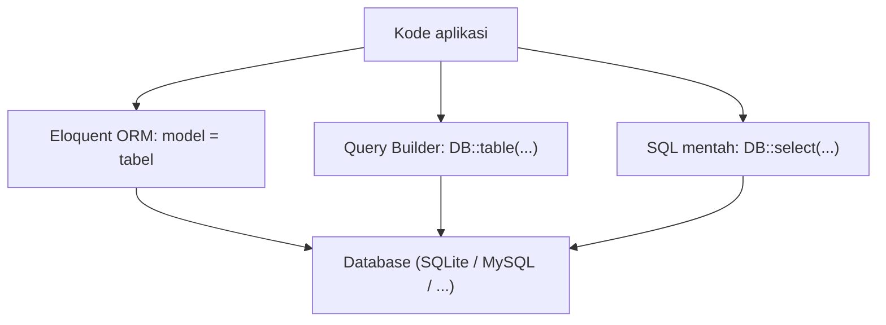
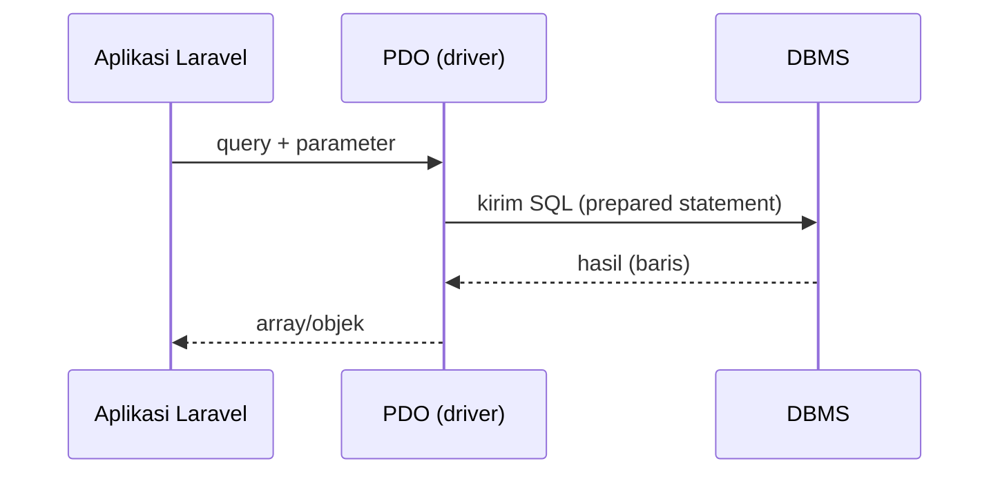

# Pengantar Database

Sampai bab Blade, data aplikasimu hidup di dalam kode: array di route, atau sesi yang hilang saat cookie dihapus. Aplikasi nyata harus menyimpan data **secara permanen**,
dapat dicari dengan cepat, dan aman dipakai banyak pengguna sekaligus. Alat untuk itu adalah **database**. Sub bab ini memperkenalkan apa itu database, jenisnya, dan
tiga cara Laravel berbicara dengannya.

## Tujuan Pembelajaran

Setelah menyelesaikan sub bab ini, kamu dapat:

- [ ] Menjelaskan masalah yang diselesaikan database dibanding menyimpan data di berkas atau array.
- [ ] Membedakan database, DBMS, tabel, baris, dan kolom.
- [ ] Menyebutkan jenis database (relasional dan non-relasional) beserta contohnya.
- [ ] Menyebutkan database yang didukung Laravel dan memilih yang cocok untuk belajar.
- [ ] Menjelaskan tiga lapisan akses data di Laravel: SQL mentah, Query Builder, dan Eloquent.
- [ ] Memeriksa database proyek dengan `php artisan db:show` dan `db:table`.

## Prasyarat

- Bab utama [Blade Template dan Integrasi Frontend](../level-03/index.md), terutama proyek akhirnya yang menyimpan data di sesi.
- [Struktur Direktori Laravel](../level-01/01-09-laravel-directory-structure.md) dan [Artisan CLI](../level-01/01-12-artisan-cli.md).
- Proyek Laravel yang berjalan (mis. `belajar-blade`, yang dibuat dengan SQLite bawaan).

## Pengantar

Bayangkan toko online yang menyimpan pesanan dalam berkas teks. Dua pelanggan memesan bersamaan dan keduanya menulis ke berkas yang sama; salah satu pesanan hilang.
Mencari semua pesanan Budi berarti membaca seluruh berkas. Mengubah nama produk berarti mengedit ratusan baris. Database dirancang untuk menyelesaikan persis masalah-masalah ini.

## Penjelasan Konsep

### Apa itu database?

**Database** adalah kumpulan data terorganisasi yang disimpan dan dikelola oleh perangkat lunak khusus bernama **DBMS** (*Database Management System*), misalnya MySQL, PostgreSQL, atau SQLite.
Aplikasimu tidak membaca berkasnya langsung; ia **meminta** DBMS menyimpan, mengambil, mengubah, atau menghapus data.

| Kemampuan | Tanpa database (berkas/array) | Dengan DBMS |
|---|---|---|
| Pencarian | Baca semua data | Memakai indeks, jauh lebih cepat |
| Akses bersamaan | Rawan data hilang/rusak | Dikelola DBMS (kunci dan transaksi) |
| Konsistensi | Ditangani manual | Aturan seperti kunci unik dan kunci asing |
| Keamanan | Hak akses berkas | Pengguna dan hak akses per database/tabel |
| Cadangan | Salin berkas | Alat khusus dan replikasi |

### Istilah dasar (database relasional)

| Istilah | Arti | Analogi |
|---|---|---|
| Tabel | Kumpulan data sejenis | Satu lembar Excel |
| Kolom (*column*) | Satu atribut data, bertipe tertentu | Judul kolom |
| Baris (*row*, *record*) | Satu data lengkap | Satu baris di lembar |
| Kunci utama (*primary key*) | Penanda unik tiap baris | Nomor induk |
| Kunci asing (*foreign key*) | Kolom yang menunjuk ke baris di tabel lain | Nomor induk penulis di tabel artikel |

Pembahasan lengkap ada pada sub bab berikutnya.

### Jenis database

| Jenis | Ciri | Contoh |
|---|---|---|
| Relasional (SQL) | Tabel berhubungan lewat kunci; bahasa SQL | MySQL, MariaDB, PostgreSQL, SQLite, SQL Server |
| Dokumen | Data fleksibel berbentuk dokumen JSON | MongoDB |
| Key-value | Pasangan kunci dan nilai, sangat cepat | Redis |
| Graf | Data sebagai simpul dan hubungan | Neo4j |

Materi ini fokus pada **database relasional**, yang paling umum untuk aplikasi web Laravel.

### Database yang didukung Laravel

Menurut dokumentasi 13.x, Laravel mendukung secara resmi lima database: MariaDB 10.3+, MySQL 5.7+, PostgreSQL 10+, SQLite 3.26+, dan SQL Server 2017+. MongoDB didukung lewat
paket `mongodb/laravel-mongodb`. Proyek baru memakai **SQLite** secara bawaan: seluruh database berupa satu berkas (`database/database.sqlite`) sehingga tidak perlu memasang server.

| Database | Kelebihan untuk belajar | Catatan |
|---|---|---|
| SQLite | Tanpa instalasi, satu berkas | Bagus untuk belajar dan pengujian |
| MySQL/MariaDB | Sangat umum di hosting dan produksi | Perlu server (lihat sub bab 04.03) |
| PostgreSQL | Fitur lanjutan lengkap | Tidak dibahas mendalam di materi ini |

Seluruh kode di bab ini berjalan pada SQLite maupun MySQL kecuali disebutkan lain.

### Tiga cara Laravel mengakses data



| Lapisan | Contoh | Kapan dipakai |
|---|---|---|
| SQL mentah | `DB::select('select * from articles where id = ?', [1])` | Query khusus yang tidak terwakili lapisan lain |
| Query Builder | `DB::table('articles')->where('id', 1)->first()` | Query fleksibel tanpa model |
| Eloquent ORM | `Article::find(1)` | Pekerjaan sehari-hari; data sebagai objek |

Ketiganya memakai koneksi yang sama dan dibahas berurutan pada bab ini.

### Siklus hidup skema: migration

Struktur tabel (skema) tidak dibuat dengan klik di aplikasi lain, melainkan dengan kode **migration** yang ikut disimpan di Git. Ini membuat struktur database dapat
direproduksi di komputer rekan atau server. Migration dibahas mulai sub bab 04.05.

### Keamanan

- **SQL injection:** jangan merangkai SQL dari input pengguna. Selalu gunakan *parameter binding* (`?`) atau Query Builder/Eloquent, yang melakukannya otomatis.
- **Kredensial:** kata sandi database ada di `.env`; jangan di-*commit* dan jangan dipakai ulang antar lingkungan.
- **Hak akses minimum:** pengguna database aplikasi tidak perlu menjadi `root`.
- **Cadangan:** database tanpa cadangan hanyalah menunggu kecelakaan.

## Cara Kerja



Laravel memakai ekstensi PHP **PDO** untuk berbicara dengan DBMS. Karena itu ekstensi seperti `pdo_sqlite` atau `pdo_mysql` harus aktif.

## Contoh Praktik

Kamu memeriksa database bawaan proyek `belajar-blade`: jenis DBMS, berkas, tabel yang sudah ada, dan struktur tabel `users`. Belum ada kode yang ditulis.

## Penjelasan Kode

Tidak ada kode aplikasi baru. Kamu hanya memakai tiga perintah Artisan bawaan:

| Perintah | Fungsi |
|---|---|
| `php artisan db:show` | Ringkasan database: jenis, ukuran, jumlah koneksi, daftar tabel |
| `php artisan db:table users` | Struktur satu tabel: kolom, tipe, indeks, kunci |
| `php artisan migrate:status` | Daftar migration dan statusnya (sudah/belum dijalankan) |

## Implementasi Langkah demi Langkah

### Langkah 1: masuk ke proyek

```bash
cd ~/belajar-laravel/belajar-blade
```

### Langkah 2: lihat ringkasan database

```bash
php artisan db:show
```

Catat jenis database (seharusnya `sqlite`), nama database, dan tabel yang ada (mis. `users`, `sessions`, `cache`, `jobs`, `migrations`).

### Langkah 3: lihat struktur tabel `users`

```bash
php artisan db:table users
```

Perhatikan nama kolom, tipe data, dan indeks.

### Langkah 4: lihat status migration

```bash
php artisan migrate:status
```

### Langkah 5: temukan berkas database

```bash
ls -l database/database.sqlite
```

Berkas inilah seluruh database SQLite-mu. Lalu periksa apakah berkas itu diabaikan Git:

```bash
git check-ignore -v database/database.sqlite
```

### Langkah 6: periksa konfigurasi

```bash
grep -n "DB_" .env
```

Catat nilai `DB_CONNECTION`. Jangan menyalin isi `.env` ke tempat publik.

## Eksekusi dan Verifikasi

| Langkah | Cara memverifikasi |
|---|---|
| 2 | `db:show` menampilkan jenis database dan daftar tabel tanpa galat |
| 3 | `db:table users` menampilkan kolom seperti `id`, `name`, `email`, `password` |
| 4 | Semua migration bawaan berstatus `Ran` |
| 5 | Berkas `database.sqlite` ada; `check-ignore` menunjukkan aturan `.gitignore` bila diabaikan |
| 6 | `DB_CONNECTION=sqlite` |

## Hasil yang Diharapkan

| Perintah | Hasil |
|---|---|
| `db:show` | Tabel ringkasan dengan jenis `SQLite`, versi, dan daftar tabel |
| `db:table users` | Kolom `id`, `name`, `email`, `email_verified_at`, `password`, `remember_token`, `created_at`, `updated_at` |
| `migrate:status` | Daftar migration bawaan berstatus `Ran` |

Format tabel keluaran dan daftar tabel bergantung versi kerangka dan pilihan saat membuat proyek. Hasil ini diturunkan dari dokumentasi dan belum dijalankan oleh penulis materi;
cocokkan dengan hasilmu.

## Kesalahan Umum dan Pemecahan Masalah

| Gejala | Penyebab | Cara mengenali | Solusi | Pencegahan |
|---|---|---|---|---|
| `could not find driver` | Ekstensi PDO untuk database tidak aktif | Galat menyebut driver | Aktifkan `pdo_sqlite` / `pdo_mysql` di `php.ini` | Periksa `php -m` saat memasang PHP |
| `Database file ... does not exist` | `database.sqlite` tidak ada | Galat saat `db:show` | Buat berkas atau jalankan `php artisan migrate` | Gunakan installer dengan pilihan SQLite |
| `db:show` kosong tanpa tabel | Migration belum dijalankan | Daftar tabel kosong | `php artisan migrate` | Jalankan migrate setelah membuat proyek |
| `.env` tidak ada | Proyek di-*clone* tanpa `.env` | Galat `No application encryption key` | `cp .env.example .env` lalu `php artisan key:generate` | Ikuti README setup |
| Berkas `database.sqlite` ikut ter-*commit* | `.gitignore` diubah | `git status` memuatnya | Hapus dari index; kembalikan `.gitignore` | Jangan simpan data di repositori |

## Latihan Praktik

### Latihan dasar

**D1. Istilah**
- *Masalah:* ingin memastikan istilah dasar dipahami.
- *Persyaratan:* untuk tabel `users`, tuliskan satu contoh kolom, satu baris (bayangkan), dan kolom yang menjadi kunci utama.
- *Perilaku yang diharapkan:* ketiganya tertulis benar.
- *Tujuan belajar:* mengenali istilah tabel, kolom, dan baris.

**D2. Pilih database**
- *Masalah:* tiga proyek butuh database.
- *Persyaratan:* untuk (a) prototipe pribadi, (b) toko online dengan banyak pengunjung, (c) cache sesi super cepat, pilih jenis database dan jelaskan alasannya.
- *Perilaku yang diharapkan:* pilihan masuk akal dengan alasan.
- *Tujuan belajar:* memilih database sesuai kebutuhan.

### Latihan implementasi

**I1. Catatan inspeksi**
- *Masalah:* rekan baru ingin tahu isi database proyek.
- *Persyaratan:* jalankan `db:show --counts` dan `db:table` untuk dua tabel pilihanmu, lalu tulis ringkasan satu paragraf.
- *Perilaku yang diharapkan:* ringkasan memuat jenis DBMS, jumlah tabel, dan fungsi tiap tabel yang dipilih.
- *Tujuan belajar:* membaca skema dengan Artisan.

**I2. Cek ekstensi**
- *Masalah:* ingin memastikan driver tersedia.
- *Persyaratan:* jalankan `php -m` dan temukan `pdo_sqlite` serta `pdo_mysql` (bila ada).
- *Perilaku yang diharapkan:* daftar driver yang tersedia tercatat.
- *Tujuan belajar:* mengecek prasyarat koneksi database.

### Latihan tantangan

**T1. Tiga lapisan akses**
- *Masalah:* tim berdebat memakai SQL mentah atau Eloquent.
- *Persyaratan:* tulis perbandingan satu halaman tentang tiga lapisan akses data: contoh sintaks, kelebihan, kekurangan, dan satu kasus yang paling cocok untuk masing-masing.
- *Perilaku yang diharapkan:* perbandingan seimbang dan memuat risiko SQL injection.
- *Tujuan belajar:* memilih alat akses data.
- *Catatan:* kerjakan mandiri; tidak ada kunci jawaban.

## Uji Pemahaman

1. Mengapa menyimpan data penting di array atau berkas tidak cukup?
2. Apa beda database dan DBMS?
3. Sebutkan tiga database relasional yang didukung Laravel.
4. Mengapa SQLite cocok untuk belajar?
5. Apa tiga lapisan akses data di Laravel?
6. Apa itu *prepared statement* dan mengapa penting?
7. Di mana kata sandi database disimpan, dan apa yang tidak boleh dilakukan dengannya?

??? success "Kunci jawaban singkat"
    1. Tidak tahan akses bersamaan, lambat dicari, tidak ada konsistensi, keamanan, dan cadangan yang memadai.
    2. Database adalah kumpulan datanya; DBMS adalah perangkat lunak pengelolanya.
    3. Misalnya MySQL/MariaDB, PostgreSQL, SQLite (juga SQL Server).
    4. Satu berkas, tanpa server dan tanpa instalasi tambahan.
    5. SQL mentah, Query Builder, dan Eloquent ORM.
    6. Query dikirim terpisah dari nilai parameternya sehingga nilai tidak dapat mengubah struktur SQL; mencegah SQL injection.
    7. Di `.env`; jangan di-*commit* atau dibagikan.

## Ringkasan

- Database menyimpan data permanen, cepat dicari, aman diakses bersamaan, dan dikelola DBMS.
- Laravel mendukung MariaDB, MySQL, PostgreSQL, SQLite, dan SQL Server; proyek baru memakai SQLite.
- Tiga lapisan akses: SQL mentah, Query Builder, dan Eloquent ORM.
- Struktur tabel dikelola dengan migration yang disimpan di Git.
- Lindungi dari SQL injection dengan parameter binding dan jaga kredensial di `.env`.

Selanjutnya: *Dasar Database Relasional*, yaitu tabel, kunci, dan hubungan antar tabel.

## Referensi Resmi

- [Laravel: Database, Getting Started](https://laravel.com/docs/13.x/database)
- [Laravel: Inspecting Your Databases](https://laravel.com/docs/13.x/database#inspecting-your-databases)
- [SQLite: About](https://www.sqlite.org/about.html)
- [PHP: PDO](https://www.php.net/manual/en/book.pdo.php)
