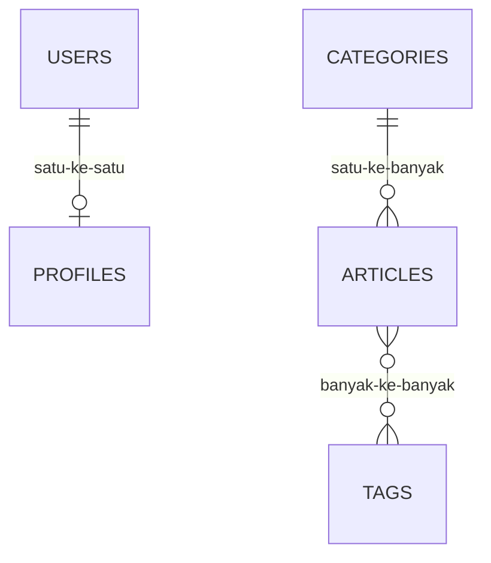
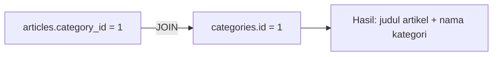

# Dasar Database Relasional

Database relasional menyimpan data dalam tabel yang saling berhubungan. Memahami tabel, kunci, dan hubungan sebelum menyentuh Eloquent membuat sisa bab ini jauh
lebih mudah: model, migration, dan relasi di Laravel hanyalah cara menuliskan konsep ini dalam PHP. Sub bab ini juga memperkenalkan SQL dasar dan normalisasi sederhana.

## Tujuan Pembelajaran

Setelah menyelesaikan sub bab ini, kamu dapat:

- [ ] Menjelaskan tabel, kolom, baris, kunci utama, dan kunci asing.
- [ ] Menjelaskan tiga jenis hubungan: satu-ke-satu, satu-ke-banyak, dan banyak-ke-banyak.
- [ ] Menjelaskan alasan memecah data ke beberapa tabel (normalisasi sederhana).
- [ ] Membaca dan menulis SQL dasar: `SELECT`, `INSERT`, `UPDATE`, `DELETE`, `WHERE`, `ORDER BY`, dan `JOIN`.
- [ ] Menjalankan SQL lewat `DB::select` dan `DB::statement` dengan parameter binding di Tinker.
- [ ] Menggambar rancangan tabel untuk sistem artikel.

## Prasyarat

- [Pengantar Database](04-01-introduction-to-databases.md).
- [Array](../level-00/00-13-arrays.md) pada PHP.
- Proyek `belajar-blade` dan `php artisan tinker` (konsol interaktif Laravel).

## Pengantar

Bayangkan blog yang menyimpan artikel beserta nama penulis dan email penulis di setiap baris. Penulis yang sama menulis 50 artikel, sehingga namanya tersimpan 50 kali.
Saat dia mengganti email, 50 baris harus diubah, dan salah satunya pasti terlewat. Solusinya: simpan penulis **sekali** di tabel sendiri, dan buat artikel menunjuk ke penulis itu.

## Penjelasan Konsep

### Tabel, kolom, baris

Contoh tabel `categories`:

| id | name | slug |
|---|---|---|
| 1 | Teknologi | teknologi |
| 2 | Olahraga | olahraga |

Setiap kolom punya **tipe data** (teks, angka, tanggal, dan sebagainya), dan setiap baris adalah satu data utuh.

### Kunci utama dan kunci asing

- **Kunci utama (*primary key*)**: kolom yang nilainya unik untuk tiap baris, biasanya `id` yang naik otomatis.
- **Kunci asing (*foreign key*)**: kolom yang berisi kunci utama tabel lain, menciptakan hubungan.

Tabel `articles` menunjuk ke `categories`:

| id | title | category_id |
|---|---|---|
| 1 | Belajar Laravel | 1 |
| 2 | Juara Liga | 2 |

`category_id` adalah kunci asing; nilai `1` berarti "artikel ini milik kategori dengan `id` 1".

### Tiga jenis hubungan



| Hubungan | Arti | Contoh | Implementasi |
|---|---|---|---|
| Satu-ke-satu | Satu baris A berpasangan dengan paling banyak satu baris B | Pengguna ↔ profil | Kunci asing unik di salah satu tabel |
| Satu-ke-banyak | Satu baris A punya banyak baris B | Kategori → artikel | Kunci asing di sisi "banyak" |
| Banyak-ke-banyak | Banyak A berhubungan dengan banyak B | Artikel ↔ tag | **Tabel penghubung** (*pivot*) berisi dua kunci asing |

### Normalisasi sederhana

Normalisasi adalah menata data agar tidak berulang dan tidak saling bertentangan. Aturan praktis untuk pemula:

1. Setiap sel berisi **satu** nilai (jangan menyimpan `php,laravel,blade` dalam satu kolom `tags`).
2. Setiap tabel membahas **satu hal** (artikel, kategori, pengguna).
3. Data yang berulang dipindah ke tabel sendiri dan dirujuk lewat kunci asing.

### SQL dasar

**SQL** (*Structured Query Language*) adalah bahasa standar untuk berbicara dengan database relasional.

| Tujuan | SQL |
|---|---|
| Ambil semua | `SELECT * FROM categories;` |
| Ambil kolom tertentu dan saring | `SELECT name FROM categories WHERE id = 1;` |
| Urutkan dan batasi | `SELECT * FROM articles ORDER BY id DESC LIMIT 5;` |
| Tambah | `INSERT INTO categories (name, slug) VALUES ('Sains', 'sains');` |
| Ubah | `UPDATE categories SET name = 'Sains Populer' WHERE id = 3;` |
| Hapus | `DELETE FROM categories WHERE id = 3;` |
| Gabung dua tabel | `SELECT a.title, c.name FROM articles a JOIN categories c ON c.id = a.category_id;` |

!!! danger "Selalu pakai klausa WHERE pada UPDATE dan DELETE"
    `DELETE FROM categories;` tanpa `WHERE` menghapus **semua** baris.

### SQL dari PHP dengan parameter binding

Jangan menyambung nilai ke string SQL. Gunakan tanda tanya (`?`) atau nama (`:id`) dan kirim nilainya terpisah:

```php-inline
use Illuminate\Support\Facades\DB;

$rows = DB::select('select * from categories where id = ?', [1]);
$rows = DB::select('select * from categories where id = :id', ['id' => 1]);
```

`DB::select` mengembalikan **array objek** `stdClass`. Untuk `INSERT`, `UPDATE`, dan `DELETE` gunakan `DB::insert`, `DB::update`, dan `DB::delete`; untuk perintah umum seperti
membuat tabel, gunakan `DB::statement`.

### Rancangan awal sistem artikel

| Tabel | Kolom penting | Hubungan |
|---|---|---|
| `users` | id, name, email | Punya banyak artikel dan komentar; punya satu profil |
| `profiles` | id, user_id, bio | Milik satu user |
| `categories` | id, name, slug | Punya banyak artikel |
| `articles` | id, title, slug, body, user_id, category_id | Milik satu user dan satu kategori; punya banyak komentar dan tag |
| `comments` | id, article_id, user_id, body | Milik satu artikel dan satu user |
| `tags` | id, name | Banyak-ke-banyak dengan artikel |
| `article_tag` | article_id, tag_id | Tabel penghubung |

Rancangan ini dikembangkan bertahap pada sub bab berikutnya dan menjadi dasar proyek akhir.

### Keamanan

- Parameter binding adalah pertahanan utama terhadap SQL injection.
- `DB::unprepared` tidak mengikat parameter; jangan pernah memasukkan input pengguna ke dalamnya.
- Perintah `UPDATE` dan `DELETE` tanpa `WHERE` sangat berbahaya; biasakan menjalankan `SELECT` dengan `WHERE` yang sama dulu.

## Cara Kerja



Operasi `JOIN` mencocokkan nilai kunci asing dengan kunci utama dan menggabungkan baris dari dua tabel.

## Contoh Praktik

Kamu membuat dua tabel percobaan (`categories_demo` dan `articles_demo`) di Tinker, mengisi data, dan menjalankan `SELECT`, `JOIN`, `UPDATE`, dan `DELETE` dengan parameter
binding. Tabel percobaan dihapus di akhir.

## Penjelasan Kode

Semua perintah dijalankan di konsol Tinker. Tabel dibuat dengan `Schema::create` agar kompatibel di SQLite dan MySQL (pembahasan `Schema` ada pada sub bab migration).

```php-inline
use Illuminate\Support\Facades\DB;
use Illuminate\Support\Facades\Schema;
use Illuminate\Database\Schema\Blueprint;

Schema::create('categories_demo', function (Blueprint $t) {
    $t->id();
    $t->string('name');
});

Schema::create('articles_demo', function (Blueprint $t) {
    $t->id();
    $t->string('title');
    $t->unsignedBigInteger('category_id');
});

DB::insert('insert into categories_demo (name) values (?)', ['Teknologi']);
DB::insert('insert into categories_demo (name) values (?)', ['Olahraga']);
DB::insert('insert into articles_demo (title, category_id) values (?, ?)', ['Belajar Laravel', 1]);
DB::insert('insert into articles_demo (title, category_id) values (?, ?)', ['Belajar SQL', 1]);
DB::insert('insert into articles_demo (title, category_id) values (?, ?)', ['Juara Liga', 2]);

DB::select('select a.title, c.name from articles_demo a join categories_demo c on c.id = a.category_id');
DB::update('update categories_demo set name = ? where id = ?', ['Olahraga Nasional', 2]);
DB::delete('delete from articles_demo where id = ?', [3]);
```

| Perintah | Fungsi |
|---|---|
| `Schema::create(...)` | Membuat dua tabel percobaan |
| `DB::insert(...)` | Menambah baris dengan binding |
| `DB::select(... join ...)` | Menggabungkan artikel dengan nama kategorinya |
| `DB::update(...)` | Mengubah satu baris; mengembalikan jumlah baris terpengaruh |
| `DB::delete(...)` | Menghapus satu baris |

## Implementasi Langkah demi Langkah

### Langkah 1: buka Tinker

```bash
cd ~/belajar-laravel/belajar-blade
php artisan tinker
```

### Langkah 2: buat tabel percobaan

Tempel perintah `Schema::create` untuk dua tabel pada Penjelasan Kode (satu per satu).

### Langkah 3: isi data

Jalankan lima perintah `DB::insert`.

### Langkah 4: baca data

```php-inline
DB::select('select * from categories_demo');
DB::select('select * from articles_demo where category_id = ?', [1]);
DB::select('select a.title, c.name from articles_demo a join categories_demo c on c.id = a.category_id');
```

### Langkah 5: ubah dan hapus

Jalankan `DB::update` dan `DB::delete`, lalu baca ulang kedua tabel.

### Langkah 6: coba tanpa binding yang benar (hanya membaca)

Bandingkan dua pemanggilan berikut dan jelaskan mengapa yang kedua berbahaya bila `$nama` berasal dari pengguna:

```php-inline
$nama = 'Teknologi';
DB::select('select * from categories_demo where name = ?', [$nama]);       // aman
DB::select("select * from categories_demo where name = '$nama'");          // JANGAN ditiru
```

### Langkah 7: bersihkan

```php-inline
Schema::dropIfExists('articles_demo');
Schema::dropIfExists('categories_demo');
```

Keluar dari Tinker dengan `exit`.

## Eksekusi dan Verifikasi

| Langkah | Cara memverifikasi |
|---|---|
| 2 | `Schema::hasTable('categories_demo')` mengembalikan `true` |
| 3–4 | `select * from categories_demo` mengembalikan dua objek |
| 4 | Join menampilkan tiga pasangan judul-kategori |
| 5 | `DB::update` mengembalikan `1`; setelah `DB::delete` artikel tersisa dua |
| 7 | `Schema::hasTable('articles_demo')` mengembalikan `false` |

## Hasil yang Diharapkan

| Perintah | Hasil |
|---|---|
| Join sebelum hapus | `Belajar Laravel – Teknologi`, `Belajar SQL – Teknologi`, `Juara Liga – Olahraga` |
| `DB::update(...)` | `1` (satu baris diubah) |
| Join setelah ubah dan hapus | Dua baris; kategori kedua bernama `Olahraga Nasional` tidak lagi terpakai oleh artikel |

Tinker menampilkan hasil sebagai array berisi objek `stdClass`; tata letak tepatnya berbeda antarversi. Hasil ini diturunkan dari dokumentasi dan perilaku SQL, dan belum
dijalankan oleh penulis materi; cocokkan dengan hasilmu.

## Kesalahan Umum dan Pemecahan Masalah

| Gejala | Penyebab | Cara mengenali | Solusi | Pencegahan |
|---|---|---|---|---|
| `SQLSTATE ... no such table` / `Base table or view not found` | Tabel belum dibuat atau salah nama | Galat menyebut nama tabel | Buat tabel atau perbaiki ejaan | Cek `Schema::hasTable` |
| `Table ... already exists` | Tabel percobaan sudah ada dari sesi sebelumnya | Galat saat `Schema::create` | `Schema::dropIfExists(...)` lalu ulangi | Selalu bersihkan di akhir |
| `Undefined variable $nama` di Tinker | Variabel belum didefinisikan di sesi | Galat variabel | Jalankan baris `$nama = ...` dulu | Tempel perintah berurutan |
| Hasil `DB::select` tampak seperti objek aneh | Hasil berupa `stdClass` | Output `{#...}` | Akses dengan `$row->name` | Pahami bentuk hasil |
| `DELETE` menghapus semua baris | `WHERE` terlupa | Tabel kosong | Isi ulang data | Jalankan `SELECT` dengan `WHERE` yang sama dulu |
| `UNIQUE constraint failed` | Mengisi nilai duplikat pada kolom unik | Galat constraint | Gunakan nilai berbeda | Pahami aturan kolom |
| Galat sintaks pada `JOIN` | Alias atau nama kolom salah | Pesan syntax error | Periksa alias | Tulis SQL perlahan dan uji bertahap |

## Latihan Praktik

### Latihan dasar

**D1. Tentukan jenis hubungan**
- *Masalah:* tentukan hubungan antar pasangan tabel.
- *Persyaratan:* untuk (a) siswa ↔ kelas, (b) guru ↔ mata pelajaran, (c) pengguna ↔ alamat penagihan, tulis jenis hubungan dan letak kunci asing/tabel penghubung.
- *Perilaku yang diharapkan:* jawaban beralasan untuk ketiganya.
- *Tujuan belajar:* mengidentifikasi hubungan.

**D2. SQL dasar**
- *Masalah:* ingin menulis query dari deskripsi.
- *Persyaratan:* tulis SQL untuk (a) lima artikel terbaru, (b) artikel dengan `category_id` 2, (c) jumlah artikel per kategori (`GROUP BY`).
- *Perilaku yang diharapkan:* tiga query valid.
- *Tujuan belajar:* menulis SQL dasar.

### Latihan implementasi

**I1. Dari satu tabel ke dua**
- *Masalah:* tabel `articles_demo` menyimpan `author_name` dan `author_email` di setiap baris.
- *Persyaratan:* gambarkan masalahnya, rancang dua tabel pengganti dengan kunci asing, dan buat keduanya di Tinker dengan data contoh.
- *Perilaku yang diharapkan:* tidak ada data penulis yang berulang.
- *Tujuan belajar:* menerapkan normalisasi sederhana.

**I2. Tabel penghubung**
- *Masalah:* artikel punya banyak tag, tag dipakai banyak artikel.
- *Persyaratan:* buat `tags_demo` dan `article_tag_demo` (dua kunci asing), isi data, dan tulis `JOIN` tiga tabel yang menampilkan judul artikel dan nama tag.
- *Perilaku yang diharapkan:* query menampilkan pasangan artikel-tag.
- *Tujuan belajar:* memahami hubungan banyak-ke-banyak.

### Latihan tantangan

**T1. Rancang ERD**
- *Masalah:* tim menyiapkan database untuk perpustakaan.
- *Persyaratan:* rancang minimal lima tabel (buku, penulis, anggota, peminjaman, kategori) dengan kunci utama, kunci asing, dan jenis hubungan; gambar dengan diagram teks atau Mermaid `erDiagram`.
- *Perilaku yang diharapkan:* rancangan tanpa data berulang dan semua hubungan jelas.
- *Tujuan belajar:* merancang skema relasional.
- *Catatan:* kerjakan mandiri; tidak ada kunci jawaban.

## Uji Pemahaman

1. Apa beda kunci utama dan kunci asing?
2. Sebutkan tiga jenis hubungan beserta contohnya.
3. Mengapa banyak-ke-banyak membutuhkan tabel penghubung?
4. Apa masalah menyimpan `php,laravel` dalam satu kolom?
5. Apa fungsi `JOIN`?
6. Mengapa nilai tidak boleh disambung langsung ke string SQL?
7. Apa risiko `UPDATE` tanpa `WHERE`?

??? success "Kunci jawaban singkat"
    1. Kunci utama mengenali baris sendiri secara unik; kunci asing menunjuk kunci utama tabel lain.
    2. Satu-ke-satu (pengguna-profil), satu-ke-banyak (kategori-artikel), banyak-ke-banyak (artikel-tag).
    3. Satu kolom tidak bisa menampung banyak rujukan secara rapi; tabel penghubung menyimpan pasangan kunci.
    4. Sulit dicari, disaring, dan dijaga konsistensinya; melanggar aturan satu nilai per sel.
    5. Menggabungkan baris dari dua tabel berdasarkan kecocokan kunci.
    6. Membuka celah SQL injection; gunakan parameter binding.
    7. Semua baris diubah.

## Ringkasan

- Database relasional menyimpan data dalam tabel yang dihubungkan kunci utama dan kunci asing.
- Tiga hubungan: satu-ke-satu, satu-ke-banyak, dan banyak-ke-banyak (dengan tabel penghubung).
- Normalisasi sederhana: satu nilai per sel, satu topik per tabel, data berulang dipindah.
- SQL dasar: `SELECT`, `INSERT`, `UPDATE`, `DELETE`, `WHERE`, `ORDER BY`, `JOIN`.
- Gunakan parameter binding dan selalu perhatikan `WHERE` pada `UPDATE` dan `DELETE`.

Selanjutnya: *Instalasi dan Konfigurasi MySQL*, menyiapkan server database yang umum dipakai di produksi.

## Referensi Resmi

- [Laravel: Running SQL Queries](https://laravel.com/docs/13.x/database#running-queries)
- [Laravel: Migrations, Foreign Key Constraints](https://laravel.com/docs/13.x/migrations#foreign-key-constraints)
- [SQLite: SQL Syntax](https://www.sqlite.org/lang.html)
- [MySQL: SQL Statements](https://dev.mysql.com/doc/refman/8.4/en/sql-statements.html)
