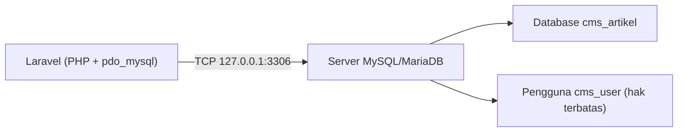

# Instalasi dan Konfigurasi MySQL

SQLite cukup untuk belajar, tetapi sebagian besar hosting dan server produksi memakai **MySQL** atau **MariaDB**. Mengenalnya sejak awal membantu kamu pindah dari
lingkungan belajar ke dunia nyata. Sub bab ini **bersifat opsional untuk menjalankan materi** (semua kode tetap berjalan di SQLite), tetapi sangat dianjurkan dicoba:
memasang server, membuat database dan pengguna khusus aplikasi, lalu memastikan koneksi berhasil.

## Tujuan Pembelajaran

Setelah menyelesaikan sub bab ini, kamu dapat:

- [ ] Menjelaskan perbedaan SQLite dan server MySQL/MariaDB.
- [ ] Memasang MySQL atau MariaDB di sistem operasimu.
- [ ] Mengamankan instalasi dan masuk dengan klien `mysql`.
- [ ] Membuat database `utf8mb4` dan pengguna khusus dengan hak akses terbatas.
- [ ] Memeriksa ekstensi PHP `pdo_mysql`.
- [ ] Menjelaskan pilihan *charset* dan *collation* yang aman untuk teks Indonesia dan emoji.

## Prasyarat

- [Pengantar Database](04-01-introduction-to-databases.md) dan [Dasar Database Relasional](04-02-relational-database-fundamentals.md).
- Hak administrator di komputer atau server latihanmu.
- PHP 8.3 atau lebih baru dengan ekstensi `pdo_mysql` (diperiksa di bawah).

## Pengantar

SQLite adalah berkas; MySQL adalah **program server** yang berjalan terus-menerus, menerima koneksi lewat jaringan (biasanya port 3306), dan punya sistem pengguna sendiri.
Karena itu ada beberapa langkah tambahan: memasang server, membuat pengguna, dan memberi tahu Laravel alamat serta kredensialnya.

!!! info "Materi ini bersifat opsional"
    Jika kamu tidak ingin memasang server sekarang, lewati langkah instalasi dan lanjutkan dengan SQLite. Bagian koneksi MySQL pada sub bab berikutnya dapat dibaca tanpa dijalankan.
    Pasanglah dari sumber resmi saja, dan hindari menjalankan server database yang terbuka ke internet pada komputer pribadimu.

## Penjelasan Konsep

### SQLite dibanding MySQL/MariaDB

| Aspek | SQLite | MySQL / MariaDB |
|---|---|---|
| Bentuk | Satu berkas | Server terpisah |
| Instalasi | Tidak ada | Perlu dipasang dan dijalankan |
| Banyak pengguna bersamaan | Terbatas pada penulisan | Dirancang untuk banyak koneksi |
| Pengguna dan hak akses | Tidak ada | Ada (akun, hak per database) |
| Umum di | Belajar, pengujian, aplikasi kecil | Hosting dan produksi |

### MySQL atau MariaDB?

**MariaDB** adalah turunan MySQL yang dikembangkan komunitas dan sangat mirip dalam pemakaian. Laravel mendukung keduanya (MySQL 5.7+ dan MariaDB 10.3+ menurut dokumentasi).
Pilih salah satu; perintah di sub bab ini berlaku untuk keduanya, dengan perbedaan kecil pada nama paket.

### Cara memasang

Gunakan sumber resmi dan versi yang masih didukung (lihat halaman rilis MySQL/MariaDB).

| Sistem | Cara umum |
|---|---|
| Windows | *MySQL Installer* dari situs resmi MySQL, atau paket seperti XAMPP/Laragon yang menyertakan MariaDB/MySQL |
| macOS | Homebrew: `brew install mysql` lalu `brew services start mysql` |
| Ubuntu/Debian | `sudo apt install mysql-server` (atau `mariadb-server`), lalu `sudo systemctl start mysql` |

Pada Windows dengan MySQL Installer, pilih *Developer Default* atau *Server only*, catat kata sandi `root` yang kamu buat, dan biarkan port bawaan `3306`.

### Mengamankan instalasi

Jalankan skrip pengamanan bawaan (nama dan pertanyaannya sedikit berbeda antar distribusi):

```bash
sudo mysql_secure_installation
```

Pada skrip ini kamu biasanya diminta menetapkan kata sandi `root`, menghapus pengguna anonim, melarang `root` masuk dari jarak jauh, dan menghapus database `test`.

### Masuk dengan klien `mysql`

```bash
mysql -u root -p
```

Setelah memasukkan kata sandi, prompt berubah menjadi `mysql>`. Di Ubuntu, `sudo mysql` dapat memberi akses `root` lewat soket tanpa kata sandi.

### Charset dan collation

Gunakan `utf8mb4` agar semua karakter Unicode (termasuk emoji dan aksara non-Latin) tersimpan benar. `utf8` di MySQL sebenarnya hanya 3 byte per karakter dan tidak dianjurkan.
Collation `utf8mb4_unicode_ci` mengurutkan dan membandingkan teks tanpa memedulikan huruf besar/kecil. Nilai bawaan konfigurasi Laravel untuk MySQL adalah `utf8mb4` dan `utf8mb4_unicode_ci`.

### Membuat database dan pengguna aplikasi

Jangan memakai `root` untuk aplikasi. Buat database dan pengguna khusus yang hanya berhak atas database itu:

```sql
CREATE DATABASE cms_artikel CHARACTER SET utf8mb4 COLLATE utf8mb4_unicode_ci;
CREATE USER 'cms_user'@'localhost' IDENTIFIED BY 'GANTI_DENGAN_SANDI_KUAT';
GRANT ALL PRIVILEGES ON cms_artikel.* TO 'cms_user'@'localhost';
```

| Perintah | Fungsi |
|---|---|
| `CREATE DATABASE ...` | Membuat database kosong dengan charset yang benar |
| `CREATE USER ...@'localhost'` | Membuat pengguna yang hanya boleh masuk dari komputer yang sama |
| `GRANT ALL PRIVILEGES ON cms_artikel.*` | Memberi hak penuh hanya pada database `cms_artikel` |

Ganti `GANTI_DENGAN_SANDI_KUAT` dengan kata sandi yang kuat dan unik. Jangan menulis kata sandi asli di tempat publik atau di materi ini.

### Memeriksa ekstensi PHP

```bash
php -m | grep -i pdo
```

Pastikan `pdo_mysql` ada. Jika tidak, aktifkan di `php.ini` (hilangkan tanda `;` pada `extension=pdo_mysql`) lalu mulai ulang PHP/server.

### Memeriksa koneksi dari terminal

```bash
mysql -u cms_user -p cms_artikel -e "SELECT 1;"
```

Jika berhasil, kamu melihat tabel hasil bernilai `1`.

### Keamanan

- Jangan menjalankan aplikasi dengan akun `root`.
- Jangan membuka port 3306 ke internet. Pada komputer pribadi, pastikan server hanya mendengarkan `127.0.0.1` (biasanya sudah demikian).
- Gunakan kata sandi kuat dan berbeda untuk setiap lingkungan; simpan di `.env`, bukan di kode.
- Perbarui MySQL/MariaDB ke versi yang masih menerima pembaruan keamanan.

## Cara Kerja



## Contoh Praktik

Kamu memasang MySQL atau MariaDB, mengamankannya, membuat database `cms_artikel` beserta pengguna `cms_user`, dan memastikan koneksi dari terminal berhasil.
Hubungan dengan Laravel dikerjakan pada sub bab berikutnya.

## Penjelasan Kode

Satu-satunya "kode" pada sub bab ini adalah SQL pembuatan database dan pengguna di atas. Penjelasan tiap baris sudah ada pada tabel di bagian konsep.

## Implementasi Langkah demi Langkah

### Langkah 1: pasang server

Ikuti cara pemasangan untuk sistemmu pada tabel di atas.

### Langkah 2: pastikan server berjalan

Linux dengan systemd:

```bash
sudo systemctl status mysql
```

macOS dengan Homebrew:

```bash
brew services list
```

Pada Windows, buka aplikasi *Services* dan cari layanan `MySQL` atau `MariaDB`.

### Langkah 3: amankan instalasi

```bash
sudo mysql_secure_installation
```

Di Windows, MySQL Installer sudah menanyakan kata sandi `root` saat pemasangan.

### Langkah 4: masuk sebagai root

```bash
mysql -u root -p
```

### Langkah 5: buat database dan pengguna

Di prompt `mysql>`, jalankan tiga perintah SQL pada bagian konsep (dengan kata sandi milikmu). Lalu:

```sql
SHOW DATABASES;
SELECT user, host FROM mysql.user;
EXIT;
```

### Langkah 6: periksa PHP

```bash
php -m | grep -i pdo
```

### Langkah 7: uji login pengguna aplikasi

```bash
mysql -u cms_user -p cms_artikel -e "SELECT 1;"
```

## Eksekusi dan Verifikasi

| Langkah | Cara memverifikasi |
|---|---|
| 2 | Status layanan `active (running)` / `started` |
| 4 | Prompt `mysql>` muncul |
| 5 | `SHOW DATABASES;` memuat `cms_artikel`; daftar pengguna memuat `cms_user` |
| 6 | `pdo_mysql` ada dalam daftar |
| 7 | Keluar tabel dengan nilai `1` tanpa galat `Access denied` |

## Hasil yang Diharapkan

| Perintah | Hasil |
|---|---|
| `mysql -u root -p` | Masuk ke prompt `mysql>` |
| `SHOW DATABASES;` | Daftar termasuk `cms_artikel` |
| `mysql -u cms_user -p cms_artikel -e "SELECT 1;"` | Tabel dengan satu kolom bernilai `1` |

Tampilan dan nama layanan berbeda antar sistem operasi. Langkah ini bergantung pada lingkunganmu dan belum dijalankan oleh penulis materi; cocokkan dengan hasilmu.

## Kesalahan Umum dan Pemecahan Masalah

| Gejala | Penyebab | Cara mengenali | Solusi | Pencegahan |
|---|---|---|---|---|
| `Can't connect to MySQL server on 'localhost'` | Server belum berjalan | Galat koneksi | Jalankan layanan MySQL/MariaDB | Aktifkan layanan agar mulai otomatis |
| `Access denied for user` | Kata sandi atau nama pengguna salah | Pesan `Access denied` | Periksa kredensial; buat ulang pengguna bila perlu | Catat kredensial di pengelola kata sandi |
| `Unknown database 'cms_artikel'` | Database belum dibuat | Galat saat memilih database | Jalankan `CREATE DATABASE` | Ikuti urutan langkah |
| `mysql: command not found` | Klien belum ada di `PATH` | Perintah tidak dikenali | Tambahkan folder `bin` MySQL ke `PATH` | Gunakan terminal yang memuat `PATH` baru |
| `could not find driver` di Laravel | `pdo_mysql` tidak aktif | Galat dari PHP | Aktifkan ekstensi di `php.ini` dan mulai ulang | Periksa `php -m` |
| Karakter emoji atau aksara asing rusak (`????`) | Charset bukan `utf8mb4` | Data tersimpan sebagai tanda tanya | Buat database ulang dengan `utf8mb4` | Selalu tentukan charset saat `CREATE DATABASE` |
| Port 3306 sudah dipakai | Ada MySQL/MariaDB lain berjalan | Server gagal mulai | Hentikan salah satu atau ganti port | Satu server database per mesin latihan |

## Latihan Praktik

### Latihan dasar

**D1. Bandingkan server**
- *Masalah:* ingin memahami bedanya.
- *Persyaratan:* tulis tiga perbedaan praktis antara SQLite dan MySQL dari sudut pandang pengembang pemula.
- *Perilaku yang diharapkan:* tiga perbedaan relevan tertulis.
- *Tujuan belajar:* memahami karakter tiap DBMS.

**D2. Periksa versi**
- *Masalah:* ingin tahu versi server.
- *Persyaratan:* jalankan `mysql --version` dan `SELECT VERSION();` di klien, lalu pastikan versimu memenuhi syarat Laravel (MySQL 5.7+ / MariaDB 10.3+).
- *Perilaku yang diharapkan:* versi tercatat dan dinilai memadai.
- *Tujuan belajar:* memeriksa kompatibilitas.

### Latihan implementasi

**I1. Database kedua**
- *Masalah:* ingin database untuk percobaan lain.
- *Persyaratan:* buat database `latihan_db` dan pengguna `latihan_user` yang hanya berhak atas database itu; buktikan `latihan_user` tidak bisa memakai `cms_artikel` (`USE cms_artikel;` harus ditolak).
- *Perilaku yang diharapkan:* akses terbatas terbukti.
- *Tujuan belajar:* menerapkan hak akses minimum.

**I2. Periksa charset**
- *Masalah:* ingin memastikan database memakai `utf8mb4`.
- *Persyaratan:* jalankan `SELECT DEFAULT_CHARACTER_SET_NAME, DEFAULT_COLLATION_NAME FROM information_schema.SCHEMATA WHERE SCHEMA_NAME = 'cms_artikel';`.
- *Perilaku yang diharapkan:* keluaran `utf8mb4` dan collation yang sesuai.
- *Tujuan belajar:* memverifikasi konfigurasi.

### Latihan tantangan

**T1. Prosedur siapkan lingkungan**
- *Masalah:* rekan baru perlu menyiapkan MySQL di komputernya.
- *Persyaratan:* tulis panduan satu halaman (dengan tangkapan perintah, bukan kata sandi asli) dari pemasangan sampai uji koneksi untuk sistem operasi rekanmu, termasuk tiga masalah umum dan solusinya.
- *Perilaku yang diharapkan:* rekan dapat mengikuti tanpa bertanya.
- *Tujuan belajar:* mendokumentasikan penyiapan lingkungan.
- *Catatan:* kerjakan mandiri; tidak ada kunci jawaban.

## Uji Pemahaman

1. Apa beda SQLite dan server MySQL?
2. Mengapa aplikasi tidak boleh memakai akun `root`?
3. Mengapa memilih `utf8mb4`?
4. Apa fungsi `GRANT ALL PRIVILEGES ON cms_artikel.*`?
5. Bagaimana memeriksa ekstensi `pdo_mysql`?
6. Mengapa port 3306 tidak boleh terbuka ke internet?
7. Apa beda MySQL dan MariaDB menurut pemakaian Laravel?

??? success "Kunci jawaban singkat"
    1. SQLite berupa satu berkas tanpa server; MySQL adalah server terpisah dengan sistem pengguna.
    2. `root` berhak atas semuanya; bila aplikasi diretas, seluruh server terdampak.
    3. Mendukung seluruh karakter Unicode, termasuk emoji.
    4. Memberi hak penuh pada semua tabel di database tersebut, dan hanya itu.
    5. `php -m | grep -i pdo`.
    6. Penyerang dapat mencoba masuk atau mengeksploitasi server database.
    7. Laravel mendukung keduanya dengan cara pakai hampir sama.

## Ringkasan

- MySQL/MariaDB adalah server database yang lazim di produksi; SQLite cukup untuk belajar.
- Pasang dari sumber resmi, amankan, dan masuk dengan klien `mysql`.
- Buat database `utf8mb4` dan pengguna khusus dengan hak terbatas; jangan pakai `root` di aplikasi.
- Pastikan `pdo_mysql` aktif dan uji koneksi dari terminal.
- Kata sandi disimpan di `.env`, bukan di kode.

Selanjutnya: *Koneksi Database*, menghubungkan aplikasi Laravel ke SQLite atau MySQL.

## Referensi Resmi

- [Laravel: Database, Configuration](https://laravel.com/docs/13.x/database#configuration)
- [MySQL: Installing and Upgrading MySQL](https://dev.mysql.com/doc/refman/8.4/en/installing.html)
- [MariaDB: Getting Started](https://mariadb.com/kb/en/getting-installing-and-upgrading-mariadb/)
- [PHP: PDO_MYSQL](https://www.php.net/manual/en/ref.pdo-mysql.php)
