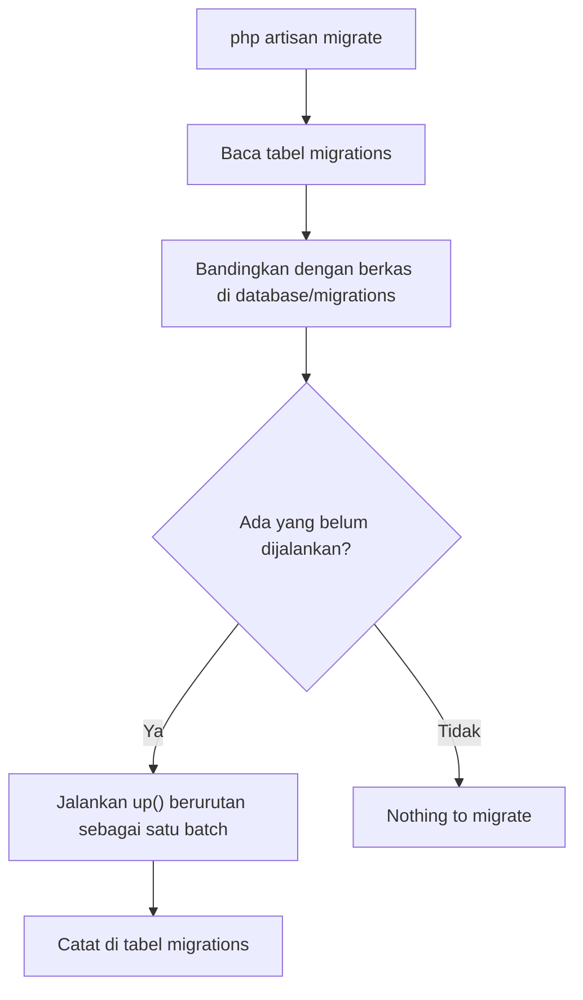

# Migration Database

Bagaimana struktur tabel dibagikan antar anggota tim dan antar server? Mengirim berkas `.sql` lewat chat mudah ketinggalan zaman dan rawan salah. Laravel memakai
**migration**: berkas PHP yang mendeskripsikan perubahan struktur database, disimpan di Git, dan dijalankan berurutan. Sub bab ini menjelaskan konsepnya dan cara menjalankan
migration yang sudah ada; membuat migration sendiri dibahas pada sub bab berikutnya.

## Tujuan Pembelajaran

Setelah menyelesaikan sub bab ini, kamu dapat:

- [ ] Menjelaskan masalah yang diselesaikan migration dan analoginya dengan kontrol versi.
- [ ] Membaca struktur berkas migration: kelas anonim dengan method `up` dan `down`.
- [ ] Menjalankan migration dengan `php artisan migrate` dan memeriksanya dengan `migrate:status`.
- [ ] Menjelaskan tabel `migrations` dan konsep *batch*.
- [ ] Melihat SQL yang akan dijalankan dengan `--pretend`.
- [ ] Menjelaskan mengapa migration yang sudah dibagikan tidak boleh diedit.

## Prasyarat

- [Koneksi Database](04-04-database-connection.md) dan proyek `cms-artikel`.
- [Artisan CLI](../level-01/01-12-artisan-cli.md).
- Pemahaman dasar Git ([Dasar Git dan GitHub](../level-00/00-24-git-and-github-fundamentals.md)).

## Pengantar

Dokumentasi resmi menyebut migration seperti kontrol versi untuk database: tim dapat mendefinisikan dan membagikan skema database aplikasi. Tanpa migration, setiap kali
rekanmu menarik kode baru yang membutuhkan kolom tambahan, kamu harus memberi tahu mereka secara manual agar menambahkan kolom itu di database lokal.

## Penjelasan Konsep

### Apa itu migration?

Satu migration = satu berkas di folder `database/migrations`, dengan nama berawalan stempel waktu (mis. `0001_01_01_000000_create_users_table.php`). Stempel waktu
menentukan **urutan** pelaksanaan.

### Struktur berkas

Migration modern adalah kelas anonim yang diturunkan dari `Migration`:

```php
<?php

use Illuminate\Database\Migrations\Migration;
use Illuminate\Database\Schema\Blueprint;
use Illuminate\Support\Facades\Schema;

return new class extends Migration
{
    public function up(): void
    {
        Schema::create('flights', function (Blueprint $table) {
            $table->id();
            $table->string('name');
            $table->timestamps();
        });
    }

    public function down(): void
    {
        Schema::drop('flights');
    }
};
```

| Bagian | Fungsi |
|---|---|
| `up()` | Menambah tabel, kolom, atau indeks: perubahan **maju** |
| `down()` | Membalikkan apa yang dilakukan `up()`: perubahan **mundur** |
| `Schema` | Facade pembangun skema, sama untuk semua jenis database |
| `Blueprint $table` | Objek tempat kamu mendefinisikan kolom dan indeks |

### Menjalankan migration

```bash
php artisan migrate
```

Perintah ini menjalankan semua migration yang **belum** dijalankan, berurutan menurut nama berkas. Laravel mencatat migration yang sudah jalan di tabel `migrations`
sehingga tidak menjalankannya dua kali.

| Perintah | Fungsi |
|---|---|
| `php artisan migrate` | Jalankan migration yang tertunda |
| `php artisan migrate:status` | Tampilkan daftar migration, apakah sudah dijalankan (`Ran`) atau tertunda (`Pending`) |
| `php artisan migrate --pretend` | Tampilkan SQL yang *akan* dijalankan tanpa menjalankannya |
| `php artisan migrate --step` | Jalankan tiap migration sebagai *batch* sendiri (memudahkan rollback satu per satu) |
| `php artisan migrate --force` | Jalankan tanpa konfirmasi (dipakai di produksi) |

### Tabel `migrations` dan batch

Tabel `migrations` memiliki kolom `migration` (nama berkas) dan `batch` (nomor kelompok). Semua migration yang dijalankan dalam satu kali `migrate` berada di *batch* yang sama.
Rollback (sub bab 04.09) membalik satu batch sekaligus.

### Migration bawaan proyek baru

Proyek Laravel baru menyertakan migration untuk tabel yang dipakai fitur bawaan, antara lain `users` (bersama `password_reset_tokens` dan `sessions`), `cache`, dan `jobs`.
Daftar persisnya bergantung versi kerangka.

### Aturan emas: jangan edit migration yang sudah dibagikan

Jika sebuah migration sudah dijalankan di komputer lain atau server, **jangan diubah**. Perubahannya tidak akan terjalankan di sana karena migration itu sudah tercatat selesai.
Buat migration **baru** untuk mengubah tabel (sub bab 04.08). Mengedit migration hanya aman selama belum pernah dijalankan di luar komputermu, dan itu pun harus diikuti
`migrate:fresh` di lokal.

### Keamanan

- Migration bisa menghapus data (`dropColumn`, `drop`). Di produksi, Laravel meminta konfirmasi sebelum menjalankan perintah destruktif; jangan melewatinya sembarangan dengan `--force`.
- **Cadangkan** database produksi sebelum migrasi besar.
- `migrate:fresh` menghapus **semua** tabel; jangan pernah menjalankannya di produksi.

## Cara Kerja



## Contoh Praktik

Kamu memeriksa migration bawaan `cms-artikel`, melihat SQL yang dihasilkan dengan `--pretend`, menjalankan `migrate`, dan membaca isi tabel `migrations` lewat Tinker.

## Penjelasan Kode

Tidak ada kode baru. Buka salah satu migration bawaan untuk membaca strukturnya:

```bash
ls database/migrations
cat database/migrations/*create_users_table.php
```

Temukan: kelas anonim, `up()` dengan `Schema::create('users', ...)`, dan `down()` dengan `Schema::dropIfExists(...)`.

## Implementasi Langkah demi Langkah

### Langkah 1: lihat daftar migration

```bash
cd ~/belajar-laravel/cms-artikel
ls database/migrations
php artisan migrate:status
```

### Langkah 2: baca satu migration

```bash
cat database/migrations/*create_users_table.php
```

### Langkah 3: lihat SQL tanpa menjalankan

Jika masih ada migration tertunda:

```bash
php artisan migrate --pretend
```

Jika semuanya sudah `Ran`, pesan `Nothing to migrate` muncul. Itu normal pada proyek SQLite hasil installer.

### Langkah 4: jalankan

```bash
php artisan migrate
```

### Langkah 5: lihat tabel `migrations`

```bash
php artisan tinker
```

```php-inline
DB::table('migrations')->get();
DB::table('migrations')->max('batch');
```

### Langkah 6: periksa tabel hasil

```bash
php artisan db:show
php artisan db:table sessions
```

## Eksekusi dan Verifikasi

| Langkah | Cara memverifikasi |
|---|---|
| 1 | `migrate:status` menampilkan daftar dengan status `Ran` atau `Pending` |
| 4 | Pesan `Nothing to migrate` atau daftar migration yang dijalankan |
| 5 | Baris pada tabel `migrations` sesuai jumlah berkas; `batch` bernilai 1 untuk migrasi awal |
| 6 | Tabel dari migration terlihat di `db:show` |

## Hasil yang Diharapkan

| Perintah | Hasil |
|---|---|
| `migrate:status` | Setiap migration bawaan berstatus `Ran` |
| `migrate --pretend` | Daftar SQL `create table ...` (bila ada yang tertunda) |
| `DB::table('migrations')->get()` | Koleksi baris dengan kolom `id`, `migration`, `batch` |

Pesan dan format keluaran bergantung versi. Hasil ini diturunkan dari dokumentasi dan belum dijalankan oleh penulis materi; cocokkan dengan hasilmu.

## Kesalahan Umum dan Pemecahan Masalah

| Gejala | Penyebab | Cara mengenali | Solusi | Pencegahan |
|---|---|---|---|---|
| `Nothing to migrate` padahal kamu baru menulis migration | Berkas salah folder, atau tersimpan dengan nama tanpa stempel waktu | `migrate:status` tidak memuatnya | Taruh di `database/migrations` dengan nama dari `make:migration` | Buat berkas lewat Artisan |
| `Table '...' already exists` | Tabel ada tetapi migration belum tercatat | Galat saat `migrate` | Hapus tabel manual atau `migrate:fresh` (di lokal) | Jangan membuat tabel manual di luar migration |
| `SQLSTATE ... no such table: migrations` | Koneksi ke database kosong yang salah | Tabel tidak ada | Periksa `.env`; jalankan `migrate` | Cek `db:show` dahulu |
| Perubahan pada migration lama tidak berlaku | Migration sudah tercatat `Ran` | `migrate` tidak menjalankannya | Buat migration baru; di lokal `migrate:fresh` | Jangan edit migration yang sudah dijalankan |
| Konfirmasi "Application In Production" | `APP_ENV=production` | Prompt konfirmasi | Pastikan memang di produksi; gunakan `--force` hanya bila yakin | Periksa `APP_ENV` |
| Galat kunci asing saat `migrate` | Urutan migration salah (tabel induk belum ada) | Galat constraint | Pastikan stempel waktu tabel induk lebih awal | Buat tabel induk lebih dulu |

## Latihan Praktik

### Latihan dasar

**D1. Baca migration**
- *Masalah:* ingin memahami struktur berkas.
- *Persyaratan:* pada migration `create_users_table`, tuliskan nama tabel yang dibuat, tiga kolom, dan isi `down()`.
- *Perilaku yang diharapkan:* catatan sesuai isi berkas.
- *Tujuan belajar:* membaca migration.

**D2. Status**
- *Masalah:* ingin tahu apa yang sudah jalan.
- *Persyaratan:* jalankan `migrate:status` dan jelaskan arti `Ran` dan `Pending`.
- *Perilaku yang diharapkan:* penjelasan benar.
- *Tujuan belajar:* membaca status migration.

### Latihan implementasi

**I1. Bandingkan SQL**
- *Masalah:* ingin melihat SQL SQLite vs MySQL.
- *Persyaratan:* jalankan `php artisan migrate:rollback --pretend` (hanya menampilkan SQL, tidak mengubah data). Bila kamu punya SQLite dan MySQL, bandingkan SQL kedua database dan catat dua perbedaannya.
- *Perilaku yang diharapkan:* perbedaan tipe kolom tercatat.
- *Tujuan belajar:* memahami abstraksi `Schema`.

**I2. Batch**
- *Masalah:* ingin memahami batch.
- *Persyaratan:* periksa `DB::table('migrations')->get()` dan tuliskan migration mana yang berada di batch yang sama.
- *Perilaku yang diharapkan:* migration awal berada di satu batch.
- *Tujuan belajar:* memahami batch.

### Latihan tantangan

**T1. Pedoman tim**
- *Masalah:* tim sering bentrok karena migration.
- *Persyaratan:* tulis pedoman satu halaman (aturan penamaan, larangan mengedit migration yang sudah dibagikan, urutan tabel induk-anak, aturan produksi).
- *Perilaku yang diharapkan:* pedoman memuat alasan tiap aturan.
- *Tujuan belajar:* menyusun kebiasaan kerja yang aman.
- *Catatan:* kerjakan mandiri; tidak ada kunci jawaban.

## Uji Pemahaman

1. Apa masalah yang diselesaikan migration?
2. Apa fungsi `up()` dan `down()`?
3. Bagaimana Laravel tahu migration mana yang sudah dijalankan?
4. Apa itu batch?
5. Apa fungsi `--pretend`?
6. Mengapa migration yang sudah dibagikan tidak boleh diedit?
7. Mengapa `migrate:fresh` berbahaya di produksi?

??? success "Kunci jawaban singkat"
    1. Menyamakan struktur database antar anggota tim dan antar server secara terkendali.
    2. `up()` menerapkan perubahan; `down()` membalikkannya.
    3. Lewat tabel `migrations`.
    4. Kelompok migration yang dijalankan dalam satu kali `migrate`; rollback membalik satu batch.
    5. Menampilkan SQL tanpa menjalankannya.
    6. Perubahannya tidak akan dijalankan di tempat yang sudah mencatatnya `Ran`; buat migration baru.
    7. Menghapus semua tabel beserta datanya.

## Ringkasan

- Migration adalah kontrol versi untuk skema database: berkas PHP dengan `up()` dan `down()`.
- `php artisan migrate` menjalankan migration tertunda; `migrate:status` dan `--pretend` membantu memeriksa.
- Tabel `migrations` mencatat yang sudah dijalankan beserta nomor batch.
- Jangan edit migration yang sudah dibagikan; buat yang baru.
- Berhati-hati dengan perintah destruktif di produksi.

Selanjutnya: *Membuat Migration*, menulis migration sendiri untuk tabel `articles`.

## Referensi Resmi

- [Laravel: Migrations](https://laravel.com/docs/13.x/migrations)
- [Laravel: Migration Structure](https://laravel.com/docs/13.x/migrations#migration-structure)
- [Laravel: Running Migrations](https://laravel.com/docs/13.x/migrations#running-migrations)
