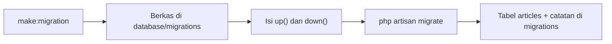
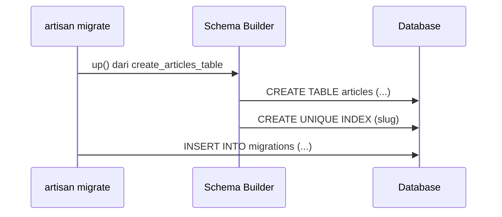

# Membuat Migration

Sekarang giliranmu menulis migration. Kamu akan membuat tabel `articles`, tempat artikel disimpan, dengan perintah `make:migration`, mengisi method `up()` dan `down()`,
menjalankannya, dan memverifikasi hasilnya. Tabel ini dikembangkan sepanjang bab utama ini sampai menjadi bagian dari proyek akhir.

## Tujuan Pembelajaran

Setelah menyelesaikan sub bab ini, kamu dapat:

- [ ] Membuat migration dengan `php artisan make:migration` dan aturan penamaannya.
- [ ] Membedakan migration pembuatan tabel dan perubahan tabel (`--create` dan `--table`).
- [ ] Menulis `Schema::create` dengan kolom dasar dan `timestamps()`.
- [ ] Menulis `down()` yang membalikkan `up()`.
- [ ] Menjalankan migration dan memeriksa hasilnya dengan `db:table`.
- [ ] Menambah data uji ke tabel baru lewat Tinker.

## Prasyarat

- [Migration Database](04-05-database-migration.md).
- Proyek `cms-artikel` dengan koneksi yang sehat (`php artisan db:show` berhasil).
- [Array](../level-00/00-13-arrays.md) dan [Class dan Objek](../level-00/00-19-classes-and-objects.md) pada PHP.

## Pengantar

Tabel `articles` adalah inti sistem artikel. Karena struktur akan berkembang (kategori, penulis, tag), kita mulai dari versi sederhana: judul, slug (bagian URL ramah),
isi, dan stempel waktu. Penambahan kolom lain dilakukan dengan migration baru, seperti kebiasaan kerja tim.

## Penjelasan Konsep

### Perintah `make:migration`

```bash
php artisan make:migration create_articles_table
```

Berkas baru muncul di `database/migrations` dengan nama seperti `2026_11_07_100000_create_articles_table.php` (stempel waktu menyesuaikan saat perintah dijalankan).

### Aturan penamaan

Laravel menebak nama tabel dan jenis operasi dari nama migration:

| Nama migration | Yang dibuat |
|---|---|
| `create_articles_table` | Kerangka `Schema::create('articles', ...)` |
| `add_is_published_to_articles_table` | Kerangka `Schema::table('articles', ...)` |
| `drop_summary_from_articles_table` | Kerangka `Schema::table('articles', ...)` |

Bila nama tidak mengikuti pola, kamu dapat menentukan tabel dengan opsi `--create=articles` atau `--table=articles`. Gunakan nama deskriptif: nama migration adalah dokumentasi
riwayat database-mu.

### Kerangka `Schema::create`

Isi `up()` dan `down()` untuk tabel `articles`:

File: `database/migrations/xxxx_xx_xx_xxxxxx_create_articles_table.php`

```php
<?php

use Illuminate\Database\Migrations\Migration;
use Illuminate\Database\Schema\Blueprint;
use Illuminate\Support\Facades\Schema;

return new class extends Migration
{
    public function up(): void
    {
        Schema::create('articles', function (Blueprint $table) {
            $table->id();
            $table->string('title');
            $table->string('slug')->unique();
            $table->text('body');
            $table->timestamps();
        });
    }

    public function down(): void
    {
        Schema::dropIfExists('articles');
    }
};
```

| Baris | Arti |
|---|---|
| `$table->id()` | Kolom `id` bertipe bilangan bulat besar, kunci utama, naik otomatis |
| `$table->string('title')` | Teks pendek (`VARCHAR`, bawaan 255 karakter) |
| `$table->string('slug')->unique()` | Teks pendek yang **tidak boleh sama** antar baris (indeks unik) |
| `$table->text('body')` | Teks panjang |
| `$table->timestamps()` | Dua kolom `created_at` dan `updated_at` (boleh `NULL`), diisi Eloquent otomatis |
| `Schema::dropIfExists('articles')` | Membalikkan `up()` dengan menghapus tabel |

Nama tabel memakai bentuk **jamak** dan *snake_case* (`articles`, `blog_posts`) agar cocok dengan konvensi model Eloquent (`Article` → `articles`). Nama tabel dan kolom pada
materi ini memakai bahasa Inggris sesuai konvensi framework; teks yang ditampilkan ke pengguna tetap bahasa Indonesia.

### Mengapa `down()` itu penting

`down()` memungkinkan `migrate:rollback` mengembalikan perubahan. Tulis `down()` yang benar-benar membalikkan `up()`: tabel yang dibuat dihapus, kolom yang ditambah dihapus.

### Apa yang terjadi saat dijalankan



### Keamanan

- Jangan menaruh data rahasia atau data sungguhan di dalam migration.
- Pikirkan kolom yang akan menyimpan data pribadi sejak awal (apa yang perlu disimpan? berapa lama?).
- Indeks unik pada `slug` mencegah dua artikel berbagi URL yang sama.

## Cara Kerja



## Contoh Praktik

Kamu membuat migration `create_articles_table`, menjalankannya, memeriksa struktur tabel, memasukkan satu artikel lewat Tinker, dan menguji bahwa `slug` ganda ditolak.

## Penjelasan Kode

Kode migration ada pada bagian konsep. Untuk menguji, kamu memakai Query Builder di Tinker (dibahas lengkap di sub bab 04.15):

```php-inline
DB::table('articles')->insert([
    'title' => 'Belajar Migration',
    'slug' => 'belajar-migration',
    'body' => 'Migration adalah kontrol versi untuk database.',
    'created_at' => now(),
    'updated_at' => now(),
]);
```

Query Builder tidak mengisi `created_at` dan `updated_at` otomatis (itu pekerjaan Eloquent), sehingga diisi manual dengan helper `now()`.

## Implementasi Langkah demi Langkah

### Langkah 1: buat migration

```bash
cd ~/belajar-laravel/cms-artikel
php artisan make:migration create_articles_table
```

Perhatikan nama berkas yang dihasilkan dan isi kerangkanya.

### Langkah 2: isi `up()` dan `down()`

Ganti isi berkas dengan kode pada bagian konsep.

### Langkah 3: lihat SQL

```bash
php artisan migrate --pretend
```

### Langkah 4: jalankan

```bash
php artisan migrate
php artisan migrate:status
```

### Langkah 5: periksa struktur

```bash
php artisan db:table articles
```

### Langkah 6: isi dan uji data

```bash
php artisan tinker
```

Jalankan `DB::table('articles')->insert([...])` seperti di atas, lalu:

```php-inline
DB::table('articles')->get();
```

### Langkah 7: uji batas unik

Jalankan `insert` yang sama sekali lagi. Baca pesan galat `UNIQUE constraint failed` (SQLite) atau `Duplicate entry` (MySQL).

### Langkah 8: catat di Git

```bash
git add database/migrations
git commit -m "Tambah migration tabel articles"
```

## Eksekusi dan Verifikasi

| Langkah | Cara memverifikasi |
|---|---|
| 1 | Berkas `*_create_articles_table.php` ada |
| 3 | SQL `create table "articles"` muncul |
| 4 | `migrate` menandai migration `DONE`; `migrate:status` menampilkan `Ran` |
| 5 | `db:table articles` menampilkan kolom `id`, `title`, `slug`, `body`, `created_at`, `updated_at` dan indeks unik pada `slug` |
| 6 | `get()` mengembalikan satu baris |
| 7 | Insert kedua gagal karena `slug` ganda |

## Hasil yang Diharapkan

| Perintah | Hasil |
|---|---|
| `db:table articles` | Enam kolom dan indeks unik pada `slug` |
| Insert pertama | `true` |
| Insert kedua | Pengecualian `UniqueConstraintViolationException` / `QueryException` |

Bentuk SQL dan pesan galat bergantung database yang dipakai. Hasil ini diturunkan dari dokumentasi dan belum dijalankan oleh penulis materi; cocokkan dengan hasilmu.

## Kesalahan Umum dan Pemecahan Masalah

| Gejala | Penyebab | Cara mengenali | Solusi | Pencegahan |
|---|---|---|---|---|
| `Class ... not found` saat `migrate` | Berkas migration memuat kelas dengan nama bentrok | Galat kelas | Gunakan kelas anonim (`return new class extends Migration`) | Pakai kerangka bawaan |
| `Table 'articles' already exists` | Tabel sudah dibuat manual atau migration ganda | Galat saat `migrate` | Hapus tabel atau `migrate:fresh` (lokal) | Jangan buat tabel di luar migration |
| `Duplicate entry` / `UNIQUE constraint failed` | Nilai `slug` sudah ada | Galat insert | Gunakan slug berbeda | Buat slug unik otomatis (sub bab observer) |
| `NOT NULL constraint failed: articles.body` | Kolom wajib tidak diisi | Galat insert | Isi semua kolom wajib atau jadikan `nullable()` | Rancang kolom wajib dan opsional |
| `created_at` kosong setelah insert Query Builder | Query Builder tidak mengisi timestamp | Kolom bernilai `NULL` | Isi manual, atau gunakan Eloquent | Pahami perbedaan lapisan |
| `down()` tidak bekerja saat rollback | `down()` kosong atau salah | Tabel tetap ada | Isi `down()` dengan benar | Uji `migrate:rollback` di lokal |
| Nama tabel tunggal (`article`) menyulitkan model | Tidak mengikuti konvensi | Model harus menyetel `$table` | Pakai bentuk jamak | Ikuti konvensi penamaan |

## Latihan Praktik

### Latihan dasar

**D1. Tabel kategori**
- *Masalah:* artikel butuh kategori.
- *Persyaratan:* buat migration `create_categories_table` dengan kolom `id`, `name`, `slug` (unik), dan `timestamps`; jalankan dan periksa dengan `db:table`.
- *Perilaku yang diharapkan:* tabel `categories` terbentuk sesuai desain.
- *Tujuan belajar:* membuat migration sendiri.

**D2. Lihat SQL**
- *Masalah:* ingin tahu SQL yang dihasilkan.
- *Persyaratan:* gunakan `--pretend` pada migration baru sebelum menjalankannya dan jelaskan satu baris SQL yang paling mengejutkanmu.
- *Perilaku yang diharapkan:* penjelasan sesuai SQL.
- *Tujuan belajar:* memahami terjemahan `Schema` ke SQL.

### Latihan implementasi

**I1. Tabel tag**
- *Masalah:* artikel perlu label.
- *Persyaratan:* buat migration `create_tags_table` (`id`, `name` unik, `timestamps`), isi tiga tag dengan Query Builder, dan uji nama ganda ditolak.
- *Perilaku yang diharapkan:* tiga tag tersimpan; duplikat ditolak.
- *Tujuan belajar:* menerapkan indeks unik.

**I2. Rollback uji**
- *Masalah:* ingin memastikan `down()` benar.
- *Persyaratan:* jalankan `php artisan migrate:rollback --step=1` pada migration tag, pastikan tabel hilang, lalu `migrate` lagi.
- *Perilaku yang diharapkan:* tabel hilang lalu muncul kembali.
- *Tujuan belajar:* menguji `down()`.

### Latihan tantangan

**T1. Rancang tabel komentar**
- *Masalah:* sebelum menulis, tim ingin rancangan.
- *Persyaratan:* rancang tabel `comments` (kolom, tipe, wajib/opsional, indeks) dengan alasan tiap pilihan, tanpa membuat kunci asing dulu (dibahas pada sub bab 04.17); lalu implementasikan migration-nya.
- *Perilaku yang diharapkan:* rancangan dan migration konsisten.
- *Tujuan belajar:* merancang skema sebelum menulis migration.
- *Catatan:* kerjakan mandiri; tidak ada kunci jawaban.

## Uji Pemahaman

1. Apa perintah untuk membuat migration tabel `posts`?
2. Bagaimana Laravel menebak nama tabel dari nama migration?
3. Apa fungsi `timestamps()`?
4. Mengapa `down()` perlu ditulis benar?
5. Apa arti `->unique()` pada `slug`?
6. Mengapa nama tabel berbentuk jamak?
7. Mengapa `created_at` kosong bila memakai `DB::table()->insert()` tanpa mengisinya?

??? success "Kunci jawaban singkat"
    1. `php artisan make:migration create_posts_table`.
    2. Dari pola `create_*_table`, `add_*_to_*_table`, dan sejenisnya.
    3. Menambah kolom `created_at` dan `updated_at`.
    4. Agar rollback dapat mengembalikan perubahan dengan benar.
    5. Dua baris tidak boleh memiliki nilai `slug` yang sama.
    6. Agar sesuai konvensi Eloquent (model `Article` memakai tabel `articles`).
    7. Query Builder tidak mengisi timestamp otomatis; itu fitur Eloquent.

## Ringkasan

- `php artisan make:migration create_x_table` membuat kerangka; nama menentukan tabel dan operasi.
- `Schema::create` mendefinisikan kolom; `down()` membalikkan `up()`.
- `id()`, `string()`, `text()`, dan `timestamps()` adalah kolom dasar; `unique()` menambah indeks unik.
- Jalankan `migrate`, lalu verifikasi dengan `db:table`.
- Gunakan nama jamak dan *snake_case* agar cocok dengan Eloquent.

Selanjutnya: *Tipe Kolom Database*, mengenal tipe kolom yang tersedia dan kapan memakainya.

## Referensi Resmi

- [Laravel: Generating Migrations](https://laravel.com/docs/13.x/migrations#generating-migrations)
- [Laravel: Creating Tables](https://laravel.com/docs/13.x/migrations#creating-tables)
- [Laravel: Running Migrations](https://laravel.com/docs/13.x/migrations#running-migrations)
