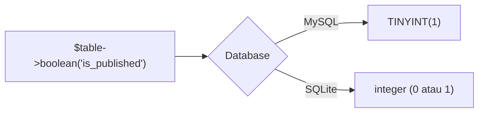

# Tipe Kolom Database

Setiap kolom punya tipe: apakah ia menyimpan teks, angka, tanggal, atau nilai benar/salah. Memilih tipe yang tepat menghemat ruang, mempercepat query, dan mencegah
kesalahan data. Sub bab ini mengenalkan tipe kolom yang paling sering dipakai di Laravel, pengubah kolom (*modifier*), dan cara menguji perilakunya lewat tabel percobaan.

## Tujuan Pembelajaran

Setelah menyelesaikan sub bab ini, kamu dapat:

- [ ] Memilih tipe kolom yang sesuai: teks, angka, desimal, boolean, tanggal, JSON, dan enum.
- [ ] Memakai pengubah kolom: `nullable`, `default`, `unique`, `index`, `unsigned`, dan `comment`.
- [ ] Menjelaskan mengapa uang sebaiknya memakai `decimal`, bukan `float`.
- [ ] Menjelaskan perbedaan `string` dan `text`, serta `timestamp` dan `dateTime`.
- [ ] Menguji tipe kolom dengan tabel percobaan dan Tinker.
- [ ] Menyebutkan perbedaan perilaku tipe antara SQLite dan MySQL.

## Prasyarat

- [Membuat Migration](04-06-creating-migrations.md).
- [Tipe Data PHP](../level-00/00-09-php-data-types.md).
- Proyek `cms-artikel`.

## Pengantar

Tipe `string` untuk `title` dan `text` untuk `body` sudah kamu pakai. Tetapi bagaimana dengan harga, status publikasi, tanggal terbit, atau pengaturan fleksibel? Tipe yang salah
menimbulkan bug halus: harga Rp 19.99 menjadi 19.989999 karena `float`, atau teks 300 karakter terpotong di kolom `string(255)`.

## Penjelasan Konsep

### Tipe yang sering dipakai

| Tipe Laravel | Menyimpan | Contoh pemakaian |
|---|---|---|
| `$table->id()` | Kunci utama bilangan bulat besar naik otomatis | `id` |
| `$table->string('name', 100)` | Teks pendek (bawaan 255) | judul, nama, slug |
| `$table->text('body')` | Teks panjang | isi artikel |
| `$table->integer('views')` | Bilangan bulat | jumlah dilihat |
| `$table->bigInteger('size')` | Bilangan bulat besar | ukuran berkas |
| `$table->unsignedInteger('stock')` | Bilangan bulat tak negatif | stok |
| `$table->boolean('is_published')` | Benar/salah | status terbit |
| `$table->decimal('price', 10, 2)` | Desimal presisi tetap (total digit, digit di belakang koma) | harga |
| `$table->float('rating')` | Bilangan pecahan perkiraan | nilai statistik |
| `$table->date('birth_date')` | Tanggal | tanggal lahir |
| `$table->dateTime('published_at')` | Tanggal dan jam | waktu terbit |
| `$table->timestamp('verified_at')` | Stempel waktu | waktu verifikasi |
| `$table->timestamps()` | `created_at` dan `updated_at` | semua tabel |
| `$table->json('options')` | Data JSON | pengaturan fleksibel |
| `$table->enum('status', ['draft','published'])` | Satu nilai dari daftar tetap | status |
| `$table->uuid('uuid')` | UUID | pengenal publik |
| `$table->foreignId('user_id')` | Kunci asing (sub bab 04.17) | rujukan ke tabel lain |

Daftar lengkap ada pada dokumentasi migration.

### `string` atau `text`?

`string` adalah `VARCHAR` dengan batas panjang (bawaan 255) dan bisa diindeks efisien; `text` menyimpan teks panjang dengan batas jauh lebih besar tetapi tidak cocok sebagai
kolom pencarian utama. Judul, nama, dan slug: `string`. Isi artikel dan deskripsi panjang: `text`.

### Uang: `decimal`, bukan `float`

Bilangan `float` menyimpan nilai perkiraan biner sehingga operasi seperti `0.1 + 0.2` tidak tepat. Untuk uang gunakan `decimal` (mis. `decimal('price', 12, 2)`), atau simpan
dalam satuan terkecil sebagai integer (rupiah penuh, atau sen).

### `dateTime` atau `timestamp`?

Keduanya menyimpan tanggal dan jam. Di MySQL, `timestamp` punya rentang tahun terbatas (hingga 2038) dan dikonversi ke zona waktu sesi, sedangkan `dateTime` tidak.
Laravel memakai `timestamp` untuk `created_at`/`updated_at`. Untuk tanggal bisnis (waktu terbit, jatuh tempo), `dateTime` umumnya lebih aman.

### Pengubah kolom (*modifier*)

Pengubah dirantai setelah definisi kolom:

| Pengubah | Fungsi |
|---|---|
| `->nullable()` | Kolom boleh `NULL` (kosong) |
| `->default($nilai)` | Nilai bawaan bila tidak diisi |
| `->unique()` | Nilai harus unik |
| `->index()` | Membuat indeks untuk mempercepat pencarian |
| `->unsigned()` | Bilangan tak negatif (MySQL/MariaDB) |
| `->comment('...')` | Catatan di database (MySQL/MariaDB/PostgreSQL) |
| `->after('kolom')` | Posisi kolom setelah kolom lain (hanya MySQL/MariaDB) |
| `->useCurrent()` | Bawaan `timestamp` = waktu sekarang |

Kolom **wajib** secara bawaan (`NOT NULL`). Jadikan `nullable()` hanya untuk kolom yang memang boleh kosong, misalnya `published_at` pada draf.

### Perbedaan database

Tipe Laravel diterjemahkan ke tipe sesuai database. SQLite bertipe lebih longgar (mis. boolean disimpan sebagai 0/1, enum sebagai teks dengan *check constraint*), sedangkan MySQL ketat.
Pengubah `after`, `unsigned`, dan `comment` hanya berlaku di sebagian database. Uji di database yang akan dipakai produksi.

### Keamanan dan desain

- Batasi panjang kolom sesuai kebutuhan; validasi input di aplikasi tetap wajib.
- Jangan menyimpan kata sandi sebagai teks biasa (kolom `password` menyimpan *hash*, dibahas di bab keamanan).
- Pertimbangkan data pribadi sejak merancang kolom; simpan seperlunya.

## Cara Kerja



Tipe di migration bersifat abstrak; driver menerjemahkannya ke tipe asli database.

## Contoh Praktik

Kamu membuat tabel percobaan `type_demos` berisi banyak tipe kolom, mengisinya lewat Query Builder, membaca hasilnya untuk melihat perilaku tiap tipe, lalu menghapus tabel
dengan `migrate:rollback`.

## Penjelasan Kode

File: `database/migrations/xxxx_xx_xx_xxxxxx_create_type_demos_table.php` (hasil `php artisan make:migration create_type_demos_table`)

```php
<?php

use Illuminate\Database\Migrations\Migration;
use Illuminate\Database\Schema\Blueprint;
use Illuminate\Support\Facades\Schema;

return new class extends Migration
{
    public function up(): void
    {
        Schema::create('type_demos', function (Blueprint $table) {
            $table->id();
            $table->string('name', 100);
            $table->text('description')->nullable();
            $table->integer('views')->default(0);
            $table->boolean('is_active')->default(true);
            $table->decimal('price', 10, 2)->default(0);
            $table->float('rating')->nullable();
            $table->date('release_date')->nullable();
            $table->dateTime('published_at')->nullable();
            $table->json('options')->nullable();
            $table->enum('status', ['draft', 'published'])->default('draft');
            $table->timestamps();
        });
    }

    public function down(): void
    {
        Schema::dropIfExists('type_demos');
    }
};
```

| Kolom | Perilaku yang diamati |
|---|---|
| `views` | Bernilai `0` bila tidak diisi |
| `is_active` | Bawaan `true` (tersimpan sebagai 1) |
| `price` | Desimal dua digit |
| `options` | Menyimpan teks JSON |
| `status` | Hanya `draft` atau `published` |

Perintah uji di Tinker:

```php-inline
DB::table('type_demos')->insert([
    'name' => 'Percobaan 1',
    'price' => 19.99,
    'options' => json_encode(['tema' => 'gelap']),
    'created_at' => now(),
    'updated_at' => now(),
]);

DB::table('type_demos')->first();
```

## Implementasi Langkah demi Langkah

### Langkah 1: buat dan isi migration

```bash
cd ~/belajar-laravel/cms-artikel
php artisan make:migration create_type_demos_table
```

Isi dengan kode di atas, lalu:

```bash
php artisan migrate
php artisan db:table type_demos
```

### Langkah 2: isi dan baca data

Jalankan `php artisan tinker`, lalu perintah `insert` dan `first()` di atas.

### Langkah 3: uji nilai bawaan

Perhatikan bahwa `views`, `is_active`, `status` terisi otomatis walau tidak disebut pada `insert`.

### Langkah 4: uji batas enum

```php-inline
DB::table('type_demos')->insert([
    'name' => 'Salah', 'status' => 'archived',
    'created_at' => now(), 'updated_at' => now(),
]);
```

Amati hasilnya. Pada MySQL nilai di luar daftar ditolak; SQLite juga menolak melalui *check constraint* yang dibuat Laravel.

### Langkah 5: uji presisi

```php-inline
DB::table('type_demos')->insert([
    'name' => 'Harga', 'price' => 0.1 + 0.2,
    'created_at' => now(), 'updated_at' => now(),
]);
DB::table('type_demos')->where('name', 'Harga')->value('price');
```

Bandingkan hasilnya dengan `0.1 + 0.2` di PHP (`0.30000000000000004`).

### Langkah 6: bersihkan

```bash
php artisan migrate:rollback --step=1
```

Pastikan tabel `type_demos` sudah hilang. Hapus berkas migration percobaan (`database/migrations/*_create_type_demos_table.php`) agar tidak mengotori riwayat, dan jangan di-*commit*.

## Eksekusi dan Verifikasi

| Langkah | Cara memverifikasi |
|---|---|
| 1 | `db:table type_demos` menampilkan 13 kolom dengan tipe yang sesuai |
| 2 | `first()` mengembalikan satu objek |
| 3 | `views` bernilai `0`, `is_active` bernilai `1`, `status` bernilai `draft` |
| 4 | Insert dengan `status` salah ditolak |
| 5 | Nilai `price` menjadi `0.30` (dua digit desimal), bukan `0.30000000000000004` |
| 6 | Tabel `type_demos` tidak ada lagi |

## Hasil yang Diharapkan

| Kolom | Nilai yang terlihat |
|---|---|
| `price` | `19.99` untuk insert pertama; sekitar `0.3` untuk percobaan presisi |
| `options` | Teks `{"tema":"gelap"}` |
| `is_active` | `1` (SQLite) atau `1`/`true` sesuai driver |

Bentuk hasil (angka desimal, boolean) berbeda sedikit antara SQLite dan MySQL. Hasil ini diturunkan dari dokumentasi dan belum dijalankan oleh penulis materi; cocokkan
dengan hasilmu.

## Kesalahan Umum dan Pemecahan Masalah

| Gejala | Penyebab | Cara mengenali | Solusi | Pencegahan |
|---|---|---|---|---|
| `Data too long for column` / teks terpotong | Panjang melebihi `string(n)` | Galat saat insert (MySQL) | Perbesar `string` atau pakai `text` | Pilih panjang sesuai kebutuhan |
| `NOT NULL constraint failed` | Kolom wajib tidak diisi | Galat insert | Beri `default()` atau `nullable()` atau isi nilainya | Rancang kolom wajib/opsional |
| Harga tidak tepat | Memakai `float` untuk uang | Selisih desimal | Gunakan `decimal` atau integer satuan terkecil | Jangan `float` untuk uang |
| Nilai enum ditolak | Nilai di luar daftar | Galat constraint | Gunakan nilai yang diizinkan | Kelola daftar nilai di satu tempat |
| `after()` diabaikan di SQLite | Pengubah hanya untuk MySQL/MariaDB | Urutan kolom tidak berubah | Abaikan atau uji di MySQL | Jangan bergantung pada urutan kolom |
| Boolean tampil `1`/`0` | Disimpan sebagai angka | Nilai tampil angka | Gunakan cast `boolean` di model (sub bab 04.13) | Atur cast di Eloquent |
| Tanggal salah zona waktu | `timestamp` dikonversi zona waktu | Selisih jam | Atur zona waktu aplikasi dan pahami `timestamp` vs `dateTime` | Konfigurasi `APP_TIMEZONE` |

## Latihan Praktik

### Latihan dasar

**D1. Pilih tipe**
- *Masalah:* tentukan tipe kolom.
- *Persyaratan:* pilih tipe Laravel untuk (a) nomor telepon, (b) harga produk, (c) tanggal lahir, (d) pengaturan JSON, (e) status pesanan. Jelaskan alasannya.
- *Perilaku yang diharapkan:* pilihan dan alasan masuk akal (telepon: `string`, bukan integer).
- *Tujuan belajar:* memilih tipe sesuai data.

**D2. Wajib atau opsional**
- *Masalah:* tentukan `nullable`.
- *Persyaratan:* untuk kolom `articles`: title, slug, body, published_at, summary, tentukan mana yang `nullable` dan alasannya.
- *Perilaku yang diharapkan:* `published_at` dan `summary` opsional.
- *Tujuan belajar:* merancang nullability.

### Latihan implementasi

**I1. Tabel produk percobaan**
- *Masalah:* ingin tabel produk lengkap.
- *Persyaratan:* buat migration tabel `products` (name, sku unik, description nullable, price `decimal`, stock `unsignedInteger` default 0, is_active boolean default true, released_at nullable, timestamps), jalankan, dan isi tiga produk.
- *Perilaku yang diharapkan:* tabel dan data sesuai desain.
- *Tujuan belajar:* menerapkan banyak tipe dan pengubah.

**I2. Indeks pencarian**
- *Masalah:* pencarian berdasarkan `sku` lambat.
- *Persyaratan:* tambahkan `->index()` ke kolom yang sering dicari (lewat migration baru atau pada tabel baru) dan jelaskan manfaat serta biayanya (penulisan lebih lambat, ruang lebih besar).
- *Perilaku yang diharapkan:* penjelasan seimbang antara manfaat dan biaya.
- *Tujuan belajar:* memahami indeks.

### Latihan tantangan

**T1. Eksperimen presisi uang**
- *Masalah:* tim berdebat `float` vs `decimal`.
- *Persyaratan:* buat tabel dengan kolom `price_float` (`float`) dan `price_decimal` (`decimal(10,2)`), jumlahkan seribu kali nilai `0.10` di PHP dan di database, lalu laporkan perbedaannya.
- *Perilaku yang diharapkan:* laporan menunjukkan selisih dan rekomendasi.
- *Tujuan belajar:* memahami presisi numerik.
- *Catatan:* kerjakan mandiri; tidak ada kunci jawaban.

## Uji Pemahaman

1. Apa beda `string` dan `text`?
2. Mengapa uang tidak disimpan sebagai `float`?
3. Apa fungsi `nullable()`?
4. Apa beda `dateTime` dan `timestamp`?
5. Kapan memakai `enum`?
6. Mengapa `after()` tidak selalu berfungsi?
7. Mengapa nomor telepon disimpan sebagai `string`?

??? success "Kunci jawaban singkat"
    1. `string` teks pendek berbatas panjang; `text` teks panjang.
    2. `float` tidak presisi; gunakan `decimal` atau integer satuan terkecil.
    3. Mengizinkan nilai `NULL`.
    4. `timestamp` memiliki rentang terbatas dan konversi zona waktu di MySQL; `dateTime` tidak.
    5. Bila nilai hanya boleh satu dari daftar tetap yang kecil.
    6. Hanya didukung MySQL/MariaDB.
    7. Karena bukan untuk dihitung dan dapat berawalan nol atau tanda `+`.

## Ringkasan

- Pilih tipe sesuai data: `string`, `text`, `integer`, `boolean`, `decimal`, `dateTime`, `json`, `enum`.
- Pengubah (`nullable`, `default`, `unique`, `index`) menyempurnakan kolom.
- Gunakan `decimal` untuk uang, bukan `float`.
- Perilaku tipe berbeda antara SQLite dan MySQL; uji di database produksi.
- Kolom wajib secara bawaan; jadikan opsional hanya bila perlu.

Selanjutnya: *Mengubah Tabel Database*, menambah, mengubah, dan menghapus kolom lewat migration baru.

## Referensi Resmi

- [Laravel: Available Column Types](https://laravel.com/docs/13.x/migrations#available-column-types)
- [Laravel: Column Modifiers](https://laravel.com/docs/13.x/migrations#column-modifiers)
- [MySQL: Data Types](https://dev.mysql.com/doc/refman/8.4/en/data-types.html)
