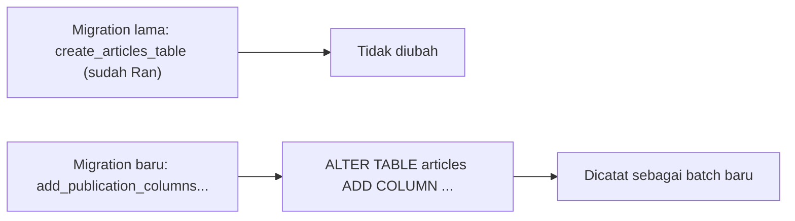

# Mengubah Tabel Database

Kebutuhan aplikasi selalu berubah: artikel kini perlu status terbit, ringkasan, atau judul lebih panjang. Struktur tabel yang sudah dijalankan **tidak boleh diedit di
migration lamanya**; kamu menambah migration **baru** yang memodifikasi tabel. Sub bab ini mengajarkan menambah, mengubah, mengganti nama, dan menghapus kolom dengan
`Schema::table`, serta hal-hal yang harus diwaspadai pada tabel yang sudah berisi data.

## Tujuan Pembelajaran

Setelah menyelesaikan sub bab ini, kamu dapat:

- [ ] Menambah kolom dengan `Schema::table` dan menulis `down()` yang membalikkannya.
- [ ] Mengubah tipe atau atribut kolom dengan `change()` dan menjelaskan aturan "tulis ulang semua pengubah".
- [ ] Mengganti nama kolom dengan `renameColumn` dan menghapus kolom dengan `dropColumn`.
- [ ] Mengganti nama atau menghapus tabel dengan `Schema::rename` dan `Schema::drop`.
- [ ] Menambah kolom wajib ke tabel berisi data dengan aman.
- [ ] Menjelaskan mengapa perubahan skema ditulis sebagai migration baru.

## Prasyarat

- [Tipe Kolom Database](04-07-database-column-types.md) dan [Membuat Migration](04-06-creating-migrations.md).
- Proyek `cms-artikel` dengan tabel `articles` dan minimal satu baris data (dari sub bab 04.06).

## Pengantar

Tabel `articles` berisi satu baris uji. Menambah kolom wajib `is_published` tanpa nilai bawaan akan gagal atau menimbulkan data tak konsisten karena baris lama tidak
punya nilai. Skenario ini mewakili masalah nyata di produksi, tempat tabel berisi jutaan baris.

## Penjelasan Konsep

### Menambah kolom

Nama migration `add_..._to_articles_table` membuat kerangka `Schema::table`:

```php
public function up(): void
{
    Schema::table('articles', function (Blueprint $table) {
        $table->string('summary')->nullable()->after('slug');
        $table->boolean('is_published')->default(false);
        $table->dateTime('published_at')->nullable();
    });
}

public function down(): void
{
    Schema::table('articles', function (Blueprint $table) {
        $table->dropColumn(['summary', 'is_published', 'published_at']);
    });
}
```

| Bagian | Arti |
|---|---|
| `Schema::table('articles', ...)` | Mengubah tabel yang sudah ada |
| `->nullable()` / `->default(false)` | Membuat kolom baru aman bagi baris lama (tidak wajib atau punya nilai bawaan) |
| `->after('slug')` | Menempatkan kolom setelah `slug` (hanya MySQL/MariaDB; diabaikan di SQLite) |
| `dropColumn([...])` | Menghapus beberapa kolom sekaligus di `down()` |

### Mengubah kolom: `change()`

`change()` mengubah tipe atau atribut kolom yang sudah ada. Dokumentasi menekankan: saat mengubah kolom, kamu harus **menulis ulang semua pengubah** yang ingin dipertahankan;
pengubah yang tidak ditulis akan hilang.

```php
// Memperpanjang judul dari 255 ke 200? Contoh ini mempersempit; lihat peringatan data di bawah.
$table->string('title', 200)->change();

// Menjaga atribut lain: nullable dan default harus ditulis ulang
$table->string('summary', 300)->nullable()->change();
```

`change()` tidak mengubah indeks kolom; gunakan pengubah indeks eksplisit bila perlu (`->unique(false)`, `->primary()`).

### Mengganti nama dan menghapus kolom

```php
$table->renameColumn('summary', 'excerpt');   // ganti nama
$table->dropColumn('excerpt');                // hapus satu kolom
$table->dropColumn(['views', 'rating']);      // hapus beberapa kolom
```

Dokumentasi juga menyediakan jalan pintas seperti `dropTimestamps()`, `dropSoftDeletes()`, dan `dropRememberToken()`.

### Mengganti nama dan menghapus tabel

```php
Schema::rename('articles', 'posts');
Schema::dropIfExists('type_demos');
```

Sebelum mengganti nama tabel yang memiliki kunci asing, beri nama eksplisit pada constraint-nya agar tidak merujuk nama tabel lama (dokumentasi migration).

### `down()` untuk rename dan drop

| Operasi di `up()` | Pembalik di `down()` |
|---|---|
| `renameColumn('a', 'b')` | `renameColumn('b', 'a')` |
| `dropColumn('x')` | Tambah kembali kolom `x` dengan definisi aslinya |
| `change()` ke tipe baru | `change()` kembali ke tipe lama |

Data di kolom yang dihapus **tidak dapat dikembalikan** oleh `down()`; hanya strukturnya.

### Menambah kolom wajib ke tabel berisi data

Tiga pilihan aman:

1. Beri `->default(...)`: baris lama otomatis mendapat nilai bawaan.
2. Jadikan `->nullable()`, isi data lama, lalu ubah menjadi wajib di migration berikutnya.
3. Untuk tabel besar, rencanakan jendela pemeliharaan dan uji di salinan data produksi.

### Keamanan dan keselamatan data

- `dropColumn` dan mempersempit tipe (`string(200)`) dapat menghilangkan atau memotong data. **Cadangkan** sebelum menjalankan di produksi.
- Jangan menjalankan perubahan skema besar saat lalu lintas tinggi tanpa perencanaan.
- Uji `up()` dan `down()` di lokal dengan data contoh.

## Cara Kerja



## Contoh Praktik

Kamu membuat tiga migration pada tabel `articles`: (1) menambah `summary`, `is_published`, dan `published_at`; (2) mengganti nama `summary` menjadi `excerpt` dan mempersempit
`title` menjadi 200 karakter; (3) menghapus `excerpt`. Setelah itu tabel `articles` memiliki kolom publikasi dan judul 200 karakter.

## Penjelasan Kode

File: `database/migrations/xxxx_add_publication_columns_to_articles_table.php`

```php
<?php

use Illuminate\Database\Migrations\Migration;
use Illuminate\Database\Schema\Blueprint;
use Illuminate\Support\Facades\Schema;

return new class extends Migration
{
    public function up(): void
    {
        Schema::table('articles', function (Blueprint $table) {
            $table->string('summary')->nullable();
            $table->boolean('is_published')->default(false);
            $table->dateTime('published_at')->nullable();
        });
    }

    public function down(): void
    {
        Schema::table('articles', function (Blueprint $table) {
            $table->dropColumn(['summary', 'is_published', 'published_at']);
        });
    }
};
```

File: `database/migrations/xxxx_rename_summary_and_shorten_title_on_articles_table.php`

```php
<?php

use Illuminate\Database\Migrations\Migration;
use Illuminate\Database\Schema\Blueprint;
use Illuminate\Support\Facades\Schema;

return new class extends Migration
{
    public function up(): void
    {
        Schema::table('articles', function (Blueprint $table) {
            $table->renameColumn('summary', 'excerpt');
            $table->string('title', 200)->change();
        });
    }

    public function down(): void
    {
        Schema::table('articles', function (Blueprint $table) {
            $table->renameColumn('excerpt', 'summary');
            $table->string('title', 255)->change();
        });
    }
};
```

File: `database/migrations/xxxx_drop_excerpt_from_articles_table.php`

```php
<?php

use Illuminate\Database\Migrations\Migration;
use Illuminate\Database\Schema\Blueprint;
use Illuminate\Support\Facades\Schema;

return new class extends Migration
{
    public function up(): void
    {
        Schema::table('articles', function (Blueprint $table) {
            $table->dropColumn('excerpt');
        });
    }

    public function down(): void
    {
        Schema::table('articles', function (Blueprint $table) {
            $table->string('excerpt')->nullable();
        });
    }
};
```

| Migration | Fungsi |
|---|---|
| 1 | Menambah tiga kolom aman bagi baris lama (`nullable` atau `default`) |
| 2 | Mengganti nama `summary` → `excerpt` dan mempersempit `title` menjadi 200 |
| 3 | Menghapus `excerpt`; `down()` membuatnya kembali (tanpa data lama) |

## Implementasi Langkah demi Langkah

### Langkah 1: pastikan ada data

```bash
cd ~/belajar-laravel/cms-artikel
php artisan tinker
```

```php-inline
DB::table('articles')->count();
```

Bila `0`, tambahkan satu baris seperti pada sub bab 04.06.

### Langkah 2: buat tiga migration

```bash
php artisan make:migration add_publication_columns_to_articles_table
php artisan make:migration rename_summary_and_shorten_title_on_articles_table --table=articles
php artisan make:migration drop_excerpt_from_articles_table
```

Isi ketiganya dengan kode di atas. Opsi `--table` menentukan tabel bila nama migration tidak cukup jelas bagi Laravel.

### Langkah 3: jalankan satu per satu

```bash
php artisan migrate --step
php artisan db:table articles
php artisan migrate:status
```

Opsi `--step` menjadikan tiap migration batch tersendiri sehingga bisa di-*rollback* satu per satu (sub bab 04.09).

### Langkah 4: periksa data

```php-inline
DB::table('articles')->first();
```

Baris lama tetap ada; `is_published` bernilai `0` (false), `published_at` bernilai `NULL`.

### Langkah 5: uji batas kolom `title`

Coba menyimpan judul 250 karakter dan lihat hasilnya:

```php-inline
DB::table('articles')->insert([
    'title' => str_repeat('a', 250), 'slug' => 'judul-panjang', 'body' => 'x',
    'created_at' => now(), 'updated_at' => now(),
]);
```

Pada MySQL dalam mode ketat, ini ditolak (`Data too long`). SQLite tidak menegakkan panjang `VARCHAR`, sehingga bisa berhasil; ini contoh perbedaan perilaku antar database.
Hapus baris percobaan setelahnya: `DB::table('articles')->where('slug', 'judul-panjang')->delete();`

### Langkah 6: catat di Git

```bash
git add database/migrations
git commit -m "Tambah kolom publikasi dan rapikan tabel articles"
```

## Eksekusi dan Verifikasi

| Langkah | Cara memverifikasi |
|---|---|
| 3 | `db:table articles` memuat `is_published`, `published_at`, tanpa `excerpt` |
| 3 | `migrate:status` memuat tiga migration baru berstatus `Ran` dengan batch berbeda |
| 4 | Baris lama utuh; `is_published` = 0 |
| 5 | Perilaku panjang `title` sesuai database yang dipakai |

## Hasil yang Diharapkan

| Kolom `articles` setelah ketiga migration | Keterangan |
|---|---|
| `id`, `title` (200), `slug`, `body` | Kolom awal; `title` dipersempit |
| `is_published`, `published_at` | Kolom baru |
| `created_at`, `updated_at` | Tetap ada |
| `summary` / `excerpt` | Tidak ada lagi |

Hasil `db:table` menampilkan tipe sesuai database yang dipakai. Hasil ini diturunkan dari dokumentasi dan belum dijalankan oleh penulis materi; cocokkan dengan hasilmu.

## Kesalahan Umum dan Pemecahan Masalah

| Gejala | Penyebab | Cara mengenali | Solusi | Pencegahan |
|---|---|---|---|---|
| `NOT NULL constraint failed` / `Field doesn't have a default` saat menambah kolom wajib | Baris lama tidak punya nilai | Galat saat `migrate` | Tambah `->default()` atau `->nullable()` | Selalu pikirkan baris lama |
| Atribut kolom hilang setelah `change()` | Pengubah tidak ditulis ulang | `nullable`/`default` lenyap | Tulis semua pengubah di `change()` | Salin definisi lengkap kolom |
| `Column already exists` | Menjalankan migration dua kali manual atau salah nama | Galat saat `migrate` | Periksa `db:table`; perbaiki migration | Jangan ubah tabel di luar migration |
| `Unknown column` saat rename | Nama kolom lama salah | Galat saat `migrate` | Periksa ejaan dengan `db:table` | Cek struktur sebelum menulis |
| Data hilang setelah `dropColumn` | Kolom berisi data dihapus | Nilai tidak dapat dipulihkan | Pulihkan dari cadangan | Cadangkan sebelum menghapus kolom |
| `down()` gagal setelah drop | `down()` membuat kolom tanpa data | Data lama tidak kembali | Terima batasan; jangan mengandalkan `down()` untuk data | Cadangan, bukan rollback, untuk data |
| `after()` tidak berpengaruh | Bukan MySQL/MariaDB | Urutan kolom tidak berubah | Abaikan | Jangan bergantung pada urutan kolom |

## Latihan Praktik

### Latihan dasar

**D1. Tambah kolom**
- *Masalah:* artikel butuh jumlah dilihat.
- *Persyaratan:* buat migration `add_views_to_articles_table` yang menambah `views` (`unsignedInteger`, default 0), jalankan, dan periksa baris lama.
- *Perilaku yang diharapkan:* baris lama memiliki `views = 0`.
- *Tujuan belajar:* menambah kolom aman.

**D2. Rollback migration terakhir**
- *Masalah:* ingin membatalkan penambahan `views`.
- *Persyaratan:* jalankan `php artisan migrate:rollback --step=1` dan pastikan kolom hilang dan `down()` benar.
- *Perilaku yang diharapkan:* kolom `views` tidak ada lagi.
- *Tujuan belajar:* menguji `down()`.

### Latihan implementasi

**I1. Ubah panjang dan pertahankan atribut**
- *Masalah:* `slug` perlu 150 karakter dan tetap unik.
- *Persyaratan:* ubah dengan `change()` tanpa kehilangan indeks unik; jelaskan bagaimana kamu memastikan indeks tetap ada.
- *Perilaku yang diharapkan:* `db:table articles` menunjukkan `slug` tetap unik.
- *Tujuan belajar:* memahami batasan `change()`.

**I2. Kolom wajib bertahap**
- *Masalah:* ingin kolom `author_name` wajib, padahal tabel berisi data.
- *Persyaratan:* lakukan dalam tiga langkah: tambah `nullable`, isi data lama dengan `DB::table('articles')->update(...)`, lalu ubah menjadi wajib dengan `change()`.
- *Perilaku yang diharapkan:* kolom akhirnya wajib tanpa menghapus data.
- *Tujuan belajar:* migrasi data aman.

### Latihan tantangan

**T1. Rencana perubahan produksi**
- *Masalah:* tabel `orders` berisi 50 juta baris dan perlu kolom wajib baru.
- *Persyaratan:* tulis rencana (cadangan, pengujian di salinan, urutan migration, pemantauan, rencana mundur) dan jelaskan risiko tiap langkah.
- *Perilaku yang diharapkan:* rencana realistis dan memuat rencana mundur.
- *Tujuan belajar:* berpikir tentang perubahan skema di produksi.
- *Catatan:* kerjakan mandiri; tidak ada kunci jawaban.

## Uji Pemahaman

1. Mengapa perubahan skema ditulis sebagai migration baru?
2. Apa yang terjadi pada pengubah kolom saat `change()` dipakai?
3. Bagaimana menambah kolom wajib ke tabel berisi data?
4. Apa fungsi `renameColumn`?
5. Apa batasan `down()` setelah `dropColumn`?
6. Apa risiko `string('title', 200)->change()` pada data panjang?
7. Mengapa `after()` tidak boleh diandalkan?

??? success "Kunci jawaban singkat"
    1. Migration lama sudah tercatat `Ran` dan tidak akan dijalankan ulang di tempat lain.
    2. Pengubah yang tidak ditulis ulang akan hilang.
    3. Beri `default()` atau jadikan `nullable()` terlebih dahulu.
    4. Mengganti nama kolom tanpa mengubah datanya.
    5. Hanya membuat ulang struktur kolom, tidak datanya.
    6. Data lebih panjang dapat ditolak atau terpotong, tergantung database.
    7. Hanya didukung MySQL/MariaDB.

## Ringkasan

- Ubah tabel dengan migration baru memakai `Schema::table`.
- Kolom baru harus aman bagi baris lama: `nullable()` atau `default()`.
- `change()` mengharuskan semua pengubah ditulis ulang; `renameColumn` dan `dropColumn` mengubah struktur.
- `down()` mengembalikan struktur, bukan data yang sudah terhapus.
- Cadangkan data sebelum perubahan yang merusak.

Selanjutnya: *Rollback dan Refresh Migration*, membalikkan dan mengulang migration.

## Referensi Resmi

- [Laravel: Updating Tables](https://laravel.com/docs/13.x/migrations#updating-tables)
- [Laravel: Modifying Columns](https://laravel.com/docs/13.x/migrations#modifying-columns)
- [Laravel: Renaming Columns](https://laravel.com/docs/13.x/migrations#renaming-columns)
- [Laravel: Dropping Columns](https://laravel.com/docs/13.x/migrations#dropping-columns)
