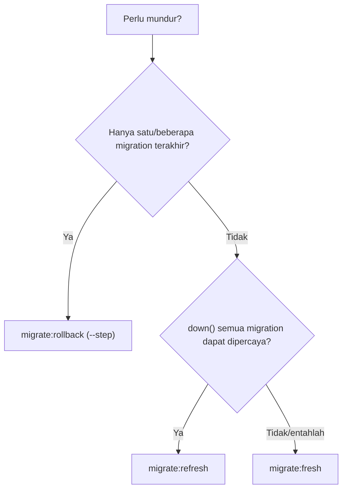
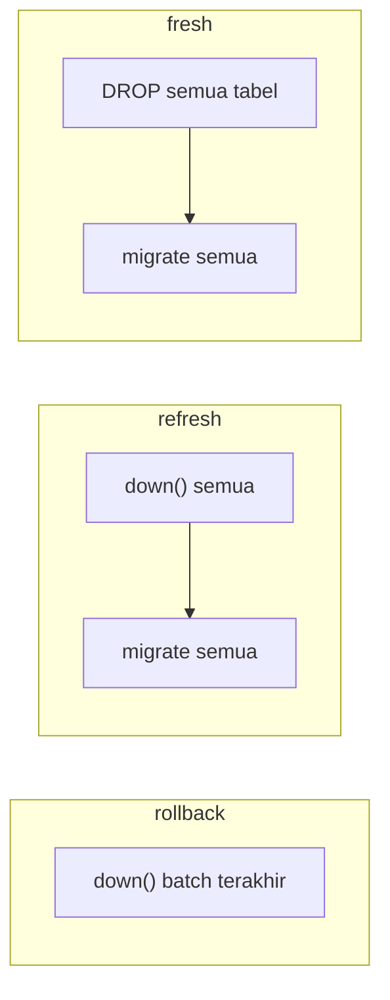

# Rollback dan Refresh Migration

Selama pengembangan kamu sering ingin "kembali" ke keadaan sebelumnya, atau membangun ulang database dari nol. Laravel menyediakan beberapa perintah untuk itu, dengan
tingkat keamanan berbeda: ada yang hanya membalik satu migration, ada yang menghapus semua tabel. Sub bab ini menjelaskan perbedaannya agar kamu memilih yang tepat dan
tidak kehilangan data secara tidak sengaja.

## Tujuan Pembelajaran

Setelah menyelesaikan sub bab ini, kamu dapat:

- [ ] Membalik migration terakhir atau beberapa migration dengan `migrate:rollback`.
- [ ] Menjelaskan perbedaan `rollback`, `reset`, `refresh`, dan `fresh`.
- [ ] Memakai opsi `--step`, `--batch`, dan `--seed`.
- [ ] Menjelaskan peran `down()` pada rollback.
- [ ] Memilih perintah yang tepat untuk situasi lokal dan menghindarinya di produksi.
- [ ] Menjelaskan efek tiap perintah terhadap data.

## Prasyarat

- [Mengubah Tabel Database](04-08-modifying-database-tables.md).
- Proyek `cms-artikel` dengan beberapa migration yang sudah dijalankan.
- Pemahaman tabel `migrations` dan batch ([Migration Database](04-05-database-migration.md)).

## Pengantar

Kamu menulis migration, menjalankannya, lalu sadar ada salah kolom. Mengubah manual di database membuat database dan kode tidak sinkron. Cara yang benar: membalik migration
(`down()`), memperbaiki, dan menjalankan ulang. Ketika kekacauan lebih besar, membangun ulang seluruh database dari awal sering lebih cepat.

## Penjelasan Konsep

### Perbandingan perintah

| Perintah | Yang terjadi | Data |
|---|---|---|
| `migrate:rollback` | Menjalankan `down()` pada **batch terakhir** | Hilang pada tabel/kolom yang dibalik |
| `migrate:rollback --step=N` | Membalik N migration terakhir | Sama |
| `migrate:rollback --batch=N` | Membalik batch ke-N | Sama |
| `migrate:reset` | Membalik **semua** migration (`down()` semuanya) | Semua tabel migration hilang |
| `migrate:refresh` | `reset` lalu `migrate` | Semua data hilang; skema dibuat ulang |
| `migrate:fresh` | **Menghapus semua tabel** lalu `migrate` (tanpa memakai `down()`) | Semua data hilang |
| `db:wipe` | Menghapus semua tabel, view, dan tipe | Semua data hilang |

Tambahkan `--seed` pada `refresh` atau `fresh` untuk mengisi data awal sesudahnya (sub bab 04.10).

### `rollback`

```bash
php artisan migrate:rollback
php artisan migrate:rollback --step=2
php artisan migrate:rollback --batch=3
php artisan migrate:rollback --pretend
```

`rollback` memanggil `down()` pada migration yang dibalik, sehingga `down()` harus benar. Opsi `--pretend` hanya menampilkan SQL-nya.

### `reset` dan `refresh`

```bash
php artisan migrate:reset
php artisan migrate:refresh
php artisan migrate:refresh --step=5
php artisan migrate:refresh --seed
```

`refresh` = `reset` + `migrate`. Dengan `--step=5` hanya 5 migration terakhir yang dibalik dan dijalankan ulang.

### `fresh`

```bash
php artisan migrate:fresh
php artisan migrate:fresh --seed
```

`fresh` menghapus semua tabel **tanpa** memanggil `down()`, lalu menjalankan semua migration dari awal. Ia pilihan paling dapat diandalkan saat `down()` rusak atau skema
berantakan di lokal. Menurut dokumentasi, secara bawaan ia hanya menyentuh koneksi database bawaan (opsi `--database` memilih koneksi lain).

### Memilih perintah



### Hanya untuk lokal

`refresh`, `fresh`, `reset`, dan `db:wipe` menghapus data. Di lingkungan `production`, Laravel meminta konfirmasi; jangan melewatinya dengan `--force` pada database nyata.
Di produksi, kamu hanya menjalankan `migrate` ke depan. Bila perlu mundur, cadangkan dulu dan gunakan migration perbaikan baru ke depan.

### Keamanan

- Pastikan koneksi aktif benar (`php artisan db:show`) sebelum menjalankan perintah penghapus; jangan sampai mengenai database lain.
- Jangan simpan data penting hanya di database lokal tanpa cadangan atau seeder.
- Jangan menjalankan `migrate:fresh` di server bersama atau produksi.

## Cara Kerja



## Contoh Praktik

Kamu memeriksa batch, membalik satu migration, menjalankannya lagi, lalu membandingkan efek `refresh` dan `fresh` pada data uji di tabel `articles`.

## Penjelasan Kode

Tidak ada kode aplikasi baru; semua dilakukan lewat Artisan. Pastikan tiga migration pada sub bab sebelumnya dijalankan dengan `--step` sehingga masing-masing punya batch sendiri.

## Implementasi Langkah demi Langkah

### Langkah 1: lihat kondisi

```bash
cd ~/belajar-laravel/cms-artikel
php artisan db:show
php artisan migrate:status
```

Catat migration dan batch-nya.

### Langkah 2: pastikan ada data uji

```bash
php artisan tinker
```

```php-inline
DB::table('articles')->count();
```

### Langkah 3: lihat SQL rollback

```bash
php artisan migrate:rollback --step=1 --pretend
```

### Langkah 4: rollback satu migration

```bash
php artisan migrate:rollback --step=1
php artisan migrate:status
php artisan db:table articles
```

Migration `drop_excerpt...` kembali `Pending` dan kolom `excerpt` muncul lagi (tanpa data).

### Langkah 5: jalankan lagi

```bash
php artisan migrate
```

### Langkah 6: coba `refresh`

```bash
php artisan migrate:refresh
```

Periksa jumlah baris `articles`: kembali ke `0`. Tabel dibuat ulang melalui `down()` lalu `up()` semua migration.

### Langkah 7: coba `fresh`

Isi lagi satu baris uji di Tinker, lalu:

```bash
php artisan migrate:fresh
```

Bandingkan dengan `refresh`: hasil akhirnya sama (tabel kosong), tetapi `fresh` tidak memakai `down()`.

### Langkah 8: lihat bukti rusaknya `down()` (opsional)

Pada salinan lokal, hapus isi `down()` salah satu migration, jalankan `migrate:refresh`, amati galat atau tabel yang tersisa, lalu `migrate:fresh` untuk memperbaiki. Kembalikan `down()`.

## Eksekusi dan Verifikasi

| Langkah | Cara memverifikasi |
|---|---|
| 3 | SQL `alter table ... drop column` / `add column` ditampilkan tanpa mengubah data |
| 4 | `drop_excerpt...` berstatus `Pending`; `excerpt` ada lagi |
| 5 | Semua migration `Ran` |
| 6 | `articles` kosong setelah `refresh` |
| 7 | `articles` kosong setelah `fresh` |

## Hasil yang Diharapkan

| Perintah | Dampak pada data `articles` |
|---|---|
| `migrate:rollback --step=1` | Data tetap; hanya kolom `excerpt` kembali (kosong) |
| `migrate:refresh` | Data hilang; tabel dibuat ulang |
| `migrate:fresh` | Data hilang; tabel dibuat ulang tanpa `down()` |

Keluaran perintah bergantung versi (daftar migration dengan durasi). Hasil ini diturunkan dari dokumentasi dan belum dijalankan oleh penulis materi; cocokkan dengan hasilmu.

## Kesalahan Umum dan Pemecahan Masalah

| Gejala | Penyebab | Cara mengenali | Solusi | Pencegahan |
|---|---|---|---|---|
| `Nothing to rollback` | Tidak ada migration yang sudah dijalankan | Pesan itu | Jalankan `migrate` dulu | Cek `migrate:status` |
| Rollback membalik terlalu banyak | Semua migration berada di satu batch | Banyak tabel hilang | Gunakan `--step=1` | Jalankan `migrate --step` saat belajar |
| Galat saat `down()` | `down()` salah atau tidak lengkap | Galat SQL | Perbaiki `down()` atau gunakan `fresh` di lokal | Uji `down()` segera setelah menulisnya |
| Kunci asing menghalangi hapus tabel | Urutan penghapusan salah | Galat constraint | Hapus tabel anak dulu di `down()` | Balik urutan pembuatan di `down()` |
| Data uji hilang tak terduga | Menjalankan `refresh`/`fresh` | Tabel kosong | Isi ulang dengan seeder | Siapkan seeder (sub bab 04.10) |
| Perintah menolak jalan di produksi | `APP_ENV=production` | Prompt konfirmasi | Jangan paksa di database nyata | Periksa `APP_ENV` dan `db:show` |
| Mengenai database yang salah | `.env` mengarah ke database lain | `db:show` menampilkan nama tak terduga | Periksa konfigurasi sebelum menjalankan | Biasakan `db:show` dahulu |

## Latihan Praktik

### Latihan dasar

**D1. Pilih perintah**
- *Masalah:* tentukan perintah yang tepat.
- *Persyaratan:* untuk (a) membatalkan migration terakhir, (b) membangun ulang database lokal dari nol dengan data contoh, (c) `down()` rusak dan skema kacau, pilih perintah dan alasannya.
- *Perilaku yang diharapkan:* (a) `rollback --step=1`, (b) `migrate:fresh --seed`, (c) `migrate:fresh`.
- *Tujuan belajar:* memilih perintah yang tepat.

**D2. Baca batch**
- *Masalah:* ingin memahami batch.
- *Persyaratan:* tuliskan migration apa saja yang ada pada tiap batch di proyekmu (dari `migrate:status`) dan apa yang terjadi bila `rollback` tanpa `--step`.
- *Perilaku yang diharapkan:* penjelasan sesuai data proyekmu.
- *Tujuan belajar:* memahami batch.

### Latihan implementasi

**I1. Uji `down()` semua migration**
- *Masalah:* tim ingin yakin `down()` benar.
- *Persyaratan:* jalankan `migrate:refresh` lalu `migrate:status`; jika ada galat, perbaiki `down()` yang bermasalah.
- *Perilaku yang diharapkan:* `refresh` selesai tanpa galat.
- *Tujuan belajar:* memelihara `down()`.

**I2. Rollback bertarget**
- *Masalah:* ingin membalik hanya satu migration di tengah.
- *Persyaratan:* jelaskan mengapa `rollback --step` membalik migration **terbaru**, bukan yang di tengah, dan bagaimana cara aman memperbaiki migration di tengah (migration baru ke depan).
- *Perilaku yang diharapkan:* penjelasan menekankan "jangan edit yang sudah dibagikan".
- *Tujuan belajar:* memahami urutan rollback.

### Latihan tantangan

**T1. Skrip penyegar**
- *Masalah:* tim sering membangun ulang database lokal.
- *Persyaratan:* buat skrip Bash `scripts/refresh-lokal.sh` yang menolak berjalan bila `APP_ENV` bukan `local`, menampilkan `db:show`, meminta konfirmasi, lalu menjalankan `migrate:fresh --seed`.
- *Perilaku yang diharapkan:* skrip aman dan tidak berjalan di produksi.
- *Tujuan belajar:* membuat otomasi aman.
- *Catatan:* kerjakan mandiri; tidak ada kunci jawaban.

## Uji Pemahaman

1. Apa beda `rollback` dan `reset`?
2. Apa beda `refresh` dan `fresh`?
3. Kapan `fresh` lebih tepat dari `refresh`?
4. Apa fungsi `--step` pada `rollback`?
5. Apa peran `down()` pada `rollback`?
6. Mengapa perintah-perintah ini tidak dijalankan di produksi?
7. Bagaimana memastikan perintah mengenai database yang benar?

??? success "Kunci jawaban singkat"
    1. `rollback` membalik batch terakhir; `reset` membalik semua migration.
    2. `refresh` memakai `down()` semua migration lalu `migrate`; `fresh` menghapus semua tabel tanpa `down()` lalu `migrate`.
    3. Saat `down()` rusak atau skema berantakan.
    4. Membatasi pada N migration terakhir.
    5. Menentukan bagaimana perubahan dibalik; harus benar.
    6. Menghapus data nyata.
    7. Jalankan `php artisan db:show` dan periksa `.env`.

## Ringkasan

- `rollback` membalik migration terbaru; `reset` membalik semuanya.
- `refresh` = `reset` + `migrate`; `fresh` = hapus semua tabel + `migrate`.
- `--step`, `--batch`, `--pretend`, dan `--seed` menyesuaikan perilaku.
- `down()` yang benar membuat rollback andal.
- Semua perintah penghapus hanya untuk lokal; di produksi maju dengan migration baru dan cadangan.

Selanjutnya: *Seeder Database*, mengisi data awal secara otomatis.

## Referensi Resmi

- [Laravel: Rolling Back Migrations](https://laravel.com/docs/13.x/migrations#rolling-back-migrations)
- [Laravel: Running Migrations](https://laravel.com/docs/13.x/migrations#running-migrations)
- [Laravel: Drop All Tables and Migrate](https://laravel.com/docs/13.x/migrations#drop-all-tables-migrate)
