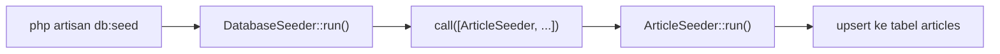

# Seeder Database

Setelah `migrate:fresh`, tabel-tabelmu kosong. Mengisi data contoh satu per satu lewat Tinker setiap kali sangat membosankan, dan rekan satu tim tidak punya data yang sama
denganmu. **Seeder** adalah kelas PHP yang mengisi database dengan data awal secara otomatis dan konsisten. Sub bab ini membuat seeder untuk tabel `articles`
dan menjalankannya dengan aman.

## Tujuan Pembelajaran

Setelah menyelesaikan sub bab ini, kamu dapat:

- [ ] Menjelaskan kegunaan seeder (data awal, data contoh pengembangan, data uji).
- [ ] Membuat seeder dengan `php artisan make:seeder`.
- [ ] Mengisi data dengan Query Builder dan membuatnya dapat diulang dengan `upsert`.
- [ ] Mengorganisasi seeder melalui `DatabaseSeeder` dan `$this->call()`.
- [ ] Menjalankan seeder dengan `db:seed`, `--class`, dan `migrate:fresh --seed`.
- [ ] Menjelaskan perbedaan data awal yang aman untuk produksi dan data palsu untuk pengembangan.

## Prasyarat

- [Rollback dan Refresh Migration](04-09-migration-rollback-and-refresh.md).
- Tabel `articles` dengan kolom `is_published` dan `published_at` (sub bab 04.08).
- Dasar kelas PHP ([Class dan Objek](../level-00/00-19-classes-and-objects.md)).

## Pengantar

Tanpa seeder, `migrate:fresh` menyisakan database kosong dan setiap anggota tim mengarang datanya sendiri sehingga bug sulit direproduksi ("di komputerku jalan"). Seeder
membuat semua orang memulai dari data yang sama.

## Penjelasan Konsep

### Jenis data seeder

| Jenis | Contoh | Boleh di produksi? |
|---|---|---|
| Data awal (*reference data*) | Daftar kategori, peran, negara | Ya, bila memang dibutuhkan aplikasi |
| Data contoh pengembangan | 50 artikel palsu | Tidak |
| Data uji | Data khusus untuk pengujian otomatis | Tidak |

### Membuat seeder

```bash
php artisan make:seeder ArticleSeeder
```

Berkas dibuat di `database/seeders/ArticleSeeder.php` dengan method `run()` kosong. Semua seeder berada di namespace `Database\Seeders`.

### Isi seeder dengan Query Builder

File: `database/seeders/ArticleSeeder.php`

```php
<?php

namespace Database\Seeders;

use Illuminate\Database\Seeder;
use Illuminate\Support\Facades\DB;
use Illuminate\Support\Str;

class ArticleSeeder extends Seeder
{
    public function run(): void
    {
        $articles = [
            ['title' => 'Mengenal Laravel', 'is_published' => true],
            ['title' => 'Belajar Migration', 'is_published' => true],
            ['title' => 'Draf Tentang Eloquent', 'is_published' => false],
        ];

        $rows = [];
        foreach ($articles as $article) {
            $rows[] = [
                'title' => $article['title'],
                'slug' => Str::slug($article['title']),
                'body' => 'Isi contoh untuk artikel: '.$article['title'],
                'is_published' => $article['is_published'],
                'published_at' => $article['is_published'] ? now() : null,
                'created_at' => now(),
                'updated_at' => now(),
            ];
        }

        DB::table('articles')->upsert(
            $rows,
            ['slug'],
            ['title', 'body', 'is_published', 'published_at', 'updated_at']
        );
    }
}
```

| Bagian | Fungsi |
|---|---|
| `Str::slug($title)` | Mengubah judul menjadi slug: `Mengenal Laravel` → `mengenal-laravel` |
| `now()` | Waktu saat ini (Carbon) |
| `DB::table('articles')->upsert($rows, ['slug'], [...])` | Menyisipkan baris; bila `slug` sudah ada, memperbarui kolom yang disebut |

`upsert` membuat seeder **idempoten**: dijalankan dua kali tidak membuat duplikat dan tidak melanggar indeks unik `slug`. Argumen: baris yang disisipkan, kolom penentu
keunikan (harus memiliki indeks unik atau kunci utama), dan kolom yang diperbarui bila baris sudah ada.

### `DatabaseSeeder` sebagai pintu masuk

`DatabaseSeeder` adalah seeder utama yang dijalankan oleh `db:seed`. Panggil seeder lain dari dalamnya agar urutannya jelas:

File: `database/seeders/DatabaseSeeder.php`

```php
<?php

namespace Database\Seeders;

use Illuminate\Database\Seeder;

class DatabaseSeeder extends Seeder
{
    public function run(): void
    {
        $this->call([
            ArticleSeeder::class,
        ]);
    }
}
```

Proyek baru sudah memuat `DatabaseSeeder` dengan `User::factory()` yang membuat satu pengguna "Test User"; kamu boleh mempertahankan atau menggantinya. Pada contoh
di atas seeder pengguna belum dipanggil agar fokus pada `ArticleSeeder`.

Menurut dokumentasi, seeder yang menyentuh banyak data dapat memakai trait `WithoutModelEvents` untuk mencegah event model berjalan saat seeding (sub bab 04.28).

### Menjalankan seeder

| Perintah | Fungsi |
|---|---|
| `php artisan db:seed` | Menjalankan `DatabaseSeeder` |
| `php artisan db:seed --class=ArticleSeeder` | Menjalankan satu seeder tertentu |
| `php artisan migrate:fresh --seed` | Bangun ulang semua tabel lalu seed |
| `php artisan migrate:refresh --seed` | Rollback, migrate, lalu seed |
| `php artisan db:seed --force` | Jalankan di produksi tanpa konfirmasi |

### Urutan dan kunci asing

Seeder tabel induk (mis. `CategorySeeder`) dipanggil **sebelum** seeder tabel anak (`ArticleSeeder`) bila ada kunci asing. Urutan dalam `$this->call([...])` menentukan urutan eksekusi.

### Keamanan

- Jangan seed data palsu atau akun dengan kata sandi lemah di produksi.
- Seeder yang membuat akun admin harus memakai kata sandi dari `.env`, bukan kata sandi tertanam di kode.
- Jalankan `db:seed` di produksi hanya untuk data awal yang aman, dan dengan sadar (`--force`).

## Cara Kerja



## Contoh Praktik

Kamu membuat `ArticleSeeder`, memanggilnya dari `DatabaseSeeder`, menjalankannya dua kali untuk membuktikan idempoten, dan menggunakan `migrate:fresh --seed` untuk membangun
database lengkap sekaligus.

## Penjelasan Kode

Kode seeder ada pada bagian konsep. Perhatikan tiga hal: slug dibuat dari judul, `published_at` hanya diisi untuk artikel terbit, dan `upsert` mencegah duplikat.

## Implementasi Langkah demi Langkah

### Langkah 1: buat seeder

```bash
cd ~/belajar-laravel/cms-artikel
php artisan make:seeder ArticleSeeder
```

### Langkah 2: isi seeder dan panggil dari `DatabaseSeeder`

Ganti isi kedua berkas dengan kode di atas.

### Langkah 3: jalankan satu seeder

```bash
php artisan db:seed --class=ArticleSeeder
```

### Langkah 4: periksa

```bash
php artisan tinker
```

```php-inline
DB::table('articles')->count();
DB::table('articles')->select('title', 'slug', 'is_published')->get();
```

### Langkah 5: jalankan lagi (idempoten)

```bash
php artisan db:seed --class=ArticleSeeder
```

Hitung ulang baris: jumlahnya tetap.

### Langkah 6: bangun ulang total

```bash
php artisan migrate:fresh --seed
```

### Langkah 7: catat di Git

```bash
git add database/seeders
git commit -m "Tambah ArticleSeeder"
```

## Eksekusi dan Verifikasi

| Langkah | Cara memverifikasi |
|---|---|
| 3 | Pesan seeder berhasil dijalankan tanpa galat |
| 4 | Tiga artikel; satu berstatus belum terbit |
| 5 | Jumlah tetap tiga; tidak ada galat `UNIQUE constraint failed` |
| 6 | Tabel dibangun ulang dan terisi tiga artikel lagi |

## Hasil yang Diharapkan

| Perintah | Hasil |
|---|---|
| `DB::table('articles')->count()` | `3` (juga setelah seeding kedua) |
| Slug | `mengenal-laravel`, `belajar-migration`, `draf-tentang-eloquent` |
| `published_at` | Terisi untuk dua artikel, `NULL` untuk draf |

Hasil ini diturunkan dari dokumentasi dan belum dijalankan oleh penulis materi; cocokkan dengan hasilmu. Catatan: perilaku `upsert` bergantung dukungan database (SQLite 3.24+,
MySQL, PostgreSQL); pada MySQL, kolom penentu harus memiliki indeks unik.

## Kesalahan Umum dan Pemecahan Masalah

| Gejala | Penyebab | Cara mengenali | Solusi | Pencegahan |
|---|---|---|---|---|
| `Target class [ArticleSeeder] does not exist` | Namespace atau nama berkas salah | Galat kelas | Periksa `namespace Database\Seeders` dan nama berkas | Buat lewat `make:seeder` |
| `UNIQUE constraint failed: articles.slug` | Insert biasa dijalankan dua kali | Galat saat seeding ulang | Pakai `upsert` atau `updateOrInsert` | Rancang seeder idempoten |
| `NOT NULL constraint failed` | Kolom wajib tidak diisi | Galat saat seeding | Isi semua kolom wajib | Cocokkan dengan skema |
| `Unknown column` | Skema belum dimigrasi | Galat kolom | Jalankan `migrate` dahulu | Gunakan `migrate:fresh --seed` |
| Galat kunci asing | Urutan seeder salah | Galat constraint | Panggil seeder induk dahulu | Urutkan di `call([...])` |
| `db:seed` tidak mengisi apa-apa | `DatabaseSeeder` tidak memanggil seeder | Tabel kosong | Tambahkan `$this->call([...])` | Periksa `DatabaseSeeder` |
| Data palsu muncul di produksi | Menjalankan `db:seed --force` sembarangan | Data aneh di aplikasi | Hapus data dan batasi seeder produksi | Pisahkan seeder pengembangan dan produksi |

## Latihan Praktik

### Latihan dasar

**D1. Seeder kategori**
- *Masalah:* butuh data kategori awal.
- *Persyaratan:* buat `CategorySeeder` untuk tabel `categories` (dari latihan 04.06) dengan tiga kategori dan slug-nya, idempoten dengan `upsert`.
- *Perilaku yang diharapkan:* tiga kategori tersimpan, tidak berlipat saat dijalankan ulang.
- *Tujuan belajar:* membuat seeder idempoten.

**D2. Panggil berurutan**
- *Masalah:* ingin satu perintah untuk semua seeder.
- *Persyaratan:* daftarkan `CategorySeeder` dan `ArticleSeeder` di `DatabaseSeeder` dan jalankan `db:seed`.
- *Perilaku yang diharapkan:* kedua tabel terisi.
- *Tujuan belajar:* mengorganisasi seeder.

### Latihan implementasi

**I1. Seeder dari file**
- *Masalah:* data awal panjang dan sering berubah.
- *Persyaratan:* simpan daftar artikel di array terpisah (mis. berkas PHP yang mengembalikan array di `database/seeders/data/`) dan baca dari seeder.
- *Perilaku yang diharapkan:* menambah artikel cukup mengubah berkas data.
- *Tujuan belajar:* memisahkan data dari logika seeder.

**I2. Seeder khusus lingkungan**
- *Masalah:* data contoh tidak boleh masuk produksi.
- *Persyaratan:* di `DatabaseSeeder`, panggil `ArticleSeeder` hanya bila `app()->environment('local')`; jelaskan bagaimana kategori awal tetap dapat di-seed di semua lingkungan.
- *Perilaku yang diharapkan:* seeder contoh hanya jalan di lokal.
- *Tujuan belajar:* memisahkan seeder per lingkungan.

### Latihan tantangan

**T1. Seeder aman untuk produksi**
- *Masalah:* aplikasi butuh akun admin awal.
- *Persyaratan:* rancang seeder admin yang membaca email dan kata sandi dari `.env` (bukan kode), tidak membuat duplikat, dan menolak berjalan jika variabel kosong. Jelaskan risiko jika kata sandi ditanam di kode.
- *Perilaku yang diharapkan:* seeder aman dan idempoten.
- *Tujuan belajar:* menangani rahasia di seeder.
- *Catatan:* kerjakan mandiri; tidak ada kunci jawaban.

## Uji Pemahaman

1. Apa masalah yang diselesaikan seeder?
2. Apa fungsi `DatabaseSeeder`?
3. Bagaimana menjalankan satu seeder saja?
4. Mengapa `upsert` membuat seeder idempoten?
5. Mengapa urutan seeder penting?
6. Data apa yang boleh di-seed di produksi?
7. Apa yang dilakukan `migrate:fresh --seed`?

??? success "Kunci jawaban singkat"
    1. Mengisi data awal/contoh secara otomatis dan konsisten untuk semua orang.
    2. Seeder utama yang dijalankan `db:seed`; memanggil seeder lain.
    3. `php artisan db:seed --class=NamaSeeder`.
    4. Baris yang sudah ada (berdasarkan kolom unik) diperbarui, bukan disisipkan lagi.
    5. Tabel induk harus terisi sebelum tabel anak yang punya kunci asing.
    6. Hanya data awal yang memang dibutuhkan aplikasi, bukan data palsu atau kata sandi lemah.
    7. Menghapus semua tabel, menjalankan migration, lalu seeder.

## Ringkasan

- Seeder mengisi data awal dan contoh; dibuat dengan `make:seeder`.
- `DatabaseSeeder` memanggil seeder lain dengan `$this->call([...])`.
- `upsert` membuat seeder dapat diulang; `migrate:fresh --seed` membangun ulang total.
- Urutan seeder mengikuti kunci asing.
- Jangan seed data palsu atau rahasia di produksi.

Selanjutnya: *Model Factory*, menghasilkan data acak dalam jumlah besar.

## Referensi Resmi

- [Laravel: Database Seeding](https://laravel.com/docs/13.x/seeding)
- [Laravel: Query Builder, Upserts](https://laravel.com/docs/13.x/queries#upserts)
- [Laravel: Helpers, Str::slug](https://laravel.com/docs/13.x/strings#method-str-slug)
