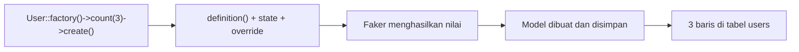

# Model Factory

Seeder dengan tiga artikel tulisan tangan cukup untuk demo, tetapi tidak untuk menguji tampilan dengan 500 artikel atau paginasi. **Factory** menghasilkan data acak yang
masuk akal dalam jumlah berapa pun, memakai library Faker. Sub bab ini mengajarkan cara membaca dan membuat factory, memakai *state* dan *sequence*, serta menggunakannya
dari Tinker dan seeder. Factory bekerja pada **model Eloquent**, sehingga contoh yang dijalankan di sini memakai model `User` bawaan; factory untuk `Article` ditulis sekarang dan
dijalankan setelah model dibuat pada sub bab 04.13.

## Tujuan Pembelajaran

Setelah menyelesaikan sub bab ini, kamu dapat:

- [ ] Menjelaskan fungsi factory dan perbedaannya dari seeder.
- [ ] Membaca `UserFactory` bawaan dan method `definition()`.
- [ ] Memakai `make()` dan `create()` dengan `count()` dari Tinker.
- [ ] Menimpa atribut, memakai *state*, dan memakai *sequence*.
- [ ] Mengatur locale Faker agar data berbahasa Indonesia.
- [ ] Menulis `ArticleFactory` dengan `make:factory`.

## Prasyarat

- [Seeder Database](04-10-database-seeder.md).
- Model `User` bawaan (`app/Models/User.php`) dan tabel `users` yang sudah dimigrasi.
- [Class dan Objek](../level-00/00-19-classes-and-objects.md) pada PHP.

## Pengantar

Faker menghasilkan nama, email, kalimat, dan tanggal acak. Factory membungkusnya dengan aturan: "satu artikel punya judul acak, slug unik dari judul, isi beberapa paragraf, dan
terbit atau draf". Satu baris kode lalu cukup untuk membuat ratusan data realistis.

## Penjelasan Konsep

### Anatomi factory

Proyek baru memuat `database/factories/UserFactory.php`:

```php-inline
class UserFactory extends Factory
{
    protected static ?string $password;

    public function definition(): array
    {
        return [
            'name' => fake()->name(),
            'email' => fake()->unique()->safeEmail(),
            'email_verified_at' => now(),
            'password' => static::$password ??= Hash::make('password'),
            'remember_token' => Str::random(10),
        ];
    }

    public function unverified(): static
    {
        return $this->state(fn (array $attributes) => [
            'email_verified_at' => null,
        ]);
    }
}
```

| Bagian | Fungsi |
|---|---|
| `definition()` | Mengembalikan nilai bawaan tiap kolom |
| `fake()` | Akses ke Faker (nama, email, kalimat, dan lainnya) |
| `fake()->unique()` | Menjamin nilai tidak berulang dalam satu proses |
| `static::$password ??= Hash::make(...)` | Menghitung hash kata sandi sekali saja agar cepat |
| `unverified()` | *State*: variasi yang dapat diterapkan |

### Menghubungkan model dan factory

Model memakai trait `HasFactory`, yang menyediakan `Model::factory()`. Secara konvensi, factory dicari di namespace `Database\Factories` dengan nama `{Model}Factory`.
Menurut dokumentasi 13.x, bila konvensi tidak berlaku, tambahkan atribut `UseFactory` pada model.

### Membuat data: `make()` dan `create()`

```php-inline
use App\Models\User;

$user  = User::factory()->make();             // objek di memori, belum disimpan
$users = User::factory()->count(3)->make();   // koleksi 3 objek, belum disimpan
$user  = User::factory()->create();           // disimpan ke database
$users = User::factory()->count(5)->create(); // 5 baris di database
```

Mass assignment otomatis dinonaktifkan saat memakai factory.

### Menimpa atribut dan *state*

```php-inline
User::factory()->create(['name' => 'Budi Santoso']);   // timpa satu atribut
User::factory()->unverified()->create();               // terapkan state
User::factory()->count(5)->unverified()->make();       // gabung count dan state
```

*State* adalah variasi yang dapat digabungkan. Bila model memakai soft delete, state `trashed()` otomatis tersedia untuk semua factory.

### Sequence

*Sequence* mengganti nilai secara bergiliran:

```php-inline
use Illuminate\Database\Eloquent\Factories\Sequence;

User::factory()->count(4)->state(new Sequence(
    ['name' => 'Admin'],
    ['name' => 'Editor'],
))->create();   // Admin, Editor, Admin, Editor
```

Metode ringkasnya: `->sequence(['name' => 'A'], ['name' => 'B'])`. Closure menerima `$sequence->index` untuk nilai yang bergantung nomor urut.

### Locale Faker: data berbahasa Indonesia

Dokumentasi menyebut locale Faker diatur pada opsi `faker_locale` di `config/app.php`; pada kerangka terbaru nilainya dibaca dari `APP_FAKER_LOCALE` di `.env`. Ubah menjadi:

```ini
APP_FAKER_LOCALE=id_ID
```

Lalu jalankan `php artisan config:clear` (bila konfigurasi pernah di-*cache*). Nama, alamat, dan beberapa teks acak kemudian bernuansa Indonesia.

### Factory untuk `Article`

Buat dengan opsi `--model` agar factory tahu modelnya (modelnya sendiri baru dibuat pada sub bab 04.13):

```bash
php artisan make:factory ArticleFactory --model=Article
```

File: `database/factories/ArticleFactory.php`

```php
<?php

namespace Database\Factories;

use Illuminate\Database\Eloquent\Factories\Factory;
use Illuminate\Support\Str;

/**
 * @extends Factory<\App\Models\Article>
 */
class ArticleFactory extends Factory
{
    public function definition(): array
    {
        $title = fake()->unique()->sentence(6);

        return [
            'title' => rtrim($title, '.'),
            'slug' => Str::slug($title),
            'body' => fake()->paragraphs(3, true),
            'is_published' => false,
            'published_at' => null,
        ];
    }

    public function published(): static
    {
        return $this->state(fn (array $attributes) => [
            'is_published' => true,
            'published_at' => fake()->dateTimeBetween('-1 year', 'now'),
        ]);
    }
}
```

| Bagian | Fungsi |
|---|---|
| `fake()->unique()->sentence(6)` | Kalimat acak berisi sekitar enam kata, tidak berulang |
| `Str::slug($title)` | Slug dari judul yang sama (unik karena judulnya unik) |
| `fake()->paragraphs(3, true)` | Tiga paragraf digabung menjadi satu string |
| `published()` | *State* yang membuat artikel terbit dengan tanggal acak setahun terakhir |

### Factory dalam seeder

```php-inline
// Di dalam run() sebuah seeder (setelah model Article ada)
Article::factory()->count(20)->published()->create();
Article::factory()->count(5)->create();
```

### Keamanan

- Factory menghasilkan data palsu; jangan jalankan di produksi.
- Kata sandi factory `password` hanya untuk lokal; jangan pernah dipakai pada akun nyata.
- Data acak tidak boleh mengandung data pribadi sungguhan; Faker membuat data fiktif, tetapi jangan menyalin data nyata ke factory.

## Cara Kerja



## Contoh Praktik

Kamu bereksperimen dengan `UserFactory` di Tinker (`make`, `create`, `count`, override, state, sequence), mengubah locale Faker, lalu membuat `ArticleFactory` yang akan dipakai
setelah model `Article` ada.

## Penjelasan Kode

Kode `ArticleFactory` dijelaskan pada bagian konsep. Hubungan ke model `Article` ditulis lewat komentar `@extends Factory<\App\Models\Article>` dan opsi `--model=Article`.

## Implementasi Langkah demi Langkah

### Langkah 1: baca factory bawaan

```bash
cd ~/belajar-laravel/cms-artikel
cat database/factories/UserFactory.php
```

### Langkah 2: coba `make` dan `create`

```bash
php artisan tinker
```

```php-inline
use App\Models\User;

User::factory()->make();
User::factory()->count(3)->make()->pluck('name');
User::factory()->count(3)->create()->pluck('email');
User::count();
```

### Langkah 3: coba override dan state

```php-inline
User::factory()->create(['name' => 'Budi Santoso', 'email' => 'budi@contoh.test']);
User::factory()->unverified()->create();
```

### Langkah 4: coba sequence

```php-inline
use Illuminate\Database\Eloquent\Factories\Sequence;

User::factory()->count(4)->state(new Sequence(['name' => 'Admin'], ['name' => 'Editor']))->create()->pluck('name');
```

### Langkah 5: ganti locale

Tambahkan `APP_FAKER_LOCALE=id_ID` ke `.env` (atau ubah nilainya), jalankan `php artisan config:clear`, buka Tinker baru, dan buat `User::factory()->count(3)->make()->pluck('name')`.

### Langkah 6: buat `ArticleFactory`

```bash
php artisan make:factory ArticleFactory --model=Article
```

Isi dengan kode pada bagian konsep. Factory ini belum dapat dijalankan sebelum model `Article` dibuat.

### Langkah 7: bersihkan data uji

```bash
php artisan migrate:fresh --seed
```

### Langkah 8: catat di Git

```bash
git add database/factories
git commit -m "Tambah ArticleFactory"
```

## Eksekusi dan Verifikasi

| Langkah | Cara memverifikasi |
|---|---|
| 2 | `make()` tidak menambah baris; `create()` menambah baris (periksa `User::count()`) |
| 3 | Pengguna `Budi Santoso` tersimpan; pengguna `unverified` memiliki `email_verified_at` `null` |
| 4 | Nama bergiliran `Admin`, `Editor`, `Admin`, `Editor` |
| 5 | Nama tampak seperti nama Indonesia |
| 6 | Berkas `ArticleFactory.php` ada |

## Hasil yang Diharapkan

| Perintah | Hasil |
|---|---|
| `User::factory()->count(3)->make()->pluck('name')` | Koleksi tiga nama acak, tidak disimpan |
| `User::factory()->count(4)->state(new Sequence(...))->create()->pluck('name')` | `["Admin","Editor","Admin","Editor"]` |
| `User::count()` | Bertambah sesuai jumlah `create()` |

Nama dan email acak berbeda tiap eksekusi. Hasil ini diturunkan dari dokumentasi dan belum dijalankan oleh penulis materi; cocokkan dengan hasilmu.

## Kesalahan Umum dan Pemecahan Masalah

| Gejala | Penyebab | Cara mengenali | Solusi | Pencegahan |
|---|---|---|---|---|
| `Class "App\Models\Article" not found` | Model belum dibuat | Galat saat memakai `ArticleFactory` | Buat model (sub bab 04.13) | Buat model dahulu atau tunda pemakaian |
| `Call to undefined method ...::factory()` | Model tidak memakai `HasFactory` | Galat method | Tambahkan trait `HasFactory` | Buat model dengan `-f` atau tambah trait |
| `OverflowException: Maximum retries of 10000 reached` | `unique()` kehabisan nilai unik | Galat Faker | Kurangi jumlah atau perluas rentang nilai | Hindari `unique()` pada sumber nilai kecil |
| `UNIQUE constraint failed: users.email` | Email manual sudah ada | Galat saat `create` | Gunakan email berbeda | Pakai `unique()` atau nilai unik |
| Perubahan locale tak berpengaruh | Konfigurasi di-*cache* atau Tinker lama | Nama masih Inggris | `php artisan config:clear` dan buka Tinker baru | Mulai ulang Tinker setelah ubah `.env` |
| Data lama menumpuk | `create()` berulang | Jumlah baris membengkak | `migrate:fresh --seed` | Bersihkan secara berkala |
| `Argument #1 ... must be of type array` pada `Sequence` | Salah argumen | Galat tipe | Berikan array atribut per elemen | Ikuti contoh dokumentasi |

## Latihan Praktik

### Latihan dasar

**D1. Perbedaan make dan create**
- *Masalah:* ingin memahami perbedaannya.
- *Persyaratan:* jalankan keduanya, bandingkan `User::count()` sebelum dan sesudah, dan jelaskan kapan `make()` lebih tepat.
- *Perilaku yang diharapkan:* `make()` tidak mengubah jumlah baris.
- *Tujuan belajar:* membedakan `make` dan `create`.

**D2. Timpa atribut**
- *Masalah:* butuh pengguna dengan email tertentu.
- *Persyaratan:* buat tiga pengguna dengan domain email `contoh.test` dengan menimpa `email` lewat closure atau sequence.
- *Perilaku yang diharapkan:* tiga pengguna berdomain sama.
- *Tujuan belajar:* menimpa atribut.

### Latihan implementasi

**I1. State baru**
- *Masalah:* pengujian butuh pengguna dengan nama tertentu yang belum terverifikasi.
- *Persyaratan:* tambahkan state `unverified` yang sudah ada dan state baru `named($nama)` di `UserFactory` yang menetapkan nama; gabungkan keduanya saat membuat data.
- *Perilaku yang diharapkan:* pengguna terbuat dengan kedua state.
- *Tujuan belajar:* menulis state kustom.

**I2. Factory kategori**
- *Masalah:* butuh data kategori acak.
- *Persyaratan:* buat `CategoryFactory` (name unik dari `fake()->unique()->word()`, slug dari nama) dengan `--model=Category`; jalankan setelah model `Category` dibuat.
- *Perilaku yang diharapkan:* factory siap pakai.
- *Tujuan belajar:* menulis factory sendiri.

### Latihan tantangan

**T1. Dataset realistis**
- *Masalah:* tampilan perlu dites dengan variasi data.
- *Persyaratan:* rancang (tulis, belum perlu dijalankan) komposisi data untuk 100 artikel: 70% terbit, 30% draf; tanggal terbit tersebar setahun; judul pendek dan panjang. Jelaskan state dan sequence yang akan dipakai.
- *Perilaku yang diharapkan:* rancangan mencakup state `published`, sequence, dan alasan.
- *Tujuan belajar:* merancang data uji.
- *Catatan:* kerjakan mandiri; tidak ada kunci jawaban.

## Uji Pemahaman

1. Apa beda seeder dan factory?
2. Apa fungsi `definition()`?
3. Apa beda `make()` dan `create()`?
4. Apa itu state?
5. Apa fungsi sequence?
6. Bagaimana mengubah locale Faker?
7. Mengapa `unique()` bisa menimbulkan galat?

??? success "Kunci jawaban singkat"
    1. Seeder menjalankan pengisian data; factory mendefinisikan cara membuat satu data acak.
    2. Mengembalikan nilai bawaan tiap kolom untuk satu model.
    3. `make()` hanya membuat objek di memori; `create()` juga menyimpannya.
    4. Variasi atribut yang dapat diterapkan dan digabungkan.
    5. Mengganti nilai atribut secara bergiliran untuk setiap model.
    6. Atur `APP_FAKER_LOCALE` di `.env` (dibaca `config/app.php`).
    7. Bila nilai unik habis (rentang terlalu kecil), Faker menyerah setelah batas percobaan.

## Ringkasan

- Factory mendefinisikan data acak untuk satu model lewat `definition()` dan Faker.
- `make()` membuat di memori, `create()` menyimpan; `count()` untuk jumlah banyak.
- State dan sequence menambah variasi; `APP_FAKER_LOCALE=id_ID` memberi data berbahasa Indonesia.
- `make:factory ArticleFactory --model=Article` membuat factory artikel yang dipakai setelah model dibuat.
- Jangan pakai factory dan kata sandi contoh di produksi.

Selanjutnya: *Pengantar Eloquent ORM*, memetakan tabel menjadi model PHP.

## Referensi Resmi

- [Laravel: Eloquent Factories](https://laravel.com/docs/13.x/eloquent-factories)
- [Laravel: Factory States](https://laravel.com/docs/13.x/eloquent-factories#factory-states)
- [Laravel: Sequences](https://laravel.com/docs/13.x/eloquent-factories#sequences)
- [FakerPHP: Documentation](https://fakerphp.org/)
