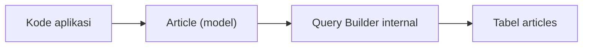
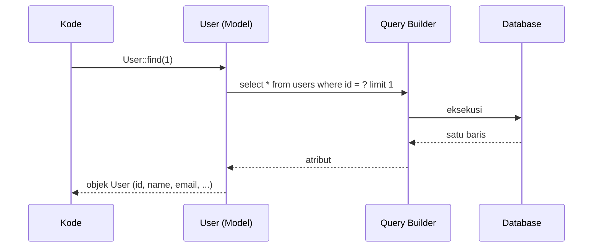

# Pengantar Eloquent ORM

Menulis SQL untuk setiap operasi cepat membosankan dan rawan salah. **ORM** (*Object-Relational Mapper*) menjembatani dunia tabel dan dunia objek: satu tabel menjadi satu
kelas PHP, satu baris menjadi satu objek. ORM bawaan Laravel bernama **Eloquent**. Sub bab ini menjelaskan gagasan di baliknya, konvensi yang dipakai, dan memperlihatkan
Eloquent bekerja pada model `User` bawaan sebelum kamu membuat model sendiri.

## Tujuan Pembelajaran

Setelah menyelesaikan sub bab ini, kamu dapat:

- [ ] Menjelaskan apa itu ORM dan pola *Active Record* yang dipakai Eloquent.
- [ ] Memetakan tabel, kolom, dan baris ke kelas, properti, dan objek.
- [ ] Menyebutkan konvensi Eloquent: nama tabel, kunci utama, dan timestamp.
- [ ] Menjelaskan kelebihan dan batasan Eloquent dibanding Query Builder.
- [ ] Menjalankan query Eloquent sederhana di Tinker.
- [ ] Memakai `php artisan model:show` untuk mengintip model.

## Prasyarat

- [Pengantar Database](04-01-introduction-to-databases.md), [Dasar Database Relasional](04-02-relational-database-fundamentals.md), dan [Migration](04-05-database-migration.md).
- [Class dan Objek](../level-00/00-19-classes-and-objects.md) serta [Namespace dan Autoloading](../level-00/00-22-namespace-and-autoloading.md).
- Proyek `cms-artikel` dengan tabel `users` dan `articles`.

## Pengantar

Bandingkan dua cara mengambil pengguna dengan `id` 1:

```php-inline
// SQL mentah
$rows = DB::select('select * from users where id = ?', [1]);
$name = $rows[0]->name;

// Eloquent
$user = User::find(1);
$name = $user->name;
```

Versi kedua lebih singkat, mudah dibaca, dan memberi objek yang bisa dipakai kembali (menyimpan, mengambil relasi, dan seterusnya).

## Penjelasan Konsep

### Apa itu ORM?

**Object-Relational Mapping** memetakan struktur database ke objek:

| Dunia database | Dunia PHP |
|---|---|
| Tabel `articles` | Kelas `App\Models\Article` |
| Baris | Objek (instance) `Article` |
| Kolom | Properti objek (`$article->title`) |
| `INSERT`/`UPDATE`/`DELETE` | `$article->save()`, `$article->delete()` |
| Hubungan antar tabel | Method relasi (`$article->comments`) |

### Pola Active Record

Eloquent menerapkan pola **Active Record**: setiap objek model mengetahui cara menyimpan dirinya (`save()`), memperbarui, dan menghapus. Kelas model juga menyediakan method
statis untuk query (`Article::where(...)`). Pola ini sederhana dan produktif; konsekuensinya, model terikat erat dengan tabelnya.



Menurut dokumentasi, setiap tabel database punya "Model" yang sesuai untuk berinteraksi dengan tabel itu, baik mengambil, menambah, mengubah, maupun menghapus data.

### Konvensi Eloquent (*convention over configuration*)

Bila kamu mengikuti konvensi, hampir tidak ada konfigurasi:

| Hal | Konvensi |
|---|---|
| Nama tabel | Bentuk jamak *snake_case* dari nama kelas: `Article` → `articles`, `AirTrafficController` → `air_traffic_controllers` |
| Kunci utama | Kolom `id` |
| Timestamp | Kolom `created_at` dan `updated_at` diisi otomatis |
| Koneksi | Koneksi database bawaan |
| Lokasi model | `app/Models` |

Konvensi dapat diubah. Pada 13.x dokumentasi menunjukkan atribut PHP `#[Table(...)]` untuk mengubah nama tabel, kunci utama, atau mematikan timestamp (sub bab 04.13).

### Eloquent atau Query Builder?

| Aspek | Eloquent | Query Builder (`DB::table`) |
|---|---|---|
| Hasil | Objek model | Objek `stdClass` biasa |
| Timestamp otomatis | Ya | Tidak |
| Relasi, cast, event, soft delete | Ya | Tidak |
| Kecepatan untuk data sangat besar | Sedikit lebih berat | Lebih ringan |
| Cocok untuk | Sebagian besar kerja CRUD | Laporan, query berat, tanpa model |

Keduanya bisa dicampur dalam satu aplikasi.

### Melihat Eloquent bekerja pada `User`

Model `User` bawaan sudah ada di `app/Models/User.php`. Contoh di Tinker:

```php-inline
use App\Models\User;

User::count();
User::first();
User::find(1)?->name;
User::where('email', 'budi@contoh.test')->first();
```

Hasilnya objek `User`; propertinya diakses dengan `->`.

### Memahami `model:show`

```bash
php artisan model:show User
```

Perintah ini menampilkan atribut, tipe kolom, relasi, dan observer model dalam satu ringkasan, berguna untuk membaca model yang belum kamu kenal.

### Keamanan

- Eloquent memakai *prepared statement*, sehingga aman dari SQL injection selama kamu tidak menyisipkan input mentah ke `whereRaw` atau sejenisnya.
- Hati-hati dengan *mass assignment* (sub bab berikutnya): hanya kolom yang diizinkan boleh diisi massal.
- Objek model dapat memuat data sensitif (`password`); gunakan atribut tersembunyi (`#[Hidden]`) bila model dikirim sebagai JSON.

## Cara Kerja



## Contoh Praktik

Kamu menjalankan beberapa query Eloquent pada model `User` di Tinker, memeriksa SQL yang dihasilkan, mengubah satu pengguna, dan membaca ringkasan model dengan `model:show`.

## Penjelasan Kode

Contoh Tinker pada bagian konsep sudah mewakili. Dua perintah baru berguna untuk belajar:

```php-inline
User::where('id', 1)->toSql();        // SQL yang akan dijalankan
User::find(1)->toArray();             // atribut model sebagai array
```

## Implementasi Langkah demi Langkah

### Langkah 1: siapkan data

```bash
cd ~/belajar-laravel/cms-artikel
php artisan migrate:fresh
php artisan tinker
```

```php-inline
use App\Models\User;

User::factory()->count(5)->create();
```

### Langkah 2: baca dengan Eloquent

```php-inline
User::count();
User::first();
User::first()->name;
User::find(2)->email;
User::where('id', '>', 3)->get()->pluck('name');
```

### Langkah 3: lihat SQL-nya

```php-inline
User::where('id', '>', 3)->toSql();
User::where('id', '>', 3)->toRawSql();
```

`toSql()` menampilkan SQL dengan tanda tanya; `toRawSql()` menyisipkan nilai untuk debugging (jangan dipakai untuk mengeksekusi).

### Langkah 4: ubah satu pengguna

```php-inline
$user = User::find(1);
$user->name = 'Nama Baru';
$user->save();
User::find(1)->name;
```

### Langkah 5: lihat tanggal otomatis

```php-inline
$user->created_at;
$user->updated_at;
```

### Langkah 6: ringkasan model

Keluar dari Tinker (`exit`), lalu:

```bash
php artisan model:show User
```

## Eksekusi dan Verifikasi

| Langkah | Cara memverifikasi |
|---|---|
| 1 | `User::count()` bernilai 5 |
| 2 | `User::first()` mengembalikan objek `User` |
| 3 | `toSql()` menampilkan `select * from "users" where "id" > ?` |
| 4 | Nama berubah dan tersimpan |
| 5 | `created_at` dan `updated_at` terisi objek Carbon |
| 6 | `model:show` menampilkan kolom, tipe, dan atribut |

## Hasil yang Diharapkan

| Perintah | Hasil |
|---|---|
| `User::count()` | `5` |
| `User::find(2)->email` | Email acak pengguna kedua |
| `User::where('id','>',3)->get()->pluck('name')` | Koleksi dua nama |
| `$user->updated_at` | Waktu saat perubahan tersimpan |

Penulisan kutip pengidentifikasi dalam SQL (`"users"` atau `` `users` ``) berbeda antar database. Data acak berbeda tiap eksekusi. Hasil ini diturunkan dari dokumentasi
dan belum dijalankan oleh penulis materi; cocokkan dengan hasilmu.

## Kesalahan Umum dan Pemecahan Masalah

| Gejala | Penyebab | Cara mengenali | Solusi | Pencegahan |
|---|---|---|---|---|
| `Class "User" not found` di Tinker | Lupa `use App\Models\User;` | Galat kelas | Tambah `use` atau tulis `\App\Models\User` | Impor di awal sesi Tinker |
| `Attempt to read property "name" on null` | `find()` tidak menemukan baris | Galat pada null | Gunakan `findOrFail` atau `?->` | Periksa hasil sebelum memakai |
| `no such table: users` | Migrasi belum dijalankan | Galat tabel | `php artisan migrate` | Cek `migrate:status` |
| Perubahan tak tersimpan | Lupa `save()` | Data lama tetap | Panggil `save()` | Ingat: ubah properti lalu simpan |
| Model tidak menemukan tabel | Nama kelas tidak sesuai konvensi | Galat nama tabel | Ubah nama tabel/kelas atau gunakan `#[Table]` | Ikuti konvensi penamaan |
| `toSql()` dipakai sebagai input query | Salah paham | SQL tanpa nilai | Gunakan hanya untuk debugging | Jangan eksekusi hasil `toRawSql()` |

## Latihan Praktik

### Latihan dasar

**D1. Peta konsep**
- *Masalah:* ingin memastikan pemahaman pemetaan.
- *Persyaratan:* buat tabel yang memetakan tabel `users`, satu baris, satu kolom, dan operasi `INSERT` ke padanannya di PHP/Eloquent.
- *Perilaku yang diharapkan:* pemetaan benar.
- *Tujuan belajar:* memahami ORM.

**D2. Cari data**
- *Masalah:* ingin mencari pengguna.
- *Persyaratan:* di Tinker, ambil pengguna pertama, pengguna dengan `id` terbesar (`User::orderByDesc('id')->first()`), dan jumlah semua pengguna.
- *Perilaku yang diharapkan:* tiga hasil tampil benar.
- *Tujuan belajar:* membaca data dengan Eloquent.

### Latihan implementasi

**I1. Bandingkan dua gaya**
- *Masalah:* ingin menilai Eloquent vs Query Builder.
- *Persyaratan:* ambil pengguna `id` 1 dengan `DB::table('users')->find(1)` dan `User::find(1)`; bandingkan jenis hasil (`stdClass` vs `User`) dan tuliskan satu kelebihan masing-masing.
- *Perilaku yang diharapkan:* perbedaan tipe hasil tercatat.
- *Tujuan belajar:* memahami lapisan akses data.

**I2. Baca SQL**
- *Masalah:* ingin tahu SQL di balik Eloquent.
- *Persyaratan:* tulis tiga query Eloquent berbeda dan catat `toRawSql()` masing-masing.
- *Perilaku yang diharapkan:* SQL sesuai dengan query.
- *Tujuan belajar:* menghubungkan Eloquent dengan SQL.

### Latihan tantangan

**T1. Kelebihan dan kekurangan Active Record**
- *Masalah:* tim berdiskusi pola arsitektur.
- *Persyaratan:* tulis analisis satu halaman tentang kelebihan dan kekurangan Active Record (kemudahan, keterikatan dengan database, pengujian), dengan contoh kode.
- *Perilaku yang diharapkan:* analisis seimbang dan berdasar contoh.
- *Tujuan belajar:* menilai pola secara kritis.
- *Catatan:* kerjakan mandiri; tidak ada kunci jawaban.

## Uji Pemahaman

1. Apa itu ORM?
2. Apa itu pola Active Record?
3. Apa nama tabel bawaan untuk model `BlogPost`?
4. Apa kunci utama dan timestamp bawaan Eloquent?
5. Apa beda hasil Eloquent dan Query Builder?
6. Apa fungsi `toSql()`?
7. Mengapa Eloquent aman dari SQL injection pada kasus umum?

??? success "Kunci jawaban singkat"
    1. Pemeta tabel database ke kelas/objek PHP.
    2. Setiap objek model mengetahui cara menyimpan, mengubah, dan menghapus dirinya.
    3. `blog_posts`.
    4. Kolom `id`; kolom `created_at` dan `updated_at`.
    5. Eloquent menghasilkan objek model; Query Builder menghasilkan `stdClass`.
    6. Menampilkan SQL dari query tanpa menjalankannya.
    7. Memakai prepared statement dengan parameter binding.

## Ringkasan

- ORM memetakan tabel ke kelas dan baris ke objek; Eloquent memakai pola Active Record.
- Konvensi: tabel jamak *snake_case*, kunci utama `id`, timestamp otomatis.
- Eloquent memberi objek kaya fitur; Query Builder lebih ringan.
- `toSql()` dan `model:show` membantu memahami apa yang terjadi.
- Tetap waspada pada mass assignment dan SQL mentah.

Selanjutnya: *Membuat Model*, menulis model `Article` dengan konfigurasi yang benar.

## Referensi Resmi

- [Laravel: Eloquent, Getting Started](https://laravel.com/docs/13.x/eloquent)
- [Laravel: Eloquent Model Conventions](https://laravel.com/docs/13.x/eloquent#eloquent-model-conventions)
- [Laravel: Inspecting Models](https://laravel.com/docs/13.x/eloquent#inspecting-models)
