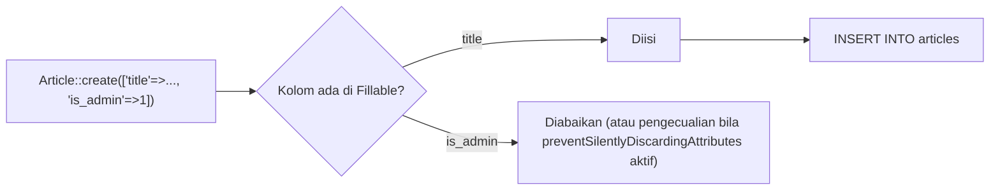

# Membuat Model

Kamu sudah memakai model `User` bawaan. Sekarang kamu membuat model sendiri untuk tabel `articles`: menentukan kolom yang boleh diisi massal, mengubah tipe data otomatis
(*casting*), dan menyesuaikan konvensi bila perlu. Model yang dikonfigurasi dengan benar adalah dasar semua sub bab Eloquent berikutnya.

## Tujuan Pembelajaran

Setelah menyelesaikan sub bab ini, kamu dapat:

- [ ] Membuat model dengan `php artisan make:model` dan opsinya (`-m`, `-f`, `-s`, `-a`).
- [ ] Menjelaskan lokasi dan struktur model di `app/Models`.
- [ ] Menentukan kolom yang boleh diisi massal dengan atribut `#[Fillable]`.
- [ ] Mengatur cast tipe data dengan method `casts()`.
- [ ] Menyesuaikan nama tabel dan konvensi lain dengan atribut `#[Table(...)]`.
- [ ] Menyembunyikan atribut dari array/JSON dengan `#[Hidden]`.

## Prasyarat

- [Pengantar Eloquent ORM](04-12-introduction-to-eloquent-orm.md).
- Tabel `articles` dengan kolom publikasi (sub bab 04.08) dan `ArticleFactory` (sub bab 04.11).
- [Namespace dan Autoloading](../level-00/00-22-namespace-and-autoloading.md).

## Pengantar

Eloquent melindungi aplikasimu secara bawaan: **semua** model terlindungi dari *mass assignment*. Jika kamu memanggil `Article::create($request->all())` tanpa mendeklarasikan
kolom yang boleh diisi, hasilnya galat. Perlindungan ini mencegah penyerang mengirim kolom tak terduga (misalnya `is_admin`) dan mengubahnya.

## Penjelasan Konsep

### Perintah `make:model`

```bash
php artisan make:model Article
```

Model dibuat di `app/Models/Article.php`. Opsi umum:

| Opsi | Menghasilkan |
|---|---|
| `-m` / `--migration` | Model + migration |
| `-f` / `--factory` | Model + factory |
| `-s` / `--seed` | Model + seeder |
| `-c` / `--controller` | Model + controller |
| `-mfsc` | Gabungan: migration, factory, seeder, controller |
| `-a` / `--all` | Model + migration, factory, seeder, policy, controller, dan form request |
| `-p` / `--pivot` | Model pivot |

Karena migration dan factory untuk `Article` sudah ada, kamu cukup membuat modelnya sendiri.

### Model `Article`

File: `app/Models/Article.php`

```php
<?php

namespace App\Models;

use Illuminate\Database\Eloquent\Attributes\Fillable;
use Illuminate\Database\Eloquent\Factories\HasFactory;
use Illuminate\Database\Eloquent\Model;

#[Fillable(['title', 'slug', 'body', 'is_published', 'published_at'])]
class Article extends Model
{
    use HasFactory;

    protected function casts(): array
    {
        return [
            'is_published' => 'boolean',
            'published_at' => 'datetime',
        ];
    }
}
```

| Bagian | Fungsi |
|---|---|
| `#[Fillable([...])]` | Daftar kolom yang boleh diisi massal lewat `create()`, `fill()`, atau `update()` |
| `use HasFactory` | Menyediakan `Article::factory()` |
| `casts()` | Mengubah nilai kolom ke tipe PHP saat dibaca/ditulis |
| `'is_published' => 'boolean'` | `1`/`0` dari database menjadi `true`/`false` |
| `'published_at' => 'datetime'` | String tanggal menjadi objek `Carbon` |

### Mass assignment: `#[Fillable]`

Dokumentasi 13.x menyatakan: sebelum memakai `create`, kamu harus menentukan atribut `Fillable` **atau** `Guarded` pada model; kolom di luar daftar akan **diabaikan diam-diam**
secara bawaan. Skema yang disarankan adalah **allow-list**: sebutkan hanya kolom yang aman diisi dari input. Jangan memasukkan kolom sensitif seperti `is_admin` atau `role`.

Untuk membuat kolom yang diabaikan ketahuan saat pengembangan, tambahkan di `AppServiceProvider::boot()`:

```php-inline
use Illuminate\Database\Eloquent\Model;

public function boot(): void
{
    Model::preventSilentlyDiscardingAttributes(! $this->app->isProduction());
}
```

Dengan ini, mengisi kolom yang tidak ada di `Fillable` melempar pengecualian pada lingkungan non-produksi, bukan diabaikan diam-diam.

Kode lama sering memakai properti `protected $fillable = [...]`. Kamu akan menemuinya di banyak contoh dan proyek; konsepnya sama, hanya bentuk penulisannya berbeda
dengan atribut pada 13.x.

### Cast tipe data

Method `casts()` mengembalikan peta kolom ke tipe. Cast yang sering dipakai:

| Cast | Hasil |
|---|---|
| `'boolean'` | `true`/`false` |
| `'integer'`, `'float'` | Angka |
| `'datetime'` | Objek Carbon |
| `'array'` / `'json'` | JSON ↔ array PHP |
| `'hashed'` | Nilai di-*hash* saat disimpan (dipakai untuk `password` di `User`) |

### Menyesuaikan konvensi: `#[Table]`

```php-inline
use Illuminate\Database\Eloquent\Attributes\Table;

#[Table('my_flights')]                          // nama tabel
#[Table(key: 'flight_id')]                      // kunci utama
#[Table(timestamps: false)]                     // tanpa created_at / updated_at
```

Gunakan hanya bila tabel warisan tidak mengikuti konvensi. Untuk proyek baru, ikuti konvensi.

!!! warning "Hati-hati dengan nama model berbahasa Indonesia"
    Eloquent menebak nama tabel dengan **pluralisasi bahasa Inggris**. Model `Artikel` dipetakan ke tabel `artikels`, bukan `artikel`. Kunci asing otomatis juga bernuansa Inggris
    (`artikel_id`). Karena itu materi ini memakai nama model dan tabel berbahasa Inggris (`Article`, `articles`), sedangkan tampilan ke pengguna tetap bahasa Indonesia.
    Bila harus memakai nama Indonesia, tentukan `#[Table('artikel')]` dan semua kunci relasi secara eksplisit.

### Menyembunyikan atribut: `#[Hidden]`

Atribut yang disembunyikan tidak muncul pada `toArray()`/`toJson()`. Model `User` bawaan memakainya:

```php-inline
#[Hidden(['password', 'remember_token'])]
```

### Membaca ringkasan model

```bash
php artisan model:show Article
```

### Keamanan

- Gunakan *allow-list* `Fillable`, bukan membuka semua kolom.
- Jangan mengisi kolom sensitif (`is_admin`, `role`, `password` mentah) dari input pengguna.
- Sembunyikan atribut rahasia dengan `#[Hidden]` sebelum model dikirim sebagai JSON.

## Cara Kerja



## Contoh Praktik

Kamu membuat model `Article`, memeriksanya dengan `model:show`, menjalankan `ArticleFactory` untuk mengisi data, dan mengamati efek cast dan mass assignment di Tinker.

## Penjelasan Kode

Penjelasan tiap bagian model ada pada bagian konsep. Perhatikan bahwa `id`, `created_at`, dan `updated_at` tidak perlu ada di `Fillable` karena diisi database/Eloquent.

## Implementasi Langkah demi Langkah

### Langkah 1: buat model

```bash
cd ~/belajar-laravel/cms-artikel
php artisan make:model Article
```

### Langkah 2: isi model

Ganti isi berkas dengan kode pada bagian konsep.

### Langkah 3: aktifkan peringatan mass assignment

Tambahkan `Model::preventSilentlyDiscardingAttributes(! $this->app->isProduction());` (dan `use`-nya) ke `AppServiceProvider::boot()`.

### Langkah 4: lihat ringkasan model

```bash
php artisan model:show Article
```

### Langkah 5: isi data dengan factory

```bash
php artisan migrate:fresh
php artisan tinker
```

```php-inline
use App\Models\Article;

Article::factory()->count(10)->published()->create();
Article::factory()->count(5)->create();
Article::count();
Article::first()->is_published;
Article::first()->published_at;
```

### Langkah 6: uji cast dan mass assignment

```php-inline
$a = Article::create(['title' => 'Uji Model', 'slug' => 'uji-model', 'body' => 'Isi']);
$a->is_published;                 // false (boolean)
$a->published_at;                 // null

Article::create(['title' => 'X', 'slug' => 'x', 'body' => 'Y', 'id' => 999]);
```

Perintah terakhir mencoba mengisi kolom `id` yang tidak ada di `Fillable`; amati pengecualian (atau pengabaian diam-diam bila langkah 3 dilewati).

### Langkah 7: catat di Git

```bash
git add app database
git commit -m "Tambah model Article"
```

## Eksekusi dan Verifikasi

| Langkah | Cara memverifikasi |
|---|---|
| 1–2 | `app/Models/Article.php` ada dan memuat `#[Fillable]` |
| 4 | `model:show` menampilkan kolom `articles` beserta tipe |
| 5 | `Article::count()` bernilai 15 |
| 6 | `is_published` bertipe boolean; pengisian `id` ditolak atau diabaikan |

## Hasil yang Diharapkan

| Perintah | Hasil |
|---|---|
| `Article::count()` | `15` |
| `Article::first()->is_published` | `true` (boolean, bukan `1`) |
| `Article::first()->published_at` | Objek `Carbon\Carbon` |
| `Article::create([... 'id' => 999])` | `MassAssignmentException` bila `preventSilentlyDiscardingAttributes` aktif; kolom `id` diabaikan bila tidak aktif |

Nama kelas pengecualian dan pesan dapat berbeda antar versi. Hasil ini diturunkan dari dokumentasi dan belum dijalankan oleh penulis materi; cocokkan dengan hasilmu.

## Kesalahan Umum dan Pemecahan Masalah

| Gejala | Penyebab | Cara mengenali | Solusi | Pencegahan |
|---|---|---|---|---|
| Data tidak tersimpan, tanpa galat | Kolom tidak ada di `Fillable`, diabaikan diam-diam | Kolom `NULL` atau galat `NOT NULL` | Tambahkan ke `Fillable` | Aktifkan `preventSilentlyDiscardingAttributes` |
| `MassAssignmentException` | Mengisi kolom di luar `Fillable` | Galat sebut kolom | Tambahkan kolom (bila aman) atau jangan isi massal | Rancang allow-list dari awal |
| Tabel `artikels` tidak ditemukan | Nama model Indonesia | Galat tabel | Pakai nama Inggris atau `#[Table('artikel')]` | Ikuti konvensi |
| `Class "App\Models\Article" not found` | Namespace/berkas salah | Galat kelas | Periksa `namespace App\Models;` | Buat lewat `make:model` |
| Tanggal berupa string | Cast `datetime` tidak ada | `published_at` bertipe string | Tambah ke `casts()` | Daftarkan semua kolom tanggal |
| Boolean tampil `1` | Cast `boolean` tidak ada | Nilai `1`/`0` | Tambah `'is_published' => 'boolean'` | Cast semua boolean |
| `Call to undefined method Article::factory()` | Trait `HasFactory` hilang | Galat method | Tambahkan `use HasFactory;` | Pakai `make:model -f` |

## Latihan Praktik

### Latihan dasar

**D1. Model kategori**
- *Masalah:* butuh model untuk tabel `categories`.
- *Persyaratan:* buat `Category` dengan `make:model Category -f` (tabelnya sudah ada dari latihan 04.06), isi `#[Fillable(['name','slug'])]`, dan isi factory-nya (`name` unik, slug dari nama).
- *Perilaku yang diharapkan:* `Category::factory()->count(3)->create()` berhasil.
- *Tujuan belajar:* membuat model lengkap.

**D2. Cast**
- *Masalah:* ingin tipe data yang benar.
- *Persyaratan:* tampilkan `$article->published_at->format('d M Y')` dan `$article->is_published ? 'Terbit' : 'Draf'` di Tinker.
- *Perilaku yang diharapkan:* tanggal terformat dan teks sesuai status.
- *Tujuan belajar:* memakai hasil cast.

### Latihan implementasi

**I1. Uji allow-list**
- *Masalah:* ingin membuktikan perlindungan mass assignment.
- *Persyaratan:* tambahkan kolom `is_featured` (boolean, default false) lewat migration, **jangan** masukkan ke `Fillable`, lalu coba `Article::create([... 'is_featured' => true])`; catat hasilnya dengan dan tanpa `preventSilentlyDiscardingAttributes`, lalu putuskan apakah kolom itu pantas masuk `Fillable`.
- *Perilaku yang diharapkan:* kamu dapat menjelaskan alasan keputusanmu.
- *Tujuan belajar:* memahami mass assignment.

**I2. Sembunyikan atribut**
- *Masalah:* JSON artikel tidak perlu menampilkan `body` pada daftar.
- *Persyaratan:* tambahkan `#[Hidden(['body'])]`, bandingkan `Article::first()->toArray()` sebelum dan sesudah, dan jelaskan kapan pendekatan ini tepat.
- *Perilaku yang diharapkan:* `body` tidak muncul di array.
- *Tujuan belajar:* mengontrol serialisasi.

### Latihan tantangan

**T1. Model dengan konvensi tak lazim**
- *Masalah:* ada tabel warisan `tbl_berita` dengan kunci utama `kode_berita` dan tanpa timestamp.
- *Persyaratan:* tulis model `News` dengan `#[Table(...)]` yang menyesuaikan nama tabel, kunci utama, dan timestamp (rujuk dokumentasi), lalu jelaskan risiko tiap penyimpangan dari konvensi.
- *Perilaku yang diharapkan:* model tidak memerlukan perubahan pada tabel.
- *Tujuan belajar:* menyesuaikan Eloquent dengan skema warisan.
- *Catatan:* kerjakan mandiri; tidak ada kunci jawaban.

## Uji Pemahaman

1. Di mana model disimpan dan bagaimana membuatnya?
2. Mengapa Eloquent melindungi dari mass assignment?
3. Apa fungsi `#[Fillable]`?
4. Apa fungsi method `casts()`?
5. Bagaimana nama tabel model `BlogPost` ditentukan?
6. Mengapa nama model berbahasa Indonesia merepotkan?
7. Apa fungsi `#[Hidden]`?

??? success "Kunci jawaban singkat"
    1. `app/Models`; `php artisan make:model Nama`.
    2. Agar penyerang tidak dapat mengubah kolom tak terduga lewat input.
    3. Menentukan kolom yang boleh diisi massal (allow-list).
    4. Mengubah kolom ke tipe PHP tertentu saat dibaca/ditulis.
    5. Bentuk jamak *snake_case*: `blog_posts`.
    6. Pluralisasi Inggris menghasilkan nama tabel dan kunci asing tak terduga.
    7. Menyembunyikan atribut dari `toArray()` dan `toJson()`.

## Ringkasan

- `make:model` membuat model di `app/Models`; opsi `-mfs` membuat berkas pendamping.
- `#[Fillable]` adalah allow-list untuk mass assignment; kolom lain diabaikan atau ditolak.
- `casts()` mengubah tipe kolom; `#[Hidden]` menyembunyikan atribut; `#[Table]` menyesuaikan konvensi.
- Gunakan nama model dan tabel berbahasa Inggris agar konvensi Eloquent bekerja.
- Aktifkan `preventSilentlyDiscardingAttributes` di pengembangan untuk menangkap kolom yang terabaikan.

Selanjutnya: *Operasi CRUD*, membuat, membaca, mengubah, dan menghapus data dengan Eloquent.

## Referensi Resmi

- [Laravel: Eloquent, Generating Model Classes](https://laravel.com/docs/13.x/eloquent#generating-model-classes)
- [Laravel: Mass Assignment](https://laravel.com/docs/13.x/eloquent#mass-assignment)
- [Laravel: Eloquent Model Conventions](https://laravel.com/docs/13.x/eloquent#eloquent-model-conventions)
- [Laravel: Attribute Casting](https://laravel.com/docs/13.x/eloquent-mutators#attribute-casting)
