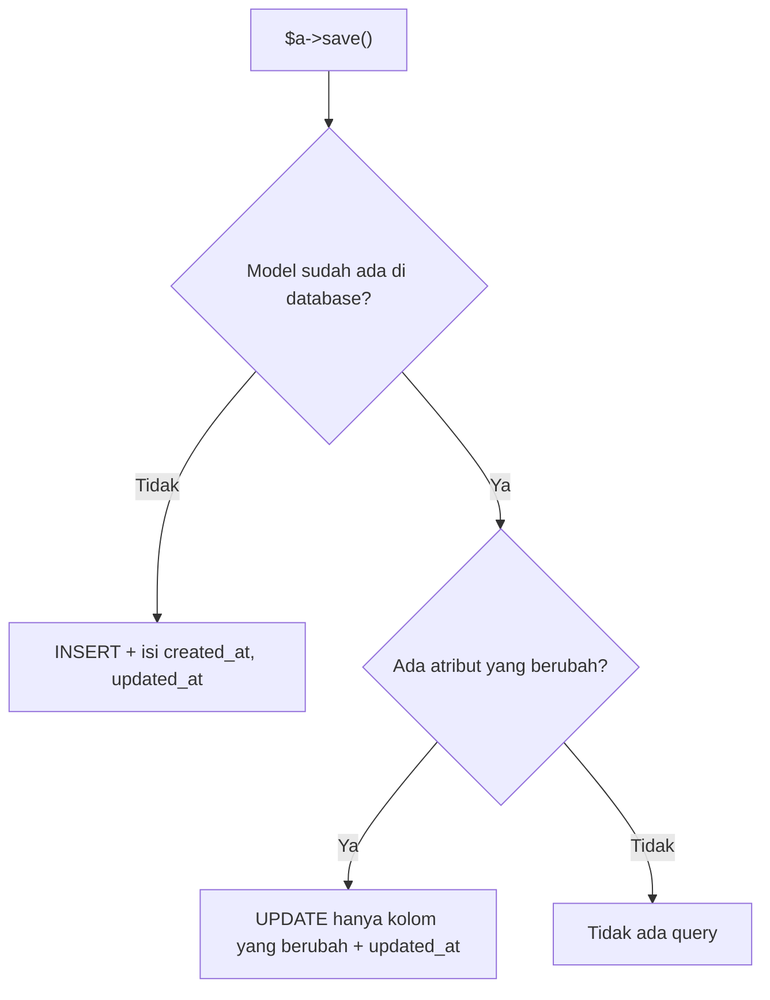

# Operasi CRUD

**CRUD** adalah empat operasi dasar pada data: *Create* (tambah), *Read* (baca), *Update* (ubah), dan *Delete* (hapus). Hampir semua fitur aplikasi adalah kombinasi keempatnya.
Dengan model `Article` yang sudah siap, kamu kini melakukannya lewat Eloquent. Sub bab ini dijalankan sepenuhnya di Tinker agar fokus pada Eloquent; penghubungan CRUD ke form
dan halaman web dikerjakan pada proyek akhir.

## Tujuan Pembelajaran

Setelah menyelesaikan sub bab ini, kamu dapat:

- [ ] Menambah data dengan `new` + `save()`, `create()`, dan factory.
- [ ] Membaca data dengan `all`, `find`, `findOrFail`, `first`, `where`, dan `get`.
- [ ] Mengubah data dengan memodifikasi properti lalu `save()`, atau dengan `update()`.
- [ ] Menghapus data dengan `delete()` dan `destroy()`.
- [ ] Memakai `firstOrCreate` dan `updateOrCreate`.
- [ ] Memeriksa perubahan model dengan `isDirty()`, `wasChanged()`, dan `refresh()`.

## Prasyarat

- [Membuat Model](04-13-creating-models.md): model `Article` dengan `#[Fillable]` dan cast.
- Tabel `articles` terisi (jalankan `migrate:fresh` lalu `Article::factory()->count(15)->create()` bila perlu).
- [Query Builder dasar](04-02-relational-database-fundamentals.md) (konsep SQL) dan Tinker.

## Pengantar

Aplikasi blog memerlukan halaman daftar artikel (read), form tambah (create), form ubah (update), dan tombol hapus (delete). Sebelum membuat halaman-halamannya, kamu perlu yakin
operasi di tingkat model berjalan benar. Tinker adalah laboratorium yang cepat untuk itu.

## Penjelasan Konsep

### Create: menambah data

```php-inline
use App\Models\Article;

// 1. Buat objek, isi properti, simpan
$a = new Article();
$a->title = 'Artikel Pertama';
$a->slug = 'artikel-pertama';
$a->body = 'Isi artikel.';
$a->save();

// 2. Mass assignment dengan create()
$b = Article::create([
    'title' => 'Artikel Kedua',
    'slug' => 'artikel-kedua',
    'body' => 'Isi lagi.',
]);

// 3. Factory (untuk data uji)
Article::factory()->count(3)->create();
```

`save()` mengembalikan `true`/`false`; `create()` mengembalikan model yang tersimpan (dengan `id` terisi). Timestamp `created_at` dan `updated_at` diisi otomatis. Cara 2 mensyaratkan kolom
ada di `#[Fillable]`.

### Read: membaca data

| Tujuan | Kode | Hasil |
|---|---|---|
| Semua | `Article::all()` | Koleksi semua model |
| Satu berdasarkan `id` | `Article::find(1)` | Model atau `null` |
| Satu atau 404 | `Article::findOrFail(1)` | Model atau pengecualian `ModelNotFoundException` |
| Pertama yang cocok | `Article::where('slug', 'artikel-pertama')->first()` | Model atau `null` |
| Pertama atau 404 | `Article::where(...)->firstOrFail()` | Model atau pengecualian |
| Banyak dengan syarat | `Article::where('is_published', true)->get()` | Koleksi |
| Hitung | `Article::where('is_published', true)->count()` | Angka |
| Nilai satu kolom | `Article::where('id', 1)->value('title')` | String |

`findOrFail` dan `firstOrFail` penting di route: bila dilempar dalam request web, Laravel otomatis mengubahnya menjadi respons **404**.

### Update: mengubah data

```php-inline
// 1. Ambil, ubah properti, simpan
$a = Article::find(1);
$a->title = 'Judul Baru';
$a->save();

// 2. update() dengan array (mass assignment)
$a->update(['title' => 'Judul Lain', 'is_published' => true]);

// 3. Update massal lewat query (tidak memicu event model)
Article::where('is_published', false)->update(['body' => 'Diperbarui massal']);
```

`updated_at` ikut diperbarui otomatis pada cara 1 dan 2. Pada update massal lewat query (cara 3), event model tidak berjalan karena model tidak diambil lebih dulu (sub bab 04.28).

### Delete: menghapus data

```php-inline
$a = Article::find(1);
$a->delete();                          // hapus lewat instance

Article::destroy(2);                   // hapus berdasarkan kunci utama
Article::destroy([3, 4, 5]);           // beberapa sekaligus
Article::where('is_published', false)->delete();   // hapus massal lewat query
```

Menghapus lewat query massal tidak memicu event model. Untuk menghapus yang dapat dipulihkan, gunakan *soft delete* (sub bab 04.27).

### Mencari atau membuat

| Method | Perilaku |
|---|---|
| `firstOrCreate($cari, $tambahan)` | Cari berdasarkan `$cari`; jika tidak ada, buat dengan gabungan keduanya |
| `updateOrCreate($cari, $nilai)` | Cari berdasarkan `$cari`; jika ada, ubah dengan `$nilai`; jika tidak, buat |
| `firstOrNew(...)` | Seperti `firstOrCreate` tetapi tidak menyimpan |

```php-inline
Article::firstOrCreate(
    ['slug' => 'tentang-kami'],
    ['title' => 'Tentang Kami', 'body' => 'Profil singkat.']
);

Article::updateOrCreate(
    ['slug' => 'tentang-kami'],
    ['title' => 'Tentang Kami (Baru)']
);
```

### Memeriksa perubahan

```php-inline
$a = Article::find(1);
$a->title = 'Diubah';
$a->isDirty();            // true: ada perubahan yang belum disimpan
$a->isDirty('title');     // true
$a->save();
$a->wasChanged('title');  // true: berubah pada save terakhir
$a->refresh();            // muat ulang atribut dari database
```

### Bentuk hasil

`all()` dan `get()` mengembalikan `Illuminate\Database\Eloquent\Collection`, yang dilengkapi banyak method (`pluck`, `map`, `filter`, `count`, `first`). Nilai kolom diakses seperti properti:
`$a->title`. Konversi: `$a->toArray()`, `$a->toJson()`.

### Keamanan

- Jangan melewatkan seluruh input mentah ke `create()`/`update()`; ambil hanya kolom yang divalidasi (`$request->validated()`).
- `delete()`/`update()` massal tanpa `where` memengaruhi seluruh tabel; tinjau syarat sebelum menjalankan.
- Pada route web, gunakan `findOrFail` agar data yang tidak ada menghasilkan 404, bukan galat 500.

## Cara Kerja



## Contoh Praktik

Di Tinker, kamu menjalankan seluruh siklus CRUD pada tabel `articles`: tambah, baca, ubah, hapus, `firstOrCreate`/`updateOrCreate`, dan pemeriksaan perubahan.

## Penjelasan Kode

Contoh pada bagian konsep sudah lengkap. Dua perilaku penting untuk diamati sendiri: `save()` pada model yang tidak berubah tidak menjalankan query, dan `update()`
massal lewat query tidak memperbarui model yang sudah kamu pegang di memori (gunakan `refresh()`).

## Implementasi Langkah demi Langkah

### Langkah 1: siapkan

```bash
cd ~/belajar-laravel/cms-artikel
php artisan migrate:fresh
php artisan tinker
```

```php-inline
use App\Models\Article;
```

### Langkah 2: Create

Jalankan tiga cara menambah data pada bagian konsep. Lalu `Article::count()`.

### Langkah 3: Read

```php-inline
Article::all()->pluck('title');
Article::find(1)->title;
Article::where('slug', 'artikel-kedua')->first()->title;
Article::find(9999);
Article::findOrFail(9999);
```

Amati `null` pada `find(9999)` dan pengecualian pada `findOrFail(9999)`.

### Langkah 4: Update

```php-inline
$a = Article::first();
$a->title = 'Judul Diubah';
$a->isDirty();
$a->save();
$a->wasChanged('title');
$a->update(['is_published' => true, 'published_at' => now()]);
Article::first()->is_published;
```

### Langkah 5: Delete

```php-inline
$count = Article::count();
Article::destroy(2);
Article::count() === $count - 1;
Article::where('is_published', false)->delete();
```

### Langkah 6: cari-atau-buat

Jalankan `firstOrCreate` dua kali dengan data sama dan pastikan jumlah baris hanya bertambah sekali; lalu `updateOrCreate`.

### Langkah 7: bersihkan

```bash
php artisan migrate:fresh --seed
```

## Eksekusi dan Verifikasi

| Langkah | Cara memverifikasi |
|---|---|
| 2 | Jumlah baris bertambah; `id`, `created_at` terisi |
| 3 | `find(9999)` mengembalikan `null`; `findOrFail(9999)` melempar `ModelNotFoundException` |
| 4 | `isDirty()` true sebelum `save`, `wasChanged('title')` true sesudahnya |
| 5 | Jumlah baris berkurang setelah `destroy` dan `delete` massal |
| 6 | `firstOrCreate` dua kali menambah satu baris |

## Hasil yang Diharapkan

| Perintah | Hasil |
|---|---|
| `new Article` + `save()` | `true`; `$a->id` terisi |
| `Article::create([...])` | Objek `Article` dengan `id` |
| `Article::find(9999)` | `null` |
| `Article::findOrFail(9999)` | `Illuminate\Database\Eloquent\ModelNotFoundException` |
| `Article::destroy(2)` | `1` (jumlah baris dihapus) |

Hasil ini diturunkan dari dokumentasi dan belum dijalankan oleh penulis materi; cocokkan dengan hasilmu.

## Kesalahan Umum dan Pemecahan Masalah

| Gejala | Penyebab | Cara mengenali | Solusi | Pencegahan |
|---|---|---|---|---|
| `Attempt to read property on null` | `find()` tidak menemukan | Galat null | Gunakan `findOrFail` atau cek `null` | Tangani hasil kosong |
| `NOT NULL constraint failed` | Kolom wajib kosong pada `create` | Galat saat simpan | Isi kolom wajib | Validasi input |
| Kolom tidak tersimpan lewat `create` | Tidak ada di `Fillable` | Kolom kosong | Tambah ke `Fillable` (jika aman) | Aktifkan `preventSilentlyDiscardingAttributes` |
| `UNIQUE constraint failed: articles.slug` | Slug ganda | Galat saat simpan | Gunakan slug unik atau `updateOrCreate` | Buat slug otomatis |
| Model di memori tidak berubah setelah update massal | Update lewat query tidak menyentuh instance | Data lama di variabel | Panggil `refresh()` atau ambil ulang | Pahami beda instance dan query |
| `delete()` massal menghapus semua | `where` terlupa | Tabel kosong | Isi ulang dengan seeder | Tinjau query sebelum `delete` |
| `save()` tidak mengubah `updated_at` | Tidak ada atribut yang berubah | `isDirty()` false | Tidak perlu tindakan | Periksa `isDirty` |

## Latihan Praktik

### Latihan dasar

**D1. Siklus CRUD**
- *Masalah:* ingin menguasai empat operasi.
- *Persyaratan:* di Tinker, tambah satu artikel, baca berdasarkan slug, ubah judulnya, lalu hapus. Catat `Article::count()` pada tiap tahap.
- *Perilaku yang diharapkan:* jumlah +1, tetap, tetap, lalu -1.
- *Tujuan belajar:* mempraktikkan CRUD.

**D2. `find` dan `findOrFail`**
- *Masalah:* ingin memahami bedanya.
- *Persyaratan:* panggil keduanya dengan `id` yang tidak ada dan jelaskan mana yang cocok untuk route web.
- *Perilaku yang diharapkan:* `findOrFail` dipilih karena menghasilkan 404.
- *Tujuan belajar:* memilih method baca yang tepat.

### Latihan implementasi

**I1. Terbitkan artikel**
- *Masalah:* ingin menerbitkan draf.
- *Persyaratan:* ambil semua artikel yang `is_published = false`, terbitkan satu per satu dengan `update(['is_published' => true, 'published_at' => now()])`, lalu bandingkan dengan satu `update` massal lewat query; bahas beda event dan `updated_at`.
- *Perilaku yang diharapkan:* kedua cara menghasilkan data akhir sama.
- *Tujuan belajar:* membedakan update per model dan massal.

**I2. Idempoten dengan `updateOrCreate`**
- *Masalah:* impor data bisa dijalankan berulang.
- *Persyaratan:* tulis perulangan yang mengimpor tiga artikel dengan `updateOrCreate(['slug' => ...], [...])`, jalankan dua kali, dan buktikan jumlah baris tetap tiga.
- *Perilaku yang diharapkan:* tidak ada duplikat.
- *Tujuan belajar:* membuat operasi idempoten.

### Latihan tantangan

**T1. Perilaku `save()`**
- *Masalah:* tim bertanya kapan `UPDATE` benar-benar dijalankan.
- *Persyaratan:* gunakan `DB::listen` atau `DB::enableQueryLog()` di Tinker untuk membuktikan bahwa `save()` pada model tanpa perubahan tidak menjalankan query, dan bahwa hanya kolom yang berubah yang masuk ke `UPDATE`.
- *Perilaku yang diharapkan:* log query mendukung kedua klaim.
- *Tujuan belajar:* membaca query yang dihasilkan Eloquent.
- *Catatan:* kerjakan mandiri; tidak ada kunci jawaban.

## Uji Pemahaman

1. Apa kepanjangan dan arti CRUD?
2. Apa beda `save()` dan `create()`?
3. Apa beda `find()` dan `findOrFail()`?
4. Apa yang dilakukan `firstOrCreate`?
5. Mengapa update massal lewat query tidak memicu event model?
6. Apa fungsi `isDirty()`?
7. Apa beda `delete()` dan `destroy()`?

??? success "Kunci jawaban singkat"
    1. Create, Read, Update, Delete: tambah, baca, ubah, hapus.
    2. `save()` menyimpan objek yang sudah dibuat; `create()` membuat dan menyimpan dari array (butuh `Fillable`).
    3. `find()` mengembalikan `null` bila tidak ada; `findOrFail()` melempar pengecualian (404 di web).
    4. Mencari baris; bila tidak ada, membuatnya.
    5. Model tidak diambil terlebih dahulu, hanya SQL `UPDATE` yang dijalankan.
    6. Memeriksa apakah ada atribut yang berubah dan belum disimpan.
    7. `delete()` pada instance/query; `destroy()` menghapus berdasarkan kunci utama.

## Ringkasan

- CRUD lewat Eloquent: `save`/`create`, `find`/`where`/`get`, `save`/`update`, `delete`/`destroy`.
- `findOrFail` dan `firstOrFail` menghasilkan 404 pada route web.
- `firstOrCreate` dan `updateOrCreate` membuat operasi idempoten.
- Update atau hapus massal lewat query tidak memicu event model.
- Jangan teruskan input mentah ke `create`/`update`; batasi dengan `Fillable` dan validasi.

Selanjutnya: *Query Builder*, menyusun query fleksibel tanpa model.

## Referensi Resmi

- [Laravel: Inserting and Updating Models](https://laravel.com/docs/13.x/eloquent#inserting-and-updating-models)
- [Laravel: Retrieving Single Models](https://laravel.com/docs/13.x/eloquent#retrieving-single-models)
- [Laravel: Deleting Models](https://laravel.com/docs/13.x/eloquent#deleting-models)
- [Laravel: Examining Attribute Changes](https://laravel.com/docs/13.x/eloquent#examining-attribute-changes)
