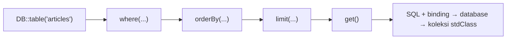

# Query Builder

**Query Builder** adalah antarmuka berantai (*fluent*) Laravel untuk menyusun query SQL dengan kode PHP. Ia dipakai Eloquent di belakang layar, tetapi juga dapat dipakai
langsung lewat `DB::table('nama_tabel')` tanpa model. Memahaminya membuatmu paham apa yang dilakukan Eloquent, dan memberi alat untuk laporan atau query yang tidak cocok dengan model.

## Tujuan Pembelajaran

Setelah menyelesaikan sub bab ini, kamu dapat:

- [ ] Menyusun query baca dengan `select`, `where`, `orderBy`, `limit`, dan `get`/`first`/`value`/`pluck`.
- [ ] Memakai berbagai klausa `where` (`whereIn`, `whereBetween`, `whereNull`, grup logika).
- [ ] Memakai fungsi agregat (`count`, `max`, `min`, `avg`, `sum`) dan `groupBy`.
- [ ] Menggabungkan tabel dengan `join` dan `leftJoin`.
- [ ] Menambah, mengubah, dan menghapus data dengan `insert`, `update`, dan `delete`.
- [ ] Melihat SQL hasil dengan `toSql()`/`toRawSql()` dan menjelaskan keamanan parameter binding.

## Prasyarat

- [Operasi CRUD](04-14-crud-operations.md) dan [Dasar Database Relasional](04-02-relational-database-fundamentals.md) (SQL dasar).
- Tabel `articles` terisi data (mis. `Article::factory()->count(15)->create()`; sebagian terbit).
- Tinker.

## Pengantar

Bayangkan laporan "jumlah artikel terbit per bulan". Hasilnya bukan model `Article` melainkan baris ringkasan. Membuat model khusus untuk itu berlebihan; Query Builder pas.

## Penjelasan Konsep

### Memulai query

```php-inline
use Illuminate\Support\Facades\DB;

DB::table('articles')->get();      // semua baris (koleksi objek stdClass)
```

Setiap method mengembalikan builder yang dapat dirantai, sampai kamu memanggil method penutup (`get`, `first`, `count`, dan sebagainya).

### Mengambil hasil

| Method | Hasil |
|---|---|
| `get()` | Koleksi semua baris |
| `first()` | Satu baris (objek) atau `null` |
| `find($id)` | Satu baris berdasarkan `id` |
| `value('title')` | Nilai satu kolom dari baris pertama |
| `pluck('title')` | Koleksi nilai satu kolom |
| `pluck('title', 'id')` | Koleksi `id => title` |
| `exists()` / `doesntExist()` | `true`/`false` |

### Memilih kolom

```php-inline
DB::table('articles')->select('id', 'title')->get();
DB::table('articles')->select('title as judul')->get();
DB::table('articles')->distinct()->pluck('is_published');
```

### Klausa `where`

```php-inline
DB::table('articles')->where('is_published', true)->get();
DB::table('articles')->where('id', '>', 5)->get();          // operator eksplisit
DB::table('articles')->where('title', 'like', '%Laravel%')->get();
DB::table('articles')->whereIn('id', [1, 2, 3])->get();
DB::table('articles')->whereNotIn('id', [1, 2])->get();
DB::table('articles')->whereBetween('id', [3, 8])->get();
DB::table('articles')->whereNull('published_at')->get();
DB::table('articles')->whereNotNull('published_at')->get();
DB::table('articles')->where('is_published', true)->orWhere('id', 1)->get();
```

!!! warning "Kelompokkan `orWhere` dengan closure"
    `where('a', 1)->orWhere('b', 2)->where('c', 3)` tidak berarti `(a=1 OR b=2) AND c=3`. Bungkus kondisi `OR` dalam closure agar tanda kurung benar:
    `->where(function ($q) { $q->where('a', 1)->orWhere('b', 2); })->where('c', 3)`.

### Urutan, batas, dan offset

```php-inline
DB::table('articles')->orderBy('id', 'desc')->get();
DB::table('articles')->latest()->get();          // orderBy created_at desc
DB::table('articles')->oldest()->get();
DB::table('articles')->limit(5)->offset(10)->get();
DB::table('articles')->inRandomOrder()->first();
```

### Agregat dan pengelompokan

```php-inline
DB::table('articles')->count();
DB::table('articles')->max('id');
DB::table('articles')->min('id');
DB::table('articles')->avg('id');
DB::table('articles')->sum('id');

DB::table('articles')
    ->select('is_published', DB::raw('count(*) as total'))
    ->groupBy('is_published')
    ->get();
```

`DB::raw()` menyisipkan potongan SQL mentah; **jangan** memasukkan input pengguna ke dalamnya.

### Join

```php-inline
DB::table('articles')
    ->join('users', 'users.id', '=', 'articles.user_id')       // INNER JOIN
    ->select('articles.title', 'users.name')
    ->get();

DB::table('articles')->leftJoin('users', 'users.id', '=', 'articles.user_id');  // LEFT JOIN
```

Contoh join membutuhkan kolom `user_id` pada `articles`, yang baru ditambahkan di sub bab 04.17. Sampai saat itu, coba join pada tabel lain atau lewati contoh ini.

### Menulis data

```php-inline
DB::table('articles')->insert([
    'title' => 'Dari Query Builder', 'slug' => 'dari-query-builder', 'body' => 'x',
    'created_at' => now(), 'updated_at' => now(),
]);

$id = DB::table('articles')->insertGetId([...]);       // mengembalikan id baru

DB::table('articles')->where('id', 1)->update(['is_published' => true]);
DB::table('articles')->where('id', 1)->increment('views');  // bila kolom views ada
DB::table('articles')->updateOrInsert(['slug' => 'x'], ['title' => 'X']);
DB::table('articles')->where('id', 1)->delete();
```

Query Builder **tidak** mengisi `created_at`/`updated_at` otomatis dan tidak menjalankan event model, cast, atau soft delete.

### Memproses data besar

```php-inline
DB::table('articles')->orderBy('id')->chunkById(100, function ($rows) {
    foreach ($rows as $row) { /* proses */ }
});
```

`chunkById` mengambil data per kelompok sehingga memori tetap kecil.

### Melihat SQL

```php-inline
DB::table('articles')->where('id', '>', 5)->toSql();
DB::table('articles')->where('id', '>', 5)->toRawSql();   // dengan nilai (hanya untuk debugging)
```

### Keamanan

- Query Builder memakai parameter binding, sehingga nilai di `where('kolom', $nilai)` aman dari SQL injection.
- Nama kolom **tidak** di-*binding*. Jangan memasukkan nama kolom dari input pengguna (`orderBy($request->kolom)`) tanpa daftar yang diizinkan (*allow-list*).
- `DB::raw`, `whereRaw`, dan `selectRaw` menerima SQL mentah: pisahkan nilai dengan binding (`whereRaw('a > ?', [$x])`).

## Cara Kerja



## Contoh Praktik

Kamu menulis beberapa query pada tabel `articles` di Tinker: baca dengan syarat, urutan, agregat, dan pengelompokan; tulis dengan `insert`/`update`/`delete`; dan membaca SQL-nya.

## Penjelasan Kode

Semua contoh ada di bagian konsep. Perhatikan perbedaan hasil `DB::table('articles')->first()` (objek `stdClass`) dengan `Article::first()` (objek `Article` dengan cast): pada Query Builder,
`is_published` berupa `1`/`0` dan `published_at` berupa string.

## Implementasi Langkah demi Langkah

### Langkah 1: siapkan data

```bash
cd ~/belajar-laravel/cms-artikel
php artisan migrate:fresh
php artisan tinker
```

```php-inline
use App\Models\Article;
use Illuminate\Support\Facades\DB;

Article::factory()->count(10)->published()->create();
Article::factory()->count(5)->create();
```

### Langkah 2: baca

```php-inline
DB::table('articles')->count();
DB::table('articles')->where('is_published', true)->count();
DB::table('articles')->select('id', 'title')->orderByDesc('id')->limit(3)->get();
DB::table('articles')->whereIn('id', [1, 2, 3])->pluck('title');
DB::table('articles')->where('id', 1)->value('slug');
```

### Langkah 3: agregat dan pengelompokan

```php-inline
DB::table('articles')->max('id');
DB::table('articles')
    ->select('is_published', DB::raw('count(*) as total'))
    ->groupBy('is_published')
    ->get();
```

### Langkah 4: tulis

```php-inline
$id = DB::table('articles')->insertGetId([
    'title' => 'Dari Query Builder', 'slug' => 'dari-query-builder', 'body' => 'x',
    'created_at' => now(), 'updated_at' => now(),
]);
DB::table('articles')->where('id', $id)->update(['title' => 'Judul Diubah']);
DB::table('articles')->where('id', $id)->delete();
```

### Langkah 5: lihat SQL

```php-inline
DB::table('articles')->where('is_published', true)->orderBy('id')->limit(5)->toRawSql();
```

### Langkah 6: bandingkan dengan Eloquent

```php-inline
DB::table('articles')->first()->is_published;
Article::first()->is_published;
```

## Eksekusi dan Verifikasi

| Langkah | Cara memverifikasi |
|---|---|
| 2 | Hitung total 15, terbit 10; `select` menampilkan hanya `id` dan `title` |
| 3 | Pengelompokan menghasilkan dua baris: terbit (10) dan belum (5) |
| 4 | `insertGetId` mengembalikan angka; update dan delete mengembalikan `1` |
| 5 | SQL memuat `where "is_published" = 1 order by "id" asc limit 5` |
| 6 | Query Builder: `1`; Eloquent: `true` |

## Hasil yang Diharapkan

| Perintah | Hasil |
|---|---|
| `where('is_published', true)->count()` | `10` |
| `groupBy('is_published')` | Dua objek: `{is_published: 0, total: 5}` dan `{is_published: 1, total: 10}` |
| `DB::table('articles')->first()->is_published` | `1` (bukan `true`) |

Nilai boolean, kutip pengidentifikasi, dan urutan baris dapat berbeda antar database. Hasil ini diturunkan dari dokumentasi dan belum dijalankan oleh penulis materi; cocokkan dengan hasilmu.

## Kesalahan Umum dan Pemecahan Masalah

| Gejala | Penyebab | Cara mengenali | Solusi | Pencegahan |
|---|---|---|---|---|
| `Call to a member function ... on null` | `first()` tidak menemukan baris | Galat null | Cek `null` atau gunakan `firstOrFail` (Eloquent) | Tangani hasil kosong |
| Hasil `OR` tidak sesuai harapan | `orWhere` tidak dikelompokkan | Baris tak terduga | Bungkus dengan closure | Uji dengan `toRawSql()` |
| `Unknown column` | Salah nama kolom/alias | Galat SQL | Periksa `db:table` | Cek skema |
| `created_at` kosong | Query Builder tidak mengisi timestamp | Kolom `NULL` | Isi manual atau gunakan Eloquent | Pahami perbedaan lapisan |
| `orderBy` dari input pengguna rawan | Nama kolom tidak di-binding | Potensi injeksi | Gunakan allow-list kolom | Jangan percaya nama kolom dari luar |
| Memori habis di data besar | `get()` memuat semua | Proses mati | Gunakan `chunkById`/`cursor` | Proses data besar bertahap |
| `Object of class stdClass could not be converted to string` | Mencetak objek | Galat konversi | Akses properti: `$row->title` | Ingat hasil berupa objek |

## Latihan Praktik

### Latihan dasar

**D1. Filter dan urut**
- *Masalah:* butuh lima artikel terbit terbaru.
- *Persyaratan:* tulis query dengan `where`, `orderByDesc('published_at')`, `limit(5)`, dan `get()`.
- *Perilaku yang diharapkan:* lima baris, tanggal menurun.
- *Tujuan belajar:* merangkai query dasar.

**D2. Cari judul**
- *Masalah:* pencarian sederhana.
- *Persyaratan:* cari artikel yang judulnya memuat kata tertentu dengan `like`; tampilkan SQL dengan `toRawSql()`.
- *Perilaku yang diharapkan:* hasil dan SQL cocok.
- *Tujuan belajar:* memakai `like`.

### Latihan implementasi

**I1. Laporan per status**
- *Masalah:* butuh ringkasan jumlah artikel terbit vs draf.
- *Persyaratan:* gunakan `groupBy` dan `DB::raw('count(*) as total')`, lalu ubah hasil menjadi array `['terbit' => n, 'draf' => m]` dengan `mapWithKeys`.
- *Perilaku yang diharapkan:* array dengan dua kunci.
- *Tujuan belajar:* agregasi dan transformasi koleksi.

**I2. Pengurutan aman**
- *Masalah:* pengguna memilih kolom pengurutan dari URL.
- *Persyaratan:* tulis fungsi yang menerima nama kolom dari input dan hanya mengurutkan bila termasuk daftar `['id','title','published_at']`; selain itu pakai `id`.
- *Perilaku yang diharapkan:* input `title;drop table` tidak berpengaruh.
- *Tujuan belajar:* allow-list pada nama kolom.

### Latihan tantangan

**T1. Paginasi manual**
- *Masalah:* ingin memahami `limit`/`offset`.
- *Persyaratan:* tulis fungsi `halaman($n, $perHalaman)` memakai `offset` dan `limit`, lalu bandingkan dengan `paginate()` (sub bab 04.25) dari sisi SQL.
- *Perilaku yang diharapkan:* hasil halaman sama dengan yang dihasilkan `paginate()`.
- *Tujuan belajar:* memahami cara kerja paginasi.
- *Catatan:* kerjakan mandiri; tidak ada kunci jawaban.

## Uji Pemahaman

1. Apa beda `get()` dan `first()`?
2. Apa beda `pluck('title')` dan `value('title')`?
3. Mengapa `orWhere` perlu dikelompokkan dengan closure?
4. Apa perbedaan hasil Query Builder dan Eloquent?
5. Mengapa nama kolom dari input pengguna berbahaya di `orderBy`?
6. Apa fungsi `chunkById`?
7. Apa fungsi `toRawSql()` dan kapan tidak boleh dipakai?

??? success "Kunci jawaban singkat"
    1. `get()` mengembalikan koleksi; `first()` satu baris.
    2. `pluck` mengembalikan koleksi nilai; `value` satu nilai dari baris pertama.
    3. Agar logika AND/OR diberi tanda kurung yang benar.
    4. Query Builder menghasilkan `stdClass` tanpa cast, timestamp otomatis, atau event; Eloquent menghasilkan model.
    5. Nama kolom tidak di-binding sehingga dapat disalahgunakan; gunakan allow-list.
    6. Memproses data besar per kelompok agar memori hemat.
    7. Menampilkan SQL dengan nilai untuk debugging; jangan dieksekusi atau dipakai sebagai masukan query.

## Ringkasan

- `DB::table()` memulai query berantai yang diakhiri `get`, `first`, `value`, `pluck`, atau agregat.
- Klausa `where`, `orderBy`, `limit`, `groupBy`, dan `join` menyusun query fleksibel.
- `insert`, `update`, `delete` menulis data tetapi tanpa timestamp otomatis dan event.
- Parameter binding melindungi nilai; nama kolom dan SQL mentah harus dijaga manual.
- `toSql()`/`toRawSql()` membantu debugging.

Selanjutnya: *Query Eloquent*, menyusun query dengan model, scope, dan koleksi.

## Referensi Resmi

- [Laravel: Query Builder](https://laravel.com/docs/13.x/queries)
- [Laravel: Where Clauses](https://laravel.com/docs/13.x/queries#where-clauses)
- [Laravel: Aggregates](https://laravel.com/docs/13.x/queries#aggregates)
- [Laravel: Chunking Results](https://laravel.com/docs/13.x/queries#chunking-results)
