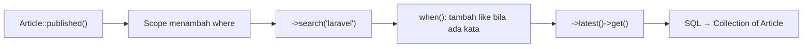

# Query Eloquent

Eloquent mewarisi seluruh kemampuan Query Builder, lalu menambahkan hasil berupa model, *scope* untuk query yang dapat dipakai ulang, dan koleksi yang kaya. Sub bab ini membahas
cara menyusun query yang bersih dan mudah dibaca, memecah syarat berulang menjadi *scope*, membuat query bersyarat dengan `when()`, dan mengolah hasil dengan koleksi.

## Tujuan Pembelajaran

Setelah menyelesaikan sub bab ini, kamu dapat:

- [ ] Menyusun query pada model dengan `where`, `orderBy`, `latest`, `limit`, dan agregat.
- [ ] Menulis *local scope* dengan atribut `#[Scope]` untuk syarat yang sering dipakai.
- [ ] Membuat query bersyarat dengan `when()` (mis. pencarian opsional).
- [ ] Memilih `get`, `first`, `pluck`, `cursor`, `lazy`, atau `chunk` sesuai kebutuhan memori.
- [ ] Mengolah hasil dengan method koleksi (`map`, `filter`, `groupBy`, `sortBy`).
- [ ] Menjelaskan perbedaan query pada database dan pengolahan pada koleksi.

## Prasyarat

- [Operasi CRUD](04-14-crud-operations.md) dan [Query Builder](04-15-query-builder.md).
- Model `Article` dengan data (mis. 10 terbit dan 5 draf dari factory).
- [Fungsi](../level-00/00-14-functions.md) dan closure pada PHP.

## Pengantar

Kamu akan sering menulis `Article::where('is_published', true)->whereNotNull('published_at')->latest('published_at')` di banyak tempat. Mengubah arti "artikel terbit" berarti
mengedit semuanya. *Scope* memusatkan definisi itu di model: `Article::published()`.

## Penjelasan Konsep

### Query dasar pada model

```php-inline
use App\Models\Article;

Article::where('is_published', true)->get();
Article::where('is_published', true)->orderBy('published_at', 'desc')->limit(5)->get();
Article::latest('published_at')->first();         // terbaru berdasarkan kolom
Article::whereDate('published_at', today())->get();
Article::whereYear('created_at', 2026)->count();
Article::max('id');
Article::query()->where(...)->get();              // memulai builder secara eksplisit
```

Seluruh method Query Builder (sub bab 04.15) tersedia pada model. Bedanya, hasilnya adalah model dengan cast dan relasi.

### Local scope dengan `#[Scope]`

Dokumentasi 13.x memakai atribut `Scope` pada method `protected` yang menerima `Builder`:

File: `app/Models/Article.php` (tambahkan)

```php-inline
use Illuminate\Database\Eloquent\Attributes\Scope;
use Illuminate\Database\Eloquent\Builder;

#[Scope]
protected function published(Builder $query): void
{
    $query->where('is_published', true)->whereNotNull('published_at');
}

#[Scope]
protected function search(Builder $query, ?string $term): void
{
    $query->when($term, fn (Builder $q) => $q->where('title', 'like', "%{$term}%"));
}
```

Pemakaian (nama method dipanggil tanpa atribut dan tanpa parameter `$query`):

```php-inline
Article::published()->latest('published_at')->get();
Article::published()->search('laravel')->get();
```

Scope dapat dirantai dengan query lain. Scope menjaga arti "terbit" tetap satu sumber kebenaran.

### Query bersyarat dengan `when()`

`when($kondisi, $callback)` menjalankan `$callback` hanya bila `$kondisi` bernilai benar. Cocok untuk filter opsional dari form:

```php-inline
$term = $request->query('q');
$status = $request->query('status');

Article::query()
    ->when($term, fn ($q, $term) => $q->where('title', 'like', "%{$term}%"))
    ->when($status === 'draft', fn ($q) => $q->where('is_published', false))
    ->latest()
    ->get();
```

### Memilih cara mengambil data

| Method | Perilaku | Memori | Kapan |
|---|---|---|---|
| `get()` | Semua hasil sebagai Collection | Semua di memori | Data kecil sampai sedang |
| `first()` | Satu model | Kecil | Satu baris |
| `pluck('title')` | Satu kolom sebagai koleksi | Kecil | Daftar nilai |
| `chunk(100, fn)` / `chunkById(100, fn)` | Per kelompok | Hemat | Pemrosesan batch |
| `lazy()` | `LazyCollection` per kelompok | Hemat | Iterasi besar dengan sintaks koleksi |
| `cursor()` | Satu model sekali waktu | Sangat hemat | Iterasi besar sederhana |

### Pengolahan koleksi

Hasil `get()` adalah `Illuminate\Database\Eloquent\Collection`. Operasi koleksi berjalan di PHP, **setelah** data diambil:

```php-inline
$articles = Article::published()->get();

$articles->pluck('title');
$articles->map(fn ($a) => strtoupper($a->title));
$articles->filter(fn ($a) => strlen($a->title) > 30);
$articles->sortBy('title');
$articles->groupBy(fn ($a) => $a->published_at->format('Y-m'));
$articles->count();
```

!!! tip "Database dulu, koleksi kemudian"
    Penyaringan dan penghitungan sebaiknya dilakukan di database (`where`, `count`) agar hanya data perlu yang diambil. Gunakan koleksi untuk mengolah hasil yang sudah kecil.

### Global scope (sekilas)

*Global scope* menerapkan syarat otomatis ke **setiap** query model (contohnya *soft delete*). Dokumentasi menyediakan atribut `#[ScopedBy]`. Karena dapat membuat query terasa "ajaib",
pakai dengan hemat; soft delete dibahas pada sub bab 04.27.

### Keamanan dan performa

- Pencarian `like "%kata%"` tidak memakai indeks biasa; untuk data besar pertimbangkan *full-text search*.
- Nilai di `where` aman (binding), tetapi jangan memakai input untuk nama kolom (`where($request->kolom, ...)`) tanpa allow-list.
- `get()` tanpa batas pada tabel besar dapat menghabiskan memori; gunakan `paginate`, `chunk`, atau `cursor`.

## Cara Kerja



## Contoh Praktik

Kamu menambah dua scope ke model `Article`, menjalankan query terbit dan pencarian di Tinker, membuat query bersyarat dengan `when`, dan mengolah hasilnya dengan koleksi.

## Penjelasan Kode

Kode scope ada pada bagian konsep. Kedua method berparameter `Builder $query` dan tidak mengembalikan nilai (`void`): mereka memodifikasi query yang sedang dibangun. Nama method
menjadi nama scope yang dipanggil dari model.

## Implementasi Langkah demi Langkah

### Langkah 1: siapkan data

```bash
cd ~/belajar-laravel/cms-artikel
php artisan migrate:fresh
php artisan tinker
```

```php-inline
use App\Models\Article;

Article::factory()->count(10)->published()->create();
Article::factory()->count(5)->create();
Article::factory()->published()->create(['title' => 'Belajar Laravel Eloquent']);
```

### Langkah 2: tambahkan scope ke model

Edit `app/Models/Article.php`, tambahkan dua scope dan `use`-nya, lalu mulai ulang Tinker (`exit`, `php artisan tinker`).

### Langkah 3: pakai scope

```php-inline
use App\Models\Article;

Article::published()->count();
Article::published()->search('Laravel')->pluck('title');
Article::published()->latest('published_at')->limit(3)->pluck('title', 'id');
```

### Langkah 4: query bersyarat

```php-inline
$cari = 'laravel';
$status = null;

Article::query()
    ->when($cari, fn ($q, $cari) => $q->where('title', 'like', "%{$cari}%"))
    ->when($status === 'draft', fn ($q) => $q->where('is_published', false))
    ->toRawSql();
```

Ubah `$cari` menjadi `null` dan bandingkan SQL-nya.

### Langkah 5: olah koleksi

```php-inline
$articles = Article::published()->get();
$articles->groupBy(fn ($a) => $a->published_at->format('Y-m'))->map->count();
$articles->sortBy('title')->pluck('title')->take(3);
```

### Langkah 6: iterasi hemat memori

```php-inline
Article::query()->orderBy('id')->chunkById(5, function ($batch) {
    echo $batch->count().' ';
});
```

### Langkah 7: catat di Git

```bash
git add app/Models/Article.php
git commit -m "Tambah scope published dan search pada Article"
```

## Eksekusi dan Verifikasi

| Langkah | Cara memverifikasi |
|---|---|
| 3 | `published()->count()` bernilai 11; pencarian "Laravel" memuat judul uji |
| 4 | SQL memuat `like` hanya bila `$cari` terisi |
| 5 | `groupBy` menghasilkan jumlah per bulan |
| 6 | `chunkById(5)` mencetak `5 5 5 ` untuk 15 artikel di tabel (atau sesuai jumlah) |

## Hasil yang Diharapkan

| Perintah | Hasil |
|---|---|
| `Article::published()->count()` | `11` |
| `Article::published()->search('Laravel')->pluck('title')` | Minimal `Belajar Laravel Eloquent` |
| `when` dengan `$cari = null` | SQL tanpa `like` |

Judul acak dari Faker dapat kebetulan memuat kata pencarian; hasil kedua minimal memuat judul uji. Hasil ini diturunkan dari dokumentasi dan belum dijalankan oleh penulis materi;
cocokkan dengan hasilmu.

## Kesalahan Umum dan Pemecahan Masalah

| Gejala | Penyebab | Cara mengenali | Solusi | Pencegahan |
|---|---|---|---|---|
| `Call to undefined method Article::published()` | Atribut `#[Scope]` atau `use` hilang; Tinker lama | Galat method | Tambahkan atribut dan `use`; mulai ulang Tinker | Restart Tinker setelah ubah model |
| Scope tidak memfilter | Method tidak mengubah `$query` | Hasil tidak berubah | Pastikan memanggil `$query->where(...)` | Uji dengan `toRawSql()` |
| Hasil `orWhere` aneh dalam scope | `orWhere` tanpa grup | Baris tak terduga | Bungkus dengan closure | Uji SQL hasil |
| Memori habis | `get()` pada tabel besar | Proses mati | Gunakan `chunkById`, `lazy`, atau `cursor` | Batasi data |
| `when()` selalu menjalankan callback | Kondisi bernilai truthy (mis. string `"0"` dianggap kosong tetapi `"false"` benar) | Filter tak sesuai | Periksa nilai kondisi | Normalisasi input sebelum `when` |
| Hasil `groupBy` error pada `null` | `published_at` `null` | Galat metode pada null | Filter dengan `published()` dahulu | Tangani nilai kosong |
| Pencarian lambat | `like '%...%'` tanpa indeks | Query lama | Pertimbangkan full-text | Ukur dengan data besar |

## Latihan Praktik

### Latihan dasar

**D1. Scope draf**
- *Masalah:* butuh daftar draf.
- *Persyaratan:* tambah scope `draft` (`is_published = false`) dan tampilkan judul tiga draf terbaru.
- *Perilaku yang diharapkan:* hanya draf.
- *Tujuan belajar:* menulis scope.

**D2. Urutan terbaru**
- *Masalah:* beranda butuh lima artikel terbaru yang terbit.
- *Persyaratan:* rantai `published()`, `latest('published_at')`, dan `limit(5)`.
- *Perilaku yang diharapkan:* lima artikel dengan tanggal menurun.
- *Tujuan belajar:* merantai scope.

### Latihan implementasi

**I1. Filter gabungan**
- *Masalah:* halaman admin memfilter berdasarkan kata kunci dan status.
- *Persyaratan:* tulis fungsi `filter(?string $q, ?string $status)` yang mengembalikan query dengan `when` untuk keduanya; uji empat kombinasi dengan `toRawSql()`.
- *Perilaku yang diharapkan:* SQL menyesuaikan kombinasi.
- *Tujuan belajar:* query bersyarat.

**I2. Scope berparameter**
- *Masalah:* ingin artikel terbit dalam N hari terakhir.
- *Persyaratan:* tambah scope `recent(int $days)` dengan `where('published_at', '>=', now()->subDays($days))` dan uji dengan 7 dan 365.
- *Perilaku yang diharapkan:* hasil makin banyak bila hari makin besar.
- *Tujuan belajar:* scope dengan parameter.

### Latihan tantangan

**T1. Database vs koleksi**
- *Masalah:* tim ragu menyaring di database atau di koleksi.
- *Persyaratan:* untuk 10.000 artikel (buat dengan factory), ukur waktu dan memori dua cara menghitung artikel terbit (`Article::where(...)->count()` vs `Article::all()->where(...)->count()`) dan jelaskan hasilnya.
- *Perilaku yang diharapkan:* laporan menunjukkan cara database jauh lebih hemat.
- *Tujuan belajar:* memahami biaya mengambil data.
- *Catatan:* kerjakan mandiri; tidak ada kunci jawaban.

## Uji Pemahaman

1. Apa fungsi local scope?
2. Bagaimana menulis scope di 13.x?
3. Apa fungsi `when()`?
4. Apa beda `get()` dan `cursor()`?
5. Mengapa menyaring di database lebih baik daripada di koleksi?
6. Apa yang dikembalikan `pluck('title')`?
7. Mengapa pencarian `like '%x%'` bisa lambat?

??? success "Kunci jawaban singkat"
    1. Memusatkan syarat query yang sering dipakai agar dapat dipakai ulang.
    2. Method `protected` dengan atribut `#[Scope]` yang menerima `Builder $query`.
    3. Menjalankan callback query hanya bila kondisi benar.
    4. `get()` memuat semua hasil; `cursor()` satu model sekali waktu sehingga hemat memori.
    5. Hanya data yang diperlukan yang diambil, sehingga hemat waktu dan memori.
    6. Koleksi nilai kolom tersebut.
    7. Awalan wildcard membuat indeks biasa tidak dapat dimanfaatkan.

## Ringkasan

- Seluruh Query Builder tersedia pada model; hasilnya adalah model dan koleksi.
- Scope (`#[Scope]`) memusatkan syarat yang berulang; `when()` membuat filter opsional.
- Pilih `get`, `chunk`, `lazy`, atau `cursor` menurut kebutuhan memori.
- Saring di database, olah di koleksi.
- Waspadai pencarian `like` pada data besar dan nama kolom dari input.

Selanjutnya: *Kunci Utama dan Kunci Asing*, dasar semua relasi.

## Referensi Resmi

- [Laravel: Eloquent, Retrieving Models](https://laravel.com/docs/13.x/eloquent#retrieving-models)
- [Laravel: Local Scopes](https://laravel.com/docs/13.x/eloquent#local-scopes)
- [Laravel: Conditional Clauses](https://laravel.com/docs/13.x/queries#conditional-clauses)
- [Laravel: Eloquent Collections](https://laravel.com/docs/13.x/eloquent-collections)
