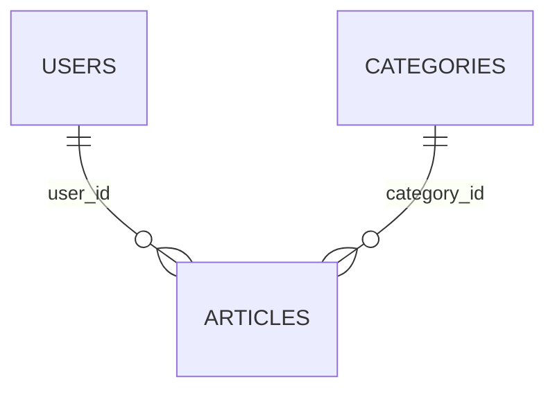

# Kunci Utama dan Kunci Asing

Relasi antar tabel bergantung pada dua jenis kunci: **kunci utama** yang mengenali sebuah baris, dan **kunci asing** yang menunjuk ke baris di tabel lain. Sub bab ini
membahas keduanya dengan konteks Laravel: bagaimana migration mendefinisikannya, apa yang dijaga oleh *foreign key constraint*, dan bagaimana tabel `articles` dihubungkan ke
`users` dan `categories`. Ini fondasi seluruh sub bab relasi berikutnya.

## Tujuan Pembelajaran

Setelah menyelesaikan sub bab ini, kamu dapat:

- [ ] Menjelaskan fungsi kunci utama dan jenisnya (bilangan bulat naik otomatis, UUID, ULID).
- [ ] Menulis kunci asing dengan `foreignId()->constrained()`.
- [ ] Memilih perilaku `onDelete`: `cascade`, `restrict`, `set null`.
- [ ] Menjelaskan integritas referensial dan apa yang dicegahnya.
- [ ] Menambah kunci asing ke tabel yang sudah berisi data dengan aman.
- [ ] Mengenali pengaturan kunci asing pada SQLite.

## Prasyarat

- [Dasar Database Relasional](04-02-relational-database-fundamentals.md) dan [Mengubah Tabel Database](04-08-modifying-database-tables.md).
- Proyek `cms-artikel` dengan model `Article`.
- Tabel `users` bawaan.

## Pengantar

Bayangkan artikel dengan `category_id = 7`, padahal kategori 7 sudah dihapus. Artikel itu "yatim": menunjuk data yang tidak ada. Kunci asing dengan *constraint* membuat
database sendiri yang menolak keadaan seperti itu.

## Penjelasan Konsep

### Kunci utama (*primary key*)

Kunci utama harus **unik** dan **tidak kosong**. Laravel menyediakan beberapa gaya:

| Gaya | Migration | Catatan |
|---|---|---|
| Bilangan bulat naik otomatis | `$table->id()` | Bawaan; sederhana, ringkas, urut |
| UUID | `$table->uuid('id')->primary()` | Sulit ditebak, aman untuk ID publik |
| ULID | `$table->ulid('id')->primary()` | Seperti UUID tetapi dapat diurutkan menurut waktu |

Untuk memakai UUID/ULID pada model gunakan trait `HasUuids` atau `HasUlids`. Kebanyakan tabel cukup dengan `id()`.

### Kunci asing (*foreign key*)

Kunci asing menyimpan kunci utama tabel lain. Cara ringkas di Laravel:

```php
$table->foreignId('category_id')->constrained();
```

`foreignId` membuat kolom `UNSIGNED BIGINT`; `constrained()` memakai konvensi untuk menebak tabel dan kolom rujukan: `category_id` → tabel `categories`, kolom `id`. Bentuk
panjangnya:

```php
$table->unsignedBigInteger('category_id');
$table->foreign('category_id')->references('id')->on('categories');
```

Bila nama tabel tidak mengikuti konvensi: `constrained('nama_tabel')`.

### Perilaku saat induk dihapus atau diubah

Tentukan nasib baris anak lewat `onDelete`:

| Pengubah | Arti | Contoh pemakaian |
|---|---|---|
| `->cascadeOnDelete()` | Hapus anak ikut terhapus | Komentar dihapus bersama artikelnya |
| `->restrictOnDelete()` | Tolak penghapusan induk bila masih punya anak | Kategori yang masih dipakai artikel |
| `->nullOnDelete()` | Kolom anak diisi `NULL` (kolom harus `nullable`) | Artikel tetap ada bila penulis dihapus |
| `->noActionOnDelete()` | Tolak penghapusan bila anak ada | Serupa `restrict` |

Pengubah lain seperti `cascadeOnUpdate()` mengatur perubahan kunci induk. Dokumentasi menekankan bahwa pengubah kolom lain (`nullable()`) harus dipanggil **sebelum** `constrained()`.

### Integritas referensial

Dengan constraint, database menolak:

- Menyisipkan anak dengan kunci asing yang tidak ada (`category_id = 999`).
- Menghapus induk yang masih direferensikan (kecuali `cascade` atau `set null`).

Ini lapisan keamanan data yang lebih kuat daripada hanya mengandalkan kode aplikasi.

### SQLite dan kunci asing

Dokumentasi menyebut kunci asing diaktifkan secara bawaan pada koneksi SQLite Laravel (matikan dengan `DB_FOREIGN_KEYS=false`). Menambah kunci asing ke tabel yang **sudah ada** di
SQLite memerlukan pembuatan ulang tabel; Laravel melakukannya otomatis saat `Schema::table` dengan `constrained()`, tetapi pada MySQL operasinya berupa `ALTER TABLE`.

### Menambah kunci asing ke tabel berisi data

Baris lama belum punya nilai untuk kolom baru. Karena itu kunci asing baru pada tabel berisi data sebaiknya `nullable()`:

```php
$table->foreignId('category_id')->nullable()->constrained()->nullOnDelete();
```

Setelah data lama diisi, kolom dapat dijadikan wajib lewat migration berikutnya bila perlu.

### Indeks pada kunci asing

`foreignId()->constrained()` membuat indeks yang mempercepat `JOIN` dan pencarian anak berdasarkan induk. Kunci asing tanpa indeks (mis. `unsignedBigInteger` saja) membuat query lambat.

### Rancangan tabel `articles`

| Kolom | Merujuk | Perilaku |
|---|---|---|
| `user_id` | `users.id` | `nullOnDelete` (artikel tetap ada tanpa penulis) |
| `category_id` | `categories.id` | `nullOnDelete` (artikel tanpa kategori) |

### Keamanan

- Constraint mencegah data yatim dan beberapa serangan manipulasi ID; tetap validasi `exists:categories,id` di tingkat aplikasi (bab validasi).
- Pertimbangkan `cascadeOnDelete` dengan hati-hati: satu penghapusan dapat menghapus banyak data. Gunakan `restrict` untuk data penting.
- ID berurutan mudah ditebak; bila ID tampil di URL publik dan datanya sensitif, pertimbangkan UUID/ULID dan otorisasi.

## Cara Kerja



Database memeriksa constraint setiap kali ada `INSERT`, `UPDATE`, atau `DELETE` yang menyentuh kolom kunci asing atau kunci utama yang dirujuk.

## Contoh Praktik

Kamu memastikan tabel `categories` ada, menambah kolom `user_id` dan `category_id` ke `articles` dengan kunci asing, lalu menguji penolakan data yatim dan perilaku `nullOnDelete`.

## Penjelasan Kode

File: `database/migrations/xxxx_add_user_and_category_to_articles_table.php`

```php
<?php

use Illuminate\Database\Migrations\Migration;
use Illuminate\Database\Schema\Blueprint;
use Illuminate\Support\Facades\Schema;

return new class extends Migration
{
    public function up(): void
    {
        Schema::table('articles', function (Blueprint $table) {
            $table->foreignId('user_id')->nullable()->constrained()->nullOnDelete();
            $table->foreignId('category_id')->nullable()->constrained()->nullOnDelete();
        });
    }

    public function down(): void
    {
        Schema::table('articles', function (Blueprint $table) {
            $table->dropConstrainedForeignId('user_id');
            $table->dropConstrainedForeignId('category_id');
        });
    }
};
```

| Bagian | Fungsi |
|---|---|
| `foreignId('user_id')` | Kolom `unsigned bigint` |
| `->nullable()` | Baris lama boleh belum punya penulis |
| `->constrained()` | Constraint ke `users.id` (tebakan dari nama kolom) |
| `->nullOnDelete()` | Hapus penulis → `articles.user_id` menjadi `NULL` |
| `dropConstrainedForeignId(...)` | Di `down()`: menghapus constraint sekaligus kolomnya |

Tabel `categories` harus sudah ada sebelum migration ini (stempel waktu lebih awal). Jika kamu belum membuatnya pada latihan sub bab 04.06, buat dulu:

```bash
php artisan make:model Category -mf
```

File: `database/migrations/xxxx_create_categories_table.php` (isi `up()`; pastikan stempel waktunya **lebih awal** daripada migration `add_user_and_category...`)

```php
Schema::create('categories', function (Blueprint $table) {
    $table->id();
    $table->string('name')->unique();
    $table->string('slug')->unique();
    $table->timestamps();
});
```

Model `Category` diberi `#[Fillable(['name', 'slug'])]`.

## Implementasi Langkah demi Langkah

### Langkah 1: pastikan tabel `categories` ada

```bash
cd ~/belajar-laravel/cms-artikel
php artisan migrate:status
```

Bila tidak ada migration `create_categories_table`, buat model + migration + factory seperti di atas. Pastikan namanya tidak bertukar urutan dengan migration kunci asing:
bila stempel waktu migration `categories` lebih baru daripada migration kunci asing, ubah nama berkasnya (hanya karena belum pernah dijalankan di tempat lain).

### Langkah 2: buat dan isi migration kunci asing

```bash
php artisan make:migration add_user_and_category_to_articles_table
```

Isi dengan kode di atas.

### Langkah 3: bangun ulang database

```bash
php artisan migrate:fresh
php artisan db:table articles
```

Perhatikan kolom `user_id`, `category_id` dan constraint-nya.

### Langkah 4: uji penolakan data yatim

```bash
php artisan tinker
```

```php-inline
use App\Models\Article;
use Illuminate\Support\Facades\DB;

DB::table('articles')->insert([
    'title' => 'Yatim', 'slug' => 'yatim', 'body' => 'x', 'category_id' => 999,
    'created_at' => now(), 'updated_at' => now(),
]);
```

Amati galat `FOREIGN KEY constraint failed` (SQLite) atau `Cannot add or update a child row` (MySQL).

### Langkah 5: uji `nullOnDelete`

```php-inline
use App\Models\User;

$user = User::factory()->create();
$id = DB::table('articles')->insertGetId([
    'title' => 'Punya Penulis', 'slug' => 'punya-penulis', 'body' => 'x',
    'user_id' => $user->id, 'created_at' => now(), 'updated_at' => now(),
]);
$user->delete();
DB::table('articles')->where('id', $id)->value('user_id');
```

Hasilnya `null`: artikel tetap ada, penulisnya hilang.

### Langkah 6: catat di Git

```bash
git add database app
git commit -m "Tambah kunci asing user dan category pada articles"
```

## Eksekusi dan Verifikasi

| Langkah | Cara memverifikasi |
|---|---|
| 3 | `db:table articles` menampilkan `user_id` dan `category_id` dengan foreign key |
| 4 | Insert dengan `category_id = 999` ditolak |
| 5 | `user_id` menjadi `null` setelah pengguna dihapus; artikel tetap ada |

## Hasil yang Diharapkan

| Aksi | Hasil |
|---|---|
| Insert dengan kategori tak ada | `Illuminate\Database\QueryException` (constraint gagal) |
| Hapus pengguna dengan `nullOnDelete` | `user_id` artikel menjadi `NULL` |

Teks galat berbeda antara SQLite dan MySQL. Hasil ini diturunkan dari dokumentasi dan belum dijalankan oleh penulis materi; cocokkan dengan hasilmu.

## Kesalahan Umum dan Pemecahan Masalah

| Gejala | Penyebab | Cara mengenali | Solusi | Pencegahan |
|---|---|---|---|---|
| `Base table or view not found: categories` | Migration `categories` setelah migration kunci asing | Galat saat `migrate` | Pastikan stempel waktu `categories` lebih awal | Buat tabel induk lebih dulu |
| `Cannot add foreign key constraint` (MySQL) | Tipe kolom beda (`int` vs `unsigned bigint`) | Galat 1215/3780 | Gunakan `foreignId` | Samakan tipe dengan kunci utama rujukan |
| `NOT NULL constraint failed` saat menambah kolom | Kolom wajib pada tabel berisi data | Galat saat `migrate` | Jadikan `nullable()` | Pikirkan baris lama |
| `nullable()` setelah `constrained()` diabaikan | Urutan pengubah salah | Kolom tetap wajib | Panggil `nullable()` sebelum `constrained()` | Ikuti urutan dokumentasi |
| Kunci asing tidak ditegakkan | `DB_FOREIGN_KEYS=false` | Insert yatim berhasil | Hapus pengaturan itu | Aktifkan constraint |
| Tidak bisa menghapus induk | `restrict` / `noAction` dan anak masih ada | Galat constraint | Hapus anak dulu atau ubah aturan | Pilih aturan sesuai bisnis |
| Hapus induk menghapus banyak data | `cascadeOnDelete` | Banyak baris hilang | Pakai `restrict` atau soft delete | Pertimbangkan dampaknya |

## Latihan Praktik

### Latihan dasar

**D1. Pilih perilaku**
- *Masalah:* tentukan aturan `onDelete`.
- *Persyaratan:* untuk (a) komentar dan artikelnya, (b) artikel dan kategorinya, (c) pesanan dan pelanggan, pilih `cascade`, `restrict`, atau `set null` beserta alasannya.
- *Perilaku yang diharapkan:* pilihan beralasan.
- *Tujuan belajar:* merancang perilaku kunci asing.

**D2. Baca constraint**
- *Masalah:* ingin melihat constraint di database.
- *Persyaratan:* jalankan `Schema::getForeignKeys('articles')` di Tinker dan jelaskan keluarannya.
- *Perilaku yang diharapkan:* dua kunci asing terdaftar.
- *Tujuan belajar:* memeriksa skema.

### Latihan implementasi

**I1. Ubah menjadi `restrict`**
- *Masalah:* kategori tidak boleh dihapus bila masih dipakai artikel.
- *Persyaratan:* ubah aturan `category_id` menjadi `restrictOnDelete()` lewat migration baru (hapus constraint lama dan buat ulang), lalu buktikan penghapusan kategori yang dipakai ditolak.
- *Perilaku yang diharapkan:* penghapusan ditolak dengan galat constraint.
- *Tujuan belajar:* mengubah constraint dengan aman.

**I2. UUID untuk tabel baru**
- *Masalah:* ingin ID publik yang tak mudah ditebak.
- *Persyaratan:* buat tabel `invitations` dengan `uuid('id')->primary()` dan model dengan trait `HasUuids`; buat satu data dan lihat `id`-nya.
- *Perilaku yang diharapkan:* `id` berupa UUID.
- *Tujuan belajar:* memakai kunci utama non-integer.

### Latihan tantangan

**T1. Strategi hapus**
- *Masalah:* tim menimbang strategi penghapusan data berelasi.
- *Persyaratan:* bandingkan `cascade`, `restrict`, `set null`, dan *soft delete* untuk relasi pengguna-artikel-komentar; rekomendasikan satu kombinasi beserta alasannya.
- *Perilaku yang diharapkan:* rekomendasi memperhatikan kehilangan data dan kebutuhan audit.
- *Tujuan belajar:* mengambil keputusan desain data.
- *Catatan:* kerjakan mandiri; tidak ada kunci jawaban.

## Uji Pemahaman

1. Apa syarat sebuah kunci utama?
2. Apa yang dilakukan `foreignId('category_id')->constrained()`?
3. Apa beda `cascadeOnDelete`, `restrictOnDelete`, dan `nullOnDelete`?
4. Apa itu integritas referensial?
5. Mengapa kunci asing pada tabel berisi data sebaiknya `nullable()`?
6. Mengapa urutan migration induk-anak penting?
7. Mengapa UUID dipertimbangkan sebagai ID publik?

??? success "Kunci jawaban singkat"
    1. Unik dan tidak kosong.
    2. Membuat kolom `unsigned bigint` dan constraint ke `categories.id`.
    3. Anak ikut terhapus / penghapusan induk ditolak / kolom anak menjadi `NULL`.
    4. Jaminan bahwa setiap kunci asing menunjuk baris yang ada.
    5. Baris lama belum punya nilai; tanpa `nullable` migrasi gagal.
    6. Constraint merujuk tabel yang harus sudah ada.
    7. Sulit ditebak dibanding bilangan berurutan.

## Ringkasan

- Kunci utama mengenali baris; kunci asing menunjuk kunci utama tabel lain.
- `foreignId()->constrained()` membuat kolom dan constraint sekaligus; `nullOnDelete`/`cascadeOnDelete`/`restrictOnDelete` mengatur nasib anak.
- Constraint menjaga integritas referensial di tingkat database.
- Tambahkan kunci asing ke tabel berisi data sebagai `nullable` terlebih dahulu.
- Urutan migration dan kesesuaian tipe kolom menentukan keberhasilan.

Selanjutnya: *Relasi Satu-ke-Satu*, menghubungkan pengguna dengan profilnya.

## Referensi Resmi

- [Laravel: Foreign Key Constraints](https://laravel.com/docs/13.x/migrations#foreign-key-constraints)
- [Laravel: Eloquent, UUID and ULID Keys](https://laravel.com/docs/13.x/eloquent#uuid-and-ulid-keys)
- [Laravel: Database Configuration (SQLite)](https://laravel.com/docs/13.x/database#sqlite-configuration)
