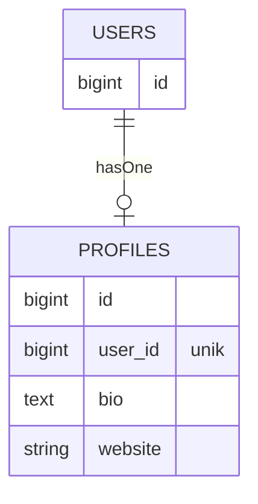
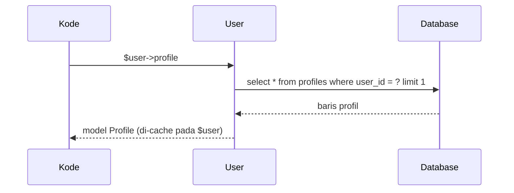

# Relasi Satu-ke-Satu

Relasi satu-ke-satu menghubungkan satu baris di tabel A dengan **paling banyak** satu baris di tabel B. Contoh klasik: seorang pengguna memiliki satu profil (biodata, situs web,
foto). Memisahkan data profil dari tabel `users` menjaga tabel inti tetap ramping dan memudahkan pengelolaan. Sub bab ini membuat relasi `User` → `Profile` dengan Eloquent.

## Tujuan Pembelajaran

Setelah menyelesaikan sub bab ini, kamu dapat:

- [ ] Merancang relasi satu-ke-satu dengan kunci asing yang unik.
- [ ] Mendefinisikan `hasOne` dan kebalikannya `belongsTo`.
- [ ] Mengakses data relasi sebagai properti dinamis (`$user->profile`).
- [ ] Membuat dan memperbarui data relasi lewat `$user->profile()->create()` dan `updateOrCreate`.
- [ ] Memakai `withDefault` untuk menghindari galat pada relasi kosong.
- [ ] Menjelaskan perbedaan memanggil `$user->profile` dan `$user->profile()`.

## Prasyarat

- [Kunci Utama dan Kunci Asing](04-17-primary-keys-and-foreign-keys.md).
- Model `User` dan `Article`; [Membuat Model](04-13-creating-models.md).
- [Class dan Objek](../level-00/00-19-classes-and-objects.md) pada PHP, termasuk *return type*.

## Pengantar

Tabel `users` menyimpan data akun (nama, email, kata sandi). Informasi tambahan seperti biografi dan situs web hanya relevan bagi sebagian pengguna dan jarang dibaca saat login.
Memindahkannya ke tabel `profiles` yang menunjuk balik ke `users` membuat tabel `users` tetap kecil.

## Penjelasan Konsep

### Skema



Kunci asing berada di tabel **anak** (`profiles.user_id`). Agar benar-benar satu-ke-satu, `user_id` diberi indeks **unik** sehingga satu pengguna tak punya dua profil.

### Migration

```bash
php artisan make:model Profile -mf
```

File: `database/migrations/xxxx_create_profiles_table.php`

```php-inline
Schema::create('profiles', function (Blueprint $table) {
    $table->id();
    $table->foreignId('user_id')->unique()->constrained()->cascadeOnDelete();
    $table->text('bio')->nullable();
    $table->string('website')->nullable();
    $table->timestamps();
});
```

| Baris | Arti |
|---|---|
| `foreignId('user_id')->unique()` | Satu pengguna paling banyak satu profil |
| `->constrained()->cascadeOnDelete()` | Profil ikut terhapus bila pengguna dihapus |

### Model

File: `app/Models/Profile.php`

```php
<?php

namespace App\Models;

use Illuminate\Database\Eloquent\Attributes\Fillable;
use Illuminate\Database\Eloquent\Factories\HasFactory;
use Illuminate\Database\Eloquent\Model;
use Illuminate\Database\Eloquent\Relations\BelongsTo;

#[Fillable(['bio', 'website'])]
class Profile extends Model
{
    use HasFactory;

    public function user(): BelongsTo
    {
        return $this->belongsTo(User::class);
    }
}
```

File: `app/Models/User.php` (tambahkan method relasi)

```php-inline
use Illuminate\Database\Eloquent\Relations\HasOne;

public function profile(): HasOne
{
    return $this->hasOne(Profile::class);
}
```

| Relasi | Letak | Arti |
|---|---|---|
| `User::profile()` → `hasOne` | Model induk | "Pengguna ini punya satu profil" |
| `Profile::user()` → `belongsTo` | Model anak | "Profil ini milik satu pengguna" |

`user_id` tidak dimasukkan ke `#[Fillable]` karena diisi lewat relasi, bukan dari input pengguna. Eloquent menebak kunci asing `user_id` dari nama model induk. Jika berbeda,
berikan argumen: `hasOne(Profile::class, 'owner_id', 'id')`.

### Properti dinamis vs method relasi

| Pemanggilan | Hasil |
|---|---|
| `$user->profile` | **Model** `Profile` (atau `null`); menjalankan query bila belum dimuat |
| `$user->profile()` | **Objek relasi** (builder) yang bisa diberi syarat atau dipakai membuat data |

```php-inline
$user->profile->bio;                         // membaca
$user->profile()->where('website', 'like', '%.id')->first();   // query pada relasi
$user->profile()->create(['bio' => 'Halo']); // membuat profil untuk pengguna ini
```

### Membuat dan memperbarui

```php-inline
$user->profile()->create(['bio' => 'Penulis teknologi', 'website' => 'https://contoh.test']);
$user->profile()->updateOrCreate([], ['bio' => 'Bio baru']);   // buat bila belum ada, ubah bila ada
```

`$user->profile()->create(...)` mengisi `user_id` otomatis. Pada sisi anak:

```php-inline
$profile->user->name;     // pengguna pemilik profil
```

### Relasi kosong dan `withDefault`

Bila pengguna belum punya profil, `$user->profile` bernilai `null`, sehingga `$user->profile->bio` melempar galat. Gunakan nilai bawaan:

```php-inline
public function profile(): HasOne
{
    return $this->hasOne(Profile::class)->withDefault(['bio' => 'Belum ada bio']);
}
```

Dengan `withDefault`, `$user->profile` selalu mengembalikan model (kosong, belum disimpan), jadi `$user->profile->bio` aman.

### Eager loading (pratinjau)

Mengambil profil untuk banyak pengguna satu per satu menimbulkan banyak query. `User::with('profile')->get()` memuat semuanya sekaligus (sub bab 04.23).

### Keamanan

- Jangan membuka `user_id` ke mass assignment; kaitkan profil lewat relasi (`$user->profile()->create`) agar pengguna tak bisa membuat profil atas nama orang lain.
- Pastikan otorisasi: hanya pemilik profil (atau admin) boleh mengubahnya (bab keamanan).

## Cara Kerja



Hasil relasi disimpan pada objek `$user`, sehingga pembacaan kedua `$user->profile` tidak menjalankan query lagi.

## Contoh Praktik

Kamu membuat tabel `profiles`, model `Profile`, mendefinisikan relasi di `User` dan `Profile`, lalu membuat dan membaca profil lewat Tinker dan menguji batas satu-ke-satu.

## Penjelasan Kode

Kode migration dan model ada pada bagian konsep. Pastikan `Profile` mengimpor `BelongsTo`, dan `User` mengimpor `HasOne`.

## Implementasi Langkah demi Langkah

### Langkah 1: buat model dan migration

```bash
cd ~/belajar-laravel/cms-artikel
php artisan make:model Profile -mf
```

### Langkah 2: isi migration, model, dan factory

Isi `up()` seperti di atas. Isi `ProfileFactory`:

```php-inline
public function definition(): array
{
    return [
        'user_id' => \App\Models\User::factory(),
        'bio' => fake()->paragraph(),
        'website' => fake()->url(),
    ];
}
```

Isi `Profile` dan tambahkan `profile()` pada `User`.

### Langkah 3: migrasi

```bash
php artisan migrate
php artisan db:table profiles
```

### Langkah 4: coba relasi

```bash
php artisan tinker
```

```php-inline
use App\Models\User;
use App\Models\Profile;

$user = User::factory()->create();
$user->profile;                                  // null
$user->profile()->create(['bio' => 'Penulis', 'website' => 'https://contoh.test']);
$user->refresh()->profile->bio;
Profile::first()->user->name;
```

### Langkah 5: uji batas satu-ke-satu

```php-inline
$user->profile()->create(['bio' => 'Profil kedua']);
```

Amati galat `UNIQUE constraint failed: profiles.user_id` karena `user_id` unik.

### Langkah 6: `updateOrCreate` dan `withDefault`

```php-inline
$user->profile()->updateOrCreate([], ['bio' => 'Bio diperbarui']);
User::factory()->create()->profile;   // null tanpa withDefault
```

Tambahkan `->withDefault(['bio' => 'Belum ada bio'])` pada `User::profile()`, mulai ulang Tinker, dan ulangi baris terakhir.

### Langkah 7: catat di Git

```bash
git add app database
git commit -m "Tambah relasi satu-ke-satu User dan Profile"
```

## Eksekusi dan Verifikasi

| Langkah | Cara memverifikasi |
|---|---|
| 3 | `db:table profiles` menampilkan `user_id` unik dan foreign key |
| 4 | `$user->profile` bernilai `null` sebelum dibuat; sesudahnya `Penulis` |
| 5 | Profil kedua untuk pengguna yang sama ditolak |
| 6 | `updateOrCreate` mengubah profil yang sudah ada; `withDefault` mengembalikan model berisi `Belum ada bio` |

## Hasil yang Diharapkan

| Perintah | Hasil |
|---|---|
| `$user->profile` (belum dibuat) | `null` |
| `$user->refresh()->profile->bio` | `Penulis` |
| `Profile::first()->user->name` | Nama pengguna pemilik |
| Profil kedua untuk pengguna sama | Galat unique constraint |

Hasil ini diturunkan dari dokumentasi dan belum dijalankan oleh penulis materi; cocokkan dengan hasilmu.

## Kesalahan Umum dan Pemecahan Masalah

| Gejala | Penyebab | Cara mengenali | Solusi | Pencegahan |
|---|---|---|---|---|
| `Attempt to read property "bio" on null` | Pengguna belum punya profil | Galat null | `withDefault`, `?->`, atau cek `isset` | Rancang untuk relasi kosong |
| `Call to undefined method User::profile()` | Method relasi belum ditambahkan | Galat method | Tambahkan `profile()` di `User` | Periksa model |
| `Class "App\Models\Profile" not found` | Tanpa `use` / namespace salah | Galat kelas | Perbaiki namespace | Gunakan `make:model` |
| `no such column: profiles.user_id` | Migration belum dijalankan | Galat kolom | `php artisan migrate` | Cek `migrate:status` |
| Data relasi lama setelah diubah | Relasi di-cache pada objek | Nilai lama | `refresh()` atau `load('profile')` | Muat ulang bila perlu |
| Dua profil untuk satu pengguna | Tanpa indeks unik | Dua baris | Tambah `->unique()` | Terapkan constraint di database |
| `Add [user_id] to fillable` | Mengisi `user_id` massal | Galat mass assignment | Buat lewat relasi | Jangan tambah `user_id` ke `Fillable` |

## Latihan Praktik

### Latihan dasar

**D1. Baca kedua arah**
- *Masalah:* ingin menavigasi relasi.
- *Persyaratan:* dari satu `User` baca bio profilnya; dari satu `Profile` baca nama pengguna.
- *Perilaku yang diharapkan:* kedua arah menghasilkan data yang cocok.
- *Tujuan belajar:* memahami `hasOne` dan `belongsTo`.

**D2. Properti vs method**
- *Masalah:* kebingungan `profile` vs `profile()`.
- *Persyaratan:* tunjukkan dengan contoh kapan masing-masing dipakai dan hasil `get_class` keduanya.
- *Perilaku yang diharapkan:* `Profile` (model) vs `HasOne` (relasi).
- *Tujuan belajar:* membedakan hasil.

### Latihan implementasi

**I1. Seeder pengguna dengan profil**
- *Masalah:* data contoh harus punya profil.
- *Persyaratan:* gunakan `User::factory()->has(Profile::factory())->count(5)->create()` di sebuah seeder dan verifikasi lima pasangan.
- *Perilaku yang diharapkan:* lima pengguna masing-masing dengan satu profil.
- *Tujuan belajar:* membuat data relasi dengan factory.

**I2. Pembaruan aman**
- *Masalah:* pengguna mengedit profilnya sendiri.
- *Persyaratan:* tulis fungsi yang menerima `User $user` dan array hasil validasi, lalu memakai `updateOrCreate([], $data)`; jelaskan mengapa `user_id` tidak boleh dari input.
- *Perilaku yang diharapkan:* satu profil per pengguna, tanpa `user_id` dari luar.
- *Tujuan belajar:* menulis kode relasi aman.

### Latihan tantangan

**T1. Satu-ke-satu terbalik**
- *Masalah:* pengguna memiliki satu "pengaturan" (`settings`).
- *Persyaratan:* rancang tabel, migration, model, dan relasi (`hasOne` + `belongsTo`) untuk `Setting`, termasuk nilai bawaan lewat `withDefault`; jelaskan di tabel mana kunci asing berada dan mengapa.
- *Perilaku yang diharapkan:* relasi bekerja dua arah.
- *Tujuan belajar:* merancang relasi sendiri.
- *Catatan:* kerjakan mandiri; tidak ada kunci jawaban.

## Uji Pemahaman

1. Di tabel mana kunci asing relasi `hasOne` berada?
2. Mengapa `user_id` diberi `unique()`?
3. Apa kebalikan `hasOne`?
4. Apa beda `$user->profile` dan `$user->profile()`?
5. Apa fungsi `withDefault`?
6. Mengapa `user_id` tidak masuk `Fillable`?
7. Apa yang terjadi pada profil bila pengguna dihapus (pada skema ini)?

??? success "Kunci jawaban singkat"
    1. Di tabel anak (`profiles`).
    2. Agar satu pengguna paling banyak punya satu profil.
    3. `belongsTo`.
    4. Yang pertama mengembalikan model hasil query; yang kedua objek relasi untuk query atau pembuatan data.
    5. Mengembalikan model bawaan (kosong) bila relasi tidak ada.
    6. Diisi lewat relasi agar tak bisa dipalsukan dari input.
    7. Profil ikut terhapus (`cascadeOnDelete`).

## Ringkasan

- Satu-ke-satu: kunci asing unik di tabel anak; `hasOne` di induk, `belongsTo` di anak.
- `$user->profile` membaca model; `$user->profile()` mengakses relasi untuk query/pembuatan.
- `create()` dan `updateOrCreate()` pada relasi mengisi kunci asing otomatis.
- `withDefault` menghindari galat pada relasi kosong.
- Jangan terima kunci asing dari input pengguna.

Selanjutnya: *Relasi Satu-ke-Banyak*, relasi paling umum antara kategori, artikel, dan komentar.

## Referensi Resmi

- [Laravel: One to One](https://laravel.com/docs/13.x/eloquent-relationships#one-to-one)
- [Laravel: Default Models](https://laravel.com/docs/13.x/eloquent-relationships#default-models)
- [Laravel: Inserting and Updating Related Models](https://laravel.com/docs/13.x/eloquent-relationships#inserting-and-updating-related-models)
