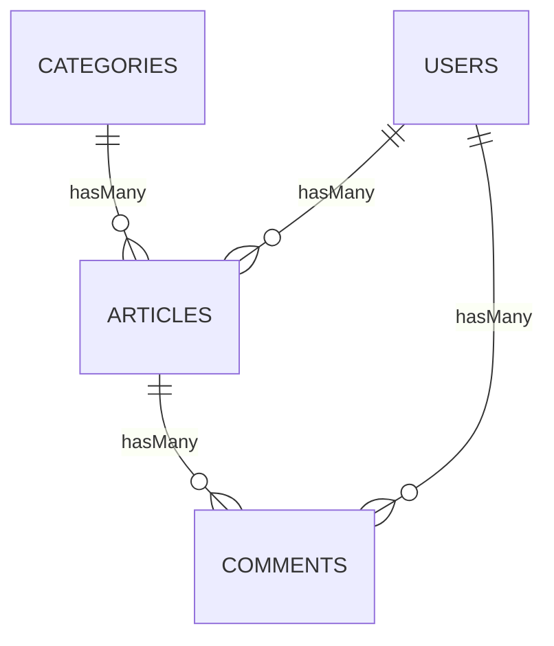
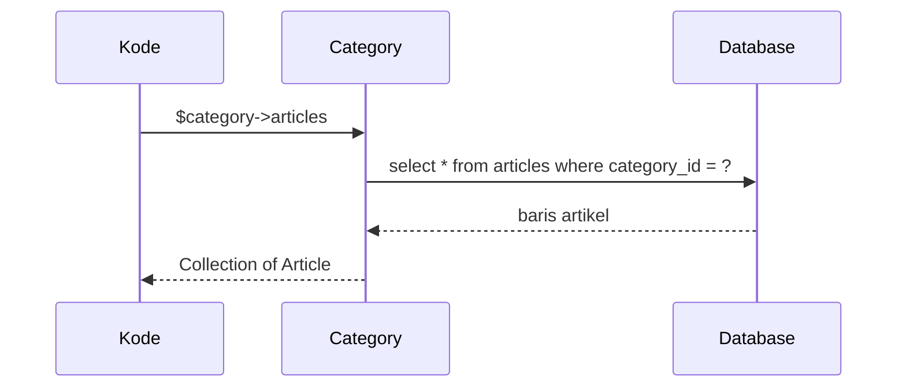

# Relasi Satu-ke-Banyak

Relasi **satu-ke-banyak** (*one to many*) adalah yang paling sering muncul: satu kategori memiliki banyak artikel, satu artikel memiliki banyak komentar, satu pengguna menulis banyak
artikel. Sub bab ini membangun relasi `Category` → `Article`, `User` → `Article`, dan `Article` → `Comment`, serta cara membuat, membaca, dan menyaring data lewat relasi.

## Tujuan Pembelajaran

Setelah menyelesaikan sub bab ini, kamu dapat:

- [ ] Mendefinisikan `hasMany` pada induk dan `belongsTo` pada anak.
- [ ] Membaca koleksi relasi (`$category->articles`) dan induk (`$article->category`).
- [ ] Membuat anak lewat relasi (`$category->articles()->create()`) dan mengaitkan lewat `associate`.
- [ ] Menyaring induk berdasarkan anak dengan `has`, `whereHas`, dan `withCount`.
- [ ] Menambahkan kunci asing pada factory dengan `recycle`, `for`, dan `has`.
- [ ] Membuat tabel `comments` dengan kunci asing ke `articles` dan `users`.

## Prasyarat

- [Relasi Satu-ke-Satu](04-18-one-to-one-relationships.md) dan [Kunci Utama dan Kunci Asing](04-17-primary-keys-and-foreign-keys.md).
- Tabel `articles` dengan `user_id` dan `category_id`; tabel `categories`; model `Article`, `Category`, `User`.
- [Query Eloquent](04-16-eloquent-queries.md).

## Pengantar

Halaman kategori "Teknologi" perlu daftar artikelnya. Halaman artikel perlu nama kategorinya, penulis, dan komentar. Semuanya adalah relasi satu-ke-banyak. Dengan Eloquent,
kamu cukup menulis `$category->articles` tanpa menyusun `JOIN` sendiri.

## Penjelasan Konsep

### Skema



Kunci asing berada di sisi **banyak**: `articles.category_id`, `articles.user_id`, `comments.article_id`, `comments.user_id`.

### Relasi di model

File: `app/Models/Category.php`

```php-inline
use Illuminate\Database\Eloquent\Relations\HasMany;

public function articles(): HasMany
{
    return $this->hasMany(Article::class);
}
```

File: `app/Models/Article.php`

```php-inline
use Illuminate\Database\Eloquent\Relations\BelongsTo;
use Illuminate\Database\Eloquent\Relations\HasMany;

public function category(): BelongsTo
{
    return $this->belongsTo(Category::class);
}

public function user(): BelongsTo
{
    return $this->belongsTo(User::class);
}

public function comments(): HasMany
{
    return $this->hasMany(Comment::class);
}
```

File: `app/Models/User.php` (tambahkan)

```php-inline
public function articles(): HasMany
{
    return $this->hasMany(Article::class);
}

public function comments(): HasMany
{
    return $this->hasMany(Comment::class);
}
```

Penjelasan: `hasMany(Article::class)` mencari kolom `category_id` di tabel `articles` (nama model induk + `_id`). Gunakan argumen tambahan bila nama kolom berbeda:
`hasMany(Article::class, 'foreign_key', 'local_key')`.

### Tabel dan model `Comment`

```bash
php artisan make:model Comment -mf
```

File: `database/migrations/xxxx_create_comments_table.php`

```php-inline
Schema::create('comments', function (Blueprint $table) {
    $table->id();
    $table->foreignId('article_id')->constrained()->cascadeOnDelete();
    $table->foreignId('user_id')->nullable()->constrained()->nullOnDelete();
    $table->text('body');
    $table->timestamps();
});
```

File: `app/Models/Comment.php`

```php-inline
#[Fillable(['body'])]
class Comment extends Model
{
    use HasFactory;

    public function article(): BelongsTo { return $this->belongsTo(Article::class); }
    public function user(): BelongsTo    { return $this->belongsTo(User::class); }
}
```

`article_id` dan `user_id` tidak masuk `Fillable`; keduanya diisi lewat relasi. Komentar dihapus bersama artikelnya (`cascade`), dan tetap ada walau penulisnya dihapus (`null`).

### Membaca relasi

```php-inline
$category->articles;                 // koleksi Article
$category->articles->count();
$category->articles()->published()->get();   // query pada relasi (memakai scope)
$article->category->name;            // induk
$article->user?->name;               // induk yang boleh null
$article->comments;
```

### Membuat lewat relasi

```php-inline
$category->articles()->create(['title' => 'X', 'slug' => 'x', 'body' => 'Y']);   // category_id otomatis
$article->comments()->create(['body' => 'Bagus!']);

// mengaitkan model yang sudah ada
$article->category()->associate($category);
$article->save();
$article->category()->dissociate();   // putus: category_id menjadi null
$article->save();
```

### Menyaring induk berdasarkan anak

| Kode | Arti |
|---|---|
| `Category::has('articles')->get()` | Kategori yang punya minimal satu artikel |
| `Category::has('articles', '>=', 3)->get()` | Minimal tiga artikel |
| `Category::doesntHave('articles')->get()` | Kategori tanpa artikel |
| `Category::whereHas('articles', fn ($q) => $q->where('is_published', true))->get()` | Punya artikel terbit |
| `Category::withCount('articles')->get()` | Setiap kategori memiliki `articles_count` |
| `Article::whereBelongsTo($category)->get()` | Artikel milik kategori itu |

`withCount` menambah atribut `articles_count` lewat satu query, tanpa memuat artikelnya.

### Factory dengan kunci asing

Perbarui `ArticleFactory::definition()` agar menghasilkan kunci asing:

```php-inline
use App\Models\Category;
use App\Models\User;

'user_id' => User::factory(),
'category_id' => Category::factory(),
```

Secara bawaan, tiap artikel akan membuat pengguna dan kategori baru. Untuk berbagi induk:

```php-inline
$category = Category::factory()->create();
$user = User::factory()->create();

Article::factory()->count(5)->for($category)->for($user)->create();       // satu induk untuk semua
Category::factory()->has(Article::factory()->count(3))->create();         // kategori + 3 artikel
Article::factory()->count(10)->recycle($user)->recycle($category)->create();   // pakai ulang induk yang ada
```

Factory `CommentFactory`:

```php-inline
'article_id' => Article::factory(),
'user_id' => User::factory(),
'body' => fake()->sentence(),
```

### Keamanan

- Jangan menerima `category_id` atau `user_id` dari input tanpa validasi (`exists:categories,id`) dan otorisasi.
- Untuk komentar, isi `user_id` dari pengguna yang sedang masuk, bukan dari form.
- `cascadeOnDelete` pada `comments.article_id` berarti menghapus artikel menghapus komentarnya; pertimbangkan *soft delete* (sub bab 04.27).

## Cara Kerja



## Contoh Praktik

Kamu menambah tabel `comments`, mendefinisikan relasi di empat model, memperbarui factory, lalu membuat data berelasi dan menyaringnya dengan `has`, `whereHas`, dan `withCount` di Tinker.

## Penjelasan Kode

Seluruh kode relasi ada pada bagian konsep. Perhatikan konsistensi: setiap `hasMany` punya pasangan `belongsTo` di model anak, dan kunci asing mengikuti konvensi `{model}_id`.

## Implementasi Langkah demi Langkah

### Langkah 1: buat tabel dan model `Comment`

```bash
cd ~/belajar-laravel/cms-artikel
php artisan make:model Comment -mf
```

Isi migration, `Comment`, dan `CommentFactory`.

### Langkah 2: tambahkan relasi ke model

Tambahkan method relasi pada `Category`, `Article`, `User` (impor `HasMany` dan `BelongsTo`). Perbarui `ArticleFactory`.

### Langkah 3: migrasi ulang

```bash
php artisan migrate:fresh
```

### Langkah 4: buat data berelasi

```bash
php artisan tinker
```

```php-inline
use App\Models\{Article, Category, Comment, User};

$user = User::factory()->create();
$tech = Category::factory()->create(['name' => 'Teknologi', 'slug' => 'teknologi']);
Category::factory()->create(['name' => 'Kosong', 'slug' => 'kosong']);

Article::factory()->count(4)->published()->for($tech)->for($user)->create();
$article = Article::first();
$article->comments()->create(['body' => 'Komentar pertama']);
Comment::factory()->count(2)->for($article)->create();
```

### Langkah 5: baca relasi

```php-inline
$tech->articles->pluck('title');
$article->category->name;
$article->user->name;
$article->comments->count();
```

### Langkah 6: saring dan hitung

```php-inline
Category::has('articles')->pluck('name');
Category::doesntHave('articles')->pluck('name');
Category::withCount('articles')->get()->pluck('articles_count', 'name');
Category::whereHas('articles', fn ($q) => $q->where('is_published', true))->count();
```

### Langkah 7: kaitkan dan putuskan

```php-inline
$kosong = Category::where('slug', 'kosong')->first();
$article->category()->associate($kosong)->save();
$kosong->articles()->count();
$article->category()->dissociate()->save();
$article->fresh()->category_id;
```

### Langkah 8: uji cascade

```php-inline
$article->delete();
Comment::count();   // komentar artikel itu ikut terhapus
```

### Langkah 9: catat di Git

```bash
git add app database
git commit -m "Tambah relasi satu-ke-banyak Category, Article, Comment, dan User"
```

## Eksekusi dan Verifikasi

| Langkah | Cara memverifikasi |
|---|---|
| 4 | `Article::count()` 4, `Comment::count()` 3 |
| 5 | `$tech->articles` memuat 4 judul; `$article->comments->count()` 3 |
| 6 | `has` memuat `Teknologi`; `doesntHave` memuat `Kosong`; `withCount` menampilkan 4 dan 0 |
| 7 | Setelah `associate`, `$kosong->articles()->count()` 1; setelah `dissociate`, `category_id` `null` |
| 8 | Komentar artikel yang dihapus ikut hilang |

## Hasil yang Diharapkan

| Perintah | Hasil |
|---|---|
| `Category::withCount('articles')->get()->pluck('articles_count','name')` | `Teknologi => 4`, `Kosong => 0` |
| `$article->category()->dissociate()->save()` lalu `fresh()->category_id` | `null` |
| `Comment::count()` setelah menghapus artikel berkomentar 3 | `0` |

Hasil ini diturunkan dari dokumentasi dan belum dijalankan oleh penulis materi; cocokkan dengan hasilmu.

## Kesalahan Umum dan Pemecahan Masalah

| Gejala | Penyebab | Cara mengenali | Solusi | Pencegahan |
|---|---|---|---|---|
| `Call to undefined relationship [articles] on model [Category]` | Method relasi belum ada | Galat relasi | Tambahkan `articles()` | Periksa nama method |
| `$category->articles` kosong padahal ada data | Kunci asing tak sesuai konvensi | Hasil kosong | Beri argumen kunci pada `hasMany` | Ikuti `{model}_id` |
| `Add [category_id] to fillable` | Mengisi kunci asing massal | Galat mass assignment | Buat lewat relasi (`->articles()->create`) | Jangan tambahkan kunci asing ke `Fillable` |
| `Integrity constraint violation` pada `comments` | `article_id` tidak ada | Galat constraint | Buat komentar lewat relasi artikel | Gunakan relasi untuk membuat anak |
| Hasil `orWhere` pada relasi tak sesuai | `orWhere` tanpa grup | Baris lintas induk | Bungkus dengan closure | Uji `toRawSql()` |
| Data tak terduga terhapus | `cascadeOnDelete` | Anak hilang | Gunakan `restrict` atau soft delete | Rancang aturan hapus |
| `articles_count` tidak ada | Lupa `withCount` | Atribut `null` | Tambahkan `withCount('articles')` | Muat hitungan sebelum membaca |

## Latihan Praktik

### Latihan dasar

**D1. Navigasi relasi**
- *Masalah:* ingin berpindah antar model lewat relasi.
- *Persyaratan:* dari satu `Comment`, baca judul artikelnya, nama kategori artikel, dan nama penulis komentar.
- *Perilaku yang diharapkan:* ketiganya tampil benar.
- *Tujuan belajar:* menelusuri rantai relasi.

**D2. Hitung dengan `withCount`**
- *Masalah:* ingin jumlah komentar per artikel.
- *Persyaratan:* gunakan `Article::withCount('comments')->get()` dan tampilkan judul dengan `comments_count`.
- *Perilaku yang diharapkan:* satu query menghasilkan semua hitungan.
- *Tujuan belajar:* memakai `withCount`.

### Latihan implementasi

**I1. Artikel terbit milik kategori**
- *Masalah:* halaman kategori butuh artikel terbit saja.
- *Persyaratan:* tambah method `publishedArticles()` di `Category` (`hasMany` + syarat terbit) atau gunakan `$category->articles()->published()`; jelaskan kelebihannya.
- *Perilaku yang diharapkan:* hanya artikel terbit.
- *Tujuan belajar:* menyaring relasi.

**I2. Pindahkan kategori**
- *Masalah:* sebuah artikel salah kategori.
- *Persyaratan:* pindahkan lewat `associate`, lalu lewat `update(['category_id' => ...])` (setelah sementara menambah ke `Fillable`) dan bahas mana yang lebih aman.
- *Perilaku yang diharapkan:* kedua cara berhasil; cara relasi lebih terkendali.
- *Tujuan belajar:* membandingkan cara mengubah relasi.

### Latihan tantangan

**T1. Kategori terpopuler**
- *Masalah:* beranda butuh tiga kategori dengan artikel terbit terbanyak.
- *Persyaratan:* gunakan `withCount(['articles as published_count' => fn ($q) => $q->published()])`, `orderByDesc('published_count')`, dan `limit(3)`; tampilkan SQL.
- *Perilaku yang diharapkan:* tiga kategori terurut menurun.
- *Tujuan belajar:* hitungan bersyarat pada relasi.
- *Catatan:* kerjakan mandiri; tidak ada kunci jawaban.

## Uji Pemahaman

1. Di tabel mana kunci asing relasi satu-ke-banyak berada?
2. Apa pasangan `hasMany`?
3. Apa beda `$category->articles` dan `$category->articles()`?
4. Apa fungsi `withCount`?
5. Apa beda `has` dan `whereHas`?
6. Bagaimana membuat artikel milik kategori tanpa menulis `category_id`?
7. Apa risiko `cascadeOnDelete` pada komentar?

??? success "Kunci jawaban singkat"
    1. Di sisi "banyak" (tabel anak).
    2. `belongsTo` di model anak.
    3. Yang pertama koleksi hasil; yang kedua objek relasi untuk query tambahan atau pembuatan.
    4. Menambah atribut `{relasi}_count` lewat satu query.
    5. `has` memeriksa keberadaan anak; `whereHas` menambah syarat pada anak.
    6. `$category->articles()->create([...])`.
    7. Menghapus artikel menghapus semua komentarnya, tidak dapat dipulihkan.

## Ringkasan

- Satu-ke-banyak: `hasMany` di induk, `belongsTo` di anak; kunci asing di sisi banyak.
- Baca lewat properti (`$category->articles`), buat lewat method relasi (`->articles()->create()`).
- `has`, `whereHas`, `withCount` menyaring dan menghitung berdasarkan anak.
- Factory memakai `for`, `has`, dan `recycle` untuk data berelasi.
- Jangan terima kunci asing dari input; kaitkan lewat relasi.

Selanjutnya: *Relasi Banyak-ke-Banyak*, menghubungkan artikel dengan tag.

## Referensi Resmi

- [Laravel: One to Many](https://laravel.com/docs/13.x/eloquent-relationships#one-to-many)
- [Laravel: One to Many (Inverse) / Belongs To](https://laravel.com/docs/13.x/eloquent-relationships#one-to-many-inverse)
- [Laravel: Querying Relationship Existence](https://laravel.com/docs/13.x/eloquent-relationships#querying-relationship-existence)
- [Laravel: Aggregating Related Models](https://laravel.com/docs/13.x/eloquent-relationships#aggregating-related-models)
- [Laravel: Factory Relationships](https://laravel.com/docs/13.x/eloquent-factories#factory-relationships)
