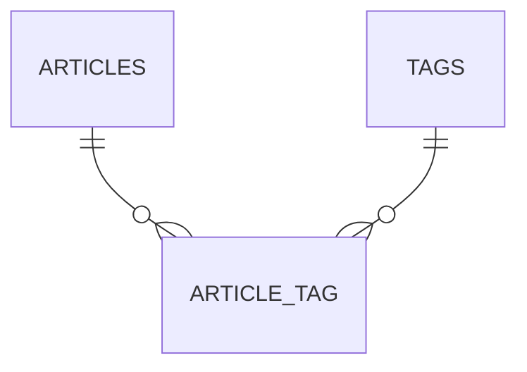
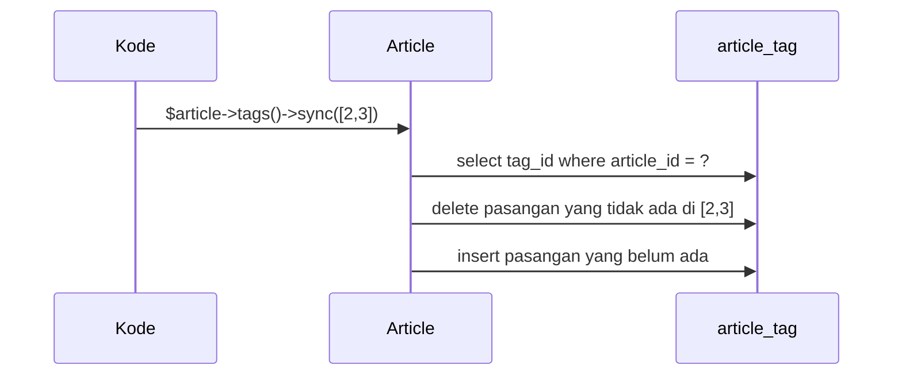

# Relasi Banyak-ke-Banyak

Sebuah artikel dapat memiliki banyak tag (`php`, `laravel`, `blade`), dan sebuah tag dipakai banyak artikel. Hubungan ini tidak bisa disimpan di satu kolom kunci asing; dibutuhkan
**tabel penghubung** (*pivot table*) yang mencatat pasangan artikel-tag. Sub bab ini membuat relasi `Article` ↔ `Tag` dan memakai method `attach`, `detach`, `sync`, dan `toggle`.

## Tujuan Pembelajaran

Setelah menyelesaikan sub bab ini, kamu dapat:

- [ ] Merancang tabel penghubung `article_tag` dengan dua kunci asing dan kunci komposit.
- [ ] Mendefinisikan `belongsToMany` pada kedua model.
- [ ] Menjelaskan konvensi nama tabel penghubung.
- [ ] Mengelola relasi dengan `attach`, `detach`, `sync`, `syncWithoutDetaching`, dan `toggle`.
- [ ] Menyimpan dan membaca kolom tambahan pada pivot (`withPivot`, `withTimestamps`).
- [ ] Menyaring artikel berdasarkan tag dengan `whereHas`.

## Prasyarat

- [Relasi Satu-ke-Banyak](04-19-one-to-many-relationships.md).
- Model `Article` dan factory-nya.
- [Array](../level-00/00-13-arrays.md) pada PHP.

## Pengantar

Jika `tags` disimpan sebagai teks `php,laravel,blade` di tabel `articles`, mencari semua artikel ber-tag `laravel` sulit dan lambat, dan mengganti nama tag berarti mengedit banyak baris.
Tabel penghubung menyelesaikannya: satu baris per pasangan.

## Penjelasan Konsep

### Skema



Tabel `article_tag` berisi `article_id` dan `tag_id`.

### Konvensi nama tabel penghubung

Laravel menamai tabel penghubung dari dua nama model dalam **urutan abjad**, huruf kecil, dipisah garis bawah, bentuk tunggal: `Article` dan `Tag` → `article_tag`.
Contoh dokumentasi: `role_user`. Jika nama berbeda, berikan sebagai argumen kedua `belongsToMany`.

### Migration

```bash
php artisan make:model Tag -mf
php artisan make:migration create_article_tag_table
```

File: `database/migrations/xxxx_create_tags_table.php` (isi `up()`)

```php-inline
Schema::create('tags', function (Blueprint $table) {
    $table->id();
    $table->string('name')->unique();
    $table->timestamps();
});
```

File: `database/migrations/xxxx_create_article_tag_table.php`

```php-inline
Schema::create('article_tag', function (Blueprint $table) {
    $table->foreignId('article_id')->constrained()->cascadeOnDelete();
    $table->foreignId('tag_id')->constrained()->cascadeOnDelete();
    $table->timestamps();
    $table->primary(['article_id', 'tag_id']);
});
```

| Bagian | Arti |
|---|---|
| Dua `foreignId` | Menunjuk artikel dan tag; ikut terhapus bila salah satunya dihapus |
| `primary(['article_id', 'tag_id'])` | Kunci komposit: pasangan yang sama tidak boleh ada dua kali |
| `timestamps()` | Mencatat waktu pasangan dibuat (dipakai bersama `withTimestamps()`) |

### Model

File: `app/Models/Tag.php`

```php-inline
use Illuminate\Database\Eloquent\Attributes\Fillable;
use Illuminate\Database\Eloquent\Relations\BelongsToMany;

#[Fillable(['name'])]
class Tag extends Model
{
    use HasFactory;

    public function articles(): BelongsToMany
    {
        return $this->belongsToMany(Article::class)->withTimestamps();
    }
}
```

File: `app/Models/Article.php` (tambahkan)

```php-inline
public function tags(): BelongsToMany
{
    return $this->belongsToMany(Tag::class)->withTimestamps();
}
```

`withTimestamps()` mengisi `created_at`/`updated_at` pivot; tanpa itu, kolom timestamp pivot tidak diisi.

### Membaca relasi

```php-inline
$article->tags;                      // Collection of Tag
$article->tags->pluck('name');
$tag->articles()->published()->get();
$article->tags[0]->pivot->created_at;   // data pivot
```

Setiap tag yang diambil lewat relasi memiliki atribut `pivot` berisi kolom tabel penghubung.

### Mengelola pasangan

| Method | Fungsi |
|---|---|
| `attach($id)` / `attach([1, 2])` | Menambah pasangan |
| `detach($id)` / `detach()` | Menghapus pasangan tertentu / semua |
| `sync([1, 2, 3])` | Membuat daftar tag **persis** seperti array: menambah yang kurang, menghapus yang lebih |
| `syncWithoutDetaching([4])` | Menambah yang belum ada tanpa menghapus yang lain |
| `toggle([1, 2])` | Membalik: yang ada dihapus, yang belum ada ditambah |

```php-inline
$article->tags()->attach([1, 2]);
$article->tags()->sync([2, 3]);       // 1 dihapus, 3 ditambah, 2 tetap
$article->tags()->detach(3);
$article->tags()->toggle([2, 5]);
```

`sync` ideal untuk form "pilih banyak tag": kirim ID yang dicentang dan hasilnya sama dengan pilihan pengguna.

### Kolom tambahan pada pivot

```php-inline
return $this->belongsToMany(Tag::class)->withPivot('added_by')->withTimestamps();
```

```php-inline
$article->tags()->attach(1, ['added_by' => 'admin']);
$article->tags->first()->pivot->added_by;
```

Tambahkan juga kolom `added_by` pada migration tabel penghubung.

### Menyaring berdasarkan tag

```php-inline
Article::whereHas('tags', fn ($q) => $q->where('name', 'laravel'))->get();
Article::whereRelation('tags', 'name', 'laravel')->get();
Article::has('tags', '>=', 2)->get();
Tag::withCount('articles')->orderByDesc('articles_count')->get();
```

### Factory

```php-inline
Article::factory()->hasAttached(Tag::factory()->count(3))->create();   // artikel dengan 3 tag baru
Article::factory()->hasAttached($tags)->count(5)->create();            // lima artikel berbagi tag yang sama
```

### Keamanan

- Validasi ID tag dari form dengan `exists:tags,id` sebelum `sync`; jangan percaya array ID mentah.
- Batasi siapa yang boleh mengubah tag artikel (otorisasi).
- `sync` menghapus pasangan yang tidak ada di array; array kosong menghapus semua tag artikel itu.

## Cara Kerja



## Contoh Praktik

Kamu membuat tabel `tags` dan `article_tag`, mendefinisikan `belongsToMany` di kedua model, lalu mengelola tag artikel dengan `attach`, `sync`, `toggle`, dan menyaring artikel berdasarkan tag.

## Penjelasan Kode

Kode migration dan model ada pada bagian konsep. Kunci komposit pada tabel penghubung adalah penjaga integritas: coba `attach` pasangan yang sama dua kali dan amati galatnya.

## Implementasi Langkah demi Langkah

### Langkah 1: buat model dan migration

```bash
cd ~/belajar-laravel/cms-artikel
php artisan make:model Tag -mf
php artisan make:migration create_article_tag_table
```

Isi migration `tags` dan `article_tag`, serta `Tag` dan relasi `tags()` pada `Article`. Isi `TagFactory`: `'name' => fake()->unique()->word()`.

### Langkah 2: migrasi

```bash
php artisan migrate:fresh
php artisan db:table article_tag
```

### Langkah 3: siapkan data

```bash
php artisan tinker
```

```php-inline
use App\Models\{Article, Tag};

$php = Tag::create(['name' => 'php']);
$laravel = Tag::create(['name' => 'laravel']);
$blade = Tag::create(['name' => 'blade']);
$a = Article::factory()->create();
$b = Article::factory()->create();
```

### Langkah 4: kelola pasangan

```php-inline
$a->tags()->attach([$php->id, $laravel->id]);
$a->tags->pluck('name');
$a->tags()->sync([$laravel->id, $blade->id]);
$a->fresh()->tags->pluck('name');
$a->tags()->toggle([$php->id, $blade->id]);
$a->fresh()->tags->pluck('name');
$a->tags()->detach();
$a->fresh()->tags->count();
```

### Langkah 5: uji pasangan ganda

```php-inline
$b->tags()->attach($php->id);
$b->tags()->attach($php->id);
```

Baca galat `UNIQUE constraint failed` pada kunci komposit. Lalu coba `syncWithoutDetaching([$php->id])`: tidak ada galat karena tidak membuat pasangan ganda.

### Langkah 6: saring

```php-inline
$b->tags()->sync([$php->id, $laravel->id]);
Article::whereHas('tags', fn ($q) => $q->where('name', 'laravel'))->pluck('id');
Tag::withCount('articles')->get()->pluck('articles_count', 'name');
```

### Langkah 7: catat di Git

```bash
git add app database
git commit -m "Tambah relasi banyak-ke-banyak Article dan Tag"
```

## Eksekusi dan Verifikasi

| Langkah | Cara memverifikasi |
|---|---|
| 2 | `db:table article_tag` menampilkan kunci primer komposit dan dua foreign key |
| 4 | `attach` → `php, laravel`; `sync` → `laravel, blade`; `toggle` → `php, laravel`; `detach()` → 0 |
| 5 | `attach` ganda ditolak; `syncWithoutDetaching` aman |
| 6 | Saringan menghasilkan ID artikel yang ber-tag `laravel`; hitungan per tag benar |

## Hasil yang Diharapkan

| Perintah | Hasil |
|---|---|
| Setelah `attach([php, laravel])` | `["php","laravel"]` |
| Setelah `sync([laravel, blade])` | `["laravel","blade"]` |
| Setelah `toggle([php, blade])` | `["laravel","php"]` (blade dihapus, php ditambah) |

Urutan elemen koleksi dapat berbeda. Hasil ini diturunkan dari dokumentasi dan belum dijalankan oleh penulis materi; cocokkan dengan hasilmu.

## Kesalahan Umum dan Pemecahan Masalah

| Gejala | Penyebab | Cara mengenali | Solusi | Pencegahan |
|---|---|---|---|---|
| `no such table: tag_article` | Nama tabel penghubung salah urutan | Galat tabel | Gunakan abjad: `article_tag` atau beri argumen kedua | Ikuti konvensi |
| `UNIQUE constraint failed` saat `attach` | Pasangan sudah ada | Galat constraint | Gunakan `syncWithoutDetaching` | Pilih method sesuai maksud |
| Tag hilang tak terduga | `sync` dengan array yang tidak lengkap | Pasangan lama terhapus | Gunakan `syncWithoutDetaching` atau kirim daftar lengkap | Pahami semantik `sync` |
| `created_at` pivot kosong | Lupa `withTimestamps()` | Kolom `NULL` | Tambahkan `withTimestamps()` | Konsisten di kedua sisi |
| `$article->tags` kosong setelah `attach` | Relasi di-cache sebelumnya | Hasil lama | `$article->load('tags')` atau `fresh()` | Muat ulang relasi |
| Galat kunci asing saat `attach` | ID tag tidak ada | Galat constraint | Validasi ID | `exists:tags,id` |
| Kolom pivot tak terbaca | Tidak ada `withPivot` | `pivot->kolom` null | Tambahkan `withPivot('kolom')` | Daftarkan kolom pivot |

## Latihan Praktik

### Latihan dasar

**D1. Tag artikel**
- *Masalah:* beri tag pada satu artikel.
- *Persyaratan:* buat tiga tag, pasangkan dua ke satu artikel dengan `attach`, dan baca namanya.
- *Perilaku yang diharapkan:* dua nama tampil.
- *Tujuan belajar:* memakai `attach`.

**D2. Perbedaan `sync`**
- *Masalah:* ingin memahami `sync`.
- *Persyaratan:* mulai dengan tag `[1, 2]`, lalu `sync([2, 3])`; tulis tag yang tersisa dan jelaskan mengapa.
- *Perilaku yang diharapkan:* tersisa `[2, 3]`.
- *Tujuan belajar:* memahami semantik `sync`.

### Latihan implementasi

**I1. Artikel populer per tag**
- *Masalah:* beranda menampilkan tag terpopuler.
- *Persyaratan:* tampilkan lima tag dengan artikel terbit terbanyak memakai `withCount(['articles as published_count' => fn ($q) => $q->published()])`.
- *Perilaku yang diharapkan:* lima tag terurut menurun.
- *Tujuan belajar:* hitungan bersyarat.

**I2. Pivot berinformasi**
- *Masalah:* ingin mencatat siapa yang menambah tag.
- *Persyaratan:* tambah kolom `added_by` pada `article_tag` (migration baru), `withPivot('added_by')`, dan `attach` dengan nilai itu; baca kembali.
- *Perilaku yang diharapkan:* `pivot->added_by` terbaca.
- *Tujuan belajar:* memakai kolom pivot.

### Latihan tantangan

**T1. Form tag multi-pilih**
- *Masalah:* form admin mengirim `tags[]` berisi ID.
- *Persyaratan:* tulis fungsi `perbaruiTag(Article $a, array $ids)` yang memvalidasi ID dengan `Tag::whereIn('id', $ids)->pluck('id')` lalu `sync`; jelaskan apa yang terjadi bila `$ids` kosong dan bagaimana mencegah penghapusan tak sengaja.
- *Perilaku yang diharapkan:* hanya ID yang ada yang dipakai.
- *Tujuan belajar:* menggunakan `sync` dengan aman.
- *Catatan:* kerjakan mandiri; tidak ada kunci jawaban.

## Uji Pemahaman

1. Mengapa banyak-ke-banyak memerlukan tabel penghubung?
2. Apa nama tabel penghubung untuk `Article` dan `Tag`?
3. Apa beda `attach` dan `sync`?
4. Apa fungsi `syncWithoutDetaching`?
5. Apa fungsi `withTimestamps()`?
6. Bagaimana mengakses kolom pivot?
7. Mengapa kunci komposit berguna pada tabel penghubung?

??? success "Kunci jawaban singkat"
    1. Satu kolom kunci asing tidak dapat menampung banyak rujukan; pasangan disimpan sebagai baris.
    2. `article_tag` (abjad, tunggal).
    3. `attach` hanya menambah; `sync` membuat daftar persis sama dengan array.
    4. Menambah pasangan yang belum ada tanpa menghapus yang lain.
    5. Mengisi `created_at`/`updated_at` pada tabel penghubung.
    6. Lewat atribut `pivot` (setelah `withPivot` untuk kolom tambahan).
    7. Mencegah pasangan yang sama tercatat dua kali.

## Ringkasan

- Banyak-ke-banyak memakai tabel penghubung berisi dua kunci asing dan kunci komposit.
- `belongsToMany` di kedua model; nama tabel default adalah abjad tunggal (`article_tag`).
- `attach`, `detach`, `sync`, `syncWithoutDetaching`, dan `toggle` mengelola pasangan.
- `withPivot` dan `withTimestamps` menangani kolom tambahan.
- Validasi ID dan hati-hati dengan `sync`.

Selanjutnya: *Has One Through dan Has Many Through*, mengakses data melalui perantara.

## Referensi Resmi

- [Laravel: Many to Many](https://laravel.com/docs/13.x/eloquent-relationships#many-to-many)
- [Laravel: Retrieving Intermediate Table Columns](https://laravel.com/docs/13.x/eloquent-relationships#retrieving-intermediate-table-columns)
- [Laravel: Inserting and Updating Related Models, Many to Many](https://laravel.com/docs/13.x/eloquent-relationships#updating-many-to-many-relationships)
- [Laravel: Factory Relationships, Many to Many](https://laravel.com/docs/13.x/eloquent-factories#many-to-many-relationships)
