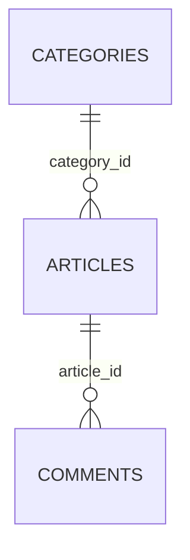

# Has One Through dan Has Many Through

Kadang data yang kamu inginkan tidak terhubung langsung, melainkan lewat **perantara**. Contoh: `Category` punya banyak `Article`, dan `Article` punya banyak `Comment`.
Bagaimana mengambil **semua komentar pada suatu kategori** tanpa memuat artikelnya satu per satu? Relasi *through* menjawabnya: `hasManyThrough` dan `hasOneThrough`
melompati tabel perantara dalam satu relasi.

## Tujuan Pembelajaran

Setelah menyelesaikan sub bab ini, kamu dapat:

- [ ] Menjelaskan kapan relasi *through* diperlukan dan struktur tiga tabelnya.
- [ ] Mendefinisikan `hasManyThrough` dari `Category` ke `Comment` lewat `Article`.
- [ ] Mendefinisikan `hasOneThrough` untuk perantara yang menghasilkan satu data.
- [ ] Menyebutkan konvensi kunci asing yang dipakai dan cara mengubahnya.
- [ ] Membaca hasil seperti relasi biasa, termasuk `count`, `where`, dan `withCount`.
- [ ] Menjelaskan kapan memakai `through()` yang fasih sebagai alternatif.

## Prasyarat

- [Relasi Satu-ke-Banyak](04-19-one-to-many-relationships.md).
- Model `Category`, `Article`, `Comment` dengan relasi `hasMany`/`belongsTo`.
- Data contoh: kategori dengan artikel yang berkomentar.

## Pengantar

Halaman statistik kategori ingin menampilkan jumlah dan isi komentar terbaru dari seluruh artikel di kategori itu. Tanpa relasi *through*, kamu menulis perulangan:
untuk setiap artikel, ambil komentarnya, gabungkan. Itu lambat dan panjang.

## Penjelasan Konsep

### Struktur tiga tabel



`categories` (A) → `articles` (perantara, B) → `comments` (tujuan, C). Relasi *through* menghubungkan A langsung ke C.

### `hasManyThrough`

File: `app/Models/Category.php` (tambahkan)

```php
use Illuminate\Database\Eloquent\Relations\HasManyThrough;

public function comments(): HasManyThrough
{
    return $this->hasManyThrough(Comment::class, Article::class);
}
```

| Argumen | Peran |
|---|---|
| Argumen pertama: `Comment::class` | Model **tujuan** (yang ingin diambil) |
| Argumen kedua: `Article::class` | Model **perantara** |

Konvensi kunci (diturunkan Eloquent):

- `articles.category_id` → menghubungkan kategori ke artikel,
- `comments.article_id` → menghubungkan artikel ke komentar.

Bila nama kolom berbeda, berikan kunci eksplisit sebagai argumen ketiga dan seterusnya (lihat dokumentasi `hasManyThrough`).

Pemakaian:

```php-inline
$category->comments;                       // semua komentar dari semua artikel kategori
$category->comments->count();
$category->comments()->latest()->limit(5)->get();
Category::withCount('comments')->get();    // jumlah komentar per kategori
```

### `hasOneThrough`

`hasOneThrough` serupa tetapi mengembalikan **satu** model. Contoh dari dokumentasi: `Mechanic` → `Car` → `Owner`, yaitu setiap mekanik menangani satu mobil dan setiap
mobil memiliki satu pemilik, sehingga pemilik mobil yang ditangani seorang mekanik dapat diambil langsung:

```php
use Illuminate\Database\Eloquent\Relations\HasOneThrough;

// Di model Mechanic
public function carOwner(): HasOneThrough
{
    return $this->hasOneThrough(Owner::class, Car::class);
}
```

Gunakan `hasOneThrough` hanya bila memang ada **satu** hasil per induk. Sistem artikel kita tidak memiliki rantai satu-ke-satu seperti itu, jadi relasi yang relevan
untuk proyek ini adalah `hasManyThrough`.

### Sintaks fasih `through()`

Dokumentasi 13.x memperlihatkan alternatif ketika relasi perantara sudah didefinisikan:

```php
// Category sudah punya articles(); Article sudah punya comments()
public function comments(): HasManyThrough
{
    return $this->through('articles')->has('comments');
}
```

Atau memakai method ajaib seperti `throughArticles()->hasComments()`. Hasilnya sama dengan `hasManyThrough`, tetapi memakai ulang definisi relasi yang ada.

### Batasan

- Relasi *through* bersifat **hanya baca** secara praktis: pembuatan data dilakukan lewat relasi biasa (`$article->comments()->create`).
- Query `hasManyThrough` memakai `JOIN` pada tabel perantara; pada data besar pastikan kunci asing terindeks (`foreignId()->constrained()` sudah melakukannya).
- Bila perantara memakai soft delete, query ikut memperhatikannya (sub bab 04.27).

### Keamanan

- Relasi *through* mengembalikan data lintas tabel; pastikan otorisasi atas kategori juga mencakup komentar yang ditampilkan.
- Jangan menampilkan komentar yang belum dimoderasi di halaman publik hanya karena relasi memudahkan pengambilannya.

## Cara Kerja


Satu query dengan `JOIN` menggantikan banyak query per artikel.

## Contoh Praktik

Kamu menambahkan `comments()` pada `Category` dengan `hasManyThrough`, membuat data dua kategori dengan artikel dan komentar, lalu membaca, menghitung, dan memeriksa SQL-nya.

## Penjelasan Kode

Kode relasi ada pada bagian konsep. Perhatikan bahwa nama relasi `comments` di `Category` berbeda dengan `comments` di `Article`; keduanya berada di model berbeda sehingga tidak bentrok.

## Implementasi Langkah demi Langkah

### Langkah 1: tambahkan relasi

Tambahkan `comments()` ke `Category` (impor `HasManyThrough`).

### Langkah 2: siapkan data

```bash
cd ~/belajar-laravel/cms-artikel
php artisan migrate:fresh
php artisan tinker
```

```php-inline
use App\Models\{Article, Category, Comment, User};

$tech = Category::factory()->create(['name' => 'Teknologi', 'slug' => 'teknologi']);
$sport = Category::factory()->create(['name' => 'Olahraga', 'slug' => 'olahraga']);
$user = User::factory()->create();

$a1 = Article::factory()->for($tech)->for($user)->create();
$a2 = Article::factory()->for($tech)->for($user)->create();
$a3 = Article::factory()->for($sport)->for($user)->create();

Comment::factory()->count(3)->for($a1)->create(['user_id' => $user->id]);
Comment::factory()->count(2)->for($a2)->create(['user_id' => $user->id]);
Comment::factory()->count(4)->for($a3)->create(['user_id' => $user->id]);
```

### Langkah 3: baca lewat perantara

```php-inline
$tech->comments->count();
$sport->comments->count();
$tech->comments()->toRawSql();
```

### Langkah 4: hitung dan urutkan

```php-inline
Category::withCount('comments')->get()->pluck('comments_count', 'name');
$tech->comments()->latest()->limit(2)->pluck('body');
```

### Langkah 5: bandingkan dengan cara manual

```php-inline
$tech->articles->flatMap->comments->count();
```

Bandingkan jumlah query kedua cara dengan `DB::enableQueryLog()` dan `DB::getQueryLog()`.

### Langkah 6: catat di Git

```bash
git add app/Models/Category.php
git commit -m "Tambah relasi hasManyThrough Category ke Comment"
```

## Eksekusi dan Verifikasi

| Langkah | Cara memverifikasi |
|---|---|
| 3 | `$tech->comments->count()` bernilai 5; `$sport->comments->count()` bernilai 4 |
| 3 | SQL memuat `inner join "articles"` |
| 4 | `withCount` menghasilkan `Teknologi => 5`, `Olahraga => 4` |
| 5 | Cara manual menghasilkan jumlah sama tetapi memakai lebih banyak query |

## Hasil yang Diharapkan

| Perintah | Hasil |
|---|---|
| `$tech->comments->count()` | `5` |
| `Category::withCount('comments')->get()->pluck('comments_count','name')` | `Teknologi => 5`, `Olahraga => 4` |
| `$tech->comments()->toRawSql()` | SQL dengan `inner join` ke `articles` dan `where articles.category_id = ...` |

Hasil ini diturunkan dari dokumentasi dan belum dijalankan oleh penulis materi; cocokkan dengan hasilmu.

## Kesalahan Umum dan Pemecahan Masalah

| Gejala | Penyebab | Cara mengenali | Solusi | Pencegahan |
|---|---|---|---|---|
| Koleksi kosong padahal ada komentar | Kunci asing tak sesuai konvensi | Hasil kosong | Beri kunci eksplisit di `hasManyThrough` | Ikuti `{model}_id` |
| Urutan argumen terbalik | Perantara dan tujuan tertukar | SQL aneh atau kosong | Argumen pertama tujuan, kedua perantara | Baca contoh dokumentasi |
| `Column not found: articles.category_id` | Kolom belum dimigrasi | Galat kolom | Jalankan migration kunci asing | Cek `db:table articles` |
| Hasil `hasOneThrough` tidak konsisten | Ada lebih dari satu kemungkinan hasil | Baris berbeda tiap kali | Gunakan `hasManyThrough` atau tambah pengurutan | Pastikan satu hasil |
| Query lambat | Kunci asing tanpa indeks | `EXPLAIN` memperlihatkan scan penuh | Gunakan `constrained()`/`index()` | Indeks pada kunci asing |
| Kolom ambigu `id` | Kolom bernama sama di tabel yang di-join | Galat ambigu | Awali dengan nama tabel: `comments.id` | Qualify nama kolom |
| Mencoba `create` lewat relasi through | Relasi hanya untuk membaca | Perilaku tak terduga | Buat lewat relasi langsung | Pakai `$article->comments()->create` |

## Latihan Praktik

### Latihan dasar

**D1. Komentar per kategori**
- *Masalah:* butuh semua komentar suatu kategori.
- *Persyaratan:* tampilkan isi lima komentar terbaru di kategori `Teknologi` memakai `$category->comments()`.
- *Perilaku yang diharapkan:* lima komentar dari artikel kategori itu.
- *Tujuan belajar:* memakai `hasManyThrough`.

**D2. Baca SQL**
- *Masalah:* ingin memahami query yang dibuat.
- *Persyaratan:* tampilkan `toRawSql()` dan jelaskan tiap bagian (`inner join`, `where`).
- *Perilaku yang diharapkan:* penjelasan sesuai SQL.
- *Tujuan belajar:* membaca SQL relasi through.

### Latihan implementasi

**I1. Komentar per pengguna lewat artikel**
- *Masalah:* ingin semua komentar pada artikel yang ditulis seorang pengguna.
- *Persyaratan:* tambah `commentsOnArticles()` di `User` dengan `hasManyThrough(Comment::class, Article::class)` (kunci asing `user_id` pada `articles`; kolom `articles.user_id` dan `comments.article_id`), lalu hitung.
- *Perilaku yang diharapkan:* jumlah komentar sesuai data.
- *Tujuan belajar:* menerapkan relasi through pada relasi lain.

**I2. Bandingkan jumlah query**
- *Masalah:* ingin membuktikan efisiensi.
- *Persyaratan:* ukur jumlah query untuk mengambil semua komentar kategori dengan `hasManyThrough` vs perulangan artikel, pakai `DB::getQueryLog()`.
- *Perilaku yang diharapkan:* satu query vs banyak.
- *Tujuan belajar:* membandingkan efisiensi.

### Latihan tantangan

**T1. Pilih alat yang tepat**
- *Masalah:* kebutuhan: "jumlah komentar per kategori" untuk dashboard.
- *Persyaratan:* bandingkan tiga cara (`withCount` pada through, `join` + `groupBy` dengan Query Builder, dan koleksi), lengkap dengan SQL dan alasan memilih salah satu.
- *Perilaku yang diharapkan:* rekomendasi berdasarkan keterbacaan dan kinerja.
- *Tujuan belajar:* memilih pendekatan query.
- *Catatan:* kerjakan mandiri; tidak ada kunci jawaban.

## Uji Pemahaman

1. Kapan relasi *through* berguna?
2. Apa urutan argumen `hasManyThrough`?
3. Apa beda `hasManyThrough` dan `hasOneThrough`?
4. Bagaimana mengubah kunci yang dipakai?
5. Apa yang dilakukan `through('articles')->has('comments')`?
6. Mengapa relasi through bukan tempat membuat data?
7. Mengapa indeks pada kunci asing penting di sini?

??? success "Kunci jawaban singkat"
    1. Saat data tujuan terhubung lewat model perantara.
    2. Model tujuan, lalu model perantara.
    3. `hasManyThrough` mengembalikan banyak model; `hasOneThrough` satu model.
    4. Dengan argumen kunci tambahan pada method relasi.
    5. Memakai ulang relasi `articles` dan `comments` yang sudah ada untuk membentuk relasi through.
    6. Pembuatan data memerlukan kunci perantara; gunakan relasi langsung.
    7. Query memakai `JOIN` sehingga indeks mempercepatnya.

## Ringkasan

- Relasi *through* menghubungkan dua model lewat perantara dalam satu relasi.
- `hasManyThrough(Tujuan::class, Perantara::class)` untuk banyak data; `hasOneThrough` untuk satu.
- Konvensi kunci asing dapat diubah dengan argumen tambahan; sintaks `through()` memakai ulang relasi yang ada.
- Satu query `JOIN` menggantikan perulangan banyak query.
- Gunakan relasi langsung untuk menulis data.

Selanjutnya: *Relasi Polimorfik*, satu model yang dapat menjadi milik beberapa jenis model.

## Referensi Resmi

- [Laravel: Has One Through](https://laravel.com/docs/13.x/eloquent-relationships#has-one-through)
- [Laravel: Has Many Through](https://laravel.com/docs/13.x/eloquent-relationships#has-many-through)
- [Laravel: Key Conventions](https://laravel.com/docs/13.x/eloquent-relationships#has-many-through-key-conventions)
