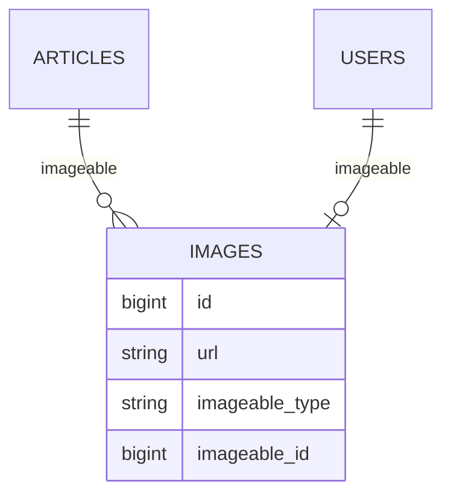
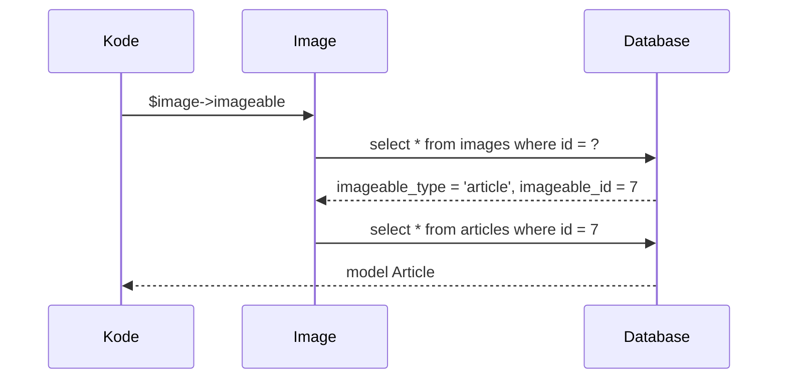

# Relasi Polimorfik

Bayangkan artikel dan pengguna sama-sama boleh punya **gambar**. Dengan relasi biasa, kamu perlu dua tabel (`article_images`, `user_images`) atau dua kolom kunci asing yang salah satunya
selalu kosong. **Relasi polimorfik** memungkinkan satu tabel (`images`) menjadi milik beberapa jenis model sekaligus, dengan menyimpan jenis dan ID pemiliknya. Sub bab ini membuat relasi
`Image` yang dapat dimiliki `Article` maupun `User`.

## Tujuan Pembelajaran

Setelah menyelesaikan sub bab ini, kamu dapat:

- [ ] Menjelaskan masalah yang diselesaikan relasi polimorfik dan kolom `*_type` serta `*_id`.
- [ ] Membuat tabel polimorfik dengan `morphs()`.
- [ ] Mendefinisikan `morphOne`, `morphMany`, dan `morphTo`.
- [ ] Membuat dan membaca data lewat relasi polimorfik.
- [ ] Menjelaskan `enforceMorphMap` dan mengapa alias lebih baik daripada nama kelas.
- [ ] Mengenali kapan `morphToMany` (banyak-ke-banyak polimorfik) dipakai.

## Prasyarat

- [Relasi Satu-ke-Banyak](04-19-one-to-many-relationships.md) dan [Relasi Satu-ke-Satu](04-18-one-to-one-relationships.md).
- Model `Article` dan `User` dengan data contoh.
- [Namespace dan Autoloading](../level-00/00-22-namespace-and-autoloading.md).

## Pengantar

Tanpa polimorfisme, tabel `images` hanya bisa menunjuk satu tabel induk lewat satu kunci asing. Dengan polimorfisme, `images` menyimpan dua kolom: `imageable_type` (jenis pemilik, mis. kelas
`Article`) dan `imageable_id` (ID pemilik). Kombinasi keduanya menunjuk baris mana pun di tabel mana pun.

## Penjelasan Konsep

### Skema



### Migration dengan `morphs()`

```bash
php artisan make:model Image -mf
```

```php-inline
Schema::create('images', function (Blueprint $table) {
    $table->id();
    $table->string('url');
    $table->morphs('imageable');   // imageable_type (string) + imageable_id (unsigned bigint) + indeks
    $table->timestamps();
});
```

`morphs('imageable')` membuat dua kolom dan indeks gabungan. Dokumentasi menunjukkan kolom ditulis manual (`imageable_id` dan `imageable_type`); helper `morphs()` melakukan hal yang sama.
Tidak ada constraint kunci asing karena kolom tidak menunjuk satu tabel saja, sehingga integritas dijaga aplikasi.

### Model

File: `app/Models/Image.php`

```php-inline
use Illuminate\Database\Eloquent\Relations\MorphTo;

#[Fillable(['url'])]
class Image extends Model
{
    use HasFactory;

    public function imageable(): MorphTo
    {
        return $this->morphTo();
    }
}
```

File: `app/Models/Article.php` (tambahkan)

```php-inline
use Illuminate\Database\Eloquent\Relations\MorphMany;

public function images(): MorphMany
{
    return $this->morphMany(Image::class, 'imageable');
}
```

File: `app/Models/User.php` (tambahkan)

```php-inline
use Illuminate\Database\Eloquent\Relations\MorphOne;

public function avatar(): MorphOne
{
    return $this->morphOne(Image::class, 'imageable');
}
```

| Relasi | Letak | Arti |
|---|---|---|
| `morphMany(Image::class, 'imageable')` | Model pemilik | Pemilik punya banyak gambar |
| `morphOne(Image::class, 'imageable')` | Model pemilik | Pemilik punya satu gambar |
| `morphTo()` | `Image` | Mengambil pemilik, apa pun jenisnya |

Argumen kedua (`'imageable'`) adalah awalan kolom `imageable_type` dan `imageable_id`.

### Memakai relasi

```php-inline
$article->images()->create(['url' => 'https://contoh.test/a.jpg']);
$article->images;                       // Collection of Image
$user->avatar()->create(['url' => 'https://contoh.test/u.jpg']);

$image->imageable;                      // Article atau User, sesuai imageable_type
$image->imageable_type;                 // nama kelas atau alias
```

### Morph map: alias menggantikan nama kelas

Secara bawaan `imageable_type` menyimpan **nama kelas lengkap** (`App\Models\Article`). Itu menjadikan nama kelas bagian dari data: mengganti namespace merusak data lama. Dokumentasi menyarankan
*morph map* dengan alias, dipasang di `AppServiceProvider::boot()`:

```php-inline
use Illuminate\Database\Eloquent\Relations\Relation;

public function boot(): void
{
    Relation::enforceMorphMap([
        'article' => \App\Models\Article::class,
        'user' => \App\Models\User::class,
    ]);
}
```

Setelah ini, `imageable_type` bernilai `article` atau `user`. `enforceMorphMap` juga melempar pengecualian bila ada model polimorfik yang belum terdaftar, sehingga kesalahan cepat ketahuan.
Pasang sebelum ada data polimorfik di database.

### Banyak-ke-banyak polimorfik

Dokumentasi menunjukkan `morphToMany`/`morphedByMany` untuk kasus seperti `taggables`: tag yang bisa dilekatkan ke artikel, video, dan lain-lain lewat satu tabel penghubung dengan kolom
`taggable_type` dan `taggable_id`. Sistem artikel kita memakai banyak-ke-banyak biasa untuk tag, jadi bentuk ini hanya dikenalkan.

### Kelebihan dan batas

| Kelebihan | Batas |
|---|---|
| Satu tabel untuk banyak pemilik | Tidak ada foreign key constraint di database |
| Menambah jenis pemilik baru tanpa migrasi | Query lintas jenis lebih rumit |
| Kode relasi seragam | Eager loading `morphTo` memerlukan perhatian |

### Keamanan

- Karena tidak ada constraint, hapus data polimorfik bersama pemiliknya (mis. di event `deleting` atau observer) agar tidak menyisakan baris yatim.
- Jangan mempercayai `imageable_type`/`imageable_id` dari input pengguna; kaitkan lewat relasi (`$article->images()->create(...)`).
- Morph map mencegah nama kelas internal bocor ke database atau API.

## Cara Kerja



## Contoh Praktik

Kamu membuat tabel `images`, model `Image`, relasi `images()` di `Article` dan `avatar()` di `User`, mendaftarkan morph map, lalu membuat dan membaca gambar dari kedua pemilik.

## Penjelasan Kode

Seluruh kode relasi dan morph map ada pada bagian konsep. Perhatikan bahwa `Image` tidak mengetahui jenis pemiliknya saat ditulis; `morphTo()` menentukan pemilik saat dijalankan.

## Implementasi Langkah demi Langkah

### Langkah 1: buat model dan migration

```bash
cd ~/belajar-laravel/cms-artikel
php artisan make:model Image -mf
```

Isi migration, `Image`, serta relasi di `Article` dan `User`. Isi `ImageFactory` dengan `'url' => fake()->imageUrl()` dan `imageable_id`/`imageable_type` yang diberikan lewat relasi.

### Langkah 2: daftarkan morph map

Tambahkan `Relation::enforceMorphMap([...])` ke `AppServiceProvider::boot()`.

### Langkah 3: migrasi ulang

```bash
php artisan migrate:fresh
php artisan db:table images
```

### Langkah 4: buat dan baca

```bash
php artisan tinker
```

```php-inline
use App\Models\{Article, User, Image};

$article = Article::factory()->create();
$user = User::factory()->create();

$article->images()->create(['url' => 'https://contoh.test/a1.jpg']);
$article->images()->create(['url' => 'https://contoh.test/a2.jpg']);
$user->avatar()->create(['url' => 'https://contoh.test/avatar.jpg']);

$article->images->pluck('url');
$user->avatar->url;
Image::all()->map(fn ($i) => [$i->imageable_type, $i->imageable_id]);
Image::first()->imageable;
Image::latest('id')->first()->imageable;
```

### Langkah 5: uji morph map

Ubah sementara `enforceMorphMap` agar hanya memuat `article`, mulai ulang Tinker, lalu ambil `$user->avatar()->create(...)`; amati pengecualian. Kembalikan setelah selesai.

### Langkah 6: catat di Git

```bash
git add app database
git commit -m "Tambah relasi polimorfik Image"
```

## Eksekusi dan Verifikasi

| Langkah | Cara memverifikasi |
|---|---|
| 3 | `db:table images` menampilkan `imageable_type`, `imageable_id` |
| 4 | `$article->images` berisi dua URL; `$user->avatar` satu URL |
| 4 | `imageable_type` bernilai `article` dan `user` |
| 4 | `Image::first()->imageable` mengembalikan `Article`; gambar terakhir mengembalikan `User` |
| 5 | Model yang tak terdaftar melempar pengecualian |

## Hasil yang Diharapkan

| Perintah | Hasil |
|---|---|
| `Image::all()->map(...)` | `[['article', id], ['article', id], ['user', id]]` |
| `Image::first()->imageable` | Objek `App\Models\Article` |
| `$user->avatar->url` | `https://contoh.test/avatar.jpg` |

Hasil ini diturunkan dari dokumentasi dan belum dijalankan oleh penulis materi; cocokkan dengan hasilmu.

## Kesalahan Umum dan Pemecahan Masalah

| Gejala | Penyebab | Cara mengenali | Solusi | Pencegahan |
|---|---|---|---|---|
| `Class "article" not found` | Nilai lama (nama kelas) di data tapi morph map aktif | Galat saat membaca `imageable` | Migrasikan data lama ke alias | Pasang morph map sebelum ada data |
| `No morph map defined for model [App\Models\X]` | Model belum didaftarkan di `enforceMorphMap` | Pengecualian | Tambahkan model ke peta | Daftarkan semua model polimorfik |
| `imageable` bernilai `null` | Pemilik sudah terhapus (yatim) | Gambar tanpa pemilik | Hapus gambar bersama pemilik | Bersihkan di observer |
| `Add [imageable_type] to fillable` | Mengisi kolom polimorfik massal | Galat mass assignment | Buat lewat relasi | Jangan masukkan ke `Fillable` |
| Nama kolom tak cocok | Argumen kedua `morphMany` salah | Hasil kosong | Samakan dengan awalan kolom | Pakai nama yang sama di semua tempat |
| Hasil lambat pada banyak gambar | Lazy loading `imageable` | Banyak query | Eager load dengan `morphTo` | Lihat sub bab eager loading |
| Mengubah namespace merusak data | `*_type` menyimpan nama kelas | Kelas tidak ditemukan | Gunakan morph map | Alias dari awal |

## Latihan Praktik

### Latihan dasar

**D1. Gambar dua pemilik**
- *Masalah:* ingin gambar untuk artikel dan pengguna.
- *Persyaratan:* buat satu gambar untuk artikel dan satu untuk pengguna, dan tampilkan pemilik tiap gambar lewat `imageable`.
- *Perilaku yang diharapkan:* pemilik sesuai jenisnya.
- *Tujuan belajar:* memakai `morphTo`.

**D2. Lihat kolom polimorfik**
- *Masalah:* ingin memahami data tersimpan.
- *Persyaratan:* tampilkan `imageable_type` dan `imageable_id` semua gambar, sebelum dan sesudah morph map.
- *Perilaku yang diharapkan:* nama kelas berubah menjadi alias.
- *Tujuan belajar:* memahami efek morph map.

### Latihan implementasi

**I1. Komentar polimorfik**
- *Masalah:* ingin komentar juga pada profil.
- *Persyaratan:* rancang (migration + relasi) `comments` polimorfik dengan `commentable_*` yang bisa dimiliki `Article` dan `Profile`, tanpa menghancurkan tabel `comments` yang ada (diskusikan strategi migrasi).
- *Perilaku yang diharapkan:* rancangan jelas dan aman bagi data lama.
- *Tujuan belajar:* mengevaluasi perubahan skema polimorfik.

**I2. Bersihkan gambar yatim**
- *Masalah:* gambar tersisa saat artikel dihapus.
- *Persyaratan:* tambahkan pembersihan (`booted` dengan `static::deleting`) pada `Article` untuk menghapus gambar artikel, dan buktikan.
- *Perilaku yang diharapkan:* tidak ada gambar yatim.
- *Tujuan belajar:* menjaga integritas manual.

### Latihan tantangan

**T1. Polimorfik atau dua tabel?**
- *Masalah:* tim menimbang desain.
- *Persyaratan:* bandingkan relasi polimorfik dengan dua tabel terpisah (`article_images`, `user_images`) dari sisi integritas, kemudahan query, dan perawatan; rekomendasikan satu.
- *Perilaku yang diharapkan:* rekomendasi seimbang dan beralasan.
- *Tujuan belajar:* menimbang desain.
- *Catatan:* kerjakan mandiri; tidak ada kunci jawaban.

## Uji Pemahaman

1. Masalah apa yang diselesaikan relasi polimorfik?
2. Dua kolom apa yang dibuat `morphs('imageable')`?
3. Apa beda `morphMany` dan `morphTo`?
4. Mengapa morph map lebih baik daripada nama kelas?
5. Mengapa tidak ada foreign key constraint pada relasi polimorfik?
6. Bagaimana mencegah data yatim?
7. Untuk apa `morphToMany`?

??? success "Kunci jawaban singkat"
    1. Satu tabel dapat dimiliki beberapa jenis model.
    2. `imageable_type` dan `imageable_id`.
    3. `morphMany` dipasang di pemilik untuk mengambil anak; `morphTo` dipasang di anak untuk mengambil pemilik.
    4. Alias stabil walau namespace berubah dan tidak membocorkan nama kelas.
    5. Kolom dapat menunjuk banyak tabel, sehingga database tidak dapat memeriksa satu tabel rujukan.
    6. Hapus anak bersama pemilik (event/observer) dan validasi di aplikasi.
    7. Hubungan banyak-ke-banyak yang dimiliki beberapa jenis model (mis. tag pada artikel dan video).

## Ringkasan

- Relasi polimorfik memungkinkan satu tabel dimiliki beberapa model lewat kolom `*_type` dan `*_id`.
- `morphs()` membuat kolom; `morphMany`/`morphOne` di pemilik, `morphTo` di anak.
- Daftarkan morph map dengan `Relation::enforceMorphMap` sejak awal.
- Tanpa constraint database, jaga integritas dengan kode (observer/event).
- Jangan terima kolom polimorfik dari input; kaitkan lewat relasi.

Selanjutnya: *Eager Loading*, memuat relasi tanpa membanjiri database dengan query.

## Referensi Resmi

- [Laravel: Polymorphic Relationships](https://laravel.com/docs/13.x/eloquent-relationships#polymorphic-relationships)
- [Laravel: Custom Polymorphic Types](https://laravel.com/docs/13.x/eloquent-relationships#custom-polymorphic-types)
- [Laravel: Migrations, morphs](https://laravel.com/docs/13.x/migrations#column-method-morphs)
