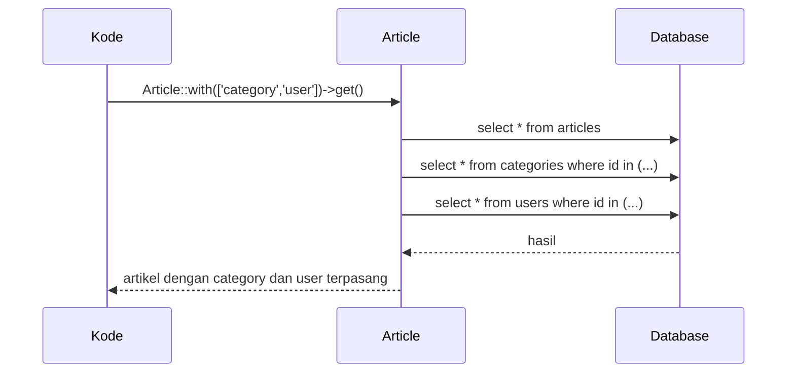

# Eager Loading

Membaca relasi lewat properti (`$article->category`) menjalankan query **saat pertama kali diakses** (*lazy loading*). Pada satu model itu tidak masalah, tetapi di dalam perulangan
bisa menimbulkan ratusan query. **Eager loading** memuat relasi sekaligus bersama model induk dengan jumlah query yang tetap. Sub bab ini mengajarkan `with()`, `load()`, `withCount()`,
dan variasinya; masalah yang dipecahkannya (N+1) dibahas rinci pada sub bab berikutnya.

## Tujuan Pembelajaran

Setelah menyelesaikan sub bab ini, kamu dapat:

- [ ] Membedakan lazy loading dan eager loading.
- [ ] Memuat relasi dengan `with()`, termasuk relasi bersarang dan banyak sekaligus.
- [ ] Memuat relasi setelah model diambil dengan `load()` dan `loadMissing()`.
- [ ] Membatasi kolom dan menambah syarat pada relasi yang dimuat.
- [ ] Memakai `withCount()` untuk menghitung relasi tanpa memuatnya.
- [ ] Membuktikan jumlah query dengan log query.

## Prasyarat

- Relasi pada [Satu-ke-Banyak](04-19-one-to-many-relationships.md) dan [Banyak-ke-Banyak](04-20-many-to-many-relationships.md).
- Data contoh: kategori, penulis, artikel, komentar, dan tag.
- [Query Eloquent](04-16-eloquent-queries.md).

## Pengantar

Halaman daftar artikel menampilkan judul, nama kategori, dan nama penulis untuk 20 artikel. Tanpa eager loading: 1 query untuk artikel + 20 untuk kategori + 20 untuk penulis = 41 query.
Dengan eager loading: 3 query, berapa pun jumlah artikelnya.

## Penjelasan Konsep

### Lazy vs eager

| Cara | Kode | Jumlah query untuk 20 artikel dan 2 relasi |
|---|---|---|
| Lazy | `Article::all()` lalu `$a->category`, `$a->user` di perulangan | 1 + 20 + 20 = 41 |
| Eager | `Article::with(['category', 'user'])->get()` | 3 |

Eager loading memuat relasi dengan satu query tambahan per relasi (`WHERE id IN (...)`), lalu menempelkannya ke model induk.

### `with()`

```php-inline
Article::with('category')->get();
Article::with(['category', 'user'])->get();
Article::with('comments.user')->get();            // bersarang: komentar, lalu penulis tiap komentar
Article::with(['category', 'comments.user'])->get();
```

Notasi titik memuat relasi di dalam relasi. Setelah itu `$article->category->name` tidak memicu query baru.

### Memilih kolom dan menambah syarat

```php-inline
Article::with('category:id,name')->get();   // hanya kolom id dan name dari kategori

Article::with(['comments' => function ($query) {
    $query->where('body', 'like', '%bagus%')->latest()->limit(3);
}])->get();
```

Pada pemilihan kolom, sertakan kunci yang dibutuhkan relasi (`id`, dan kunci asing bila memuat sisi `hasMany`). Perhatikan bahwa `limit()` di dalam eager load membatasi **total** baris
gabungan, bukan per induk; untuk "N komentar terbaru per artikel" butuh pendekatan lain.

### `load()` dan `loadMissing()`

Gunakan setelah model sudah diambil:

```php-inline
$articles = Article::all();
$articles->load('category');                 // pada koleksi
$article->load(['user', 'tags']);            // pada satu model
$article->loadMissing('comments');           // hanya jika belum dimuat
```

### `withCount()` dan agregat lain

Bila yang dibutuhkan hanya jumlah, jangan memuat seluruh relasi:

```php-inline
Article::withCount('comments')->get();                     // atribut comments_count
Article::withCount(['comments', 'tags'])->get();
Article::withCount(['comments as bagus_count' => fn ($q) => $q->where('body', 'like', '%bagus%')])->get();
Article::withSum('comments', 'id');                        // contoh agregat lain (withMin, withMax, withAvg)
```

### Mencegah lazy loading yang tak sengaja

Aktifkan pengecualian saat relasi di-lazy-load (cocok untuk pengembangan) di `AppServiceProvider::boot()`:

```php
use Illuminate\Database\Eloquent\Model;

public function boot(): void
{
    Model::preventLazyLoading(! $this->app->isProduction());
}
```

Dengan ini, memakai relasi yang belum dimuat dalam perulangan melempar `LazyLoadingViolationException`, sehingga kamu dipaksa memakai eager loading. Dokumentasi menyarankan hanya mengaktifkannya di non-produksi.

### Menghitung query

```php-inline
use Illuminate\Support\Facades\DB;

DB::enableQueryLog();
// ... jalankan kode ...
count(DB::getQueryLog());
DB::flushQueryLog();
```

### Memilih strategi

| Situasi | Pilihan |
|---|---|
| Menampilkan daftar dengan relasi | `with()` |
| Relasi dibutuhkan hanya pada sebagian kondisi | `load()` setelah pengecekan |
| Hanya butuh jumlah | `withCount()` |
| Relasi sangat besar tapi hanya sebagian dipakai | Batasi kolom atau gunakan query terpisah |

### Keamanan dan performa

- Eager loading yang berlebihan memuat data besar ke memori; muat hanya relasi dan kolom yang dipakai.
- Hati-hati agar relasi sensitif tidak ikut ter-serialisasi ke JSON; gunakan `#[Hidden]` atau resource khusus.
- `limit()` di callback eager load tidak berfungsi per induk; jangan mengandalkannya.

## Cara Kerja



## Contoh Praktik

Kamu membandingkan jumlah query lazy loading dan eager loading untuk daftar artikel, mencoba `with` bersarang, `load`, `withCount`, dan mengaktifkan `preventLazyLoading`.

## Penjelasan Kode

Perbandingan paling jelas ada pada hitungan query. Contoh pengukuran di Tinker:

```php-inline
DB::enableQueryLog();
$articles = Article::all();
foreach ($articles as $a) { $a->category?->name; $a->user?->name; }
$lazy = count(DB::getQueryLog());
DB::flushQueryLog();

$articles = Article::with(['category', 'user'])->get();
foreach ($articles as $a) { $a->category?->name; $a->user?->name; }
$eager = count(DB::getQueryLog());

[$lazy, $eager];
```

## Implementasi Langkah demi Langkah

### Langkah 1: siapkan data

```bash
cd ~/belajar-laravel/cms-artikel
php artisan migrate:fresh
php artisan tinker
```

```php-inline
use App\Models\{Article, Category, Comment, Tag, User};

$cats = Category::factory()->count(3)->create();
$users = User::factory()->count(3)->create();
Article::factory()->count(20)->recycle($cats)->recycle($users)->create();
Article::all()->each(fn ($a) => Comment::factory()->count(2)->for($a)->create(['user_id' => $users->random()->id]));
```

### Langkah 2: ukur lazy vs eager

Jalankan kode pengukuran pada Penjelasan Kode. Catat `[$lazy, $eager]`.

### Langkah 3: relasi bersarang

```php-inline
DB::flushQueryLog();
$articles = Article::with('comments.user')->get();
$articles->first()->comments->first()->user->name;
count(DB::getQueryLog());
```

### Langkah 4: `load` dan `loadMissing`

```php-inline
$articles = Article::all();
$articles->load('category');
$articles->first()->relationLoaded('category');
$articles->first()->loadMissing('category');
```

### Langkah 5: `withCount`

```php-inline
Article::withCount('comments')->get()->pluck('comments_count', 'id')->take(3);
```

### Langkah 6: batasi kolom

```php-inline
Article::with('category:id,name')->first()->category->toArray();
```

### Langkah 7: aktifkan pencegahan lazy loading

Tambahkan `Model::preventLazyLoading(! $this->app->isProduction());` ke `AppServiceProvider::boot()`, mulai ulang Tinker, lalu:

```php-inline
foreach (Article::all() as $a) { $a->category; }
```

Amati pengecualian `LazyLoadingViolationException`. Ulangi dengan `Article::with('category')->get()`: tidak ada galat.

### Langkah 8: catat di Git

```bash
git add app
git commit -m "Aktifkan pencegahan lazy loading di non-produksi"
```

## Eksekusi dan Verifikasi

| Langkah | Cara memverifikasi |
|---|---|
| 2 | `$lazy` sekitar 41 (1 + 20 + 20 bila semua punya kategori dan penulis); `$eager` bernilai 3 |
| 3 | Tiga atau empat query untuk `comments.user` (artikel, komentar, pengguna) |
| 4 | `relationLoaded('category')` bernilai `true` setelah `load` |
| 5 | Atribut `comments_count` bernilai 2 untuk tiap artikel |
| 7 | Lazy loading melempar pengecualian; eager loading tidak |

## Hasil yang Diharapkan

| Pengukuran | Hasil |
|---|---|
| Lazy loading 20 artikel, 2 relasi | Sekitar 41 query |
| Eager loading | 3 query |
| `with('comments.user')` | 3 query (artikel, komentar, pengguna) |

Angka pasti bergantung data (relasi `null` tidak menjalankan query). Hasil ini diturunkan dari dokumentasi dan belum dijalankan oleh penulis materi; cocokkan dengan hasilmu.

## Kesalahan Umum dan Pemecahan Masalah

| Gejala | Penyebab | Cara mengenali | Solusi | Pencegahan |
|---|---|---|---|---|
| Ratusan query pada halaman daftar | Lazy loading dalam perulangan | Log query besar | Gunakan `with()` | Aktifkan `preventLazyLoading` |
| `LazyLoadingViolationException` | Relasi dibaca tanpa dimuat | Pengecualian saat pengembangan | Tambahkan `with()` | Muat relasi yang akan dipakai |
| Relasi `null` padahal ada data | Kolom kunci tidak ikut dipilih (`category:name`) | Hasil kosong | Sertakan `id` pada pemilihan kolom | Selalu sertakan kunci |
| `limit` di eager load memberi hasil aneh | Berlaku total, bukan per induk | Sebagian induk kosong | Gunakan pendekatan lain (query terpisah) | Pahami keterbatasannya |
| Memori besar | Memuat relasi besar yang tak dipakai | Proses berat | Batasi relasi/kolom, pakai `withCount` | Muat seperlunya |
| `comments_count` tidak ada | Lupa `withCount` | Atribut `null` | Tambah `withCount('comments')` | Muat hitungan sebelum membaca |
| Data lama setelah relasi berubah | Relasi sudah dimuat | Nilai lama | `refresh()` / `load()` ulang | Muat ulang bila perlu |

## Latihan Praktik

### Latihan dasar

**D1. Ukur query**
- *Masalah:* ingin tahu jumlah query.
- *Persyaratan:* ukur jumlah query untuk menampilkan nama kategori 20 artikel dengan lazy dan eager loading.
- *Perilaku yang diharapkan:* 21 vs 2 (kategori saja).
- *Tujuan belajar:* membuktikan manfaat eager loading.

**D2. `withCount`**
- *Masalah:* butuh jumlah komentar tanpa memuat komentarnya.
- *Persyaratan:* tampilkan judul dan `comments_count` lima artikel teratas.
- *Perilaku yang diharapkan:* satu query.
- *Tujuan belajar:* memakai `withCount`.

### Latihan implementasi

**I1. Daftar artikel lengkap**
- *Masalah:* halaman daftar menampilkan judul, kategori, penulis, jumlah komentar, dan tag.
- *Persyaratan:* tulis satu query dengan `with(['category:id,name', 'user:id,name', 'tags:id,name'])` dan `withCount('comments')`; ukur jumlah query (maksimal 5).
- *Perilaku yang diharapkan:* jumlah query tetap, tidak bergantung jumlah artikel.
- *Tujuan belajar:* menyusun query halaman daftar yang efisien.

**I2. `load` bersyarat**
- *Masalah:* komentar hanya dimuat bila artikel terbit.
- *Persyaratan:* ambil artikel, lalu `load('comments')` hanya pada koleksi yang terbit (`$articles->where('is_published', true)->load('comments')`).
- *Perilaku yang diharapkan:* komentar hanya termuat untuk artikel terbit.
- *Tujuan belajar:* memuat relasi bersyarat.

### Latihan tantangan

**T1. Tiga komentar terbaru per artikel**
- *Masalah:* `limit(3)` di eager load tidak membatasi per artikel.
- *Persyaratan:* tunjukkan masalahnya dengan data, lalu rancang solusi (mis. mengambil komentar dalam satu query lalu memotong per artikel di PHP, atau relasi `latestOfMany`-sejenis/ subquery) dan bandingkan.
- *Perilaku yang diharapkan:* laporan menjelaskan masalah dan satu solusi yang berfungsi.
- *Tujuan belajar:* memahami batas eager loading.
- *Catatan:* kerjakan mandiri; tidak ada kunci jawaban.

## Uji Pemahaman

1. Apa beda lazy dan eager loading?
2. Bagaimana memuat relasi bersarang?
3. Apa beda `with()` dan `load()`?
4. Kapan memakai `withCount()`?
5. Apa fungsi `Model::preventLazyLoading()`?
6. Mengapa `with('category:id,name')` harus menyertakan `id`?
7. Mengapa `limit()` di dalam eager load tidak membatasi per induk?

??? success "Kunci jawaban singkat"
    1. Lazy memuat relasi saat diakses (satu query per akses); eager memuat sekaligus dengan jumlah query tetap.
    2. Dengan notasi titik: `with('comments.user')`.
    3. `with()` dipakai saat mengambil model; `load()` setelah model sudah ada.
    4. Saat hanya jumlah relasi yang dibutuhkan.
    5. Melempar pengecualian bila relasi di-lazy-load, agar kesalahan ketahuan di pengembangan.
    6. Kunci dibutuhkan untuk mencocokkan relasi dengan induknya.
    7. Eager load memakai satu query gabungan sehingga batas berlaku untuk seluruh hasil.

## Ringkasan

- Eager loading memuat relasi dengan jumlah query tetap, bukan satu per baris.
- `with()` saat query, `load()`/`loadMissing()` setelahnya, `withCount()` untuk hitungan.
- Batasi relasi dan kolom yang dimuat sesuai kebutuhan.
- `Model::preventLazyLoading()` membantu menangkap kekeliruan sejak pengembangan.
- Buktikan dengan log query, jangan menebak.

Selanjutnya: *Masalah N+1 Query*, mengenali dan memperbaiki masalah performa paling umum pada ORM.

## Referensi Resmi

- [Laravel: Eager Loading](https://laravel.com/docs/13.x/eloquent-relationships#eager-loading)
- [Laravel: Preventing Lazy Loading](https://laravel.com/docs/13.x/eloquent-relationships#preventing-lazy-loading)
- [Laravel: Aggregating Related Models](https://laravel.com/docs/13.x/eloquent-relationships#aggregating-related-models)
