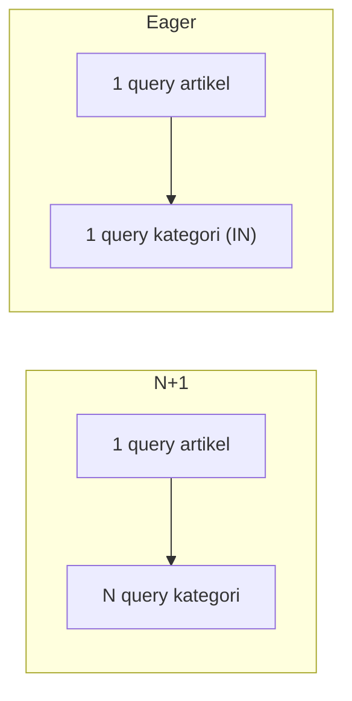

# Masalah N+1 Query

**N+1** adalah masalah performa paling umum pada aplikasi yang memakai ORM. Gejalanya: halaman yang tampak sederhana menjalankan puluhan atau ratusan query karena relasi dimuat satu per satu
di dalam perulangan. Sub bab ini menjelaskan mengapa N+1 terjadi, cara mendeteksinya (log query, `preventLazyLoading`, `DB::listen`), cara memperbaikinya, dan kapan perbaikan itu tidak cukup.

## Tujuan Pembelajaran

Setelah menyelesaikan sub bab ini, kamu dapat:

- [ ] Menjelaskan apa itu N+1 dan mengapa lazy loading di dalam perulangan menyebabkannya.
- [ ] Mendeteksi N+1 dengan menghitung query (`DB::enableQueryLog`) dan `Model::preventLazyLoading`.
- [ ] Memperbaiki N+1 dengan `with()`, `load()`, dan `withCount()`.
- [ ] Menemukan N+1 tersembunyi di view Blade dan di accessor.
- [ ] Menulis uji sederhana yang menjaga jumlah query.
- [ ] Menjelaskan batas eager loading dan alternatifnya (query terpisah, agregat).

## Prasyarat

- [Eager Loading](04-23-eager-loading.md).
- Data contoh: 20 artikel dengan kategori, penulis, komentar, dan tag.
- [Direktif Perulangan Blade](../level-03/03-05-loop-directives.md).

## Pengantar

Pengguna melaporkan halaman daftar artikel "kadang lambat". Di komputermu dengan 10 artikel semuanya cepat. Di produksi dengan 500 artikel per halaman, halaman menjalankan 1.001 query.
Masalahnya bukan di server, melainkan di cara kode memuat relasi.

## Penjelasan Konsep

### Mengapa disebut N+1

```php-inline
$articles = Article::all();            // 1 query: ambil N artikel
foreach ($articles as $article) {
    echo $article->category->name;     // N query: satu per artikel
}
```

Total **1 + N** query. Waktu bertambah linear mengikuti jumlah data, bukan konstan.

### Tersembunyi di view Blade

N+1 sering muncul bukan di controller, melainkan di Blade:

```html
@foreach ($articles as $article)
    <li>{{ $article->title }} — {{ $article->category->name }} ({{ $article->comments->count() }} komentar)</li>
@endforeach
```

Setiap `$article->category` dan `$article->comments` memicu query bila tidak dimuat di awal. Dua relasi → 2N query ekstra.

### Mendeteksi

| Cara | Kegunaan |
|---|---|
| `DB::enableQueryLog()` + `DB::getQueryLog()` | Menghitung query di Tinker/uji |
| `DB::listen(fn ($q) => ...)` | Mencatat setiap query (log, debugging) |
| `Model::preventLazyLoading()` | Melempar pengecualian saat lazy loading (pengembangan) |
| Alat debug (mis. Laravel Debugbar/Telescope) | Melihat jumlah query per request (paket tambahan, opsional) |

```php-inline
DB::enableQueryLog();
// jalankan kode
$jumlah = count(DB::getQueryLog());
DB::getQueryLog();   // lihat SQL tiap query
```

Pencegahan di pengembangan (`AppServiceProvider::boot()`):

```php-inline
Model::preventLazyLoading(! $this->app->isProduction());
```

### Memperbaiki

| Masalah | Perbaikan |
|---|---|
| `$article->category` di perulangan | `Article::with('category')` |
| `$article->comments->count()` di perulangan | `Article::withCount('comments')` lalu `$article->comments_count` |
| Relasi bersarang `comment->user` | `with('comments.user')` |
| Relasi bergantung kondisi | `load()` pada subset koleksi |

Versi perbaikan dari contoh Blade di atas:

```php-inline
$articles = Article::with('category')->withCount('comments')->get();
```

```html
@foreach ($articles as $article)
    <li>{{ $article->title }} — {{ $article->category->name }} ({{ $article->comments_count }} komentar)</li>
@endforeach
```

Jumlah query kini tetap (2 untuk relasi + 1 utama) berapa pun jumlah artikel.

### N+1 tersembunyi di accessor

Accessor atau method model yang mengakses relasi (`getAuthorNameAttribute()` yang memakai `$this->user->name`) memicu lazy loading di setiap pemanggilan. Pastikan relasi yang dibutuhkan
accessor ikut dimuat, atau gunakan data yang sudah dihitung.

### Ketika `with()` tidak cukup

- Memuat **terlalu banyak** relasi yang tak dipakai memboroskan memori: muat seperlunya.
- Relasi dengan jutaan baris sebaiknya tidak dimuat penuh; gunakan `withCount`, agregat, atau paginasi relasi.
- Untuk "N terbaru per induk" gunakan subquery atau query terpisah, bukan `limit` di eager load.

### Menjaga dengan uji

Uji sederhana yang membuktikan jumlah query tidak bertambah seiring data:

```php-inline
public function test_daftar_artikel_tidak_n_plus_satu(): void
{
    Article::factory()->count(20)->create();

    DB::enableQueryLog();
    $this->get('/artikel');
    $jumlah = count(DB::getQueryLog());

    $this->assertLessThanOrEqual(6, $jumlah);
}
```

Bab Testing membahas penulisan uji lebih lengkap; contoh ini hanya menunjukkan gagasannya.

### Keamanan dan keandalan

- N+1 dapat dimanfaatkan sebagai pemicu penolakan layanan ringan (banyak data → banyak query); batasi ukuran halaman (paginasi).
- Jangan mengaktifkan `preventLazyLoading` pengecualian di produksi tanpa pertimbangan; satu relasi terlewat menjadi error 500.

## Cara Kerja



## Contoh Praktik

Kamu membuat N+1 sengaja, mengukurnya, memperbaikinya dengan `with()` dan `withCount()`, lalu mengaktifkan `preventLazyLoading` untuk menangkapnya otomatis.

## Penjelasan Kode

Pengukuran memakai `DB::enableQueryLog()` seperti pada sub bab sebelumnya. Perbaikan utama: ganti `Article::all()` dengan `Article::with('category')->withCount('comments')->get()`.

## Implementasi Langkah demi Langkah

### Langkah 1: siapkan data

```bash
cd ~/belajar-laravel/cms-artikel
php artisan migrate:fresh
php artisan tinker
```

```php-inline
use App\Models\{Article, Category, Comment, User};
use Illuminate\Support\Facades\DB;

$cats = Category::factory()->count(5)->create();
$users = User::factory()->count(5)->create();
Article::factory()->count(30)->recycle($cats)->recycle($users)->create();
Article::all()->each(fn ($a) => Comment::factory()->count(3)->for($a)->create(['user_id' => $users->random()->id]));
```

### Langkah 2: ukur versi N+1

```php-inline
DB::enableQueryLog();
foreach (Article::all() as $a) { $a->category->name; $a->comments->count(); }
count(DB::getQueryLog());
DB::flushQueryLog();
```

### Langkah 3: perbaiki dan ukur ulang

```php-inline
foreach (Article::with('category')->withCount('comments')->get() as $a) { $a->category->name; $a->comments_count; }
count(DB::getQueryLog());
DB::flushQueryLog();
```

### Langkah 4: lihat SQL perbaikan

```php-inline
Article::with('category')->withCount('comments')->toRawSql();
```

Eager loading menjalankan satu query tambahan untuk kategori di luar `toRawSql()`; lihat `DB::getQueryLog()` setelah `get()` untuk daftar lengkapnya.

### Langkah 5: tangkap otomatis

Pastikan `Model::preventLazyLoading(...)` aktif di `AppServiceProvider` (sub bab 04.23), mulai ulang Tinker, lalu ulangi Langkah 2 dan amati pengecualian pada percobaan pertama.

### Langkah 6: N+1 di Blade (opsional, bila halaman daftar sudah ada)

Buka halaman daftar artikel, hitung query dengan `DB::listen` yang menulis ke log, lalu perbaiki dengan `with`/`withCount`. Hapus `DB::listen` setelah selesai.

### Langkah 7: catat di Git

```bash
git status
```

Tidak ada berkas baru yang perlu di-*commit* bila hanya memakai Tinker.

## Eksekusi dan Verifikasi

| Langkah | Cara memverifikasi |
|---|---|
| 2 | Hitungan sekitar 1 + 30 + 30 = 61 query |
| 3 | Hitungan 2 query (artikel beserta hitungan komentar, lalu kategori) |
| 5 | `LazyLoadingViolationException` pada percobaan N+1 |

## Hasil yang Diharapkan

| Versi | Jumlah query (30 artikel) |
|---|---|
| N+1 | Sekitar 61 |
| `with('category')->withCount('comments')` | 2 (satu utama yang menyertakan hitungan komentar, satu untuk kategori) |

`withCount` menambahkan subquery ke query utama, sehingga totalnya 2 query. Hasil ini diturunkan dari dokumentasi dan belum dijalankan oleh penulis materi; cocokkan dengan hasilmu.

## Kesalahan Umum dan Pemecahan Masalah

| Gejala | Penyebab | Cara mengenali | Solusi | Pencegahan |
|---|---|---|---|---|
| Halaman lambat saat data bertambah | N+1 di perulangan | Jumlah query naik linear | Eager loading | Aktifkan `preventLazyLoading` |
| Query tetap banyak setelah `with` | Relasi lain diakses di view | Log memperlihatkan relasi lain | Tambahkan relasi itu ke `with` | Periksa semua relasi yang dipakai view |
| `$article->comments->count()` memuat semua komentar | Memakai koleksi untuk hitungan | Query memuat banyak baris | Gunakan `withCount` | Hitung di database |
| Pengecualian di produksi | `preventLazyLoading` aktif tanpa syarat | Error 500 | Aktifkan hanya non-produksi | Gunakan `! isProduction()` |
| `with` tidak berpengaruh | Relasi dimuat sebelum atau nama salah | Query tetap banyak | Periksa nama relasi dan urutan | Uji dengan log query |
| Memori membengkak | Memuat relasi besar | Proses berat | Batasi kolom/relasi | Muat seperlunya |
| N+1 di accessor | Accessor memicu relasi | Query berulang tersembunyi | Muat relasi atau hitung di awal | Hindari relasi di accessor tanpa eager load |

## Latihan Praktik

### Latihan dasar

**D1. Temukan N+1**
- *Masalah:* kode berikut lambat: `foreach (Article::all() as $a) { echo $a->user->name; }`.
- *Persyaratan:* jelaskan penyebabnya, ukur jumlah query, dan perbaiki dengan `with('user')`.
- *Perilaku yang diharapkan:* dari 31 query menjadi 2.
- *Tujuan belajar:* mengenali dan memperbaiki N+1.

**D2. Hitung di database**
- *Masalah:* `$article->comments->count()` di perulangan.
- *Persyaratan:* ganti dengan `withCount('comments')` dan buktikan perbedaannya.
- *Perilaku yang diharapkan:* satu query menggantikan banyak query.
- *Tujuan belajar:* memakai agregat database.

### Latihan implementasi

**I1. Halaman daftar tanpa N+1**
- *Masalah:* halaman daftar menampilkan judul, kategori, penulis, jumlah komentar, dan tag.
- *Persyaratan:* tulis query dan loop Blade (atau Tinker) yang menjalankan maksimal 5 query untuk 50 artikel, dibuktikan dengan log.
- *Perilaku yang diharapkan:* jumlah query tidak bergantung jumlah artikel.
- *Tujuan belajar:* menerapkan eager loading menyeluruh.

**I2. Uji penjaga query**
- *Masalah:* ingin mencegah regresi.
- *Persyaratan:* tulis fungsi pembantu `hitungQuery(callable $f): int` yang membungkus `DB::enableQueryLog` dan gunakan untuk menegaskan batas atas pada dua pemanggilan.
- *Perilaku yang diharapkan:* fungsi mengembalikan jumlah query yang akurat.
- *Tujuan belajar:* mengotomasi pemeriksaan.

### Latihan tantangan

**T1. Laporan optimasi**
- *Masalah:* tim ingin mengoptimalkan satu halaman.
- *Persyaratan:* pilih halaman, ukur jumlah query dan waktu sebelum/sesudah optimasi (eager loading, `withCount`, pemilihan kolom, indeks), dan tulis laporan dengan angka.
- *Perilaku yang diharapkan:* laporan menunjukkan perbaikan terukur dan kompromi (memori, kompleksitas).
- *Tujuan belajar:* mengoptimalkan berbasis data.
- *Catatan:* kerjakan mandiri; tidak ada kunci jawaban.

## Uji Pemahaman

1. Mengapa disebut N+1?
2. Di mana N+1 sering tersembunyi?
3. Bagaimana mendeteksinya?
4. Bagaimana memperbaikinya?
5. Mengapa `$article->comments->count()` boros dibanding `comments_count`?
6. Mengapa `preventLazyLoading` hanya diaktifkan di non-produksi?
7. Apa risiko memuat terlalu banyak relasi?

??? success "Kunci jawaban singkat"
    1. 1 query untuk daftar ditambah N query untuk relasi tiap baris.
    2. Di perulangan Blade dan accessor model.
    3. Menghitung query (`DB::getQueryLog`), `preventLazyLoading`, alat debug.
    4. Eager loading (`with`, `load`) dan `withCount`.
    5. Yang pertama memuat semua komentar ke memori; yang kedua menghitung di database.
    6. Agar kekeliruan tidak menjadi error 500 bagi pengguna.
    7. Memori dan waktu terbuang untuk data yang tidak dipakai.

## Ringkasan

- N+1 terjadi saat relasi dimuat satu per satu di perulangan; jumlah query naik linear.
- Deteksi dengan log query dan `preventLazyLoading`.
- Perbaiki dengan `with()`, `load()`, dan `withCount()`; periksa juga view dan accessor.
- Muat seperlunya; kombinasikan dengan paginasi.
- Jaga hasil dengan pengukuran dan uji.

Selanjutnya: *Paginasi*, membatasi jumlah data per halaman.

## Referensi Resmi

- [Laravel: Eager Loading](https://laravel.com/docs/13.x/eloquent-relationships#eager-loading)
- [Laravel: Preventing Lazy Loading](https://laravel.com/docs/13.x/eloquent-relationships#preventing-lazy-loading)
- [Laravel: Listening for Query Events](https://laravel.com/docs/13.x/database#listening-for-query-events)
