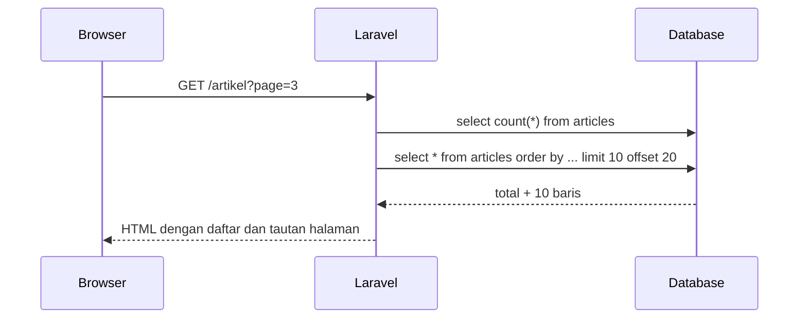

# Paginasi

Menampilkan seluruh baris tabel dalam satu halaman tidak masuk akal: lambat, boros memori, dan melelahkan dibaca. **Paginasi** membagi hasil menjadi halaman-halaman (mis. 10 artikel per halaman)
dengan tautan navigasi. Laravel mengintegrasikan paginasi langsung dengan Query Builder dan Eloquent. Sub bab ini mengajarkan `paginate`, `simplePaginate`, `cursorPaginate`, menampilkan tautan
di Blade, dan menjaga filter pencarian tetap ada saat berpindah halaman.

## Tujuan Pembelajaran

Setelah menyelesaikan sub bab ini, kamu dapat:

- [ ] Menjelaskan mengapa paginasi diperlukan dan cara kerjanya (`limit` dan `offset`).
- [ ] Memakai `paginate()`, `simplePaginate()`, dan `cursorPaginate()` serta memilihnya.
- [ ] Menampilkan hasil dan tautan halaman di Blade dengan `$items->links()`.
- [ ] Mempertahankan parameter pencarian dengan `withQueryString()`.
- [ ] Membaca metadata paginator (`total`, `currentPage`, `lastPage`, dan lainnya).
- [ ] Memahami bentuk JSON hasil paginasi dan cara menyesuaikan tampilan tautan.

## Prasyarat

- [Query Eloquent](04-16-eloquent-queries.md) dan [Eager Loading](04-23-eager-loading.md).
- [Direktif Perulangan Blade](../level-03/03-05-loop-directives.md) dan [Objek Request](../level-02/02-15-request-object.md).
- Data contoh: sedikitnya 40 artikel.
- Opsional: `npm run dev` berjalan, agar tautan paginasi bergaya (lihat catatan Tailwind di bawah).

## Pengantar

Beranda blog dengan 5.000 artikel yang dimuat sekaligus akan menjatuhkan server. Dengan paginasi, tiap request hanya mengambil sebagian kecil, dan pengguna berpindah halaman lewat tautan
`?page=2`, `?page=3`, dan seterusnya.

## Penjelasan Konsep

### Cara kerja dasar

Paginasi offset menjalankan dua query: satu `count(*)` untuk mengetahui total, dan satu `select ... limit N offset M` untuk halaman saat ini. Halaman saat ini dibaca dari parameter query `page`
secara otomatis.

### `paginate()`

```php-inline
$articles = Article::published()->latest('published_at')->paginate(10);
```

Mengembalikan `LengthAwarePaginator` yang tahu total data dan jumlah halaman. Cocok bila kamu ingin menampilkan nomor halaman.

### Pilihan lain

| Method | Query tambahan | Navigasi | Cocok untuk |
|---|---|---|---|
| `paginate($n)` | Ya (`count`) | Nomor halaman | Daftar umum |
| `simplePaginate($n)` | Tidak | Hanya Sebelumnya/Berikutnya | Tabel besar, tidak butuh total |
| `cursorPaginate($n)` | Tidak | Sebelumnya/Berikutnya | Data sangat besar, *infinite scroll*; wajib `orderBy` unik |

Dokumentasi menjelaskan kelebihan `cursorPaginate`: ia memakai `where` berdasarkan nilai kolom terurut (bukan `offset`) sehingga lebih efisien pada data besar dan tahan terhadap data yang
bertambah saat dibaca. Batasannya: hanya tautan Sebelumnya/Berikutnya, kolom urut harus unik dan tidak boleh `null`.

### Query Builder dan Eloquent

Keduanya mendukung metode yang sama:

```php-inline
DB::table('articles')->paginate(15);
Article::where('is_published', true)->paginate(15);
```

### Menampilkan di Blade

File: `resources/views/articles/index.blade.php` (potongan)

```html
@foreach ($articles as $article)
    <article>
        <h2>{{ $article->title }}</h2>
    </article>
@endforeach

{{ $articles->links() }}
```

`links()` menghasilkan tautan halaman dengan parameter `page` yang benar. Tampilan bawaannya dibuat untuk **Tailwind CSS** (proyek baru menyertakan Tailwind dan memuat view paginasi
lewat `@source` di `resources/css/app.css`). Jika proyekmu tidak memakai Tailwind, ada pilihan lain:

- Bootstrap: `Paginator::useBootstrapFive()` di `AppServiceProvider::boot()`.
- Publikasikan view dan ubah sendiri: `php artisan vendor:publish --tag=laravel-pagination` (berkas muncul di `resources/views/vendor/pagination`).
- Tentukan view per pemanggilan: `$articles->links('pagination.kustom')`.

Tanpa CSS yang cocok, tautan tetap berfungsi tetapi tampil polos.

### Metadata paginator

| Method | Isi |
|---|---|
| `$p->total()` | Total data (bukan pada `simplePaginate`/`cursorPaginate`) |
| `$p->count()` | Jumlah item di halaman ini |
| `$p->perPage()` | Item per halaman |
| `$p->currentPage()` | Halaman saat ini |
| `$p->lastPage()` | Halaman terakhir (tidak pada `simplePaginate`) |
| `$p->firstItem()` / `$p->lastItem()` | Nomor item pertama/terakhir di halaman |
| `$p->hasPages()` / `$p->hasMorePages()` | Apakah ada lebih dari satu halaman / halaman berikutnya |
| `$p->nextPageUrl()` / `$p->previousPageUrl()` | URL halaman berikut/sebelumnya |

Contoh teks ringkasan: `Menampilkan {{ $articles->firstItem() }}–{{ $articles->lastItem() }} dari {{ $articles->total() }} artikel`.

### Mempertahankan parameter query

Bila halaman daftar punya pencarian `?q=laravel`, tautan halaman harus membawa `q`. Gunakan `withQueryString()`:

```php-inline
$articles = Article::search($request->query('q'))->latest()->paginate(10)->withQueryString();
```

Alternatifnya `->appends(['sort' => 'terbaru'])` untuk parameter tertentu. `fragment('daftar')` menambahkan `#daftar` ke setiap tautan.

### Beberapa paginator pada satu halaman

Beri nama parameter halaman berbeda sebagai argumen ketiga:

```php-inline
Article::paginate(10, ['*'], 'halaman_artikel');
Comment::paginate(5, ['*'], 'halaman_komentar');
```

### Paginasi dan eager loading

Gabungkan `with()` sebelum `paginate()` agar relasi dimuat hanya untuk item di halaman itu:

```php-inline
Article::with(['category:id,name', 'user:id,name'])->withCount('comments')->latest()->paginate(10);
```

### JSON

Mengembalikan paginator dari route menghasilkan JSON dengan kunci seperti `data`, `current_page`, `last_page`, `per_page`, `total`, `next_page_url`, dan `prev_page_url`:

```php-inline
Route::get('/api/artikel', fn () => Article::paginate(5));
```

### Keamanan dan performa

- Batasi `per_page` dari input pengguna dengan nilai maksimum (mis. `min((int) $request->query('per_page', 10), 50)`); jika tidak, pengguna dapat meminta 100.000 baris.
- Nomor halaman yang terlalu besar mengembalikan halaman kosong, bukan galat; tangani tampilan kosong.
- `paginate` pada tabel sangat besar menjalankan `count(*)` yang bisa lambat; pertimbangkan `simplePaginate` atau `cursorPaginate`.
- Pastikan kolom pengurutan (`created_at`, `published_at`) terindeks.

## Cara Kerja



## Contoh Praktik

Kamu membuat route `/artikel` yang menampilkan artikel terbit 10 per halaman dengan pencarian, tautan halaman, dan ringkasan; lalu membandingkan `paginate`, `simplePaginate`,
`cursorPaginate`, dan hasil JSON.

## Penjelasan Kode

File: `routes/web.php` (tambahkan; impor `use App\Models\Article; use Illuminate\Http\Request;` bila belum)

```php-inline
Route::get('/artikel', function (Request $request) {
    $perPage = min((int) $request->query('per_page', 10), 50);

    $articles = Article::published()
        ->search($request->query('q'))
        ->with(['category:id,name', 'user:id,name'])
        ->withCount('comments')
        ->latest('published_at')
        ->paginate($perPage)
        ->withQueryString();

    return view('articles.index', ['articles' => $articles]);
});
```

| Bagian | Fungsi |
|---|---|
| `min((int) ..., 50)` | Membatasi `per_page` maksimal 50 |
| `Article::published()->search(...)` | Scope dari sub bab 04.16 |
| `with(...)->withCount(...)` | Eager loading sehingga jumlah query tetap |
| `paginate($perPage)->withQueryString()` | Membagi halaman dan membawa `q` dan `per_page` di tautan |

File: `resources/views/articles/index.blade.php`

```html
<x-layout>
    <x-slot:title>
        Artikel
    </x-slot>

    <h1>Artikel</h1>

    <form method="GET" action="/artikel">
        <input type="text" name="q" value="{{ request('q') }}" placeholder="Cari judul">
        <button type="submit">Cari</button>
    </form>

    @forelse ($articles as $article)
        <article>
            <h2>{{ $article->title }}</h2>
            <small>
                {{ $article->category?->name ?? 'Tanpa kategori' }}
                · {{ $article->user?->name ?? 'Anonim' }}
                · {{ $article->comments_count }} komentar
            </small>
        </article>
    @empty
        <p>Tidak ada artikel.</p>
    @endforelse

    @if ($articles->hasPages())
        <p>Menampilkan {{ $articles->firstItem() }}–{{ $articles->lastItem() }} dari {{ $articles->total() }} artikel</p>
        {{ $articles->links() }}
    @endif
</x-layout>
```

Halaman ini memakai `<x-layout>` dari bab Blade. Jika proyek `cms-artikel` belum punya komponen itu, salin `resources/views/components/layout.blade.php` dari `belajar-blade` dan pastikan
`@vite([...])` di dalamnya sesuai dengan berkas aset proyek ini.

## Implementasi Langkah demi Langkah

### Langkah 1: siapkan data

```bash
cd ~/belajar-laravel/cms-artikel
php artisan migrate:fresh
php artisan tinker
```

```php-inline
use App\Models\{Article, Category, User};

$cats = Category::factory()->count(4)->create();
$users = User::factory()->count(3)->create();
Article::factory()->count(45)->published()->recycle($cats)->recycle($users)->create();
Article::factory()->count(5)->create();
```

### Langkah 2: coba di Tinker

```php-inline
$p = Article::published()->latest('published_at')->paginate(10);
$p->total(); $p->perPage(); $p->lastPage(); $p->currentPage(); $p->count();
$p->items()[0]->title;
Article::published()->simplePaginate(10)->hasMorePages();
Article::orderBy('id')->cursorPaginate(10)->nextCursor();
```

### Langkah 3: route dan view

Tambahkan route dan buat `resources/views/articles/index.blade.php`. Jalankan `php artisan serve` (dan `npm run dev` bila memakai Vite).

### Langkah 4: uji di browser

Buka `http://127.0.0.1:8000/artikel`, klik halaman 2 dan 3, lalu cari kata dengan `?q=`. Periksa bahwa `q` tetap ada di tautan halaman.

### Langkah 5: uji batas

Buka `?page=999` (halaman kosong), `?per_page=1000` (dibatasi 50), dan `?page=abc`.

### Langkah 6: lihat JSON

Tambahkan sementara `Route::get('/api/artikel', fn () => Article::published()->paginate(5));` dan buka di browser untuk melihat struktur JSON.

### Langkah 7: catat di Git

```bash
git add routes resources
git commit -m "Tambah halaman daftar artikel dengan paginasi"
```

## Eksekusi dan Verifikasi

| Langkah | Cara memverifikasi |
|---|---|
| 2 | `total()` 45, `perPage()` 10, `lastPage()` 5, `count()` 10 |
| 4 | Halaman berpindah; `q` terbawa di URL tautan |
| 5 | `?page=999` menampilkan "Tidak ada artikel."; `per_page` tidak melebihi 50 |
| 6 | JSON memuat `data`, `current_page`, `last_page`, `total` |

## Hasil yang Diharapkan

| Permintaan | Hasil |
|---|---|
| `/artikel` | 10 artikel terbit, teks "Menampilkan 1–10 dari 45 artikel", tautan halaman 1–5 |
| `/artikel?page=5` | 5 artikel (sisa), teks "Menampilkan 41–45 dari 45 artikel" |
| `/artikel?q=Laravel&page=2` | Tautan halaman tetap membawa `q=Laravel` |

Tampilan tautan bergantung CSS (Tailwind bawaan atau pilihan lain). Hasil ini diturunkan dari dokumentasi dan belum dijalankan oleh penulis materi; cocokkan dengan hasilmu.

## Kesalahan Umum dan Pemecahan Masalah

| Gejala | Penyebab | Cara mengenali | Solusi | Pencegahan |
|---|---|---|---|---|
| Tautan halaman tampil polos/berantakan | CSS Tailwind tidak dimuat | Elemen `<nav>` tanpa gaya | Jalankan `npm run dev`/`build` atau pakai `useBootstrapFive()` | Pastikan aset termuat |
| Pencarian hilang di halaman 2 | Lupa `withQueryString()` | URL halaman tanpa `q` | Tambahkan `->withQueryString()` | Selalu panggil di halaman berfilter |
| `Method links does not exist` | Memakai `get()` bukan `paginate()` | Koleksi biasa | Ganti dengan `paginate()` | Periksa variabel yang dikirim |
| Urutan data berubah antar halaman | Tanpa `orderBy` yang stabil | Data muncul ganda/hilang | Tambah `orderBy` dengan kolom unik tambahan (`id`) | Urutkan dengan kolom unik |
| `cursorPaginate` galat | Tanpa `orderBy` atau kolom tidak unik | Pengecualian | Tambah `orderBy('id')` | Ikuti syarat cursor |
| Halaman lambat pada tabel besar | `count(*)` mahal | Waktu lama | `simplePaginate`/`cursorPaginate` | Pilih sesuai skala |
| Pengguna meminta jutaan baris | `per_page` tak dibatasi | Memori habis | Batasi dengan `min()` | Validasi `per_page` |
| Pagination JSON tidak memuat relasi | Relasi tidak dimuat | `category` hilang | Gunakan `with()` sebelum `paginate` | Muat relasi yang dipakai |

## Latihan Praktik

### Latihan dasar

**D1. Ganti jumlah per halaman**
- *Masalah:* ingin 5 artikel per halaman.
- *Persyaratan:* ubah ke `paginate(5)` dan hitung ulang jumlah halaman dengan 50 artikel.
- *Perilaku yang diharapkan:* 10 halaman.
- *Tujuan belajar:* memahami hubungan total, per halaman, dan halaman terakhir.

**D2. Ringkasan item**
- *Masalah:* ingin teks "Menampilkan x–y dari z".
- *Persyaratan:* tampilkan `firstItem()`, `lastItem()`, dan `total()`.
- *Perilaku yang diharapkan:* angka benar di halaman pertama, tengah, dan terakhir.
- *Tujuan belajar:* memakai metadata.

### Latihan implementasi

**I1. Filter kategori yang tahan halaman**
- *Masalah:* daftar bisa difilter kategori (`?category=teknologi`).
- *Persyaratan:* tambahkan filter dengan `when()`, `withQueryString()`, dan `select` kategori yang mempertahankan pilihan; pastikan halaman 2 membawa filter.
- *Perilaku yang diharapkan:* filter tidak hilang saat pindah halaman.
- *Tujuan belajar:* menggabungkan filter dan paginasi.

**I2. Tampilan kustom**
- *Masalah:* ingin tautan sederhana "Sebelumnya | Berikutnya".
- *Persyaratan:* gunakan `simplePaginate` dan publikasikan atau buat view paginasi sendiri yang hanya menampilkan dua tautan.
- *Perilaku yang diharapkan:* hanya dua tautan, tetap membawa query.
- *Tujuan belajar:* mengkustomisasi view paginasi.

### Latihan tantangan

**T1. Bandingkan tiga jenis paginasi**
- *Masalah:* tim memilih jenis paginasi untuk tabel 5 juta baris.
- *Persyaratan:* isi tabel dengan data besar (seeder/factory), bandingkan SQL, waktu, dan perilaku halaman jauh (`page=5000`) untuk `paginate`, `simplePaginate`, dan `cursorPaginate`; rekomendasikan satu.
- *Perilaku yang diharapkan:* laporan dengan angka dan alasan.
- *Tujuan belajar:* memilih paginasi sesuai skala.
- *Catatan:* kerjakan mandiri; tidak ada kunci jawaban.

## Uji Pemahaman

1. Mengapa paginasi diperlukan?
2. Apa beda `paginate`, `simplePaginate`, dan `cursorPaginate`?
3. Bagaimana halaman saat ini ditentukan?
4. Apa fungsi `withQueryString()`?
5. Mengapa `per_page` dari pengguna harus dibatasi?
6. Mengapa `cursorPaginate` membutuhkan `orderBy`?
7. Apa fungsi `with()` sebelum `paginate()`?

??? success "Kunci jawaban singkat"
    1. Menghindari memuat semua data sekaligus: lambat, boros memori, dan sulit dibaca.
    2. `paginate` punya total dan nomor halaman (dua query); `simplePaginate` tanpa total; `cursorPaginate` memakai kursor dan efisien untuk data besar.
    3. Dari parameter query `page`.
    4. Membawa parameter query saat ini (mis. `q`) ke tautan halaman.
    5. Agar pengguna tak bisa meminta jumlah baris berlebihan.
    6. Kursor dibuat dari nilai kolom terurut yang unik.
    7. Memuat relasi hanya untuk item di halaman itu dan mencegah N+1.

## Ringkasan

- Paginasi membagi hasil menjadi halaman; `paginate`, `simplePaginate`, `cursorPaginate` untuk kebutuhan berbeda.
- `links()` menampilkan navigasi; tampilan bawaan berbasis Tailwind dan dapat diganti.
- `withQueryString()` menjaga filter; metadata paginator memudahkan teks ringkasan.
- Batasi `per_page`, urutkan dengan kolom stabil, dan gabungkan dengan eager loading.
- Paginator yang dikembalikan dari route otomatis menjadi JSON.

Selanjutnya: *Transaksi Database*, menjaga beberapa operasi tetap konsisten.

## Referensi Resmi

- [Laravel: Pagination](https://laravel.com/docs/13.x/pagination)
- [Laravel: Cursor Pagination](https://laravel.com/docs/13.x/pagination#cursor-pagination)
- [Laravel: Customizing the Pagination View](https://laravel.com/docs/13.x/pagination#customizing-the-pagination-view)
