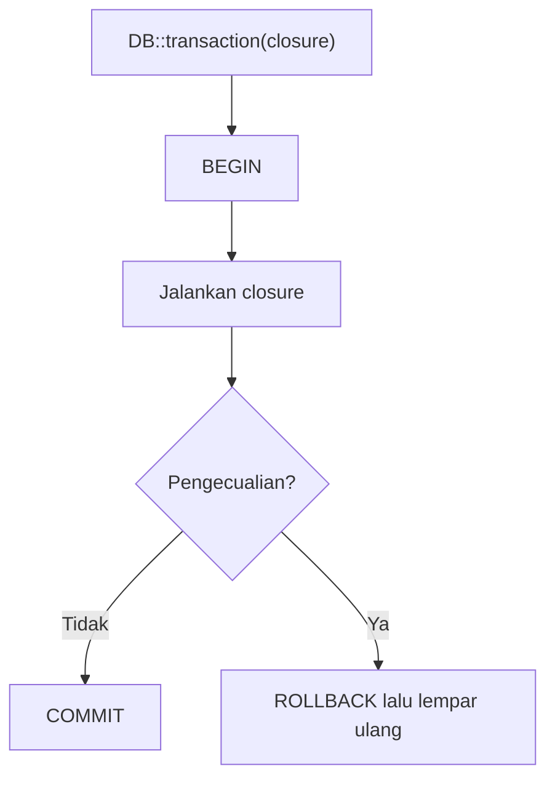

# Transaksi Database

Beberapa operasi data harus berhasil **semuanya atau tidak sama sekali**. Contoh: menerbitkan artikel baru sekaligus menambah tag dan mencatat log; jika langkah ketiga gagal, dua langkah
pertama tidak boleh tertinggal setengah jalan. **Transaksi** database menjamin sifat "semua atau tidak sama sekali" itu. Sub bab ini menjelaskan konsep ACID, cara memakai `DB::transaction`
dan transaksi manual, serta jebakan umum seperti pengecualian yang tertelan dan efek samping di luar database.

## Tujuan Pembelajaran

Setelah menyelesaikan sub bab ini, kamu dapat:

- [ ] Menjelaskan transaksi dan sifat atomik dengan contoh.
- [ ] Memakai `DB::transaction(function () { ... })` dengan commit dan rollback otomatis.
- [ ] Memakai `DB::beginTransaction()`, `commit()`, dan `rollBack()` secara manual.
- [ ] Menjelaskan efek pengecualian di dalam transaksi dan opsi `attempts` untuk deadlock.
- [ ] Mengenali operasi yang tidak ikut ter-rollback (email, berkas, antrean).
- [ ] Menguji perilaku rollback di Tinker.

## Prasyarat

- [Operasi CRUD](04-14-crud-operations.md) dan [Relasi Banyak-ke-Banyak](04-20-many-to-many-relationships.md).
- [Penanganan Exception](../level-00/00-21-exception-handling.md) pada PHP.
- Model `Article`, `Tag`, `Comment` dengan data uji.

## Pengantar

Bayangkan memindahkan uang: kurangi saldo A lalu tambah saldo B. Bila proses mati setelah langkah pertama, uang hilang. Pada aplikasi artikel, bentuk serupa adalah membuat artikel
dan melampirkan tag: jika pelampiran tag gagal, kamu tidak ingin artikel setengah jadi tersimpan.

## Penjelasan Konsep

### ACID singkat

| Sifat | Arti |
|---|---|
| **A**tomicity | Semua operasi dalam transaksi berhasil, atau semuanya dibatalkan |
| **C**onsistency | Database berpindah dari satu keadaan valid ke keadaan valid lain |
| **I**solation | Transaksi bersamaan tidak saling mengganggu |
| **D**urability | Setelah *commit*, data bertahan walau sistem mati |

### `DB::transaction()`

Cara termudah dan paling aman:

```php-inline
use Illuminate\Support\Facades\DB;

DB::transaction(function () {
    $article = Article::create([...]);
    $article->tags()->sync([1, 2, 3]);
    $article->comments()->create(['body' => 'Selamat membaca']);
});
```

Menurut dokumentasi: bila terjadi pengecualian di dalam closure, transaksi otomatis di-*rollback* dan pengecualian dilempar ulang; bila closure selesai tanpa galat, transaksi otomatis di-*commit*.
Closure dapat mengembalikan nilai, yang diteruskan sebagai hasil `DB::transaction`:

```php-inline
$article = DB::transaction(function () use ($data, $tagIds) {
    $article = Article::create($data);
    $article->tags()->sync($tagIds);
    return $article;
});
```

### Percobaan ulang (deadlock)

Argumen kedua menentukan berapa kali transaksi dicoba ulang saat terjadi *deadlock*:

```php-inline
DB::transaction(function () { /* ... */ }, attempts: 5);
```

Setelah percobaan habis, pengecualian dilempar. Pastikan isi closure aman dijalankan berulang (idempoten).

### Transaksi manual

```php-inline
DB::beginTransaction();

try {
    // operasi
    DB::commit();
} catch (\Throwable $e) {
    DB::rollBack();
    throw $e;
}
```

Gunakan bila alurnya perlu kontrol rinci. Lupa `commit()` atau `rollBack()` membiarkan transaksi menggantung; karena itu `DB::transaction()` lebih disarankan.

### Yang ikut dan yang tidak ikut ter-rollback

| Ikut ter-rollback | Tidak ikut ter-rollback |
|---|---|
| Insert, update, delete pada database yang sama | Email yang sudah terkirim |
| Perubahan melalui Eloquent dan Query Builder | Berkas yang sudah ditulis ke disk |
| | Panggilan ke API eksternal |
| | Pekerjaan antrean yang sudah didorong (kecuali memakai `afterCommit`) |

Lakukan efek samping setelah transaksi sukses, bukan di dalamnya:

```php-inline
$article = DB::transaction(fn () => /* ... */);
Mail::to($admin)->send(new ArtikelBaru($article));   // setelah commit
```

### Pernyataan yang menyebabkan *implicit commit*

Dokumentasi memperingatkan: pernyataan DDL seperti `CREATE TABLE` di MySQL memicu *commit* implisit yang membuat Laravel tidak tahu level transaksi. Jangan mengubah skema di dalam transaksi
data pada MySQL.

### Transaksi bersarang

Memanggil `DB::transaction` di dalam transaksi lain menggunakan *savepoint*; kegagalan di dalam hanya membatalkan bagian dalam bila pengecualian ditangani di luar. Rancang agar satu transaksi
terluar mewakili satu unit bisnis.

### Mengunci baris (sekilas)

Untuk mencegah dua proses mengubah data yang sama bersamaan (misalnya stok), Laravel menyediakan `lockForUpdate()` dan `sharedLock()` di dalam transaksi:

```php-inline
DB::transaction(function () {
    $produk = Produk::where('id', 1)->lockForUpdate()->first();
    $produk->decrement('stok');
});
```

Pembahasan mendalam tentang penguncian ada di bab performa; di sini hanya dikenalkan.

### Keamanan dan keandalan

- Jangan menelan pengecualian di dalam closure (`try { } catch { }` tanpa melempar ulang); transaksi dianggap sukses dan di-*commit*.
- Transaksi panjang menahan kunci dan menurunkan kinerja; jaga tetap singkat dan jangan memanggil layanan lambat di dalamnya.
- Catat kegagalan (log) agar rollback tidak terjadi diam-diam.

## Cara Kerja



## Contoh Praktik

Kamu membuat fungsi `terbitkan()` yang membuat artikel, memasang tag, dan membuat komentar pembuka dalam satu transaksi; lalu membuktikan bahwa kegagalan di langkah terakhir membatalkan semuanya.

## Penjelasan Kode

File: `app/Actions/BuatArtikel.php` (buat folder `app/Actions` bila belum ada)

```php
<?php

namespace App\Actions;

use App\Models\Article;
use Illuminate\Support\Facades\DB;

class BuatArtikel
{
    /**
     * @param  array{title:string, slug:string, body:string}  $data
     * @param  list<int>  $tagIds
     */
    public function __invoke(array $data, array $tagIds, bool $gagal = false): Article
    {
        return DB::transaction(function () use ($data, $tagIds, $gagal) {
            $article = Article::create($data);
            $article->tags()->sync($tagIds);

            if ($gagal) {
                throw new \RuntimeException('Gagal sengaja untuk uji rollback');
            }

            $article->comments()->create(['body' => 'Selamat membaca!']);

            return $article;
        });
    }
}
```

| Bagian | Fungsi |
|---|---|
| `DB::transaction(function () use (...) { ... })` | Membungkus tiga operasi dalam satu transaksi |
| `throw new \RuntimeException(...)` | Mensimulasikan kegagalan di tengah |
| `return $article` | Hasil closure dikembalikan oleh `DB::transaction` |

Kelas `Action` seperti ini adalah pola umum untuk memisahkan logika bisnis dari controller; pola arsitektur dibahas lebih lanjut pada bab arsitektur.

## Implementasi Langkah demi Langkah

### Langkah 1: siapkan tag

```bash
cd ~/belajar-laravel/cms-artikel
php artisan migrate:fresh
php artisan tinker
```

```php-inline
use App\Actions\BuatArtikel;
use App\Models\{Article, Comment, Tag};

$tags = collect(['php', 'laravel'])->map(fn ($n) => Tag::create(['name' => $n]));
```

### Langkah 2: jalan normal

```php-inline
$aksi = new BuatArtikel();
$a = $aksi(['title' => 'Transaksi Sukses', 'slug' => 'transaksi-sukses', 'body' => 'Isi'], $tags->pluck('id')->all());
[Article::count(), Comment::count(), $a->tags()->count()];
```

### Langkah 3: gagal di tengah

```php-inline
try {
    $aksi(['title' => 'Transaksi Gagal', 'slug' => 'transaksi-gagal', 'body' => 'Isi'], $tags->pluck('id')->all(), gagal: true);
} catch (\Throwable $e) {
    $e->getMessage();
}
[Article::count(), Comment::count(), Article::where('slug', 'transaksi-gagal')->exists()];
```

### Langkah 4: bandingkan tanpa transaksi

Ubah sementara `BuatArtikel` agar tidak memakai `DB::transaction` (hanya jalankan isinya), ulangi Langkah 3 dengan slug baru, dan amati bahwa artikel dan tag tertinggal walau komentar gagal.
Kembalikan transaksinya.

### Langkah 5: transaksi manual

```php-inline
use Illuminate\Support\Facades\DB;

DB::beginTransaction();
Article::create(['title' => 'Manual', 'slug' => 'manual', 'body' => 'x']);
Article::where('slug', 'manual')->exists();
DB::rollBack();
Article::where('slug', 'manual')->exists();
```

### Langkah 6: catat di Git

```bash
git add app/Actions
git commit -m "Tambah BuatArtikel dengan transaksi"
```

## Eksekusi dan Verifikasi

| Langkah | Cara memverifikasi |
|---|---|
| 2 | `[1, 1, 2]`: satu artikel, satu komentar, dua tag |
| 3 | Pengecualian tertangkap; `Article::count()` tetap 1; `exists()` bernilai `false` |
| 4 | Tanpa transaksi: artikel dan tag tersimpan walau komentar gagal |
| 5 | `exists()` `true` sebelum `rollBack`, `false` sesudahnya |

## Hasil yang Diharapkan

| Skenario | Hasil |
|---|---|
| Sukses | Artikel, tag, dan komentar tersimpan |
| Gagal dengan transaksi | Tidak ada yang tersimpan (artikel gagal pun tidak ada) |
| Gagal tanpa transaksi | Artikel dan tag tersimpan, komentar tidak ada (data setengah jadi) |

Hasil ini diturunkan dari dokumentasi dan belum dijalankan oleh penulis materi; cocokkan dengan hasilmu.

## Kesalahan Umum dan Pemecahan Masalah

| Gejala | Penyebab | Cara mengenali | Solusi | Pencegahan |
|---|---|---|---|---|
| Data tidak di-rollback walau ada galat | Pengecualian ditelan oleh `try/catch` di dalam transaksi | Data tersimpan sebagian | Lempar ulang atau jangan tangkap | Biarkan pengecualian naik ke `DB::transaction` |
| Transaksi menggantung | Lupa `commit`/`rollBack` pada cara manual | Kunci tidak terlepas | Gunakan `DB::transaction()` | Hindari transaksi manual bila bisa |
| Email terkirim padahal rollback | Efek samping di dalam transaksi | Email untuk data yang tidak ada | Kirim setelah commit | Pisahkan efek samping |
| Tabel tidak bisa dibuat dalam transaksi (MySQL) | DDL memicu implicit commit | Rollback tak berfungsi | Jangan ubah skema di transaksi data | Pisahkan migration dari transaksi |
| Deadlock | Dua transaksi saling menunggu kunci | Galat deadlock | Gunakan `attempts` dan urutan akses konsisten | Jaga transaksi singkat |
| Transaksi sangat lambat | Operasi berat di dalam | Kunci lama | Pindahkan operasi lambat keluar | Jaga transaksi singkat |
| Closure tidak melihat variabel | Lupa `use (...)` | `Undefined variable` | Tambahkan `use` | Gunakan fungsi panah/`use` |

## Latihan Praktik

### Latihan dasar

**D1. Atomik atau tidak**
- *Masalah:* tentukan operasi yang perlu transaksi.
- *Persyaratan:* dari (a) membaca artikel, (b) membuat artikel + memasang tag, (c) menambah satu komentar, (d) memindahkan stok antar gudang, tandai yang butuh transaksi.
- *Perilaku yang diharapkan:* (b) dan (d) membutuhkan transaksi.
- *Tujuan belajar:* mengenali operasi multi-langkah.

**D2. Rollback manual**
- *Masalah:* ingin merasakan rollback.
- *Persyaratan:* di Tinker, mulai transaksi manual, buat dua artikel, `rollBack()`, dan buktikan tidak ada yang tersimpan.
- *Perilaku yang diharapkan:* jumlah artikel kembali ke semula.
- *Tujuan belajar:* memahami rollback.

### Latihan implementasi

**I1. Hapus artikel beserta turunannya**
- *Masalah:* menghapus artikel harus membersihkan gambar polimorfik dan menulis log.
- *Persyaratan:* buat aksi `HapusArtikel` yang dalam satu transaksi menghapus `images` milik artikel, melepas tag, lalu menghapus artikel; uji kegagalan di tengah.
- *Perilaku yang diharapkan:* tidak ada keadaan setengah terhapus.
- *Tujuan belajar:* transaksi pada banyak tabel.

**I2. Efek samping setelah commit**
- *Masalah:* email notifikasi hanya boleh terkirim jika data tersimpan.
- *Persyaratan:* tulis kode yang memanggil `Log::info` (pengganti email) *setelah* `DB::transaction` selesai, dan tunjukkan bahwa saat transaksi gagal log tidak tercatat.
- *Perilaku yang diharapkan:* log hanya untuk transaksi sukses.
- *Tujuan belajar:* memisahkan efek samping.

### Latihan tantangan

**T1. Transfer stok aman**
- *Masalah:* dua admin memindahkan stok bersamaan.
- *Persyaratan:* rancang tabel `stocks`, tulis fungsi pemindahan memakai transaksi dan `lockForUpdate()`, dan jelaskan (atau simulasikan dengan dua sesi Tinker) apa yang terjadi tanpa penguncian.
- *Perilaku yang diharapkan:* stok tidak menjadi negatif atau salah hitung.
- *Tujuan belajar:* konkurensi dan penguncian.
- *Catatan:* kerjakan mandiri; tidak ada kunci jawaban.

## Uji Pemahaman

1. Apa arti atomik?
2. Apa yang dilakukan `DB::transaction` bila terjadi pengecualian?
3. Apa fungsi argumen `attempts`?
4. Mengapa mengirim email di dalam transaksi berbahaya?
5. Apa risiko menelan pengecualian di dalam transaksi?
6. Mengapa transaksi sebaiknya singkat?
7. Apa bedanya transaksi otomatis dan manual?

??? success "Kunci jawaban singkat"
    1. Semua operasi berhasil atau semuanya dibatalkan.
    2. Melakukan rollback dan melempar ulang pengecualian.
    3. Jumlah percobaan ulang saat terjadi deadlock.
    4. Email tidak ikut ter-rollback sehingga terkirim untuk data yang tidak pernah tersimpan.
    5. Transaksi dianggap sukses dan di-commit dengan data setengah jadi.
    6. Transaksi panjang menahan kunci dan menurunkan kinerja.
    7. Otomatis commit/rollback sendiri; manual membutuhkan `commit`/`rollBack` eksplisit.

## Ringkasan

- Transaksi menjamin operasi multi-langkah bersifat atomik.
- `DB::transaction()` meng-commit bila sukses dan rollback bila ada pengecualian.
- Transaksi manual memberi kontrol tetapi mudah salah.
- Efek samping di luar database tidak ikut ter-rollback; lakukan setelah commit.
- Jaga transaksi singkat dan jangan menelan pengecualian.

Selanjutnya: *Soft Delete*, menghapus data tanpa benar-benar menghilangkannya.

## Referensi Resmi

- [Laravel: Database Transactions](https://laravel.com/docs/13.x/database#database-transactions)
- [Laravel: Pessimistic Locking](https://laravel.com/docs/13.x/queries#pessimistic-locking)
- [MySQL: Transactions](https://dev.mysql.com/doc/refman/8.4/en/commit.html)
