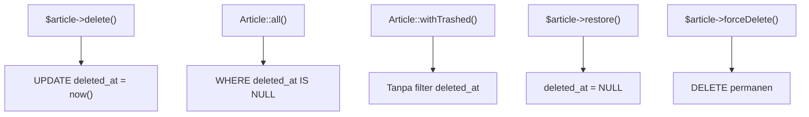

# Soft Delete

`delete()` biasa menghapus baris **selamanya**. Dalam banyak aplikasi itu terlalu berisiko: admin salah klik, atau data perlu dipulihkan untuk audit. **Soft delete** menandai baris sebagai
terhapus lewat kolom `deleted_at` tanpa benar-benar membuangnya, sehingga baris dapat dipulihkan. Sub bab ini menunjukkan cara mengaktifkannya, memulihkan, menghapus permanen, dan menghindari
jebakannya (terutama indeks unik).

## Tujuan Pembelajaran

Setelah menyelesaikan sub bab ini, kamu dapat:

- [ ] Menjelaskan perbedaan penghapusan permanen dan soft delete.
- [ ] Mengaktifkan soft delete dengan kolom `softDeletes()` dan trait `SoftDeletes`.
- [ ] Memakai `delete()`, `trashed()`, `restore()`, dan `forceDelete()`.
- [ ] Mengambil data terhapus dengan `withTrashed()` dan `onlyTrashed()`.
- [ ] Menjelaskan interaksi soft delete dengan indeks unik, relasi, dan kunci asing.
- [ ] Menjelaskan implikasi privasi dari menyimpan data yang "terhapus".

## Prasyarat

- [Operasi CRUD](04-14-crud-operations.md) dan [Mengubah Tabel Database](04-08-modifying-database-tables.md).
- Model `Article` dengan relasi komentar dan tag.
- [Query Eloquent](04-16-eloquent-queries.md).

## Pengantar

Pengguna menghapus artikel penting, lalu menyesal. Dengan soft delete, artikel hanya disembunyikan dari query normal dan dapat dikembalikan oleh admin dari "tempat sampah".

## Penjelasan Konsep

### Cara kerja

Soft delete menambah kolom `deleted_at` (nullable timestamp). Saat model dihapus, `deleted_at` diisi waktu sekarang alih-alih `DELETE`. Query Eloquent otomatis menambah
`WHERE deleted_at IS NULL`, sehingga baris terhapus tak muncul.

| Aksi | Efek di database |
|---|---|
| `$article->delete()` | `UPDATE articles SET deleted_at = now()` |
| `$article->restore()` | `UPDATE articles SET deleted_at = NULL` |
| `$article->forceDelete()` | `DELETE FROM articles` (permanen) |

### Mengaktifkan

Migration baru:

```php
public function up(): void
{
    Schema::table('articles', function (Blueprint $table) {
        $table->softDeletes();
    });
}

public function down(): void
{
    Schema::table('articles', function (Blueprint $table) {
        $table->dropSoftDeletes();
    });
}
```

Model:

```php
use Illuminate\Database\Eloquent\SoftDeletes;

class Article extends Model
{
    use HasFactory, SoftDeletes;
    // ...
}
```

Menurut dokumentasi, trait `SoftDeletes` otomatis men-*cast* `deleted_at` ke objek tanggal. Kolom dibuat dengan `$table->softDeletes()`; untuk membatalkan gunakan `dropSoftDeletes()`.

### Memakai

```php-inline
$article->delete();          // soft delete
$article->trashed();         // true jika sudah di-soft-delete

Article::all();                       // tidak memuat yang terhapus
Article::withTrashed()->get();        // semua, termasuk terhapus
Article::onlyTrashed()->get();        // hanya yang terhapus

$article->restore();                  // pulihkan
Article::onlyTrashed()->where('id', 3)->restore();   // pulihkan lewat query (tanpa event model)
$article->forceDelete();              // hapus permanen
```

Relasi juga mengenalinya: `$category->articles()->withTrashed()->get()`.

### Factory

Bila model memakai soft delete, factory otomatis mendapat state `trashed()`:

```php-inline
Article::factory()->trashed()->create();
```

### Jebakan: indeks unik

Baris yang di-soft-delete **masih ada** di tabel, sehingga masih menempati nilai unik. Jika artikel `halo-dunia` di-soft-delete lalu kamu membuat artikel baru berslug sama, database menolak
karena indeks unik `slug` masih terpakai. Pilihan:

- Terima perilakunya dan beri pesan jelas ("slug sudah dipakai, mungkin oleh artikel di tempat sampah").
- Ubah slug saat dihapus (mis. tambahkan akhiran) di observer.
- Pada validasi (bab berikutnya), aturan `unique` dapat mengabaikan baris terhapus dengan `->withoutTrashed()`; tetapi indeks database tetap menolak, jadi rancang konsisten.

### Jebakan: relasi dan kunci asing

- Soft delete **tidak** memicu `ON DELETE CASCADE` database, karena tidak ada `DELETE` yang dijalankan. Komentar artikel yang di-soft-delete tetap ada.
- Tangani anak secara eksplisit: soft delete komentar juga (event `deleting`/observer, sub bab berikutnya), atau sembunyikan komentar yang artikelnya terhapus.
- `forceDelete()` memicu cascade database (`cascadeOnDelete`).

### Hapus massal

`Article::where(...)->delete()` melakukan soft delete massal (mengisi `deleted_at`) bila model memakai trait. Update/restore massal tidak memicu event model.

### Pembersihan berkala

Data terhapus lama menumpuk. Dokumentasi menyediakan fitur *pruning* (`Prunable`/`MassPrunable`) dan perintah `model:prune` untuk menghapus permanen model lama secara terjadwal. Penjadwalan
dibahas pada bab lanjut; pertimbangkan kebijakan retensi sejak awal.

### Keamanan dan privasi

- Soft delete **bukan** penghapusan data pribadi yang sebenarnya. Bila hukum atau kebijakan mewajibkan penghapusan, gunakan `forceDelete()`.
- Pastikan halaman "tempat sampah" dan `restore` hanya dapat diakses pihak berwenang.
- Pastikan query pelaporan tidak ikut menghitung data terhapus tanpa sengaja (atau justru perlu menghitungnya).

## Cara Kerja



## Contoh Praktik

Kamu menambah `deleted_at` ke `articles`, mengaktifkan trait, lalu melakukan soft delete, memulihkan, dan menghapus permanen di Tinker, serta membuktikan jebakan indeks unik.

## Penjelasan Kode

Migration dan perubahan model ada pada bagian konsep. Setelah menambahkan trait, restart Tinker agar kelas dimuat ulang.

## Implementasi Langkah demi Langkah

### Langkah 1: migration

```bash
cd ~/belajar-laravel/cms-artikel
php artisan make:migration add_soft_deletes_to_articles_table
```

Isi dengan kode `softDeletes()`, lalu:

```bash
php artisan migrate
php artisan db:table articles
```

### Langkah 2: aktifkan trait

Tambahkan `SoftDeletes` ke `Article`.

### Langkah 3: soft delete dan lihat

```bash
php artisan tinker
```

```php-inline
use App\Models\{Article, Comment};

$a = Article::factory()->create(['slug' => 'halo-dunia']);
Article::count();
$a->delete();
Article::count();
Article::withTrashed()->count();
$a->trashed();
$a->deleted_at;
```

### Langkah 4: pulihkan

```php-inline
Article::onlyTrashed()->pluck('slug');
$a->restore();
Article::count();
$a->trashed();
```

### Langkah 5: hapus permanen

```php-inline
$a->delete();
Article::onlyTrashed()->first()->forceDelete();
Article::withTrashed()->count();
```

### Langkah 6: jebakan indeks unik

```php-inline
$b = Article::factory()->create(['slug' => 'slug-unik']);
$b->delete();
Article::factory()->create(['slug' => 'slug-unik']);
```

Baca galat unique. Bersihkan dengan `Article::onlyTrashed()->forceDelete();`.

### Langkah 7: relasi

```php-inline
$c = Article::factory()->create();
Comment::factory()->count(2)->for($c)->create();
$c->delete();
Comment::count();
```

Komentar tetap ada karena soft delete tidak memicu cascade database.

### Langkah 8: catat di Git

```bash
git add app database
git commit -m "Aktifkan soft delete pada Article"
```

## Eksekusi dan Verifikasi

| Langkah | Cara memverifikasi |
|---|---|
| 3 | `Article::count()` turun, `withTrashed()->count()` tetap; `trashed()` true; `deleted_at` terisi |
| 4 | Setelah `restore()`, `count()` naik lagi dan `trashed()` false |
| 5 | Setelah `forceDelete()`, `withTrashed()->count()` berkurang |
| 6 | Pembuatan kedua gagal dengan galat unique |
| 7 | `Comment::count()` tetap 2 |

## Hasil yang Diharapkan

| Perintah | Hasil |
|---|---|
| Setelah `delete()` | `Article::count()` 0, `withTrashed()->count()` 1 |
| Setelah `restore()` | `Article::count()` 1 |
| `Article::factory()->create(['slug' => 'slug-unik'])` kedua kali | Galat unique (slug masih dipakai baris terhapus) |
| `Comment::count()` setelah soft delete artikel | Tetap 2 |

Hasil ini diturunkan dari dokumentasi dan belum dijalankan oleh penulis materi; cocokkan dengan hasilmu.

## Kesalahan Umum dan Pemecahan Masalah

| Gejala | Penyebab | Cara mengenali | Solusi | Pencegahan |
|---|---|---|---|---|
| Data "hilang" tetapi masih ada di database | Soft delete bekerja sesuai desain | `deleted_at` terisi | `withTrashed()` atau `restore()` | Pahami perilaku |
| `no such column: deleted_at` | Migration belum dijalankan | Galat kolom | `php artisan migrate` | Cek `db:table` |
| `delete()` masih menghapus permanen | Trait `SoftDeletes` belum ditambahkan | Baris benar-benar hilang | Tambahkan trait | Periksa model |
| Galat unique setelah menghapus | Baris terhapus masih memegang nilai unik | Galat saat membuat ulang | Ubah slug saat hapus atau beri pesan | Rancang kebijakan unik |
| Anak tetap muncul setelah induk terhapus | Cascade DB tidak berjalan | Komentar tanpa artikel | Soft delete anak lewat observer/event | Tangani relasi eksplisit |
| Laporan menghitung data terhapus | Memakai `withTrashed()` tanpa sadar | Angka lebih besar | Periksa query | Konsisten memilih |
| Data sensitif masih tersimpan | Mengira soft delete = hapus | Audit menemukan data | Gunakan `forceDelete()` | Kebijakan retensi |
| `restore()` tidak ditemukan | Memanggil pada query tanpa `onlyTrashed()` | Hasil 0 | Gunakan `onlyTrashed()->restore()` | Ambil dari tempat sampah |

## Latihan Praktik

### Latihan dasar

**D1. Siklus hapus**
- *Masalah:* ingin menguasai siklus.
- *Persyaratan:* untuk satu artikel lakukan `delete()`, `restore()`, lalu `delete()` dan `forceDelete()`; catat `Article::count()` dan `withTrashed()->count()` di setiap tahap.
- *Perilaku yang diharapkan:* angka sesuai tabel hasil.
- *Tujuan belajar:* memahami tiga keadaan.

**D2. Tempat sampah**
- *Masalah:* admin butuh daftar tempat sampah.
- *Persyaratan:* tampilkan judul dan `deleted_at` dari `Article::onlyTrashed()` terbaru lebih dulu.
- *Perilaku yang diharapkan:* daftar artikel terhapus.
- *Tujuan belajar:* memakai `onlyTrashed()`.

### Latihan implementasi

**I1. Hapus anak bersama induk**
- *Masalah:* komentar harus ikut ter-soft-delete.
- *Persyaratan:* tambahkan `SoftDeletes` ke `Comment` (migration + trait) dan di `Article::booted()` tambahkan `static::deleting(fn ($a) => $a->comments()->delete())`; buktikan komentar ikut tersembunyi.
- *Perilaku yang diharapkan:* komentar artikel terhapus tidak muncul.
- *Tujuan belajar:* menangani relasi pada soft delete.

**I2. Slug yang dapat dipakai ulang**
- *Masalah:* slug artikel terhapus menghalangi artikel baru.
- *Persyaratan:* saat `deleting` (bukan `forceDeleting`) ubah slug menjadi `slug-terhapus-{timestamp}`; uji membuat artikel baru bersslug sama.
- *Perilaku yang diharapkan:* pembuatan ulang berhasil; `restore()` perlu penanganan.
- *Tujuan belajar:* mengelola keunikan.

### Latihan tantangan

**T1. Kebijakan retensi**
- *Masalah:* tim ragu berapa lama menyimpan data terhapus.
- *Persyaratan:* rancang kebijakan (30 hari di tempat sampah lalu permanen), jelaskan memakai `Prunable` atau perintah terjadwal, dan implementasikan model `Prunable` dengan `prunable()` yang memilih artikel terhapus lebih dari 30 hari; uji dengan `php artisan model:prune --pretend`.
- *Perilaku yang diharapkan:* perintah melaporkan jumlah model yang akan dipangkas.
- *Tujuan belajar:* menerapkan retensi data.
- *Catatan:* kerjakan mandiri; tidak ada kunci jawaban.

## Uji Pemahaman

1. Apa beda `delete()` biasa dan soft delete?
2. Apa yang dibutuhkan agar soft delete aktif?
3. Apa fungsi `withTrashed()` dan `onlyTrashed()`?
4. Apa beda `restore()` dan `forceDelete()`?
5. Mengapa membuat ulang slug yang sama bisa gagal?
6. Mengapa komentar tidak ikut terhapus saat artikel di-soft-delete?
7. Mengapa soft delete tidak cukup untuk permintaan penghapusan data pribadi?

??? success "Kunci jawaban singkat"
    1. Soft delete mengisi `deleted_at` tanpa `DELETE`; delete biasa menghapus baris permanen.
    2. Kolom `deleted_at` (`softDeletes()`) dan trait `SoftDeletes` pada model.
    3. `withTrashed` menyertakan baris terhapus; `onlyTrashed` hanya yang terhapus.
    4. `restore` mengembalikan baris; `forceDelete` menghapusnya permanen.
    5. Baris terhapus masih ada sehingga indeks unik masih terpakai.
    6. Tidak ada perintah `DELETE`, jadi `ON DELETE CASCADE` tidak berjalan.
    7. Data tetap tersimpan di database.

## Ringkasan

- Soft delete menandai baris dengan `deleted_at`; query normal menyembunyikannya.
- Aktifkan dengan `softDeletes()` dan trait `SoftDeletes`; gunakan `restore()`, `forceDelete()`, `withTrashed()`, `onlyTrashed()`.
- Waspadai indeks unik, relasi, dan cascade yang tidak berjalan.
- Soft delete bukan penghapusan privasi; rancang retensi dan `forceDelete`.
- Batasi akses tempat sampah dan pulihkan hanya oleh pihak berwenang.

Selanjutnya: *Event Model dan Observer*, menjalankan logika otomatis saat model berubah.

## Referensi Resmi

- [Laravel: Soft Deleting](https://laravel.com/docs/13.x/eloquent#soft-deleting)
- [Laravel: Querying Soft Deleted Models](https://laravel.com/docs/13.x/eloquent#querying-soft-deleted-models)
- [Laravel: Pruning Models](https://laravel.com/docs/13.x/eloquent#pruning-models)
- [Laravel: Migrations, softDeletes](https://laravel.com/docs/13.x/migrations#column-method-softDeletes)
