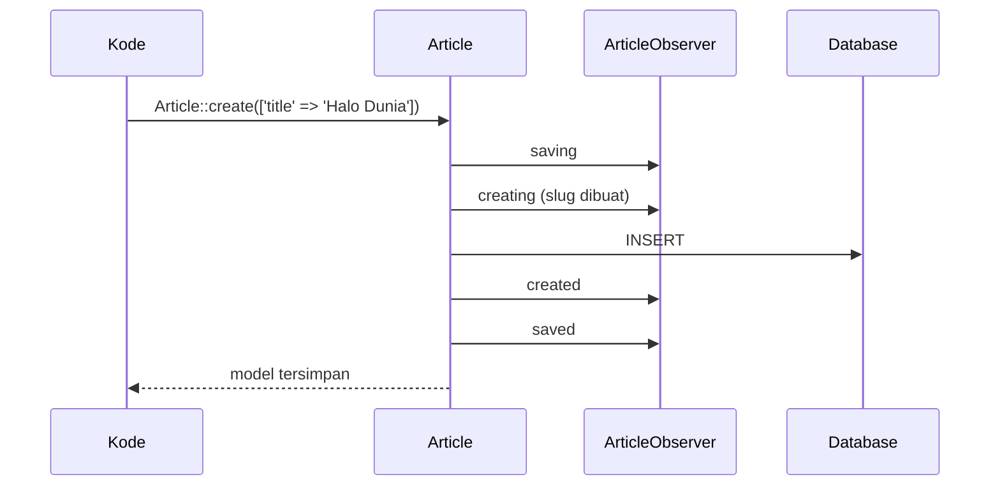

# Event Model dan Observer

Eloquent "memberi tahu" aplikasi pada momen-momen tertentu dalam hidup sebuah model: sebelum dibuat, setelah disimpan, sebelum dihapus, dan seterusnya. Kamu dapat menjalankan kode
otomatis pada momen itu, misalnya membuat slug dari judul, mengisi `published_at`, atau membersihkan data turunan. **Observer** mengelompokkan semua pendengar event itu dalam satu kelas.
Sub bab ini mengajarkan event model, observer, dan batasannya, sekaligus menutup bahan inti Eloquent sebelum proyek akhir.

## Tujuan Pembelajaran

Setelah menyelesaikan sub bab ini, kamu dapat:

- [ ] Menyebutkan event model Eloquent dan urutan terjadinya.
- [ ] Mendengarkan event dengan closure di method `booted`.
- [ ] Membuat observer dengan `make:observer` dan mendaftarkannya dengan `#[ObservedBy]`.
- [ ] Memakai observer untuk membuat slug unik, mengisi `published_at`, dan membersihkan data turunan.
- [ ] Menjelaskan kapan event **tidak** berjalan (operasi massal, `saveQuietly`).
- [ ] Menimbang kapan observer tepat dan kapan membuat logika terlalu "ajaib".

## Prasyarat

- [Operasi CRUD](04-14-crud-operations.md), [Soft Delete](04-27-soft-deletes.md), dan [Relasi Polimorfik](04-22-polymorphic-relationships.md).
- Model `Article` yang sudah lengkap.
- [Class dan Objek](../level-00/00-19-classes-and-objects.md) pada PHP.

## Pengantar

Setiap kali artikel dibuat tanpa slug, kamu ingin slug dibuat dari judul. Menulis `Str::slug()` di setiap controller dan seeder mudah terlupa. Dengan event `creating`, aturan itu hidup
di satu tempat dan berlaku pada semua cara membuat artikel lewat Eloquent.

## Penjelasan Konsep

### Event yang tersedia

Dokumentasi menyebut event model: `retrieved`, `creating`, `created`, `updating`, `updated`, `saving`, `saved`, `deleting`, `deleted`, `trashed`, `forceDeleting`, `forceDeleted`, `restoring`,
`restored`, dan `replicating`.

| Event | Terjadi |
|---|---|
| `retrieved` | Setelah model diambil dari database |
| `creating` / `created` | Sebelum / sesudah baris baru disimpan |
| `updating` / `updated` | Sebelum / sesudah baris yang ada diubah |
| `saving` / `saved` | Sebelum / sesudah `create` **atau** `update` (mencakup keduanya) |
| `deleting` / `deleted` | Sebelum / sesudah dihapus |
| `restoring` / `restored` | Sebelum / sesudah dipulihkan (soft delete) |
| `forceDeleting` / `forceDeleted` | Sebelum / sesudah dihapus permanen |

Urutan saat membuat: `saving` → `creating` → (INSERT) → `created` → `saved`. Event "-ing" berjalan sebelum query sehingga bisa mengubah atribut; event "-ed" berjalan sesudahnya.

### Mendengarkan dengan closure

Dokumentasi menyarankan mendaftarkan closure di method `booted` model:

```php-inline
protected static function booted(): void
{
    static::creating(function (Article $article) {
        if (blank($article->slug)) {
            $article->slug = Str::slug($article->title);
        }
    });
}
```

Cocok untuk satu atau dua pendengar sederhana.

### Observer

Bila ada banyak pendengar, kelompokkan dalam observer:

```bash
php artisan make:observer ArticleObserver --model=Article
```

Observer dibuat di `app/Observers`; nama method mengikuti nama event.

File: `app/Observers/ArticleObserver.php`

```php
<?php

namespace App\Observers;

use App\Models\Article;
use Illuminate\Support\Str;

class ArticleObserver
{
    public function creating(Article $article): void
    {
        if (blank($article->slug)) {
            $article->slug = $this->slugUnik($article->title);
        }
    }

    public function saving(Article $article): void
    {
        if ($article->is_published && is_null($article->published_at)) {
            $article->published_at = now();
        }
    }

    public function forceDeleted(Article $article): void
    {
        $article->images()->delete();
    }

    private function slugUnik(string $judul): string
    {
        $dasar = Str::slug($judul);
        $slug = $dasar;
        $i = 2;

        while (Article::withTrashed()->where('slug', $slug)->exists()) {
            $slug = $dasar.'-'.$i++;
        }

        return $slug;
    }
}
```

| Method | Fungsi |
|---|---|
| `creating` | Membuat slug unik dari judul bila slug kosong |
| `saving` | Mengisi `published_at` otomatis saat artikel diterbitkan |
| `forceDeleted` | Menghapus gambar polimorfik saat artikel dihapus permanen |
| `slugUnik` | Menambah akhiran `-2`, `-3`, ... bila slug sudah dipakai (termasuk baris terhapus) |

### Mendaftarkan observer

Dokumentasi 13.x memakai atribut `ObservedBy` pada model:

```php-inline
use App\Observers\ArticleObserver;
use Illuminate\Database\Eloquent\Attributes\ObservedBy;

#[ObservedBy([ArticleObserver::class])]
class Article extends Model
{
    // ...
}
```

### Kapan event TIDAK berjalan

| Situasi | Event model |
|---|---|
| `Article::where(...)->update([...])` massal | `saved`, `updated`, `deleting`, `deleted` tidak berjalan |
| `Article::where(...)->delete()` massal | Tidak berjalan (model tidak diambil) |
| `$article->saveQuietly()` / `deleteQuietly()` | Sengaja tidak berjalan |
| `Article::withoutEvents(fn () => ...)` | Tidak berjalan di dalam closure |
| Query Builder (`DB::table`) | Tidak ada event model |
| Seeder dengan trait `WithoutModelEvents` | Sengaja dimatikan selama seeding |

Karena itu, **jangan** menjadikan observer satu-satunya penjaga aturan penting; aturan yang harus selalu berlaku sebaiknya juga dijaga constraint database atau validasi.

### Observer atau tempat lain?

| Gunakan observer untuk | Hindari untuk |
|---|---|
| Menurunkan nilai atribut (slug, tanggal terbit) | Logika bisnis besar atau alur multi-langkah (gunakan kelas Action/service) |
| Membersihkan data turunan | Mengirim email/API lambat secara sinkron (gunakan antrean) |
| Mencatat jejak sederhana | Aturan yang tak boleh terlewat (gunakan constraint/validasi) |

Logika di observer "tersembunyi": pembaca controller tidak melihatnya. Dokumentasikan di model (atribut `ObservedBy` sudah membantu) dan jaga observer tetap kecil.

### Keamanan dan keandalan

- Jangan menjalankan operasi berat atau panggilan jaringan di event; kegagalannya dapat menggagalkan penyimpanan model.
- Hati-hati dengan observer yang menyimpan model lagi (`$article->save()` di `saved`): dapat memicu perulangan tak berujung.
- Event `deleting`/`forceDeleted` berguna untuk membersihkan file atau data yatim (gambar polimorfik tidak punya cascade database).

## Cara Kerja



## Contoh Praktik

Kamu membuat `ArticleObserver`, mendaftarkannya, lalu membuktikan slug otomatis dan unik, pengisian `published_at`, pembersihan gambar saat hapus permanen, dan kapan event tidak berjalan.

## Penjelasan Kode

Seluruh kode ada pada bagian konsep. Perhatikan `slugUnik` memeriksa `withTrashed()` supaya slug milik artikel yang di-soft-delete (yang masih menempati indeks unik) ikut dihindari.

## Implementasi Langkah demi Langkah

### Langkah 1: buat observer

```bash
cd ~/belajar-laravel/cms-artikel
php artisan make:observer ArticleObserver --model=Article
```

Isi dengan kode di atas.

### Langkah 2: daftarkan di model

Tambahkan `#[ObservedBy([ArticleObserver::class])]` pada `Article` (dan `use`-nya). Pastikan trait `SoftDeletes` dan relasi `images()` sudah ada.

### Langkah 3: uji slug otomatis

```bash
php artisan migrate:fresh
php artisan tinker
```

```php-inline
use App\Models\Article;

$a = Article::create(['title' => 'Halo Dunia', 'body' => 'Isi']);
$a->slug;
$b = Article::create(['title' => 'Halo Dunia', 'body' => 'Isi lain']);
$b->slug;
```

### Langkah 4: uji `published_at` otomatis

```php-inline
$c = Article::create(['title' => 'Terbit Langsung', 'body' => 'Isi', 'is_published' => true]);
$c->published_at;
$d = Article::create(['title' => 'Masih Draf', 'body' => 'Isi']);
$d->published_at;
```

### Langkah 5: uji pembersihan gambar

```php-inline
$c->images()->create(['url' => 'https://contoh.test/x.jpg']);
App\Models\Image::count();
$c->delete();
App\Models\Image::count();          // masih ada (soft delete)
$c->forceDelete();
App\Models\Image::count();          // sudah dibersihkan
```

### Langkah 6: uji kapan event tidak berjalan

```php-inline
Article::where('title', 'Masih Draf')->update(['is_published' => true]);
Article::where('title', 'Masih Draf')->first()->published_at;   // null: update massal melewati observer

$d->saveQuietly();
Article::withoutEvents(fn () => Article::create(['title' => 'Tanpa Event', 'slug' => 'tanpa-event', 'body' => 'x']));
```

### Langkah 7: catat di Git

```bash
git add app
git commit -m "Tambah ArticleObserver untuk slug, published_at, dan pembersihan gambar"
```

## Eksekusi dan Verifikasi

| Langkah | Cara memverifikasi |
|---|---|
| 3 | `$a->slug` `halo-dunia`; `$b->slug` `halo-dunia-2` |
| 4 | `$c->published_at` terisi; `$d->published_at` `null` |
| 5 | `Image::count()` tidak berubah setelah `delete()` dan menjadi 0 setelah `forceDelete()` |
| 6 | Update massal tidak mengisi `published_at` |

## Hasil yang Diharapkan

| Perintah | Hasil |
|---|---|
| `Article::create(['title' => 'Halo Dunia', ...])->slug` | `halo-dunia` |
| Artikel kedua berjudul sama | `halo-dunia-2` |
| `is_published => true` tanpa `published_at` | `published_at` terisi saat disimpan |
| Update massal `is_published => true` | `published_at` tetap `null` |

Hasil ini diturunkan dari dokumentasi dan belum dijalankan oleh penulis materi; cocokkan dengan hasilmu.

## Kesalahan Umum dan Pemecahan Masalah

| Gejala | Penyebab | Cara mengenali | Solusi | Pencegahan |
|---|---|---|---|---|
| Observer tidak berjalan | Tidak didaftarkan | Slug tidak terisi | Tambahkan `#[ObservedBy]` | Periksa atribut pada model |
| Event tidak jalan pada update massal | Query massal melewati model | Atribut tak berubah | Ambil model dan simpan, atau isi manual | Pahami batas event |
| Perulangan tak berujung | `save()` di dalam `saved` | Proses hang/stack overflow | Hindari menyimpan ulang di event | Gunakan `saving`/`creating` untuk mengubah atribut |
| `NOT NULL constraint failed: slug` | Observer tidak jalan atau `title` kosong | Galat saat simpan | Isi `title`; periksa observer | Validasi input |
| Slug ganda | Tidak memeriksa baris terhapus | Galat unique | Periksa `withTrashed()` | Gunakan `slugUnik` |
| Observer memperlambat simpan | Operasi berat di dalam event | Penyimpanan lambat | Pindahkan ke antrean | Jaga observer ringan |
| Seeder melewati observer | Trait `WithoutModelEvents` | Slug/tanggal tak terisi saat seeding | Isi nilai di seeder atau hapus trait | Sadari efek trait |
| Logika tersembunyi membingungkan tim | Terlalu banyak logika di observer | Bug sulit dilacak | Dokumentasikan, pindahkan ke Action | Batasi cakupan observer |

## Latihan Praktik

### Latihan dasar

**D1. Urutan event**
- *Masalah:* ingin melihat urutan.
- *Persyaratan:* tambahkan `Log::info` atau `echo` di `saving`, `creating`, `created`, `saved` pada observer (sementara) dan catat urutan saat `Article::create`.
- *Perilaku yang diharapkan:* `saving → creating → created → saved`.
- *Tujuan belajar:* memahami urutan event.

**D2. Event tidak berjalan**
- *Masalah:* ingin mengenali batasnya.
- *Persyaratan:* buktikan bahwa `Article::where(...)->update()` tidak memicu `updating`, sedangkan `$article->update()` memicu.
- *Perilaku yang diharapkan:* perbedaan terbukti.
- *Tujuan belajar:* membedakan update model dan massal.

### Latihan implementasi

**I1. Observer kategori**
- *Masalah:* kategori butuh slug otomatis.
- *Persyaratan:* buat `CategoryObserver` yang mengisi `slug` dari `name` pada `creating` dan memperbarui slug saat `name` berubah (`isDirty('name')` di `updating`), dengan keunikan.
- *Perilaku yang diharapkan:* slug mengikuti nama.
- *Tujuan belajar:* menerapkan observer pada model lain.

**I2. Soft delete komentar**
- *Masalah:* komentar harus ikut tersembunyi saat artikel di-soft-delete dan kembali saat dipulihkan.
- *Persyaratan:* gunakan `deleted` dan `restored` pada observer untuk menyoft-delete/memulihkan komentar (setelah menambah `SoftDeletes` ke `Comment`).
- *Perilaku yang diharapkan:* komentar ikut siklus artikel.
- *Tujuan belajar:* menyelaraskan data turunan.

### Latihan tantangan

**T1. Observer atau Action?**
- *Masalah:* tim ingin mengirim email "artikel terbit" saat `is_published` berubah menjadi true.
- *Persyaratan:* rancang dua versi (observer dan kelas Action yang dipanggil controller), bandingkan dari sisi keterlihatan, pengujian, pelewatan event massal, dan penanganan kegagalan, lalu rekomendasikan satu. Email boleh disimulasikan dengan `Log::info`.
- *Perilaku yang diharapkan:* rekomendasi beralasan.
- *Tujuan belajar:* memilih tempat logika yang tepat.
- *Catatan:* kerjakan mandiri; tidak ada kunci jawaban.

## Uji Pemahaman

1. Sebutkan urutan event saat membuat model baru.
2. Apa beda `saving` dan `creating`?
3. Bagaimana mendaftarkan observer di Laravel 13.x?
4. Mengapa update massal tidak memicu event model?
5. Apa fungsi `saveQuietly()`?
6. Mengapa tidak boleh memanggil `save()` di dalam `saved`?
7. Apa risiko menaruh logika bisnis besar di observer?

??? success "Kunci jawaban singkat"
    1. `saving`, `creating`, (INSERT), `created`, `saved`.
    2. `saving` berjalan pada create dan update; `creating` hanya pada create.
    3. Dengan atribut `#[ObservedBy([NamaObserver::class])]` pada model.
    4. Model tidak diambil; hanya SQL massal yang dijalankan.
    5. Menyimpan model tanpa memicu event.
    6. Dapat memicu perulangan tak berujung.
    7. Logika tersembunyi, sulit dilacak dan diuji, dan terlewat pada operasi massal.

## Ringkasan

- Eloquent menyiarkan event siklus hidup (`creating`, `saved`, `deleting`, dan lain-lain).
- Dengarkan dengan closure di `booted`, atau kelompokkan dalam observer dan daftarkan dengan `#[ObservedBy]`.
- Observer cocok untuk menurunkan atribut dan membersihkan data turunan.
- Operasi massal, Query Builder, `saveQuietly`, dan `withoutEvents` tidak memicu event.
- Jaga observer kecil dan jangan jadikan satu-satunya penjaga aturan penting.

Selanjutnya: proyek penutup bab ini, *Sistem Manajemen Artikel dengan Kategori, Pengguna, dan Komentar*.

## Referensi Resmi

- [Laravel: Eloquent Events](https://laravel.com/docs/13.x/eloquent#events)
- [Laravel: Observers](https://laravel.com/docs/13.x/eloquent#observers)
- [Laravel: Muting Events](https://laravel.com/docs/13.x/eloquent#muting-events)
