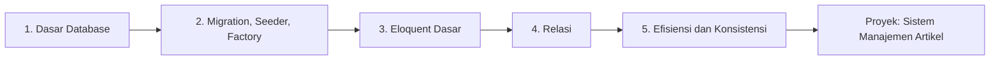

# Peta Belajar: Database dan Eloquent ORM

Bab utama ini menjawab pertanyaan: *bagaimana aplikasi menyimpan dan mengelola data secara permanen?* Kamu akan belajar merancang tabel, menulis migration, mengisi data awal, memakai
Eloquent ORM untuk CRUD dan relasi, menghindari masalah performa, dan menjaga konsistensi data. Semua dikerjakan pada satu proyek, `cms-artikel`, yang berakhir sebagai sistem manajemen artikel.

## Tujuan Pembelajaran

Setelah menyelesaikan bab utama ini, kamu dapat:

- [ ] Membuat dan mengelola migration, seeder, dan factory.
- [ ] Mengimplementasikan relasi satu-ke-satu, satu-ke-banyak, banyak-ke-banyak, *through*, dan polimorfik.
- [ ] Membangun operasi CRUD dengan Eloquent.
- [ ] Memakai Eloquent secara efisien: eager loading, paginasi, dan menghindari N+1.
- [ ] Menjaga konsistensi dengan transaksi, soft delete, dan observer.

## Prasyarat

- Bab utama [Blade Template dan Integrasi Frontend](../level-03/index.md).
- Pemahaman route dan controller dari [bab Routing](../level-02/index.md).

## Gambaran Besar

## Peta Sub Bab

| Sub bab | Yang kamu pelajari | Status |
|---|---|---|
| [Pengantar Database](04-01-introduction-to-databases.md) | Peran database, jenis, dan tiga lapisan akses data | Draf |
| [Dasar Database Relasional](04-02-relational-database-fundamentals.md) | Tabel, kunci, hubungan, dan SQL dasar | Draf |
| [Instalasi dan Konfigurasi MySQL](04-03-mysql-installation-and-configuration.md) | Memasang MySQL/MariaDB dan membuat pengguna aplikasi (opsional) | Draf |
| [Koneksi Database](04-04-database-connection.md) | Konfigurasi `.env`, SQLite, MySQL, dan diagnosis koneksi | Draf |
| [Migration Database](04-05-database-migration.md) | Konsep migration, `migrate`, status, dan batch | Draf |
| [Membuat Migration](04-06-creating-migrations.md) | `make:migration` dan tabel `articles` | Draf |
| [Tipe Kolom Database](04-07-database-column-types.md) | Tipe kolom dan pengubah kolom | Draf |
| [Mengubah Tabel Database](04-08-modifying-database-tables.md) | Menambah, mengubah, mengganti nama, dan menghapus kolom | Draf |
| [Rollback dan Refresh Migration](04-09-migration-rollback-and-refresh.md) | `rollback`, `reset`, `refresh`, dan `fresh` | Draf |
| [Seeder Database](04-10-database-seeder.md) | Data awal dengan seeder yang idempoten | Draf |
| [Model Factory](04-11-model-factories.md) | Data acak dengan factory, state, dan sequence | Draf |
| [Pengantar Eloquent ORM](04-12-introduction-to-eloquent-orm.md) | ORM, Active Record, dan konvensi Eloquent | Draf |
| [Membuat Model](04-13-creating-models.md) | Model, `#[Fillable]`, cast, dan `#[Table]` | Draf |
| [Operasi CRUD](04-14-crud-operations.md) | Create, read, update, dan delete dengan Eloquent | Draf |
| [Query Builder](04-15-query-builder.md) | `DB::table` dan query berantai | Draf |
| [Query Eloquent](04-16-eloquent-queries.md) | Scope, `when()`, dan koleksi | Draf |
| [Kunci Utama dan Kunci Asing](04-17-primary-keys-and-foreign-keys.md) | Kunci utama, kunci asing, dan constraint | Draf |
| [Relasi Satu-ke-Satu](04-18-one-to-one-relationships.md) | `hasOne` dan `belongsTo` | Draf |
| [Relasi Satu-ke-Banyak](04-19-one-to-many-relationships.md) | `hasMany`, `belongsTo`, `has`, dan `withCount` | Draf |
| [Relasi Banyak-ke-Banyak](04-20-many-to-many-relationships.md) | Tabel penghubung, `attach`, `sync`, dan `toggle` | Draf |
| [Has One Through dan Has Many Through](04-21-has-one-through-and-has-many-through.md) | Relasi melalui perantara | Draf |
| [Relasi Polimorfik](04-22-polymorphic-relationships.md) | `morphMany`, `morphTo`, dan morph map | Draf |
| [Eager Loading](04-23-eager-loading.md) | `with`, `load`, dan `withCount` | Draf |
| [Masalah N+1 Query](04-24-n-plus-one-query-problem.md) | Mendeteksi dan memperbaiki N+1 | Draf |
| [Paginasi](04-25-pagination.md) | `paginate`, `simplePaginate`, dan `cursorPaginate` | Draf |
| [Transaksi Database](04-26-database-transactions.md) | `DB::transaction` dan rollback | Draf |
| [Soft Delete](04-27-soft-deletes.md) | `SoftDeletes`, `restore`, dan `forceDelete` | Draf |
| [Event Model dan Observer](04-28-model-events-and-observers.md) | Event model dan `#[ObservedBy]` | Draf |

### Proyek Praktik

| Proyek | Hasil akhir | Status |
|---|---|---|
| [Sistem Manajemen Artikel](proyek-sistem-manajemen-artikel.md) | Artikel dengan kategori, pengguna, tag, dan komentar | Draf |

## Kriteria Penyelesaian

- [ ] Mampu membuat dan mengelola migration.
- [ ] Mampu menerapkan relasi database.
- [ ] Mampu membangun operasi CRUD.
- [ ] Mampu memakai Eloquent secara efisien.

## Cara Belajar yang Disarankan

1. Buka dokumentasi Laravel versi **13.x** saat mencari referensi.
2. Gunakan satu proyek, `cms-artikel`, yang dibuat pada sub bab Koneksi Database, dan commit di Git setiap selesai satu sub bab.
3. Jalankan `php artisan db:table` dan `php artisan model:show` untuk melihat hasil kerjamu.
4. Gunakan Tinker untuk bereksperimen sebelum menulis ke controller.

!!! info "Status materi"
    Semua dua puluh delapan sub bab pada bab utama ini sudah tersedia (berstatus **DRAFT**), beserta proyek praktik penutup. Kode belum dijalankan penulis pada aplikasi Laravel sungguhan;
    hasil yang diharapkan diturunkan dari dokumentasi dan perlu kamu cocokkan.

## Referensi Resmi

- [Laravel: Database](https://laravel.com/docs/13.x/database)
- [Laravel: Migrations](https://laravel.com/docs/13.x/migrations)
- [Laravel: Eloquent ORM](https://laravel.com/docs/13.x/eloquent)
- [Laravel: Eloquent Relationships](https://laravel.com/docs/13.x/eloquent-relationships)
