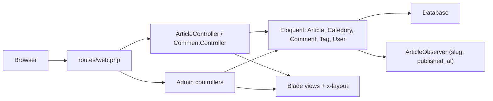

# Proyek Praktik: Sistem Manajemen Artikel

Kamu sudah menyelesaikan seluruh sub bab **Database dan Eloquent ORM**. Pada proyek ini semuanya dipakai bersama membangun **Sistem Manajemen Artikel** pada proyek `cms-artikel`:
halaman publik dengan daftar artikel (filter kategori, pencarian, paginasi), halaman detail dengan tag dan komentar, serta area admin untuk mengelola artikel (termasuk tempat sampah),
kategori, dan moderasi komentar. Seluruh data tersimpan di database lewat migration, model, relasi, dan seeder.

## Tujuan Pembelajaran

Setelah menyelesaikan proyek ini, kamu dapat:

- [ ] Menyusun skema lengkap (users, profiles, categories, articles, comments, tags, article_tag, images) lewat migration.
- [ ] Mengisi database dengan seeder dan factory yang realistis dan dapat diulang.
- [ ] Mengimplementasikan CRUD artikel dengan relasi (kategori, penulis, tag) dalam transaksi.
- [ ] Menampilkan daftar dengan eager loading, `withCount`, filter, pencarian, dan paginasi tanpa N+1.
- [ ] Memakai soft delete (hapus, pulihkan) dan observer (slug, `published_at`).
- [ ] Memvalidasi input dan melindungi form dengan CSRF.
- [ ] Memverifikasi perilaku utama dengan `curl` dan menghitung jumlah query.

## Prasyarat

Proyek ini memakai seluruh bab ini, terutama [Migration](04-06-creating-migrations.md), [Seeder](04-10-database-seeder.md), [Factory](04-11-model-factories.md),
[Relasi Satu-ke-Banyak](04-19-one-to-many-relationships.md), [Banyak-ke-Banyak](04-20-many-to-many-relationships.md), [Eager Loading](04-23-eager-loading.md),
[Paginasi](04-25-pagination.md), [Transaksi](04-26-database-transactions.md), [Soft Delete](04-27-soft-deletes.md), dan [Observer](04-28-model-events-and-observers.md);
serta bab Blade ([Layout](../level-03/03-06-blade-layouts.md), [Form](../level-03/03-12-blade-forms.md), [Pesan Error Form](../level-03/03-15-form-error-messages.md)).

Kondisi awal `~/belajar-laravel/cms-artikel` (hasil sub bab sebelumnya):

| Komponen | Keterangan |
|---|---|
| Tabel | `users`, `categories`, `articles` (kolom publikasi, `user_id`, `category_id`, `deleted_at`), `comments`, `tags`, `article_tag`, `profiles`, `images` |
| Model | `Article` (relasi, scope `published` dan `search`, `SoftDeletes`, `ObservedBy`), `Category`, `Comment`, `Tag`, `Profile`, `Image`, `User` |
| Factory | `UserFactory`, `ArticleFactory` (state `published`), `ProfileFactory` |
| Aset | `npm install` sudah dijalankan; Tailwind bawaan kerangka masih aktif di `resources/css/app.css` |

Bila ada bagian yang belum kamu punya, kembali ke sub bab terkait. Lingkungan: PHP 8.3 atau lebih baru, Composer, Node.js, dan terminal Bash. Database: SQLite (bawaan) atau MySQL.

!!! warning "Belum ada login"
    Proyek ini **belum memiliki autentikasi**: siapa pun yang mengetahui alamat `/admin` dapat mengubah data. Jangan dipasang di internet. Autentikasi dan otorisasi dibahas pada bab keamanan.
    Karena belum ada login, komentar ditulis dengan nama bebas (`author_name`) dan penulis artikel dipilih dari daftar pengguna di form admin.

## Pengantar

Aplikasi nyata mempertemukan hampir semua topik bab ini sekaligus: relasi dipakai untuk menampilkan data, transaksi menjaga konsistensi saat menyimpan, eager loading menjaga halaman tetap cepat,
dan observer memastikan aturan kecil (slug, tanggal terbit) tak terlupa. Proyek ini adalah latihan menyatukannya.

## Penjelasan Konsep

### Persyaratan aplikasi

| Kebutuhan | Halaman | Hasil |
|---|---|---|
| Beranda | `GET /` | Redirect ke `/artikel` |
| Daftar publik | `GET /artikel` | Artikel terbit, 6 per halaman, filter `?kategori=slug`, pencarian `?q=` |
| Detail publik | `GET /artikel/{slug}` | Isi, kategori, penulis, tag, komentar; 404 untuk draf |
| Tulis komentar | `POST /artikel/{slug}/komentar` | Validasi lalu redirect dengan pesan |
| Admin artikel | `GET /admin/artikel` | Daftar (aktif atau tempat sampah), 10 per halaman |
| Admin buat/ubah | `GET/POST/PUT /admin/artikel...` | Form dengan kategori, penulis, tag; disimpan dalam transaksi |
| Admin hapus/pulihkan | `DELETE`, `PATCH /admin/artikel/...` | Soft delete dan pemulihan |
| Admin kategori | `GET/POST/DELETE /admin/kategori` | Daftar, tambah, hapus |
| Admin komentar | `DELETE /admin/komentar/{id}` | Hapus komentar |

### Rancangan

| Bagian | Peran |
|---|---|
| `ArticleController`, `CommentController` | Halaman publik dan komentar |
| `Admin\ArticleController`, `Admin\CategoryController`, `Admin\CommentController` | Pengelolaan |
| `DatabaseSeeder` | Data contoh lengkap |
| Migration `add_author_name_to_comments_table` | Nama penulis komentar tanpa login |
| View `components/layout`, `articles/*`, `admin/*` | Tampilan Blade dengan Tailwind bawaan |

### Keamanan

- Semua form `POST`/`PUT`/`PATCH`/`DELETE` memakai `@csrf` dan `@method`.
- Input divalidasi di server; kunci asing dicek dengan `exists:`.
- Kunci asing tidak masuk `#[Fillable]`; dihubungkan lewat `associate`.
- Semua data dicetak dengan `{{ }}`; komentar tidak memakai `{!! !!}`.
- `per_page`/halaman dibatasi tetap (6 dan 10) sehingga tidak dikendalikan pengguna.

## Cara Kerja



## Contoh Praktik

### Struktur akhir (berkas yang kamu tambah atau ubah)

```text
database/migrations/xxxx_add_author_name_to_comments_table.php
database/factories/{CategoryFactory,TagFactory,CommentFactory}.php   (lengkapi)
database/seeders/DatabaseSeeder.php
app/Models/Comment.php                                               (Fillable)
app/Http/Controllers/ArticleController.php
app/Http/Controllers/CommentController.php
app/Http/Controllers/Admin/ArticleController.php
app/Http/Controllers/Admin/CategoryController.php
app/Http/Controllers/Admin/CommentController.php
routes/web.php
resources/views/components/layout.blade.php
resources/views/articles/{index,show}.blade.php
resources/views/admin/articles/{index,form}.blade.php
resources/views/admin/categories/index.blade.php
```

## Penjelasan Kode

### Migration dan model komentar

File: `database/migrations/xxxx_add_author_name_to_comments_table.php`

```php-inline
public function up(): void
{
    Schema::table('comments', function (Blueprint $table) {
        $table->string('author_name', 50)->nullable()->after('user_id');
    });
}

public function down(): void
{
    Schema::table('comments', function (Blueprint $table) {
        $table->dropColumn('author_name');
    });
}
```

File: `app/Models/Comment.php` (ubah atribut)

```php-inline
#[Fillable(['author_name', 'body'])]
```

### Factory

```php-inline
// CategoryFactory::definition()
$name = fake()->unique()->words(2, true);
return ['name' => ucfirst($name), 'slug' => Str::slug($name)];

// TagFactory::definition()
return ['name' => fake()->unique()->word()];

// CommentFactory::definition()
return [
    'article_id' => Article::factory(),
    'user_id' => null,
    'author_name' => fake()->name(),
    'body' => fake()->sentence(12),
];
```

### Seeder

File: `database/seeders/DatabaseSeeder.php`

```php
<?php

namespace Database\Seeders;

use App\Models\Article;
use App\Models\Category;
use App\Models\Comment;
use App\Models\Profile;
use App\Models\Tag;
use App\Models\User;
use Illuminate\Database\Seeder;

class DatabaseSeeder extends Seeder
{
    public function run(): void
    {
        $users = User::factory()->count(3)->has(Profile::factory())->create();
        $categories = Category::factory()->count(5)->create();
        $tags = Tag::factory()->count(8)->create();

        $published = Article::factory()->count(25)->published()
            ->recycle($users)->recycle($categories)->create();
        Article::factory()->count(5)->recycle($users)->recycle($categories)->create();

        Article::all()->each(function (Article $article) use ($tags) {
            $article->tags()->attach($tags->random(rand(1, 3))->pluck('id'));
        });

        $published->each(function (Article $article) {
            Comment::factory()->count(rand(0, 4))->for($article)->create();
        });
    }
}
```

| Bagian | Fungsi |
|---|---|
| `has(Profile::factory())` | Setiap pengguna mendapat satu profil |
| `recycle($users)->recycle($categories)` | Artikel berbagi pengguna dan kategori yang ada |
| `attach($tags->random(...))` | 1–3 tag acak per artikel |
| `Comment::factory()->count(rand(0, 4))->for($article)` | 0–4 komentar per artikel terbit |

Seeder menyertakan trait `WithoutModelEvents` bawaan bila ada; karena factory sudah mengisi `slug` dan `published_at`, observer tidak diperlukan saat seeding.

### Route

File: `routes/web.php` (ganti seluruh isi route latihan sebelumnya; pertahankan `use` yang ada)

```php-inline
use App\Http\Controllers\Admin\ArticleController as AdminArticleController;
use App\Http\Controllers\Admin\CategoryController as AdminCategoryController;
use App\Http\Controllers\Admin\CommentController as AdminCommentController;
use App\Http\Controllers\ArticleController;
use App\Http\Controllers\CommentController;
use Illuminate\Support\Facades\Route;

Route::redirect('/', '/artikel');

Route::get('/artikel', [ArticleController::class, 'index'])->name('articles.index');
Route::get('/artikel/{article:slug}', [ArticleController::class, 'show'])->name('articles.show');
Route::post('/artikel/{article:slug}/komentar', [CommentController::class, 'store'])->name('comments.store');

Route::prefix('admin')->name('admin.')->group(function () {
    Route::get('/artikel', [AdminArticleController::class, 'index'])->name('articles.index');
    Route::get('/artikel/baru', [AdminArticleController::class, 'create'])->name('articles.create');
    Route::post('/artikel', [AdminArticleController::class, 'store'])->name('articles.store');
    Route::get('/artikel/{article}/ubah', [AdminArticleController::class, 'edit'])->whereNumber('article')->name('articles.edit');
    Route::put('/artikel/{article}', [AdminArticleController::class, 'update'])->whereNumber('article')->name('articles.update');
    Route::delete('/artikel/{article}', [AdminArticleController::class, 'destroy'])->whereNumber('article')->name('articles.destroy');
    Route::patch('/artikel/{id}/pulihkan', [AdminArticleController::class, 'restore'])->whereNumber('id')->name('articles.restore');

    Route::get('/kategori', [AdminCategoryController::class, 'index'])->name('categories.index');
    Route::post('/kategori', [AdminCategoryController::class, 'store'])->name('categories.store');
    Route::delete('/kategori/{category}', [AdminCategoryController::class, 'destroy'])->whereNumber('category')->name('categories.destroy');

    Route::delete('/komentar/{comment}', [AdminCommentController::class, 'destroy'])->whereNumber('comment')->name('comments.destroy');
});
```

`/artikel/baru` di area admin ditulis sebelum route berparameter. Route publik memakai `{article:slug}` sehingga artikel dicari berdasarkan slug, bukan `id`.

### Controller publik

File: `app/Http/Controllers/ArticleController.php`

```php
<?php

namespace App\Http\Controllers;

use App\Models\Article;
use App\Models\Category;
use Illuminate\Http\Request;
use Illuminate\View\View;

class ArticleController extends Controller
{
    public function index(Request $request): View
    {
        $articles = Article::published()
            ->search($request->query('q'))
            ->when($request->query('kategori'), function ($query, $slug) {
                $query->whereHas('category', fn ($c) => $c->where('slug', $slug));
            })
            ->with(['category:id,name,slug', 'user:id,name'])
            ->withCount('comments')
            ->latest('published_at')
            ->paginate(6)
            ->withQueryString();

        $categories = Category::withCount(['articles as published_count' => fn ($q) => $q->published()])
            ->orderBy('name')
            ->get();

        return view('articles.index', compact('articles', 'categories'));
    }

    public function show(Article $article): View
    {
        abort_unless($article->is_published, 404);

        $article->load([
            'category:id,name,slug',
            'user:id,name',
            'tags:id,name',
            'comments' => fn ($q) => $q->latest(),
        ]);

        return view('articles.show', compact('article'));
    }
}
```

File: `app/Http/Controllers/CommentController.php`

```php
<?php

namespace App\Http\Controllers;

use App\Models\Article;
use Illuminate\Http\RedirectResponse;
use Illuminate\Http\Request;

class CommentController extends Controller
{
    public function store(Request $request, Article $article): RedirectResponse
    {
        abort_unless($article->is_published, 404);

        $data = $request->validate([
            'author_name' => ['required', 'string', 'min:2', 'max:50'],
            'body' => ['required', 'string', 'min:3', 'max:1000'],
        ]);

        $article->comments()->create($data);

        return redirect()->route('articles.show', $article)->with('status', 'Komentar ditambahkan.');
    }
}
```

### Controller admin

File: `app/Http/Controllers/Admin/ArticleController.php`

```php
<?php

namespace App\Http\Controllers\Admin;

use App\Http\Controllers\Controller;
use App\Models\Article;
use App\Models\Category;
use App\Models\Tag;
use App\Models\User;
use Illuminate\Http\RedirectResponse;
use Illuminate\Http\Request;
use Illuminate\Support\Arr;
use Illuminate\Support\Facades\DB;
use Illuminate\Validation\Rule;
use Illuminate\View\View;

class ArticleController extends Controller
{
    public function index(Request $request): View
    {
        $sampah = $request->boolean('sampah');

        $articles = Article::query()
            ->when($sampah, fn ($q) => $q->onlyTrashed())
            ->with(['category:id,name', 'user:id,name'])
            ->withCount('comments')
            ->latest()
            ->paginate(10)
            ->withQueryString();

        return view('admin.articles.index', compact('articles', 'sampah'));
    }

    public function create(): View
    {
        return view('admin.articles.form', $this->formData(new Article()));
    }

    public function store(Request $request): RedirectResponse
    {
        $data = $this->validated($request);

        $article = DB::transaction(function () use ($data, $request) {
            $article = new Article(Arr::only($data, ['title', 'slug', 'body']));
            $article->is_published = $request->boolean('is_published');
            $article->user()->associate($data['user_id']);
            $article->category()->associate($data['category_id'] ?? null);
            $article->save();
            $article->tags()->sync($data['tags'] ?? []);

            return $article;
        });

        return redirect()->route('admin.articles.index')
            ->with('status', "Artikel \"{$article->title}\" dibuat.");
    }

    public function edit(Article $article): View
    {
        return view('admin.articles.form', $this->formData($article));
    }

    public function update(Request $request, Article $article): RedirectResponse
    {
        $data = $this->validated($request, $article);

        DB::transaction(function () use ($data, $request, $article) {
            $article->fill(Arr::only($data, ['title', 'body']));
            if (filled($data['slug'] ?? null)) {
                $article->slug = $data['slug'];
            }
            $article->is_published = $request->boolean('is_published');
            $article->user()->associate($data['user_id']);
            $article->category()->associate($data['category_id'] ?? null);
            $article->save();
            $article->tags()->sync($data['tags'] ?? []);
        });

        return redirect()->route('admin.articles.index')
            ->with('status', "Artikel \"{$article->title}\" diperbarui.");
    }

    public function destroy(Article $article): RedirectResponse
    {
        $article->delete();

        return redirect()->route('admin.articles.index')
            ->with('status', "Artikel \"{$article->title}\" dipindah ke tempat sampah.");
    }

    public function restore(int $id): RedirectResponse
    {
        $article = Article::onlyTrashed()->findOrFail($id);
        $article->restore();

        return redirect()->route('admin.articles.index')
            ->with('status', "Artikel \"{$article->title}\" dipulihkan.");
    }

    private function validated(Request $request, ?Article $article = null): array
    {
        return $request->validate([
            'title' => ['required', 'string', 'max:200'],
            'slug' => ['nullable', 'string', 'max:200', Rule::unique('articles', 'slug')->ignore($article?->id)],
            'body' => ['required', 'string'],
            'user_id' => ['required', 'exists:users,id'],
            'category_id' => ['nullable', 'exists:categories,id'],
            'tags' => ['nullable', 'array'],
            'tags.*' => ['integer', 'exists:tags,id'],
        ]);
    }

    private function formData(Article $article): array
    {
        return [
            'article' => $article->loadMissing('tags:id,name'),
            'users' => User::orderBy('name')->get(['id', 'name']),
            'categories' => Category::orderBy('name')->get(['id', 'name']),
            'tags' => Tag::orderBy('name')->get(['id', 'name']),
        ];
    }
}
```

File: `app/Http/Controllers/Admin/CategoryController.php`

```php
<?php

namespace App\Http\Controllers\Admin;

use App\Http\Controllers\Controller;
use App\Models\Category;
use Illuminate\Http\RedirectResponse;
use Illuminate\Http\Request;
use Illuminate\Support\Str;
use Illuminate\View\View;

class CategoryController extends Controller
{
    public function index(): View
    {
        return view('admin.categories.index', [
            'categories' => Category::withCount('articles')->orderBy('name')->get(),
        ]);
    }

    public function store(Request $request): RedirectResponse
    {
        $data = $request->validate(['name' => ['required', 'string', 'max:50', 'unique:categories,name']]);

        Category::create(['name' => $data['name'], 'slug' => Str::slug($data['name'])]);

        return redirect()->route('admin.categories.index')->with('status', 'Kategori ditambahkan.');
    }

    public function destroy(Category $category): RedirectResponse
    {
        $category->delete();

        return redirect()->route('admin.categories.index')
            ->with('status', 'Kategori dihapus; artikelnya menjadi tanpa kategori.');
    }
}
```

File: `app/Http/Controllers/Admin/CommentController.php`

```php
<?php

namespace App\Http\Controllers\Admin;

use App\Http\Controllers\Controller;
use App\Models\Comment;
use Illuminate\Http\RedirectResponse;

class CommentController extends Controller
{
    public function destroy(Comment $comment): RedirectResponse
    {
        $article = $comment->article;
        $comment->delete();

        return redirect()->route('articles.show', $article)->with('status', 'Komentar dihapus.');
    }
}
```

| Bagian | Fungsi |
|---|---|
| `DB::transaction(...)` | Artikel dan tag disimpan bersama atau tidak sama sekali |
| `associate(...)` | Menghubungkan penulis dan kategori tanpa membuka kunci asing ke mass assignment |
| `Rule::unique(...)->ignore(...)` | Slug unik, mengabaikan artikel yang sedang diubah |
| `onlyTrashed()` / `restore()` | Tempat sampah dan pemulihan |
| `Category::delete()` | `nullOnDelete` membuat artikel kategori itu menjadi tanpa kategori |

Hapus komentar mengarahkan ke halaman artikel agar moderasi dapat dilakukan langsung di tempat komentar itu muncul.

### Tampilan

File: `resources/views/components/layout.blade.php`

```html
@props(['title' => null])
<!DOCTYPE html>
<html lang="id">
<head>
    <meta charset="UTF-8">
    <meta name="viewport" content="width=device-width, initial-scale=1">
    <title>{{ $title ? $title.' - ' : '' }}CMS Artikel</title>
    @vite(['resources/css/app.css', 'resources/js/app.js'])
</head>
<body class="bg-gray-50 text-gray-900">
    <header class="bg-white border-b">
        <nav class="max-w-4xl mx-auto p-4 flex gap-4">
            <a href="{{ route('articles.index') }}" class="font-bold">CMS Artikel</a>
            <a href="{{ route('admin.articles.index') }}">Admin Artikel</a>
            <a href="{{ route('admin.categories.index') }}">Admin Kategori</a>
        </nav>
    </header>

    <main class="max-w-4xl mx-auto p-4">
        @session('status')
            <div class="mb-4 p-3 bg-green-100 rounded">{{ $value }}</div>
        @endsession

        @if ($errors->any())
            <div class="mb-4 p-3 bg-red-100 rounded">
                <ul class="list-disc ml-5">
                    @foreach ($errors->all() as $pesan)
                        <li>{{ $pesan }}</li>
                    @endforeach
                </ul>
            </div>
        @endif

        {{ $slot }}
    </main>
</body>
</html>
```

File: `resources/views/articles/index.blade.php`

```html
<x-layout title="Artikel">
    <form method="GET" action="{{ route('articles.index') }}" class="mb-4 flex gap-2">
        <input type="text" name="q" value="{{ request('q') }}" placeholder="Cari judul" class="border rounded p-2 flex-1">
        <select name="kategori" class="border rounded p-2">
            <option value="">Semua kategori</option>
            @foreach ($categories as $category)
                <option value="{{ $category->slug }}" @selected(request('kategori') === $category->slug)>
                    {{ $category->name }} ({{ $category->published_count }})
                </option>
            @endforeach
        </select>
        <button class="bg-blue-600 text-white rounded px-4">Cari</button>
    </form>

    @forelse ($articles as $article)
        <article class="bg-white border rounded p-4 mb-3">
            <h2 class="text-xl font-semibold">
                <a href="{{ route('articles.show', $article) }}">{{ $article->title }}</a>
            </h2>
            <p class="text-sm text-gray-500">
                {{ $article->category?->name ?? 'Tanpa kategori' }}
                · {{ $article->user?->name ?? 'Anonim' }}
                · {{ $article->published_at?->translatedFormat('d F Y') }}
                · {{ $article->comments_count }} komentar
            </p>
            <p>{{ Str::limit($article->body, 150) }}</p>
        </article>
    @empty
        <p>Tidak ada artikel.</p>
    @endforelse

    {{ $articles->links() }}
</x-layout>
```

File: `resources/views/articles/show.blade.php`

```html
<x-layout :title="$article->title">
    <article class="bg-white border rounded p-4 mb-6">
        <h1 class="text-2xl font-bold">{{ $article->title }}</h1>
        <p class="text-sm text-gray-500 mb-3">
            {{ $article->category?->name ?? 'Tanpa kategori' }}
            · {{ $article->user?->name ?? 'Anonim' }}
            · {{ $article->published_at?->translatedFormat('d F Y') }}
        </p>
        <div class="whitespace-pre-line">{{ $article->body }}</div>
        <p class="mt-3 text-sm">
            @foreach ($article->tags as $tag)
                <span class="inline-block bg-gray-200 rounded px-2 mr-1">#{{ $tag->name }}</span>
            @endforeach
        </p>
    </article>

    <h2 class="text-lg font-semibold mb-2">{{ $article->comments->count() }} komentar</h2>
    @forelse ($article->comments as $comment)
        <div class="bg-white border rounded p-3 mb-2">
            <strong>{{ $comment->author_name ?? 'Anonim' }}</strong>
            <span class="text-xs text-gray-500">{{ $comment->created_at->diffForHumans() }}</span>
            <p>{{ $comment->body }}</p>
            <form method="POST" action="{{ route('admin.comments.destroy', $comment) }}" class="mt-1">
                @csrf
                @method('DELETE')
                <button class="text-xs text-red-600">Hapus (admin)</button>
            </form>
        </div>
    @empty
        <p class="text-gray-500">Belum ada komentar.</p>
    @endforelse

    <form method="POST" action="{{ route('comments.store', $article) }}" class="mt-4 bg-white border rounded p-4">
        @csrf
        <p class="mb-2">
            <label for="author_name">Nama</label><br>
            <input id="author_name" name="author_name" value="{{ old('author_name') }}" class="border rounded p-2 w-full">
        </p>
        <p class="mb-2">
            <label for="body">Komentar</label><br>
            <textarea id="body" name="body" rows="3" class="border rounded p-2 w-full">{{ old('body') }}</textarea>
        </p>
        <button class="bg-blue-600 text-white rounded px-4 py-2">Kirim komentar</button>
    </form>
</x-layout>
```

File: `resources/views/admin/articles/index.blade.php`

```html
<x-layout title="Admin Artikel">
    <div class="flex justify-between mb-3">
        <h1 class="text-xl font-bold">{{ $sampah ? 'Tempat Sampah' : 'Artikel' }}</h1>
        <div class="flex gap-3">
            <a href="{{ route('admin.articles.index', ['sampah' => $sampah ? 0 : 1]) }}">
                {{ $sampah ? 'Lihat aktif' : 'Lihat tempat sampah' }}
            </a>
            <a href="{{ route('admin.articles.create') }}" class="bg-blue-600 text-white rounded px-3 py-1">Artikel baru</a>
        </div>
    </div>

    <table class="w-full bg-white border">
        <thead><tr class="text-left"><th class="p-2">Judul</th><th>Kategori</th><th>Penulis</th><th>Status</th><th>Komentar</th><th>Aksi</th></tr></thead>
        <tbody>
            @forelse ($articles as $article)
                <tr class="border-t">
                    <td class="p-2">{{ $article->title }}</td>
                    <td>{{ $article->category?->name ?? '-' }}</td>
                    <td>{{ $article->user?->name ?? '-' }}</td>
                    <td>{{ $article->is_published ? 'Terbit' : 'Draf' }}</td>
                    <td>{{ $article->comments_count }}</td>
                    <td class="flex gap-2 p-2">
                        @if ($sampah)
                            <form method="POST" action="{{ route('admin.articles.restore', $article->id) }}">
                                @csrf
                                @method('PATCH')
                                <button class="text-blue-600">Pulihkan</button>
                            </form>
                        @else
                            <a href="{{ route('admin.articles.edit', $article) }}">Ubah</a>
                            <form method="POST" action="{{ route('admin.articles.destroy', $article) }}"
                                  onsubmit="return confirm('Pindahkan ke tempat sampah?')">
                                @csrf
                                @method('DELETE')
                                <button class="text-red-600">Hapus</button>
                            </form>
                        @endif
                    </td>
                </tr>
            @empty
                <tr><td colspan="6" class="p-3">Tidak ada artikel.</td></tr>
            @endforelse
        </tbody>
    </table>

    <div class="mt-3">{{ $articles->links() }}</div>
</x-layout>
```

File: `resources/views/admin/articles/form.blade.php`

```html
@php($editing = $article->exists)

<x-layout :title="$editing ? 'Ubah Artikel' : 'Artikel Baru'">
    <h1 class="text-xl font-bold mb-3">{{ $editing ? 'Ubah Artikel' : 'Artikel Baru' }}</h1>

    <form method="POST" class="bg-white border rounded p-4"
          action="{{ $editing ? route('admin.articles.update', $article) : route('admin.articles.store') }}">
        @csrf
        @if ($editing)
            @method('PUT')
        @endif

        <p class="mb-2">
            <label for="title">Judul</label><br>
            <input id="title" name="title" value="{{ old('title', $article->title) }}" class="border rounded p-2 w-full">
        </p>
        <p class="mb-2">
            <label for="slug">Slug (kosongkan untuk otomatis)</label><br>
            <input id="slug" name="slug" value="{{ old('slug', $article->slug) }}" class="border rounded p-2 w-full">
        </p>
        <p class="mb-2">
            <label for="body">Isi</label><br>
            <textarea id="body" name="body" rows="6" class="border rounded p-2 w-full">{{ old('body', $article->body) }}</textarea>
        </p>
        <p class="mb-2">
            <label for="user_id">Penulis</label><br>
            <select id="user_id" name="user_id" class="border rounded p-2">
                @foreach ($users as $user)
                    <option value="{{ $user->id }}" @selected((string) old('user_id', $article->user_id) === (string) $user->id)>{{ $user->name }}</option>
                @endforeach
            </select>
        </p>
        <p class="mb-2">
            <label for="category_id">Kategori</label><br>
            <select id="category_id" name="category_id" class="border rounded p-2">
                <option value="">-- tanpa kategori --</option>
                @foreach ($categories as $category)
                    <option value="{{ $category->id }}" @selected((string) old('category_id', $article->category_id) === (string) $category->id)>{{ $category->name }}</option>
                @endforeach
            </select>
        </p>
        <fieldset class="mb-2">
            <legend>Tag</legend>
            @php($selected = collect(old('tags', $article->tags->pluck('id')->all())))
            @foreach ($tags as $tag)
                <label class="mr-3">
                    <input type="checkbox" name="tags[]" value="{{ $tag->id }}" @checked($selected->contains($tag->id))>
                    {{ $tag->name }}
                </label>
            @endforeach
        </fieldset>
        <p class="mb-3">
            <label>
                <input type="checkbox" name="is_published" value="1" @checked(old('is_published', $article->is_published))>
                Terbitkan
            </label>
        </p>

        <button class="bg-blue-600 text-white rounded px-4 py-2">Simpan</button>
        <a href="{{ route('admin.articles.index') }}" class="ml-2">Batal</a>
    </form>
</x-layout>
```

File: `resources/views/admin/categories/index.blade.php`

```html
<x-layout title="Admin Kategori">
    <h1 class="text-xl font-bold mb-3">Kategori</h1>

    <form method="POST" action="{{ route('admin.categories.store') }}" class="mb-4 flex gap-2">
        @csrf
        <input name="name" value="{{ old('name') }}" placeholder="Nama kategori" class="border rounded p-2 flex-1">
        <button class="bg-blue-600 text-white rounded px-4">Tambah</button>
    </form>

    <table class="w-full bg-white border">
        <thead><tr class="text-left"><th class="p-2">Nama</th><th>Slug</th><th>Artikel</th><th>Aksi</th></tr></thead>
        <tbody>
            @forelse ($categories as $category)
                <tr class="border-t">
                    <td class="p-2">{{ $category->name }}</td>
                    <td>{{ $category->slug }}</td>
                    <td>{{ $category->articles_count }}</td>
                    <td>
                        <form method="POST" action="{{ route('admin.categories.destroy', $category) }}"
                              onsubmit="return confirm('Hapus kategori ini?')">
                            @csrf
                            @method('DELETE')
                            <button class="text-red-600">Hapus</button>
                        </form>
                    </td>
                </tr>
            @empty
                <tr><td colspan="4" class="p-3">Belum ada kategori.</td></tr>
            @endforelse
        </tbody>
    </table>
</x-layout>
```

Beberapa catatan tampilan: Tailwind di sini dipakai sekadarnya agar halaman terbaca; fokus proyek adalah data. `Str::limit` dipakai langsung di view (facade `Str` tersedia sebagai alias global di Blade pada
aplikasi Laravel, atau tulis `Illuminate\Support\Str::limit(...)`). `translatedFormat` memakai locale aplikasi (`APP_LOCALE`); bila nama bulan berbahasa Inggris, ubah `APP_LOCALE=id` di `.env`.

## Implementasi Langkah demi Langkah

### Langkah 1: periksa kondisi awal

```bash
cd ~/belajar-laravel/cms-artikel
git status
php artisan migrate:status
```

Pastikan semua migration sebelumnya `Ran` dan pekerjaan sudah di-*commit*.

### Langkah 2: tambah kolom `author_name`

```bash
php artisan make:migration add_author_name_to_comments_table --table=comments
```

Isi `up()`/`down()` seperti di atas dan ubah `#[Fillable]` pada `Comment`.

### Langkah 3: lengkapi factory dan seeder

Isi `CategoryFactory`, `TagFactory`, dan `CommentFactory`, lalu ganti `DatabaseSeeder`.

### Langkah 4: bangun ulang dan isi data

```bash
php artisan migrate:fresh --seed
php artisan tinker --execute="echo App\Models\Article::count().' artikel, '.App\Models\Comment::count().' komentar';"
```

### Langkah 5: route dan controller

Buat controller:

```bash
php artisan make:controller ArticleController
php artisan make:controller CommentController
php artisan make:controller Admin/ArticleController
php artisan make:controller Admin/CategoryController
php artisan make:controller Admin/CommentController
```

Isi dengan kode di atas, ganti `routes/web.php`, lalu:

```bash
php artisan route:list --path=artikel
php artisan route:list --path=admin
```

### Langkah 6: view

Buat `components/layout.blade.php`, `articles/index`, `articles/show`, `admin/articles/index`, `admin/articles/form`, dan `admin/categories/index`.

### Langkah 7: jalankan

Terminal 1: `php artisan serve`. Terminal 2: `npm run dev` (agar Tailwind dan gaya paginasi termuat).

### Langkah 8: uji manual di browser

1. Buka `http://127.0.0.1:8000/`: daftar artikel 6 per halaman dengan tautan halaman.
2. Pilih kategori dan cari kata; pindah ke halaman 2 dan pastikan filter terbawa.
3. Buka satu artikel: lihat tag, komentar, dan kirim komentar kosong (galat) lalu komentar valid.
4. Buka `/admin/artikel`, buat artikel baru tanpa slug, centang **Terbitkan**, dan pilih dua tag.
5. Ubah artikel itu (ganti kategori dan tag), lalu hapus; periksa **tempat sampah** dan pulihkan.
6. Buka `/admin/kategori`, tambah kategori, hapus satu kategori yang punya artikel, dan lihat artikelnya menjadi tanpa kategori.

### Langkah 9: uji dengan curl

Dengan server berjalan (di PowerShell tulis `curl.exe`):

```bash
curl -s -o /dev/null -w "%{http_code}\n" http://127.0.0.1:8000/artikel
curl -s -o /dev/null -w "%{http_code}\n" http://127.0.0.1:8000/admin/artikel
curl -s -o /dev/null -w "%{http_code}\n" http://127.0.0.1:8000/artikel/slug-yang-tidak-ada
curl -s -o /dev/null -w "%{http_code}\n" -X POST -d "author_name=Uji&body=Halo" http://127.0.0.1:8000/artikel/slug-yang-tidak-ada/komentar
```

Lalu komentar dengan sesi dan token (ganti `SLUG` dengan slug artikel terbit dari halaman daftar):

```bash
SLUG=$(curl -s http://127.0.0.1:8000/artikel | grep -o '/artikel/[a-z0-9-]*' | head -1 | sed 's#/artikel/##')
TOKEN=$(curl -s -c cj.txt http://127.0.0.1:8000/artikel/$SLUG | grep -o 'name="_token" value="[^"]*"' | head -1 | sed 's/.*value="//;s/"//')
curl -s -o /dev/null -w "%{http_code}\n" -b cj.txt -c cj.txt -d "_token=$TOKEN&author_name=Uji&body=Halo+dunia" http://127.0.0.1:8000/artikel/$SLUG/komentar
curl -s -o /dev/null -w "%{http_code}\n" -b cj.txt -c cj.txt -d "_token=$TOKEN&author_name=&body=" http://127.0.0.1:8000/artikel/$SLUG/komentar
curl -s -b cj.txt http://127.0.0.1:8000/artikel/$SLUG | grep -c "Halo dunia"
rm cj.txt
```

### Langkah 10: hitung query halaman daftar

Di Tinker:

```php-inline
use Illuminate\Support\Facades\DB;

DB::enableQueryLog();
app()->handle(Illuminate\Http\Request::create('/artikel', 'GET'));
count(DB::getQueryLog());
```

Hasilnya harus kecil dan tetap saat jumlah artikel bertambah (artikel, hitungan total, relasi kategori, relasi penulis, hitungan komentar, dan daftar kategori).

### Langkah 11: build produksi dan Git

```bash
npm run build
git status
git add app database resources routes
git commit -m "Tambah Sistem Manajemen Artikel"
```

Pastikan `node_modules`, `public/build`, dan `.env` tidak ikut.

## Eksekusi dan Verifikasi

| Langkah | Cara memverifikasi |
|---|---|
| 4 | 30 artikel (25 terbit, 5 draf) dan sejumlah komentar tercetak |
| 5 | `route:list` menampilkan route publik dan admin |
| 8 | Alur manual berhasil, termasuk tempat sampah dan pemulihan |
| 9 | Kode status sesuai tabel berikut |
| 10 | Jumlah query kecil dan tidak bergantung jumlah artikel |
| 11 | `git status` bersih setelah commit |

## Hasil yang Diharapkan

| Permintaan | Status |
|---|---|
| `GET /artikel` | `200` |
| `GET /admin/artikel` | `200` (belum ada login) |
| `GET /artikel/slug-yang-tidak-ada` | `404` |
| `POST` komentar tanpa token | `419` |
| `POST` komentar valid dengan cookie dan token | `302` (redirect ke halaman artikel) |
| `POST` komentar kosong dengan cookie dan token | `302` (kembali dengan galat) |
| Halaman artikel setelah komentar valid | Memuat teks `Halo dunia` |

| Tampilan manual | Hasil |
|---|---|
| Daftar | 6 artikel per halaman, 5 halaman untuk 25 artikel terbit; filter terbawa saat pindah halaman |
| Detail | Tag tampil sebagai `#nama`; jumlah komentar sesuai |
| Admin | Hapus memindahkan ke tempat sampah; `Pulihkan` mengembalikan; kategori yang dihapus membuat artikelnya `-` |

Karena `curl` memakai permintaan untuk slug yang tidak ada, `POST` komentar tanpa token dapat mengembalikan `419` (CSRF diperiksa sebelum model binding). Semua hasil diturunkan dari
dokumentasi dan perilaku Laravel, dan belum dijalankan oleh penulis materi; cocokkan dengan hasilmu.

## Kesalahan Umum dan Pemecahan Masalah

| Gejala | Penyebab | Cara mengenali | Solusi | Pencegahan |
|---|---|---|---|---|
| `Class "Str" not found` di view | Alias tidak tersedia | Galat di Blade | Tulis `\Illuminate\Support\Str::limit(...)` atau gunakan `str($x)->limit(150)` | Impor eksplisit |
| Tautan paginasi tak bergaya | `npm run dev` tidak jalan | Elemen polos | Jalankan Vite | Jalankan dua terminal |
| `Add [author_name] to fillable property` / data kosong | `Fillable` komentar belum diubah | Kolom `author_name` kosong | Tambahkan `author_name` ke `Fillable` | Perbarui model bersama migration |
| `NOT NULL constraint failed: articles.slug` | Observer belum terdaftar | Galat saat membuat dengan slug kosong | Tambahkan `#[ObservedBy]` | Periksa sub bab observer |
| Galat unique pada slug | Slug dipakai artikel (bahkan yang di tempat sampah) | Galat saat simpan | Ganti slug atau hapus permanen yang lama | Pahami interaksi soft delete dan unique |
| 404 pada `/admin/artikel/{id}/ubah` untuk artikel terhapus | Route binding mengecualikan soft delete | Halaman 404 | Pulihkan dulu | Gunakan tempat sampah |
| Banyak query di daftar | Relasi tidak dimuat | Log query besar | Gunakan `with()`/`withCount` | Aktifkan `preventLazyLoading` |
| Nama bulan berbahasa Inggris | `APP_LOCALE=en` | Tampilan tanggal | Atur `APP_LOCALE=id` | Samakan locale |
| `419` saat menghapus/memulihkan | `@csrf` atau `@method` hilang | Status 419/405 | Lengkapi form | Pakai pola form baku |
| Kategori terhapus tetapi artikel hilang dari filter | Kategori diisi `null` | Artikel tanpa kategori | Sesuai desain | Rancang aturan `nullOnDelete` |

## Latihan Praktik

### Latihan dasar

**D1. Jumlah artikel per tag**
- *Masalah:* sidebar butuh tag populer.
- *Persyaratan:* tampilkan lima tag dengan artikel terbit terbanyak di halaman daftar (`withCount` bersyarat), dengan eager loading yang tepat.
- *Perilaku yang diharapkan:* lima tag terurut menurun.
- *Tujuan belajar:* menggabungkan scope dan hitungan bersyarat.

**D2. Filter tag**
- *Masalah:* pembaca ingin membuka semua artikel ber-tag tertentu.
- *Persyaratan:* tambahkan parameter `?tag=nama` pada daftar publik dengan `whereHas('tags', ...)` dan pertahankan lewat `withQueryString()`.
- *Perilaku yang diharapkan:* daftar hanya artikel ber-tag itu, termasuk saat pindah halaman.
- *Tujuan belajar:* memfilter lewat relasi banyak-ke-banyak.

### Latihan implementasi

**I1. Komentar di tempat sampah**
- *Masalah:* komentar artikel terhapus tetap ada.
- *Persyaratan:* tambahkan soft delete pada `Comment` dan sinkronkan dengan artikel lewat observer (`deleted`/`restored`); buktikan komentar ikut tersembunyi dan kembali saat artikel dipulihkan.
- *Perilaku yang diharapkan:* komentar mengikuti siklus artikel.
- *Tujuan belajar:* menyelaraskan data turunan pada soft delete.

**I2. Gambar artikel**
- *Masalah:* artikel perlu gambar sampul.
- *Persyaratan:* gunakan relasi polimorfik `images()` untuk menyimpan satu URL gambar (kolom teks di form), tampilkan di halaman detail, dan hapus bersama artikel saat hapus permanen.
- *Perilaku yang diharapkan:* gambar tampil dan terbersihkan.
- *Tujuan belajar:* memakai relasi polimorfik dalam aplikasi.

### Latihan tantangan

**T1. Uji otomatis jumlah query**
- *Masalah:* tim ingin menjaga halaman daftar tetap efisien.
- *Persyaratan:* tulis uji fitur sederhana yang membuat 5 dan 50 artikel, menghitung query pada `GET /artikel`, dan menegaskan jumlah query sama untuk keduanya. (Bab Testing membahas uji lebih lengkap; gunakan `DB::enableQueryLog` dan `$this->get(...)`.)
- *Perilaku yang diharapkan:* uji lulus; mematikan `with()` membuatnya gagal.
- *Tujuan belajar:* menjaga performa dengan uji.
- *Catatan:* kerjakan mandiri; tidak ada kunci jawaban.

## Uji Pemahaman

1. Mengapa penyimpanan artikel dan tag dibungkus `DB::transaction`?
2. Mengapa `user_id` dan `category_id` tidak masuk `#[Fillable]`?
3. Bagaimana halaman daftar menghindari N+1?
4. Mengapa route publik memakai `{article:slug}`?
5. Apa yang terjadi pada artikel saat kategorinya dihapus, dan mengapa?
6. Mengapa `abort_unless($article->is_published, 404)` diperlukan di `show`?
7. Mengapa dashboard ini belum aman untuk internet?
8. Apa peran observer dalam proyek ini?

??? success "Kunci jawaban singkat"
    1. Agar artikel dan tag tersimpan bersama atau tidak sama sekali.
    2. Agar kunci asing tidak dapat dipalsukan lewat mass assignment; dihubungkan lewat `associate` setelah divalidasi.
    3. Memakai `with()` dan `withCount()` sehingga jumlah query tetap.
    4. Agar URL ramah dan tidak menampilkan `id`.
    5. `category_id` menjadi `null` karena `nullOnDelete`, sehingga artikel tidak hilang.
    6. Agar draf tidak dapat dibuka publik lewat slug.
    7. Belum ada autentikasi dan otorisasi.
    8. Membuat slug unik, mengisi `published_at`, dan membersihkan gambar saat hapus permanen.

## Ringkasan

- Proyek ini menyatukan migration, seeder, factory, relasi, eager loading, paginasi, transaksi, soft delete, dan observer.
- Halaman publik menampilkan data efisien (jumlah query tetap) dengan filter dan paginasi.
- Admin mengelola artikel, kategori, dan komentar dengan validasi, CSRF, dan tempat sampah.
- Kunci asing dihubungkan lewat relasi, bukan input mentah.
- Autentikasi dan otorisasi menyusul pada bab berikutnya; jangan publikasikan area admin saat ini.

Selanjutnya: bab utama *Validasi Form, Autentikasi, dan Keamanan*.

## Referensi Resmi

- [Laravel: Eloquent](https://laravel.com/docs/13.x/eloquent)
- [Laravel: Eloquent Relationships](https://laravel.com/docs/13.x/eloquent-relationships)
- [Laravel: Pagination](https://laravel.com/docs/13.x/pagination)
- [Laravel: Database Transactions](https://laravel.com/docs/13.x/database#database-transactions)
- [Laravel: Validation](https://laravel.com/docs/13.x/validation)
- [Laravel: Database Testing](https://laravel.com/docs/13.x/database-testing)
